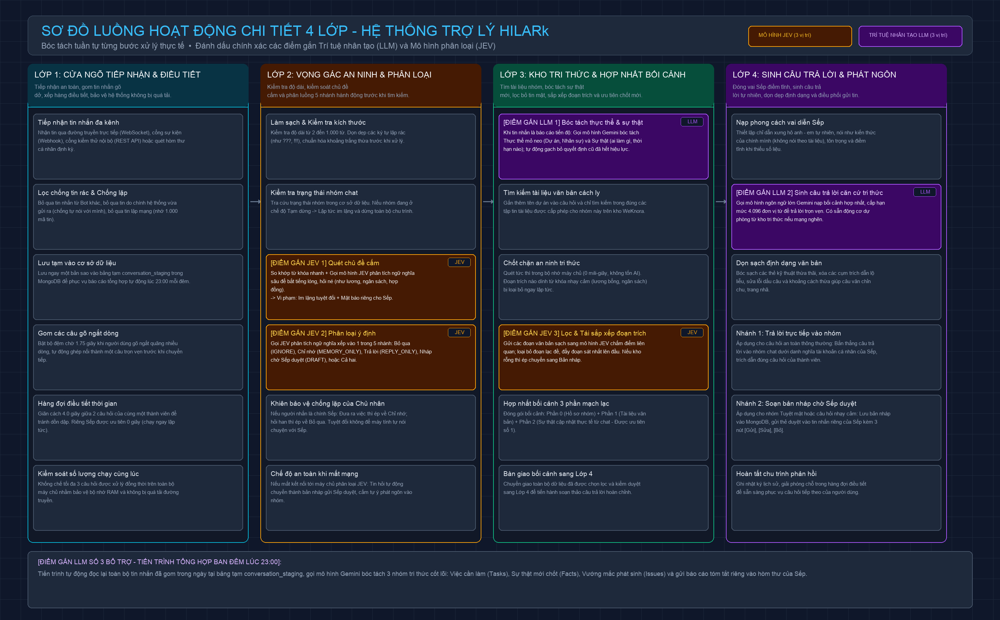
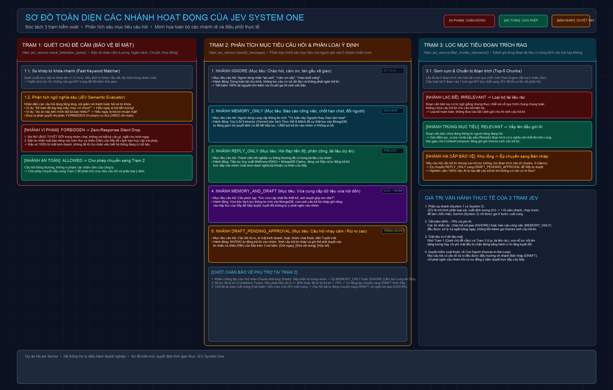
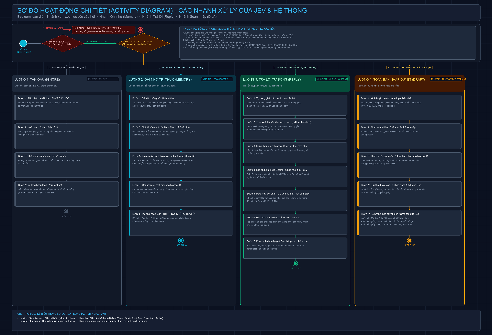

# 🚀 HiLark (LarkAssistant)

<p align="center">
  <b>Hệ Thống Trợ Lý Điều Hành Doanh Nghiệp AI Thông Minh Tích Hợp Nền Tảng Lark (LarkSuite / Feishu)</b><br>
  Kiến trúc đa tầng: <b>4 Lớp Xử Lý Tuần Tự</b> + <b>Bộ Kiểm Soát Ý Định JEV (System 1)</b> + <b>Kho Tri Thức Phân Vùng WeKnora (Hybrid RAG)</b> + <b>Ký Ức Động Giải Quyết Xung Đột (MongoDB Claims)</b> + <b>Cơ Chế Phê Duyệt An Toàn (Human-in-the-Loop)</b>.
</p>

<p align="center">
  
  
  
  
  
  
  
</p>

---

## 📖 Mục Lục

1. [Tổng Quan Bài Toán & Giải Pháp](#-tổng-quan-bài-toán--giải-pháp)
2. [Kiến Trúc Vận Hành 4 Lớp (The 4-Layer Architecture)](#-kiến-trúc-vận-hành-4-lớp-the-4-layer-architecture)
3. [Bộ Kiểm Soát Ý Định JEV & Phân Tích Mục Tiêu Câu Hỏi](#-bộ-kiểm-soát-ý-định-jev--phân-tích-mục-tiêu-câu-hỏi)
4. [Sơ Đồ Hoạt Động Tuần Tự Từng Nhánh (Activity Diagram)](#-sơ-đồ-hoạt-động-tuần-tự-từng-nhánh-activity-diagram)
5. [Cơ Chế Ký Ức Động & Giải Quyết Xung Đột Tri Thức (Claims Lifecycle)](#-cơ-chế-ký-ức-động--giải-quyết-xung-đột-tri-thức-claims-lifecycle)
6. [Bảo Mật & Phân Quyền Nhóm Chat (RAG Hard Isolation)](#-bảo-mật--phân-quyền-nhóm-chat-rag-hard-isolation)
7. [Cơ Chế Duyệt Nháp An Toàn (Human-in-the-Loop)](#-cơ-chế-duyệt-nháp-an-toàn-human-in-the-loop)
8. [Daily Digest & Tự Động Tích Luỹ Tri Thức Cuối Ngày](#-daily-digest--tự-động-tích-luỹ-tri-thức-cuối-ngày)
9. [Đồng Bộ Dữ Liệu Biểu Mẫu Lark Base (LarkBase Pipeline)](#-đồng-bộ-dữ-liệu-biểu-mẫu-lark-base-larkbase-pipeline)
10. [Cấu Trúc Thư Mục Dự Án](#-cấu-trúc-thư-mục-dự-án)
11. [Hướng Dẫn Cài Đặt & Cấu Hình Môi Trường](#-hướng-dẫn-cài-đặt--cấu-hình-môi-trường)
12. [Khởi Chạy Hệ Thống](#-khởi-chạy-hệ-thống)
13. [Kiểm Thử (Unit & Integration Tests)](#-kiểm-thử-unit--integration-tests)
14. [Danh Mục Lệnh Chat Lark & REST API](#-danh-mục-lệnh-chat-lark--rest-api)
15. [Tài Liệu Kỹ Thuật Chuyên Sâu (Deep Dives)](#-tài-liệu-kỹ-thuật-chuyên-sâu-deep-dives)

---

## 🎯 Tổng Quan Bài Toán & Giải Pháp

Khi triển khai Trợ lý Trí tuệ Nhân tạo vào các kênh giao tiếp doanh nghiệp thực tế (như Lark/Feishu), các hệ thống RAG hoặc Chatbot truyền thống thường gặp 4 bài toán hóc búa:

1. **Rác & Chi phí suy luận (Token Waste & Spam)**: Đa phần tin nhắn trong nhóm là chào hỏi, cảm ơn, đùa vui xã giao. Nếu mỗi câu chat đều gọi mô hình ngôn ngữ lớn (LLM) để tìm kiếm và trả lời sẽ gây tốn kém chi phí cực lớn và làm phiền cả nhóm chat.
2. **Xung đột tri thức (Static Docs vs. Real-time Fact Updates)**: Tài liệu tĩnh (PDF, Word, Quy trình) được tải lên kho RAG thường bị lỗi thời so với các thỏa thuận, phân công, đổi hạn chót diễn ra trực tiếp trong nhóm chat.
3. **Ảo giác & Lộ bí mật kinh doanh (Hallucination & Confidentiality Leaks)**: AI tự động trả lời có thể bịa đặt khi kho dữ liệu rỗng, hoặc vô tình tiết lộ thông tin lương bổng, ngân sách, hợp đồng nhạy cảm cho các thành viên không có thẩm quyền.
4. **Vòng lặp tự trả lời chính mình (Self-Reply Loop)**: Khi trợ lý phát ngôn dưới danh nghĩa tài khoản cá nhân của Người quản lý (`as_user=True`), tin nhắn đó được bắn ngược lại sự kiện nhóm, dễ dẫn đến vòng lặp vô tận.

### Giải pháp cốt lõi của HiLark:
- **Bộ kiểm soát tốc độ cao JEV (System 1)**: Đóng vai trò phản xạ nhanh, phân loại chính xác mục tiêu câu hỏi trước khi quyết định gọi AI hay ngắt sớm.
- **Kiến trúc Ký ức Động (Claims-based Cognitive Memory)**: Tự động bóc tách thực thể và sự thật mới chốt trong đoạn chat; sự thật mới sẽ đè bẹp thông tin cũ trong tài liệu tĩnh.
- **Cách ly cứng kho tri thức (RAG Hard Isolation)**: Mỗi nhóm chat chỉ được phép truy xuất đúng tài liệu được cấp quyền ở tầng cơ sở dữ liệu vector.
- **Cơ chế Duyệt nháp (Human-in-the-Loop)**: Mọi câu hỏi nhạy cảm hoặc thiếu dữ liệu đều được giữ lại, soạn bản nháp gửi riêng vào hộp thư cá nhân (DM) của Sếp kèm 3 nút tương tác `[Gửi ngay]`, `[Sửa]`, `[Bỏ]`.

---

## 🏛 Kiến Trúc Vận Hành 4 Lớp (The 4-Layer Architecture)

Hệ thống được thiết kế theo 4 lớp độc lập, tuần tự và khép kín:

```
┌──────────────────────────────────────────────────────────────────────────────┐
│                    LỚP 1: CỔNG TIẾP NHẬN & ĐIỀU TIẾT (INBOUND GATEWAY)        │
│  Lark WebSocket • ChatQueue Điều tiết • Giảm tải trùng lặp • Bộ đệm tin nhắn │
└──────────────────────────────────────┬───────────────────────────────────────┘
                                       │
┌──────────────────────────────────────▼───────────────────────────────────────┐
│              LỚP 2: KIỂM SOÁT AN NINH & PHÂN LUỒNG Ý ĐỊNH (JEV SYSTEM 1)     │
│  Trạm 1: Quét chủ đề cấm • Trạm 2: Phân tích mục tiêu • Khiên chống lặp Sếp  │
└──────────────────────────────────────┬───────────────────────────────────────┘
                                       │
┌──────────────────────────────────────▼───────────────────────────────────────┐
│           LỚP 3: KHO TRI THỨC & HỢP NHẤT BỐI CẢNH (KNOWLEDGE & CLAIMS)       │
│  WeKnora RAG cách ly • MongoDB Claims • Rule Engine 0ms • Trạm 3 JEV lọc RAG │
└──────────────────────────────────────┬───────────────────────────────────────┘
                                       │
┌──────────────────────────────────────▼───────────────────────────────────────┐
│                  LỚP 4: ĐÓNG VAI & PHÁT NGÔN (PERSONA & DELIVERY)            │
│  Gemini đóng vai Sếp điềm tĩnh • Làm sạch định dạng • Phát ngôn nhóm / DM Sếp│
└──────────────────────────────────────────────────────────────────────────────┘
```



### Bóc tách nhiệm vụ cụ thể từng lớp:

| Lớp | Mô-đun phụ trách | Nhiệm vụ thực tế |
| :--- | :--- | :--- |
| **Lớp 1: Tiếp Nhận & Điều Tiết** | [`lark_runner.py`](server/services/larkServices/lark_runner.py), [`chat_queue.py`](server/utils/chat_queue.py) | Lắng nghe sự kiện qua WebSocket thời gian thực; lọc tin nhắn trùng lặp; gom các tin nhắn gõ ngắt quãng của thành viên trong 2.5s thành một câu trọn vẹn trước khi chuyển tiếp. |
| **Lớp 2: An Ninh & Phân Luồng** | [`jev.py`](server/services/jev.py), [`chat_service.py`](server/services/chat_service.py) | **Trạm 1**: Quét chủ đề cấm (lương, chi phí, đút túi) $\rightarrow$ Vi phạm thì Im lặng tuyệt đối (Zero-Response) + Bắn DM mật báo cho Sếp.<br>**Trạm 2**: Phân tích mục tiêu câu hỏi thành 5 luồng hành động; kích hoạt Khiên bảo vệ Sếp và Bộ tinh chỉnh độ tự tin ($\ge 0.85$). |
| **Lớp 3: Tri Thức & Bối Cảnh** | [`llm_extractor.py`](server/utils/llm_extractor.py), [`weknora.py`](server/services/weknora.py), [`rule_engine.py`](server/utils/rule_engine.py), [`context_composer.py`](server/utils/context_composer.py) | Bóc tách thực thể và sự thật mới vào MongoDB; truy xuất tài liệu WeKnora cách ly cứng theo nhóm; lọc an ninh 0ms trên RAM; **Trạm 3 JEV** chấm điểm ngữ nghĩa loại bỏ tài liệu lạc đề; hợp nhất bối cảnh (sự thật mới của Sếp đè tài liệu cũ). |
| **Lớp 4: Đóng Vai & Phát Ngôn** | [`llm_client.py`](server/services/llm_client.py), [`text_filter.py`](server/utils/text_filter.py), [`lark_messenger.py`](server/services/larkServices/lark_messenger.py) | Nạp bối cảnh vào Gemini đóng vai Sếp điềm tĩnh, xưng hô anh - em tự nhiên; tẩy sạch các thẻ XML/RAG kỹ thuật; phát ngôn vào nhóm nhân danh tài khoản cá nhân của Sếp (`as_user=True`) hoặc gửi thẻ duyệt vào hộp thư riêng. |

---

## 🛡 Bộ Kiểm Soát Ý Định JEV & Phân Tích Mục Tiêu Câu Hỏi

**JEV (System 1)** là mạng nơ-ron suy luận cực nhanh đóng vai trò chốt chặn an ninh và điều hướng trung tâm, vận hành qua 3 trạm kiểm soát:



### Trạm 1: Quét Chủ Đề Cấm (Bảo Vệ Bí Mật Doanh Nghiệp)
- **Cơ chế 2 lớp**: Khớp từ khóa nhanh (< 0.1ms) kết hợp mô hình JEV nhận diện tiếng lóng, nói giảm nói tránh (ví dụ: *"ting ting mấy chục củ"*, *"đút túi bao nhiêu"*).
- **Hành vi khi vi phạm**:
  - **Im lặng tuyệt đối (Zero-Response)**: Bot không phát ngôn bất kỳ từ nào vào nhóm chat, không để lộ việc hệ thống có dữ liệu hay không.
  - **Mật báo riêng qua DM**: Tự động gửi cảnh báo kèm nội dung và danh tính người hỏi vào hộp thư riêng của Sếp.

### Trạm 2: Phân Tích Mục Tiêu Câu Hỏi & Phân Luồng Ý Định
JEV phân tích mục đích thực sự của người gửi thành 5 nhánh chiến lược:
1. **`IGNORE` (Xã giao)**: Chào hỏi, cảm ơn, đùa vui (`alo`, `cảm ơn sếp`) $\rightarrow$ Dừng xử lý ngay, không tốn token, không lưu rác.
2. **`MEMORY_ONLY` (Báo cáo việc)**: Thông báo tiến độ, chốt nhân sự, đổi deadline (`Nguyên thay Nam làm lead`) $\rightarrow$ Bóc tách thực thể lưu MongoDB, cấm bot trả lời nhóm.
3. **`REPLY_ONLY` (Hỏi đáp nghiệp vụ)**: Hỏi thông tin có trong tài liệu phân quyền của nhóm $\rightarrow$ Tự động tìm kiếm và trả lời nhóm dưới danh nghĩa Sếp.
4. **`MEMORY_AND_DRAFT` (Vừa nạp tin vừa hỏi dồn)**: Thành viên vừa gửi dữ liệu mới vừa hỏi duyệt $\rightarrow$ Lưu thông tin mới, chuyển câu hỏi sang dạng Bản nháp.
5. **`DRAFT_PENDING_APPROVAL` (Nhạy cảm / Rủi ro)**: Câu hỏi chạm vào khu vực bảo mật, nhóm Tuyệt mật, hoặc kho tài liệu rỗng $\rightarrow$ Soạn câu trả lời nháp gửi Sếp duyệt tay.

#### Các bộ lọc phòng vệ đặc biệt tại Trạm 2:
- **Khiên chống lặp của Chủ nhân (Owner Anti-loop Shield)**:
  - Nếu Sếp đưa tin nhắn công việc $\rightarrow$ Ép sang `MEMORY_ONLY` (Chỉ học và lưu dữ liệu, cấm bot nhảy vào cướp lời Sếp).
  - Nếu Sếp tán gẫu $\rightarrow$ Ép sang `IGNORE` (Im lặng 100%, triệt tiêu vòng lặp bot tự nói chuyện với chính Sếp).
- **Bộ tinh chỉnh độ tự tin (Confidence Tuner)**: Xác suất phân loại $\ge 0.85$ mới cho phép trả lời tự động; nếu $< 0.85$ lập tức hạ cấp sang Luồng Bản nháp.
- **Cơ chế phòng thủ sự cố (Fail-Safe)**: Nếu máy chủ JEV chập chờn $\rightarrow$ Tin nhắn dài tự động ép sang Bản nháp, tin nhắn ngắn ép sang Bỏ qua.

### Trạm 3: Lọc Mục Tiêu Đoạn Trích RAG (RAG Chunk Relevance Scorer)
- Thu thập các đoạn văn bản trích xuất từ WeKnora (Top-5 chunks).
- Đánh giá ngữ nghĩa từng đoạn văn:
  - **Lạc đề (`IRRELEVANT`)**: Loại bỏ ngay lập tức, không cho vào ngữ cảnh LLM để chống ảo giác.
  - **Trúng mục tiêu (`RELEVANT`)**: Gán điểm và xếp lên đầu để AI tiếp nhận dữ liệu chuẩn xác nhất.
  - **Kho tài liệu rỗng / Không có đoạn liên quan**: Tự động chuyển luồng từ `REPLY_ONLY` sang `DRAFT_PENDING_APPROVAL` để Sếp đích thân xử lý.

---

## 🔄 Sơ Đồ Hoạt Động Tuần Tự Từng Nhánh (Activity Diagram)

Khi tin nhắn được phân vào từng nhánh, hệ thống thực thi các chuỗi hành động khép kín theo quy trình:



### Bảng tóm tắt hoạt động từng bước:

```
[BẮT ĐẦU: Nhận tin nhắn] ──> [TRẠM 1: Quét cấm] ──┬─(Vi phạm)─> [Im lặng 100% + Mật báo Sếp] ──> [KẾT THÚC]
                                                  │
                                             (An toàn)
                                                  │
                                                  ▼
                                       [TRẠM 2: Mục tiêu câu hỏi?]
                                                  │
         ┌───────────────────┬────────────────────┼───────────────────┐
         ▼                   ▼                    ▼                   ▼
    [1. IGNORE]      [2. MEMORY_ONLY]       [3. REPLY_ONLY]     [4. DRAFT / NHÁP]
  ┌─────────────┐   ┌─────────────────┐   ┌─────────────────┐  ┌─────────────────┐
  │B1: Nhận lệnh│   │B1: Bắt đầu luồng│   │B1: Ghép tên d.án│  │B1: Bật chế độ   │
  │B2: Ngắt pipeline│B2: Gemini bóc   │   │B2: WeKnora cách │  │    kiểm duyệt   │
  │B3: Không lưu│   │    tách Facts   │   │    ly cứng nhóm │  │B2: Tìm tài liệu │
  │    MongoDB  │   │B3: Tra cứu & gạch│  │B3: Query Claims │  │    & soạn nháp  │
  │B4: Im lặng  │   │    bỏ Fact cũ   │   │    từ MongoDB   │  │B3: Khóa gửi nhóm│
  │    hoàn toàn│   │B4: Ghi Fact mới │   │B4: Lọc RAM + JEV│  │    & lưu MongoDB│
  └──────┬──────┘   │    (current)    │   │B5: Hợp nhất đè  │  │B4: Bắn DM Sếp 3 │
         │          │B5: Im lặng 100% │   │    sự thật mới  │  │    nút duyệt    │
         │          └────────┬────────┘   │B6: Gemini đóng  │  │B5: Sếp bấm Gửi /│
         │                   │            │    vai Sếp      │  │    Sửa / Bỏ     │
         │                   │            │B7: Dọn thẻ & gửi│  └────────┬────────┘
         │                   │            │    vào nhóm     │           │
         ▼                   ▼            └────────┬────────┘           ▼
     [KẾT THÚC]          [KẾT THÚC]                │                [KẾT THÚC]
                                                   ▼
                                               [KẾT THÚC]
```

---

## 🧠 Cơ Chế Ký Ức Động & Giải Quyết Xung Đột Tri Thức (Claims Lifecycle)

Hệ thống quản lý dữ liệu trên **MongoDB** theo mô hình Thực thể - Mệnh đề sự thật (Entity - Claim):

| Collection | Mục Đích |
| :--- | :--- |
| `memories` | Lưu trữ **Thực thể mỏ neo (Entities)**: Dự án, Nhân sự, Phân hệ, Khách hàng (`ent_xxxx`). |
| `claims` | Lưu trữ **Mệnh đề sự thật (Facts/Claims)** gắn với Entity (`fact_xxxx`) kèm trạng thái (`current`, `superseded`, `conflicted`). Lưu vết lịch sử thay thế qua trường `replaces`. |
| `conversation_staging`| Vùng đệm lưu trữ toàn bộ tin nhắn trao đổi trong ngày của các nhóm để phục vụ tổng hợp Daily Digest. |
| `daily_digests` | Bản ghi tri thức tổng hợp cuối ngày (`digest_YYYY-MM-DD_xxxx`) chờ duyệt nạp vào WeKnora. |
| `chat_scopes` | Bảng phân quyền ánh xạ giữa `chat_id` của nhóm Lark và `dataset_id` trên WeKnora. |
| `pending_drafts` | Bộ nhớ đệm lưu các câu trả lời nháp đang chờ Sếp bấm duyệt qua DM. |

### Cơ chế Fact Override (Sự thật mới đè tài liệu cũ):
```
Thực thể: Dự án Sàn Thanh Toán (ent_san_thanhtoan)
├── Mệnh đề cũ: fact_01 [SUPERSEDED] leader = "Nam" (Hiệu lực: Tháng 8 - Hết hạn: 20/10)
└── Mệnh đề mới: fact_02 [CURRENT]    leader = "Nguyên" (replaces: fact_01, Cập nhật: 21/10)
```
Khi thành viên hỏi *"Ai đang phụ trách lead sàn thanh toán?"*:
- Tài liệu Word trên WeKnora (viết từ tháng 8) ghi: `Nam`.
- Mệnh đề `fact_02` trong MongoDB ghi: `Nguyên`.
- **ContextComposer** tự động ưu tiên `fact_02` và hướng dẫn AI giải thích: *"Theo phân công ban đầu là Nam, tuy nhiên theo chốt mới nhất từ ngày 21/10 thì Nguyên đã tiếp nhận làm lead dự án."*

---

## 🔒 Bảo Mật & Phân Quyền Nhóm Chat (RAG Hard Isolation)

HiLark thực thi chính sách cách ly tri thức tuyệt đối giữa các nhóm chat doanh nghiệp:

1. **Khóa cứng ở tầng truy vấn cơ sở dữ liệu (Database-level Isolation)**:
   - Mỗi nhóm chat Lark liên kết với một `dataset_id` riêng trong bảng `chat_scopes`.
   - Khi tìm kiếm tri thức, mã lệnh ép trực tiếp điều kiện:
     ```python
     knowledge_ids = [scope_doc["dataset_id"]]
     # CHỈ tìm trong dataset này, WeKnora loại bỏ hoàn toàn tài liệu ngoài danh sách
     ```
2. **Quyền quản trị liên kết (Admin Whitelist)**:
   - Chỉ các thành viên thuộc danh sách Quản trị viên (`ADMIN_USERS`) mới có quyền gõ lệnh `set-kb` hoặc `reset-kb` để đổi kho tri thức của nhóm.
   - Thành viên thường gõ lệnh sẽ bị từ chối và gửi cảnh báo riêng cho Quản trị viên.

---

## ✍️ Cơ Chế Duyệt Nháp An Toàn (Human-in-the-Loop)

Đối với các câu hỏi rủi ro cao, nhạy cảm hoặc kho tài liệu rỗng:
1. Bot giữ im lặng tuyệt đối trong nhóm chat.
2. Bot gửi thẻ tương tác vào hộp thư cá nhân (DM) của Sếp:
   ```text
   ⚠️ [BẢN NHÁP CÂU TRẢ LỜI CẦN DUYỆT]
   ━━━━━━━━━━━━━━━━━━━━━━━━━━━━━━
   👥 Nhóm chat    : Dự án Cổng Thanh Toán
   👤 Người hỏi    : Hoàng Minh
   ❓ Câu hỏi      : "Kỳ này có được tạm ứng ngân sách mua server không anh?"
   📝 Dự thảo AI   : "Chào Minh, hiện ngân sách quý này đang chốt kiểm toán..."
   ━━━━━━━━━━━━━━━━━━━━━━━━━━━━━━
   👉 Lựa chọn của Sếp:
      • Bấm nút [Gửi ngay]         : Phát ngôn nguyên văn vào nhóm dưới tên Sếp
      • Bấm nút [Sửa] / Nhắn Sửa:  : Cập nhật câu chữ của Sếp rồi mới phát ngôn
      • Bấm nút [Bỏ]               : Hủy bản nháp, bot im lặng hoàn toàn
   ```
3. Sau khi Sếp duyệt, bot mới đại diện phát ngôn vào nhóm, đảm bảo 0% rủi ro phát ngôn sai lệch.

---

## 📅 Daily Digest & Tự Động Tích Luỹ Tri Thức Cuối Ngày

Vào **23:00 hàng ngày** (cấu hình trong `.env`), hệ thống tự động:
1. Đọc toàn bộ dữ liệu trao đổi trong ngày từ `conversation_staging`.
2. Dùng Gemini bóc tách 3 trụ cột tri thức:
   - **Quyết định (Decisions)**: Chính sách, giải pháp kiến trúc đã chốt.
   - **Cam kết (Commitments)**: Ai cam kết việc gì, với ai, thời hạn khi nào.
   - **Tiến độ & Cột mốc (Status & Milestones)**: Việc đã xong, cột mốc đạt được, điểm nghẽn rủi ro.
3. Gửi bản tóm tắt xin duyệt qua Lark DM cho Sếp (`DIGEST_APPROVER_ID`).
4. Khi Sếp bấm duyệt, hệ thống tự động chuyển digest thành file Markdown chuẩn, nạp lên **WeKnora Knowledge Base** để mở rộng tri thức RAG cho ngày hôm sau.

---

## 📋 Đồng Bộ Dữ Liệu Biểu Mẫu Lark Base (LarkBase Pipeline)

HiLark tích hợp sẵn đường ống đồng bộ dữ liệu hai chiều từ **Lark Base (Bitable)**:
- Tự động lấy danh sách bảng, trường dữ liệu, bản ghi công việc từ Lark Base.
- Làm sạch và chuẩn hóa kiểu dữ liệu thông qua [`larkbase/cleaner.py`](server/utils/larkbase/cleaner.py).
- Lưu trữ vào cơ sở dữ liệu nội bộ phục vụ tra cứu tiến độ thời gian thực cho trợ lý.

---

## 📁 Cấu Trúc Thư Mục Dự Án

```
HiLark/
├── README.md                      # Tài liệu tổng quan kiến trúc & hướng dẫn sử dụng
├── .env                           # File cấu hình biến môi trường
├── server/                        # Mã nguồn máy chủ trung tâm
│   ├── main.py                    # Điểm khởi chạy FastAPI & nạp Bot Lifespan
│   ├── run_lark_bot.py            # Khởi chạy riêng biệt Lark Bot (Chế độ Standalone)
│   ├── pyproject.toml             # Quản lý dependencies với uv
│   ├── core/
│   │   └── config.py              # Đọc và xác thực cấu hình biến môi trường
│   ├── database/
│   │   └── db.py                  # Kết nối MongoDB (Async Motor & PyMongo Sync)
│   ├── models/                    # Khai báo cấu trúc dữ liệu Pydantic Schemas
│   │   ├── chat.py                # Dữ liệu yêu cầu & phản hồi Chat
│   │   ├── chat_scope.py          # Dữ liệu phân quyền Nhóm chat <-> WeKnora
│   │   ├── digest.py              # Dữ liệu Daily Digest, Quyết định, Cam kết
│   │   ├── lark.py                # Dữ liệu sự kiện & gói tin Lark
│   │   ├── larkbase.py            # Dữ liệu biểu mẫu Lark Base
│   │   └── memory.py              # Dữ liệu Thực thể (Entities) & Sự thật (Claims)
│   ├── routers/                   # Các đầu mối API (FastAPI Controllers)
│   │   ├── chat.py                # Endpoints Chat Pipeline & Grounded QA
│   │   ├── digest.py              # Endpoints quản lý & đồng bộ Daily Digest
│   │   ├── health.py              # Endpoint kiểm tra sức khỏe hệ thống
│   │   ├── lark.py                # Endpoint Webhook tiếp nhận sự kiện
│   │   └── scope.py               # Endpoints quản trị phân quyền Chat Scope
│   ├── services/                  # Tầng nghiệp vụ xử lý chính
│   │   ├── bot_service.py         # Điều phối kết nối WebSocket & Daily Scheduler
│   │   ├── chat_service.py        # Pipeline xử lý hội thoại toàn trình 4 lớp
│   │   ├── digest_service.py      # Xử lý bóc tách & đồng bộ Daily Digest
│   │   ├── draft_service.py       # Quản lý vòng đời câu trả lời nháp
│   │   ├── draft_store.py         # Bộ nhớ đệm bản nháp chờ Sếp duyệt
│   │   ├── jev.py                 # Mô hình phân loại ý định & an ninh JEV System 1
│   │   ├── larkServices/          # Bộ dịch vụ tích hợp Lark chuyên sâu
│   │   │   ├── lark_client.py     # Quản lý SDK Lark, xác thực & User Token
│   │   │   ├── lark_dispatcher.py # Điều phối sự kiện tin nhắn nhóm & DM
│   │   │   ├── lark_messenger.py  # Gửi tin nhắn nhân danh Sếp hoặc nhân danh Bot
│   │   │   └── lark_runner.py     # Quản lý vòng đời kết nối WebSocket
│   │   ├── larkbase.py            # Dịch vụ đồng bộ bảng dữ liệu Lark Base
│   │   ├── llm_client.py          # Trình kết nối mô hình ngôn ngữ lớn (Gemini)
│   │   ├── scope_service.py       # Dịch vụ phân quyền nhóm chat theo Dataset
│   │   └── weknora.py             # Dịch vụ kết nối kho tri thức WeKnora RAG
│   ├── utils/                     # Các công cụ hỗ trợ lõi
│   │   ├── chat_queue.py          # Hàng đợi điều tiết & gộp tin nhắn gõ ngắt quãng
│   │   ├── context_composer.py    # Bộ hợp nhất bối cảnh (Ưu tiên Facts mới đè Docs cũ)
│   │   ├── digest.py              # Tiện ích định dạng ngày & liên kết Lark Applink
│   │   ├── lark_token.py          # Kiểm tra thời hạn User Token & chống sập bot
│   │   ├── larkbase/cleaner.py    # Chuẩn hóa & làm sạch dữ liệu biểu mẫu Lark Base
│   │   ├── llm_extractor.py       # Bóc tách thực thể & sự thật có cấu trúc
│   │   ├── rule_engine.py         # Lọc an ninh 0ms trên RAM trước khi gửi LLM
│   │   └── text_filter.py         # Làm sạch định dạng, gỡ bỏ thẻ XML/RAG thừa
│   ├── docs/                      # Toàn bộ tài liệu kỹ thuật & sơ đồ trực quan
│   │   ├── so_do_luong_hoat_dong_4_lop.md
│   │   ├── so_do_luong_hoat_dong_4_lop_chi_tiet.png
│   │   ├── jev/                   # Tài liệu & sơ đồ phân nhánh JEV
│   │   ├── layer1/ ~ layer4/      # Tài liệu chuyên sâu từng lớp 1 đến 4
│   │   ├── permission/            # Tài liệu an ninh & phân quyền dữ liệu
│   │   └── LarkBase/              # Tài liệu đường ống đồng bộ Lark Base
│   └── tests/                     # Bộ kiểm thử tự động
│       ├── full_pipeline.py       # Kiểm thử toàn trình qua Terminal
│       ├── test_chat_scope.py     # Kiểm thử phân quyền nhóm chat
│       ├── test_context_composer.py # Kiểm thử bộ giải quyết xung đột tri thức
│       ├── test_daily_digest.py   # Kiểm thử bóc tách Daily Digest
│       ├── test_interactive.py    # Console tương tác bóc tách Facts trực tiếp
│       ├── test_lark_service.py   # Kiểm thử kết nối Lark WebSocket
│       ├── test_llm_client.py     # Kiểm thử kết nối Gemini LLM
│       └── test_token_ping.py     # Kiểm thử cơ chế giám sát User Access Token
├── labs/                          # Nghiên cứu thử nghiệm (ReAct, JEV Benchmark)
└── WeKnora/                       # Kho tri thức mã nguồn mở WeKnora
```

---

## 🛠 Hướng Dẫn Cài Đặt & Cấu Hình Môi Trường

### 1. Yêu Cầu Môi Trường
- **Hệ điều hành**: Linux, macOS, Windows (WSL2).
- **Python**: Phiên bản `>= 3.13`.
- **Trình quản lý gói**: [uv](https://docs.astral.sh/uv/) (Khuyên dùng để đạt hiệu năng tối đa).
- **MongoDB**: Đang chạy cục bộ hoặc máy chủ từ xa (`mongodb://localhost:27017`).
- **WeKnora**: Đang chạy phiên bản API v1 (mặc định tại `http://localhost/api/v1`).

### 2. Cài Đặt Dependencies với `uv`

```bash
cd /Users/hoainam/Desktop/HiLark/server

# Cài đặt tự động toàn bộ thư viện cần thiết vào môi trường ảo
uv sync
```

### 3. Cấu Hình Biến Môi Trường (`.env`)

Tạo file `.env` tại thư mục gốc dự án (`HiLark/.env`):

```env
# =============================================================================
# 1. KHÓA TRÍ TUỆ NHÂN TẠO & MÔ HÌNH PHÂN LOẠI
# =============================================================================
# API Key của JEV System 1 (Mô hình phân loại ý định & an ninh tốc độ cao)
jev_api=apikey_xxxxxxxxxxxxxxxxxxxxxxxxxxxx

# Google Gemini API Key (Mô hình sinh câu trả lời & bóc tách tri thức)
gemini_api=AQ.xxxxxxxxxxxxxxxxxxxxxxxxxxxx

# =============================================================================
# 2. CẤU HÌNH KHO TRI THỨC WEKNORA (HYBRID RAG)
# =============================================================================
api_weknora=sk-xxxxxxxxxxxxxxxxxxxxxxxxxxxx
base_url=http://localhost/api/v1
dataset_id=bca87123-973d-46e4-97aa-290d7d769aef

# =============================================================================
# 3. CƠ SỞ DỮ LIỆU MONGODB
# =============================================================================
mongo_url=mongodb://localhost:27017
mongo_db=LarkAssistant
mongo_memory_collection=memories
mongo_claims_collection=claims
mongo_staging_collection=conversation_staging
mongo_digest_collection=daily_digests
mongo_chat_scope_collection=chat_scopes

# =============================================================================
# 4. KẾT NỐI NỀN TẢNG LARK (FEISHU / LARKSUITE)
# =============================================================================
app_id=cli_xxxxxxxxxxxxxxxxx
app_secret=xxxxxxxxxxxxxxxxxxxxxxxxxxxxxxxx
verification_token=xxxxxxxxxxxxxxxxxxxxxxxxxxxxxxxx
encrypt_key=xxxxxxxxxxxxxxxxxxxxxxxxxxxxxxxx
lark_domain=https://open.larksuite.com

# User Access Token (Dùng để phát ngôn nhân danh cá nhân của Sếp)
access_token_user=eyJhbGciOiJFUzI1NiIs...

# Open ID của Sếp (Chủ nhân tài khoản điều hành)
user_open_id=ou_xxxxxxxxxxxxxxxxxxxxxxxxxxxxxxxx

# =============================================================================
# 5. TỔNG HỢP DAILY DIGEST & PHÊ DUYỆT
# =============================================================================
digest_schedule_time=23:00
digest_require_approval=true
digest_approver_id=ou_xxxxxxxxxxxxxxxxxxxxxxxxxxxxxxxx

# =============================================================================
# 6. ĐIỀU TIẾT HÀNG ĐỢI & GIÁM SÁT
# =============================================================================
ENABLE_DM_POLLING=false
DM_POLL_INTERVAL=60.0
```

---

## 🚀 Khởi Chạy Hệ Thống

### Cách 1: Khởi Chạy Toàn Bộ Hệ Thống (FastAPI + WebSocket Bot + Scheduler)

```bash
cd /Users/hoainam/Desktop/HiLark/server
uv run uvicorn main:app --reload --host 0.0.0.0 --port 8000
```
- Khi chạy lệnh trên:
  - Máy chủ web FastAPI khởi động (Swagger API Docs sẵn sàng tại `http://localhost:8000/docs`).
  - Kết nối WebSocket 2 chiều tới Lark được thiết lập tự động, sẵn sàng lắng nghe tin nhắn tức thời.
  - Bộ hẹn giờ Daily Digest Daemon chạy ngầm sẵn sàng cho khung giờ 23:00.

### Cách 2: Khởi Chạy Riêng Bot Lark (Chế độ Standalone)

Nếu chỉ muốn vận hành Bot chat mà không cần mở cổng HTTP Web:
```bash
cd /Users/hoainam/Desktop/HiLark/server
uv run python run_lark_bot.py
```

---

## 🧪 Kiểm Thử (Unit & Integration Tests)

Hệ thống đi kèm bộ kiểm thử toàn diện, thực thi dễ dàng qua `uv`:

```bash
cd /Users/hoainam/Desktop/HiLark/server

# 1. Kiểm tra trạng thái User Access Token (Ping kiểm tra thời hạn, chống sập bot):
uv run python utils/lark_token.py

# 2. Kiểm thử hợp nhất tri thức & giải quyết xung đột (Context Composer):
PYTHONPATH=. uv run python tests/test_context_composer.py

# 3. Kiểm thử phân quyền nhóm chat theo Dataset WeKnora (Chat Scope):
PYTHONPATH=. uv run python tests/test_chat_scope.py

# 4. Kiểm thử trích xuất & phê duyệt Daily Digest:
PYTHONPATH=. uv run python tests/test_daily_digest.py

# 5. Console thử nghiệm bóc tách Thực thể & Sự thật trực tiếp trên Terminal:
PYTHONPATH=. uv run python tests/test_interactive.py --scenario

# 6. Chạy thử nghiệm toàn trình Full Pipeline qua một câu hỏi mẫu:
PYTHONPATH=. uv run python tests/test_full_pipeline.py --single "Ai đang phụ trách lead dự án?"
```

---

## 💬 Danh Mục Lệnh Chat Lark & REST API

### Lệnh Chat Trong Nhóm (Group Chat):
| Lệnh | Quyền hạn | Chức năng |
| :--- | :--- | :--- |
| `get-kb` hoặc `xem kb` | Mọi thành viên | Tra cứu tên và mã Dataset WeKnora đang liên kết với nhóm này. |
| `set-kb <dataset_id>` | **Quản trị viên** | Gắn một kho tri thức WeKnora riêng biệt cho nhóm chat. |
| `reset-kb` | **Quản trị viên** | Gỡ bỏ kho riêng, đưa nhóm về sử dụng kho tri thức mặc định. |

### Lệnh Chat Riêng 1-1 Với Sếp (Direct Message):
| Lệnh | Chức năng |
| :--- | :--- |
| `Gửi` / `OK` / `Duyệt` | Duyệt bản nháp câu trả lời đang chờ và phát ngôn ngay vào nhóm chat dưới tên Sếp. |
| `Sửa: <nội dung mới>` | Thay đổi nội dung câu trả lời theo đúng ý Sếp rồi mới phát ngôn vào nhóm. |
| `Bỏ` / `Hủy` | Hủy bỏ bản nháp, bot giữ im lặng hoàn toàn. |
| `Xem digest` | Xem trước bản tóm tắt Quyết định, Cam kết và Tiến độ trong ngày đang chờ duyệt. |
| `Duyệt digest` | Phê duyệt và nạp dữ liệu Daily Digest thành tài liệu mới trên kho WeKnora. |
| `Hủy digest` | Hủy bỏ bản Daily Digest của ngày. |

### Các Đầu Mối REST API Chính:
- `POST /api/chat/pipeline`: Tiếp nhận tin nhắn, thực thi toàn bộ pipeline 4 lớp và phản hồi.
- `POST /api/chat/approve-draft`: API phê duyệt gửi bản nháp từ xa.
- `GET /api/chat/entities`: Lấy danh sách toàn bộ Thực thể (Entities) đã học trong MongoDB.
- `GET /api/chat/facts`: Lấy danh sách toàn bộ Mệnh đề sự thật (Claims) kèm trạng thái (`current`/`superseded`).
- `GET /api/digests/pending/latest`: Lấy bản Daily Digest gần nhất đang chờ phê duyệt.
- `POST /api/digests/{digest_id}/approve`: Duyệt và đồng bộ Daily Digest lên WeKnora.
- `GET /api/v1/scopes`: Lấy danh sách toàn bộ phân quyền Nhóm chat <-> Knowledge Base.
- `GET /health`: Kiểm tra sức khỏe toàn diện (MongoDB, WeKnora, Lark, JEV).

---

## 📚 Tài Liệu Kỹ Thuật Chuyên Sâu (Deep Dives)

Để tìm hiểu sâu hơn về kiến trúc và cách thức cài đặt chi tiết từng phân hệ, vui lòng tham khảo các tài liệu chuyên đề:

- **Kiến trúc luồng hoạt động 4 lớp**: [`server/docs/so_do_luong_hoat_dong_4_lop.md`](server/docs/so_do_luong_hoat_dong_4_lop.md)
- **Đặc tả kiến trúc và 3 trạm kiểm soát của JEV**: [`server/docs/jev/jev_architecture_spec.md`](server/docs/jev/jev_architecture_spec.md)
- **Chi tiết Lớp 1 (Inbound Gateway & ChatQueue)**: [`server/docs/layer1/inbound_gateway_deep_dive.md`](server/docs/layer1/inbound_gateway_deep_dive.md)
- **Chi tiết Lớp 2 (Security Gating & Intent Classification)**: [`server/docs/layer2/security_gating_deep_dive.md`](server/docs/layer2/security_gating_deep_dive.md)
- **Chi tiết Lớp 3 (Knowledge Base, Claims & Context Composer)**: [`server/docs/layer3/knowledge_context_deep_dive.md`](server/docs/layer3/knowledge_context_deep_dive.md)
- **Chi tiết Lớp 4 (Persona, Sanitizer & Delivery)**: [`server/docs/layer4/persona_delivery_deep_dive.md`](server/docs/layer4/persona_delivery_deep_dive.md)
- **Chính sách phân quyền & An ninh dữ liệu**: [`server/docs/permission/security_architecture_spec.md`](server/docs/permission/security_architecture_spec.md)
- **Đường ống đồng bộ biểu mẫu Lark Base**: [`server/docs/LarkBase/sync_pipeline_deep_dive.md`](server/docs/LarkBase/sync_pipeline_deep_dive.md)

---

<p align="center">
  Được phát triển và hoàn thiện bởi <b>Tống Phước Hoài Nam</b> & đội ngũ phát triển HiLark.
</p>
