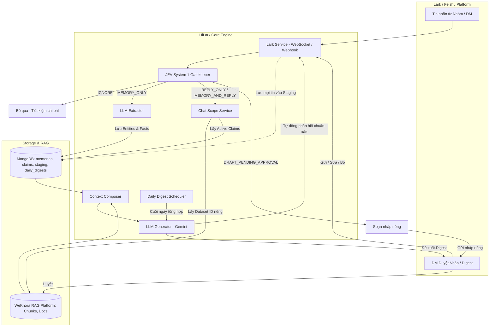
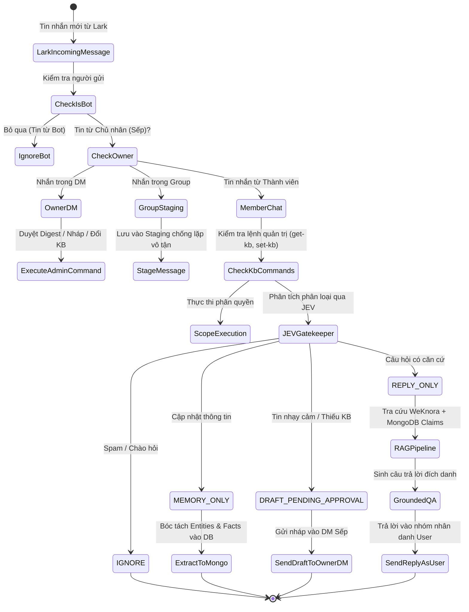

# 🚀 HiLark (LarkAssistant)

<p align="center">
  <b>Hệ Thống Trợ Lý Doanh Nghiệp AI Thông Minh Tích Hợp Lark (Feishu / LarkSuite)</b><br>
  Kết hợp <b>Hybrid RAG</b> (WeKnora) + <b>Cognitive Dynamic Memory</b> (MongoDB Claims) + <b>Gatekeeper Phân Luồng Thông Minh</b> (JEV System 1) + <b>Human-in-the-Loop</b>.
</p>

<p align="center">
  
  
  
  
  
  
  
</p>

---

## 📖 Mục Lục

- [Tổng Quan Kiến Trúc](#-tổng-quan-kiến-trúc)
- [Tính Năng Nổi Bật](#-tính-năng-nổi-bật)
- [Kiến Trúc Dữ Liệu & Bộ Nhớ Phân Cấp](#-kiến-trúc-dữ-liệu--bộ-nhớ-phân-cấp)
- [Cơ Chế Gatekeeper & Phân Luồng Tin Nhắn (JEV)](#-cơ-chế-gatekeeper--phân-luồng-tin-nhắn-jev)
- [Quy Trình Duyệt Soạn Nháp (Human-in-the-Loop)](#-quy-trình-duyệt-soạn-nháp-human-in-the-loop)
- [Daily Digest & Tích Luỹ Tri Thức Tự Động](#-daily-digest--tích-luỹ-tri-thức-tự-động)
- [Phân Quyền Tri Thức Nhóm Chat (Chat Scope)](#-phân-quyền-tri-thức-nhóm-chat-chat-scope)
- [Cấu Trúc Thư Mục](#-cấu-trúc-thư-mục)
- [Hướng Dẫn Cài Đặt & Cấu Hình](#-hướng-dẫn-cài-đặt--cấu-hình)
- [Khởi Chạy Hệ Thống](#-khởi-chạy-hệ-thống)
- [Kiểm Thử (Unit & Integration Tests)](#-kiểm-thử-unit--integration-tests)
- [Danh Mục Lệnh Chat Lark](#-danh-mục-lệnh-chat-lark)
- [REST API Endpoints](#-rest-api-endpoints)

---

## 🏛 Tổng Quan Kiến Trúc

**HiLark** đóng vai trò là một **Trợ lý Điều phối Doanh nghiệp (Executive AI Assistant / Project Lead)** hoạt động trực tiếp trong các kênh giao tiếp Lark. Hệ thống giải quyết các bài toán cốt lõi của doanh nghiệp khi ứng dụng AI:
1. **Tránh nhiễu (Spam Filter)**: Không phải tin nhắn nào cũng cần trả lời hoặc lưu trữ.
2. **Xung đột tri thức (Fact Lineage & Conflict Resolution)**: Tài liệu tĩnh (PDF, Word) thường lỗi thời so với các thỏa thuận, quyết định thời gian thực trong phòng chat. HiLark tự động ưu tiên dữ liệu mới và giải thích tiến trình biến động lịch sử.
3. **An toàn phát ngôn (Zero-hallucination & Safeguards)**: Tự động giữ lại các câu hỏi nhạy cảm hoặc thiếu cơ sở dữ liệu để gửi nháp riêng cho Sếp duyệt trước khi phát ngôn.
4. **Tự động tích lũy tri thức (Continuous Learning)**: Tổng hợp hội thoại cuối ngày thành Quyết định, Cam kết và Tiến độ, sau đó nạp tự động vào Knowledge Base.



---

## ✨ Tính Năng Nổi Bật

### 1. Tích Hợp Toàn Diện Nền Tảng Lark (LarkSuite / Feishu)
- **Lark WebSocket Long Connection**: Kết nối 2 chiều nội bộ không cần IP tĩnh, không cần mở Port hay dùng công cụ trung gian (như ngrok).
- **Hoạt động song song 2 danh tính**:
  - **Danh tính User thật (`as_user=True`)**: Phát ngôn nhân danh chính User/Leader bằng User Access Token khi trả lời tin nhắn trong nhóm.
  - **Danh tính Bot**: Gửi tin nhắn thông báo bảo mật, thẻ duyệt nháp qua Direct Message (DM) riêng cho chủ sở hữu.
- **Xưng hô đích danh**: Tự động nhận diện tên thành viên đang hỏi để chào hỏi tự nhiên, lịch thiệp (ví dụ: *"Chào Linh, về tiến độ Module Tích hợp..."*).

### 2. Bộ Lọc & Định Tuyến Thông Minh JEV (Fast Thinking Gatekeeper)
Ứng dụng mô hình suy luận tốc độ cao **TypeSafe JEV (System 1)** để phân loại ngữ nghĩa tin nhắn thành 5 nhóm hành động:
- `IGNORE`: Tin chào hỏi xã giao, đùa vui -> Bỏ qua ngay lập tức, tiết kiệm 100% token LLM.
- `MEMORY_ONLY`: Báo cáo tiến độ, cập nhật thông tin nội bộ -> Bóc tách Entities & Facts lưu vào cơ sở dữ liệu ngầm, không làm phiền nhóm chat.
- `REPLY_ONLY`: Câu hỏi chuyên môn/nghiệp vụ đã có căn cứ tri thức chuẩn -> Tự động truy xuất và trả lời ngay.
- `MEMORY_AND_REPLY`: Vấn đề quan trọng kèm câu hỏi phát sinh -> Vừa lưu tri thức mới, vừa trả lời ngay.
- `DRAFT_PENDING_APPROVAL`: Câu hỏi nhạy cảm (lương bổng, tài chính, tranh chấp) hoặc câu hỏi vượt ngoài phạm vi tri thức sẵn có -> Giữ lại làm bản nháp chờ Sếp duyệt.

### 3. Phân Cấp Tri Thức & Giải Quyết Xung Đột (Context Composer)
Hợp nhất 2 nguồn dữ liệu trước khi sinh câu trả lời:
- **Tầng 1 (Tài liệu tĩnh WeKnora)**: Quy trình, hợp đồng mẫu, tài liệu dự án dạng PDF, Word.
- **Tầng 2 (Mệnh đề động MongoDB Claims)**: Các quyết định, phân công, thay đổi deadline vừa diễn ra trong chat.
- **Quy tắc Fact Override**: Mệnh đề trạng thái `[CURRENT]` trong chat luôn có độ ưu tiên cao nhất. AI tự động chỉ rõ lịch sử biến động để thành viên nắm rõ (ví dụ: *"Theo tài liệu ban đầu ngân sách là 650 triệu, tuy nhiên theo trao đổi chốt mới nhất đã điều chỉnh lên 800 triệu"*).

### 4. Cơ Chế Duyệt Nháp An Toàn (Human-in-the-Loop)
- Khi gặp thông tin nhạy cảm, Bot gửi riêng tin nhắn bản nháp vào DM của Sếp kèm nội dung câu hỏi và các lựa chọn: `[Gửi]`, `[Sửa: <nội dung>]`, `[Bỏ]`.
- Khi Sếp nhắn lệnh duyệt, Bot sẽ đại diện Sếp phát ngôn chuẩn xác vào nhóm chat gốc.

### 5. Daily Digest Tự Động & Bóc Tách Tri Thức Cuối Ngày
- Thu thập tin nhắn trao đổi trong ngày vào vùng đệm `conversation_staging`.
- Bộ lập lịch nền (Daemon Scheduler) tự động chạy vào khung giờ định sẵn (mặc định 23:00).
- Trích xuất 3 trụ cột thông tin có truy vết nguồn gốc (Provenance):
  - **Quyết định (Decisions)**: Chính sách, thỏa thuận kỹ thuật đã chốt.
  - **Cam kết (Commitments)**: Ai hứa việc gì, hạn chót khi nào, hứa với ai.
  - **Thay đổi trạng thái (Status Changes)**: Tiến độ (progress), cột mốc (milestone), rủi ro nghẽn việc (blocker).
- Gửi báo cáo xem trước cho Leader duyệt trước khi đồng bộ hoá thành tài liệu Markdown trên kho tri thức WeKnora.

### 6. Phân Quyền Tri Thức Theo Từng Nhóm Chat (Chat Scoping)
- Mỗi nhóm chat Lark có thể gắn với một Knowledge Base (Dataset ID) riêng biệt trên WeKnora.
- Hỗ trợ câu lệnh quản trị trực tiếp trong nhóm: `get-kb`, `set-kb <dataset_id>`, `reset-kb`.
- Kiểm tra danh sách Admin được cấp quyền (Admin Whitelist), chặn truy cập trái phép và cảnh báo qua DM.

---

## 📊 Kiến Trúc Dữ Liệu & Bộ Nhớ Phân Cấp

Hệ thống quản lý dữ liệu trên **MongoDB** (Database mặc định: `LarkAssistant`) chia làm các collections chuyên biệt:

| Collection | Vai Trò & Mục Đích |
| :--- | :--- |
| `memories` | Lưu trữ **Thực thể cha (Entities)**: Dự án, Nhân sự, Đội ngũ, Tính năng, Khách hàng, Tài liệu (`ent_xxxx`). |
| `claims` | Lưu trữ **Mệnh đề con (Facts/Claims)**: Thuộc tính gắn với Entity (`fact_xxxx`) kèm trạng thái (`current`, `superseded`, `conflicted`). Lưu vết thay thế `replaces`. |
| `conversation_staging` | Vùng đệm tích lũy toàn bộ tin nhắn chat trong ngày để phục vụ tạo Daily Digest. |
| `daily_digests` | Bản ghi tổng hợp tri thức cuối ngày (`digest_YYYY-MM-DD_xxxx`) kèm trạng thái duyệt và đồng bộ WeKnora (`pending_approval`, `synced`, `rejected`). |
| `chat_scopes` | Bảng ánh xạ quyền giữa `chat_id` của nhóm Lark và `dataset_id` trên WeKnora. |

```
Entity: ent_hilark (HiLark)
├── Fact: fact_01 [SUPERSEDED] budget = "650 triệu VNĐ"
└── Fact: fact_02 [CURRENT]    budget = "800 triệu VNĐ" (replaces: fact_01)
```

---

## 🎯 Cơ Chế Gatekeeper & Phân Luồng Tin Nhắn (JEV)



---

## ✍️ Quy Trình Duyệt Soạn Nháp (Human-in-the-Loop)

Khi thành viên đặt câu hỏi thuộc diện nhạy cảm (hoặc không tìm thấy dữ liệu chuẩn trong Knowledge Base):

1. **Bot giữ im lặng trong nhóm**: Không tự ý phát ngôn gây rủi ro sai sót thông tin.
2. **Bot gửi thông báo riêng đến DM của Sếp**:
   ```text
   ⚠️ [BẢN NHÁP CẦU NỐI CẦN DUYỆT]
   ━━━━━━━━━━━━━━━━━━━━━━━━━━━━━━
   👤 Người hỏi    : Nguyễn Văn A (Nhóm Dự án X)
   ❓ Câu hỏi      : "Chính sách thưởng dự án kỳ này thế nào anh?"
   📝 Bản nháp AI  : "Chào bạn A, chính sách thưởng kỳ này..."
   ━━━━━━━━━━━━━━━━━━━━━━━━━━━━━━
   👉 Phản hồi lệnh:
      • "Gửi" / "OK"          : Duyệt và phát ngôn vào nhóm
      • "Sửa: <nội dung mới>"  : Chỉnh sửa và phát ngôn vào nhóm
      • "Bỏ"                  : Huỷ bản nháp
   ```
3. **Sếp duyệt trực tiếp qua DM**:
   - Nhắn `Gửi` hoặc `OK`: Bot lập tức đại diện Sếp phát ngôn câu trả lời vào nhóm chat.
   - Nhắn `Sửa: Dự án này tháng sau mới chốt thưởng nhé em`: Bot gửi đúng câu sửa đổi vào nhóm.
   - Nhắn `Bỏ`: Bản nháp bị huỷ, nhóm chat không nhận bất kỳ tin nhắn nào.

---

## 📅 Daily Digest & Tích Luỹ Tri Thức Tự Động

Vào **23:00 hàng ngày** (hoặc thời gian cấu hình trong `.env`), hệ thống tự động:
1. Đọc toàn bộ tin nhắn trao đổi trong `conversation_staging`.
2. Dùng Gemini phân tích và trích xuất thành 3 nhóm tri thức:
   - **Quyết định**: Các thỏa thuận đã chốt xong.
   - **Cam kết**: Hạn chót công việc, người chịu trách nhiệm.
   - **Thay đổi trạng thái**: Tiến độ (progress), cột mốc (milestone), điểm nghẽn (blocker).
3. Gửi bản tóm tắt qua Lark DM cho Người duyệt (`DIGEST_APPROVER_ID`).
4. Người duyệt chỉ cần nhắn:
   - `Duyệt digest`: Hệ thống tự động chuyển digest thành định dạng Markdown chuẩn, nạp lên **WeKnora Knowledge Base** để mở rộng cơ sở tri thức cho RAG.
   - `Hủy digest`: Đánh dấu từ chối, không nạp vào Knowledge Base.

---

## 🔒 Phân Quyền Tri Thức Nhóm Chat (Chat Scope)

Hệ thống hỗ trợ quản lý mối liên kết giữa nhóm chat và cơ sở tri thức WeKnora trực tiếp qua lệnh chat:

```text
get-kb
```
> Hiển thị thông tin Knowledge Base (Tên, Dataset ID, Người cài đặt) đang được áp dụng cho nhóm.

```text
set-kb <dataset_id>
```
> *(Chỉ Admin)* Liên kết nhóm chat với Dataset ID tương ứng trên WeKnora. Hệ thống tự động xác thực sự tồn tại của Dataset trên WeKnora trước khi lưu.

```text
reset-kb
```
> *(Chỉ Admin)* Huỷ liên kết riêng, đưa nhóm về sử dụng Knowledge Base mặc định của hệ thống.

---

## 📁 Cấu Trúc Thư Mục

```
HiLark/
├── README.md                      # Tài liệu hướng dẫn sử dụng toàn diện
├── .env                           # File cấu hình biến môi trường
├── labs/                          # Nghiên cứu & Thực nghiệm (ReAct, JEV Benchmark)
│   ├── ReAct/                     # Lab kiểm thử Agent: LLM Native vs JEV + LLM
│   ├── jev_guide.md               # Hướng dẫn API Typesafe System 1 (JEV)
│   ├── jev_vs_llm.ipynb           # So sánh độ chính xác & độ trễ JEV vs LLM
│   └── phan_tich_can_bang_du_lieu.ipynb
├── WeKnora/                       # Kho tri thức mã nguồn mở WeKnora (RAG Platform)
└── server/                        # Server chính (FastAPI + Lark Engine)
    ├── main.py                    # Entry point FastAPI & Lifespan Bot Service
    ├── run_lark_bot.py            # Chạy riêng biệt Lark Bot (chế độ Standalone)
    ├── pyproject.toml             # Khai báo thư viện & cấu hình dự án Python
    ├── core/
    │   └── config.py              # Đọc cấu hình từ .env
    ├── database/
    │   └── db.py                  # Kết nối MongoDB (Async Motor & PyMongo Sync)
    ├── models/                    # Pydantic Schemas & DTOs
    │   ├── chat.py                # Schema Chat Request/Response
    │   ├── chat_scope.py          # Schema phân quyền nhóm chat <-> KB
    │   ├── digest.py              # Schema Daily Digest, Quyết định, Cam kết
    │   ├── lark.py                # Schema sự kiện & tin nhắn Lark
    │   └── memory.py              # Schema Entities, Facts/Claims
    ├── routers/                   # Các API Controllers (FastAPI Routers)
    │   ├── chat.py                # Endpoint Unified Chat Pipeline & Grounded QA
    │   ├── digest.py              # Endpoints quản lý & đồng bộ Daily Digest
    │   ├── health.py              # Endpoint kiểm tra trạng thái Server
    │   ├── lark.py                # Endpoint Webhook tiếp nhận sự kiện Lark
    │   └── scope.py               # Endpoints quản trị phân quyền Chat Scope
    ├── services/                  # Business Logic Layer
    │   ├── bot_service.py         # Điều phối WebSocket, Event Dispatcher & Scheduler
    │   ├── digest_service.py      # Xử lý tổng hợp Daily Digest & nạp WeKnora
    │   ├── draft_store.py         # Bộ nhớ đệm quản lý bản nháp chờ Sếp duyệt
    │   ├── jev.py                 # Tích hợp TypeSafe JEV System 1 Gatekeeper
    │   ├── lark.py                # Lark Open Platform SDK Service (WS, User token)
    │   ├── llm_client.py          # Unified LLM Service (Gemini & Fallbacks)
    │   ├── scope_service.py       # Quản lý ánh xạ Nhóm Chat <-> WeKnora KB
    │   └── weknora.py             # Tích hợp WeKnora API (Retrieve, Session, Ingest)
    ├── utils/                     # Thư viện tiện ích
    │   ├── context_composer.py    # Ghép Chunks WeKnora + Claims MongoDB
    │   ├── digest.py              # Tiện ích ngày tháng & tạo Lark Applink
    │   ├── llm_extractor.py       # Trích xuất Entities & Facts có cấu trúc
    │   └── text_filter.py         # Dọn dẹp văn bản, xóa thẻ XML RAG
    └── tests/                     # Bộ kiểm thử tự động
        ├── full_pipeline.py       # Chạy thử nghiệm toàn trình qua Terminal
        ├── test_chat_scope.py     # Kiểm thử phân quyền nhóm chat
        ├── test_context_composer.py # Kiểm thử bộ giải quyết xung đột tri thức
        ├── test_daily_digest.py   # Kiểm thử bóc tách Daily Digest
        ├── test_interactive.py    # Console tương tác bóc tách Facts trực tiếp
        ├── test_lark_service.py   # Kiểm thử kết nối Lark
        └── test_llm_client.py     # Kiểm thử kết nối LLM
```

---

## 🛠 Hướng Dẫn Cài Đặt & Cấu Hình

### 1. Yêu Cầu Môi Trường
- **Python**: Phiên bản `>= 3.13`
- **Package Manager**: [uv](https://docs.astral.sh/uv/) (Khuyên dùng để tối ưu tốc độ và quản lý virtual environment)
- **MongoDB**: Đang chạy cục bộ hoặc trên Cloud (`mongodb://localhost:27017`)
- **WeKnora**: Đang chạy phiên bản API v1 (hoặc Docker Compose trong thư mục `WeKnora`)

### 2. Cài Đặt Dependencies với `uv`

Di chuyển vào thư mục `server`:
```bash
cd /Users/hoainam/Desktop/HiLark/server

# Cài đặt toàn bộ dependencies tự động với uv
uv sync
```

### 3. Cấu Hình Biến Môi Trường (`.env`)

Tạo hoặc chỉnh sửa file `.env` tại thư mục gốc của dự án (`HiLark/.env`):

```env
# =============================================================================
# 1. API KEYS & DỊCH VỤ NGOÀI
# =============================================================================
# API Key của TypeSafe JEV System 1 (Gatekeeper phân luồng)
jev_api=apikey_xxxxxxxxxxxxxxxxxxxxxxxxxxxx

# Google Gemini API Key
gemini_api=AQ.xxxxxxxxxxxxxxxxxxxxxxxxxxxx

# =============================================================================
# 2. CẤU HÌNH KHO TRI THỨC WEKNORA
# =============================================================================
api_weknora=sk-xxxxxxxxxxxxxxxxxxxxxxxxxxxx
base_url=http://localhost/api/v1
dataset_id=bca87123-973d-46e4-97aa-290d7d769aef

# =============================================================================
# 3. CƠ SỞ DỮ LIỆU MONGODB
# =============================================================================
mongo_url=mongodb://localhost:27017
mongo_db=LarkAssistant
mongo_memory_collection=memories
mongo_claims_collection=claims
mongo_staging_collection=conversation_staging
mongo_digest_collection=daily_digests
mongo_chat_scope_collection=chat_scopes

# =============================================================================
# 4. KẾT NỐI LARK OPEN PLATFORM
# =============================================================================
app_id=cli_xxxxxxxxxxxxxxxxx
app_secret=xxxxxxxxxxxxxxxxxxxxxxxxxxxxxxxx
verification_token=xxxxxxxxxxxxxxxxxxxxxxxxxxxxxxxx
encrypt_key=xxxxxxxxxxxxxxxxxxxxxxxxxxxxxxxx
lark_domain=https://open.larksuite.com

# Token người dùng (User Access Token) để phát ngôn nhân danh User
access_token_user=eyJhbGciOiJFUzI1NiIs...

# Open ID của người dùng chính (Danh tính hoạt động)
user_open_id=ou_xxxxxxxxxxxxxxxxxxxxxxxxxxxxxxxx

# =============================================================================
# 5. DAILY DIGEST & DUYỆT BẢN NHÁP
# =============================================================================
digest_schedule_time=23:00
digest_require_approval=true
digest_approver_id=ou_xxxxxxxxxxxxxxxxxxxxxxxxxxxxxxxx

# =============================================================================
# 6. POLLING & REAL-TIME
# =============================================================================
ENABLE_DM_POLLING=false
DM_POLL_INTERVAL=60.0
```

---

## 🚀 Khởi Chạy Hệ Thống

Dự án cung cấp 2 phương thức khởi chạy linh hoạt:

### Cách 1: Khởi Chạy Toàn Bộ Hệ Thống (Khuyên Dùng)
Lệnh này khởi động cả **FastAPI Server** lẫn **Lark Bot Service (WebSocket Client & Daily Digest Scheduler)** cùng lúc trong một tiến trình duy nhất:

```bash
cd /Users/hoainam/Desktop/HiLark/server
uv run uvicorn main:app --reload --host 0.0.0.0 --port 8000
```
- Khi chạy lệnh trên:
  - WebSocket Client tự động kết nối tới máy chủ Lark để lắng nghe tin nhắn tức thì.
  - Bộ hẹn giờ Daily Digest Daemon bắt đầu hoạt động ngầm.
  - Swagger UI được mở tại: `http://localhost:8000/docs`.

### Cách 2: Khởi Chạy Riêng Bot (Không bật Web API)
Nếu bạn chỉ muốn chạy Bot nhận/gửi tin nhắn Lark mà không cần mở HTTP server:

```bash
cd /Users/hoainam/Desktop/HiLark/server
uv run python run_lark_bot.py
```

---

## 🧪 Kiểm Thử (Unit & Integration Tests)

Tất cả các bài kiểm thử đều có thể thực thi nhanh chóng thông qua `uv`:

### 1. Kiểm thử phân quyền nhóm chat (Chat Scope)
```bash
cd /Users/hoainam/Desktop/HiLark/server
PYTHONPATH=. uv run python tests/test_chat_scope.py
```

### 2. Kiểm thử hợp nhất tri thức & giải quyết xung đột (Context Composer)
```bash
PYTHONPATH=. uv run python tests/test_context_composer.py
```

### 3. Kiểm thử trích xuất & phê duyệt Daily Digest
```bash
PYTHONPATH=. uv run python tests/test_daily_digest.py
```

### 4. Kiểm thử kết nối LLM Client (Gemini)
```bash
PYTHONPATH=. uv run python tests/test_llm_client.py
```

### 5. Console thử nghiệm bóc tách Entities & Facts trực tiếp qua Terminal
```bash
# Chế độ tương tác nhập từng câu:
PYTHONPATH=. uv run python tests/test_interactive.py

# Chế độ chạy tự động kịch bản 5 tin nhắn mẫu:
PYTHONPATH=. uv run python tests/test_interactive.py --scenario
```

### 6. Thử nghiệm toàn trình Full Pipeline RAG + Claims
```bash
# Thử nghiệm với một câu hỏi cụ thể:
PYTHONPATH=. uv run python tests/test_full_pipeline.py --single "Ngân sách dự án HiLark là bao nhiêu?"
```

---

## 💬 Danh Mục Lệnh Chat Lark

Người dùng và Quản trị viên có thể thao tác trực tiếp với Trợ lý qua các lệnh chat sau:

### Trong Nhóm Chat (Group Chat):
| Lệnh | Quyền Hạn | Ý Nghĩa & Tác Dụng |
| :--- | :--- | :--- |
| `get-kb` hoặc `xem kb` | Mọi thành viên | Xem Knowledge Base đang liên kết của nhóm này. |
| `set-kb <dataset_id>` | **Admin** | Liên kết nhóm chat với một Knowledge Base WeKnora riêng. |
| `reset-kb` | **Admin** | Huỷ liên kết riêng, quay về Knowledge Base mặc định. |

### Trong Chat Riêng Với Sếp (1-1 DM):
| Lệnh | Ý Nghĩa & Tác Dụng |
| :--- | :--- |
| `Gửi` / `OK` / `Duyệt` | Duyệt bản nháp câu trả lời đang chờ và phát ngôn vào nhóm. |
| `Sửa: <nội dung mới>` | Chỉnh sửa nội dung câu trả lời và phát ngôn vào nhóm. |
| `Bỏ` / `Hủy` | Huỷ bỏ bản nháp câu trả lời đang chờ. |
| `Xem digest` | Xem trước nội dung bản Daily Digest gần nhất đang chờ duyệt. |
| `Duyệt digest` | Phê duyệt và đẩy Daily Digest lên WeKnora Knowledge Base. |
| `Hủy digest` | Từ chối bản Daily Digest, không nạp vào Knowledge Base. |

---

## 📡 REST API Endpoints

Hệ thống cung cấp hệ thống REST API hoàn chỉnh phục vụ tích hợp bên ngoài:

### 1. Chat & Inference (`/api/chat`)
- `POST /api/chat/pipeline`: Xử lý tin nhắn toàn trình qua Gatekeeper -> RAG -> Trả lời.
- `POST /api/chat/user-chat`: Gửi câu hỏi mô phỏng người dùng, nhận câu trả lời dạng Persona.
- `POST /api/chat/approve-draft`: Duyệt gửi bản nháp qua API.
- `GET /api/chat/entities`: Lấy danh sách toàn bộ Thực thể (Entities) trong MongoDB.
- `GET /api/chat/facts`: Lấy danh sách toàn bộ Mệnh đề (Facts/Claims) trong MongoDB.

### 2. Daily Digest (`/api/digests`)
- `GET /api/digests/pending/latest`: Lấy bản Daily Digest gần nhất đang chờ duyệt.
- `POST /api/digests/{digest_id}/approve`: Duyệt và đồng bộ digest lên WeKnora.
- `POST /api/digests/{digest_id}/reject`: Từ chối digest.
- `POST /api/digests/process-daily`: Kích hoạt tổng hợp tin nhắn trong ngày cho 1 nhóm chat.
- `POST /api/digests/run-scheduled`: Kích hoạt thủ công luồng chạy định kỳ cho tất cả các nhóm.
- `POST /api/digests/sync-pending`: Quét và đồng bộ bù các bản ghi pending/failed lên WeKnora.

### 3. Quản Trị Phân Quyền (`/api/v1/scopes`)
- `GET /api/v1/scopes`: Lấy danh sách toàn bộ liên kết Nhóm chat <-> Knowledge Base.
- `GET /api/v1/scopes/{chat_id}`: Lấy thông tin Knowledge Base của một nhóm chat.
- `POST /api/v1/scopes`: Thiết lập liên kết nhóm chat với Knowledge Base mới.
- `DELETE /api/v1/scopes/{chat_id}`: Gỡ bỏ liên kết riêng của nhóm chat.

### 4. Lark Webhook & Health (`/api/lark`, `/health`)
- `POST /api/lark/events`: Nhận sự kiện từ Lark Event Subscriptions (hỗ trợ URL Verification challenge).
- `GET /api/lark/status`: Kiểm tra trạng thái kết nối Lark Service.
- `GET /health`: Kiểm tra sức khỏe toàn diện (FastAPI, MongoDB, WeKnora, Lark, JEV).

---

<p align="center">
  Được phát triển bởi <b>Tống Phước Hoài Nam</b> & đội ngũ nghiên cứu HiLark.
</p>
