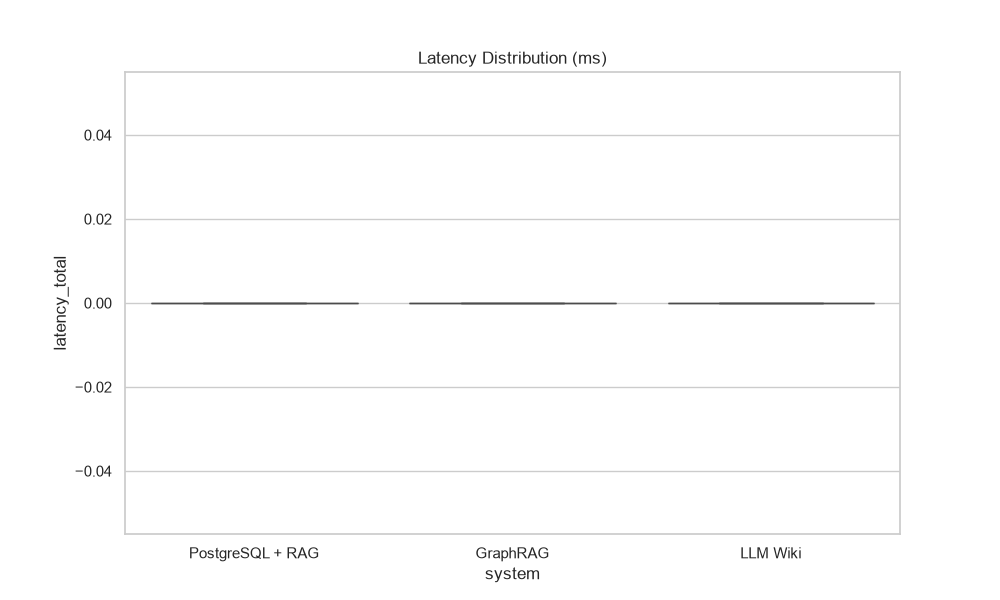
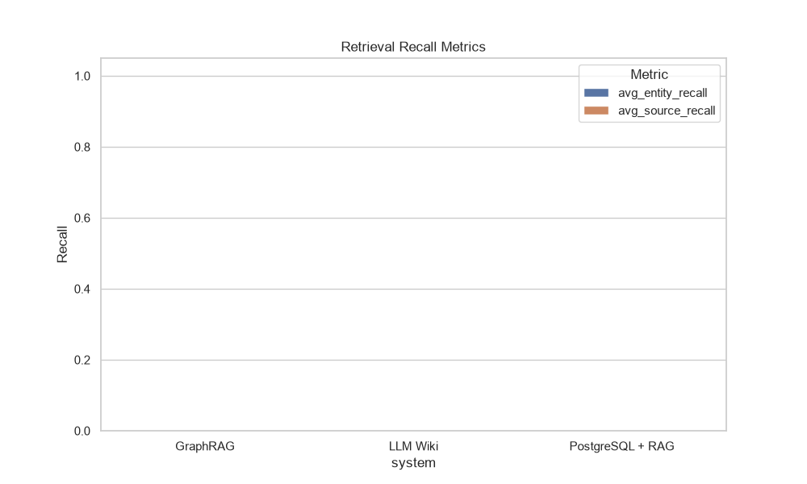
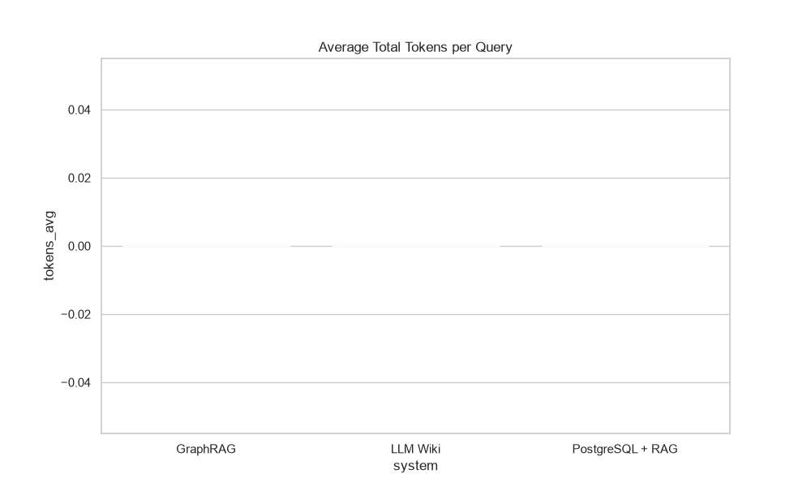

# Lab Benchmark Report: GraphRAG vs PostgreSQL+RAG vs LLM Wiki

**Generated At:** 2026-10-06T09:07:15.732350
**Dataset Version:** 1.0.0
**Model:** gemini-3.8-flash | **Embedding:** gemini-embedding-001
**Questions:** 100 | **Runs per Q:** 1

## 1. Executive Summary

| System           | Accuracy   | Entity Recall   | Avg Latency   | P95 Latency   |   Avg Tokens | Avg Query Cost   | Build Cost   |   Avg LLM Calls |
|------------------|------------|-----------------|---------------|---------------|--------------|------------------|--------------|-----------------|
| GraphRAG         | 0.0%       | 0.0%            | 0 ms          | 0 ms          |            0 | $0.0000          | $0.0000      |               0 |
| LLM Wiki         | 0.0%       | 0.0%            | 0 ms          | 0 ms          |            0 | $0.0000          | $0.0386      |               0 |
| PostgreSQL + RAG | 0.0%       | 0.0%            | 0 ms          | 0 ms          |            0 | $0.0000          | $0.0000      |               0 |

## 2. Construction Phase (Phase A)

| System           | Ingestion Time   | Index Time   | LLM Time   | Total Cost   | Storage (MB)   |
|------------------|------------------|--------------|------------|--------------|----------------|
| PostgreSQL + RAG | 0.04s            | 33.57s       | 0.00s      | $0.0000      | 1.09 MB        |
| GraphRAG         | 0.05s            | 36.48s       | 0.00s      | $0.0000      | 0.00 MB        |
| LLM Wiki         | 0.17s            | 46.35s       | 382.13s    | $0.0386      | 0.55 MB        |

## 3. Query Phase (Phase B)

### Breakdown of Latency

| System           |   Query Under. (ms) |   Retrieval (ms) |   Context (ms) |   Generation (ms) |
|------------------|---------------------|------------------|----------------|-------------------|
| GraphRAG         |                 0.0 |              0.0 |            0.0 |               0.0 |
| LLM Wiki         |                 0.0 |              0.0 |            0.0 |               0.0 |
| PostgreSQL + RAG |                 0.0 |              0.0 |            0.0 |               0.0 |

## 4. Charts

