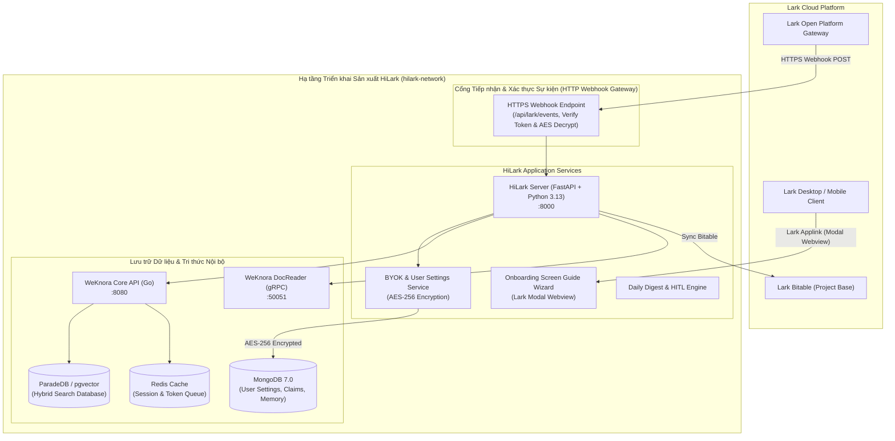
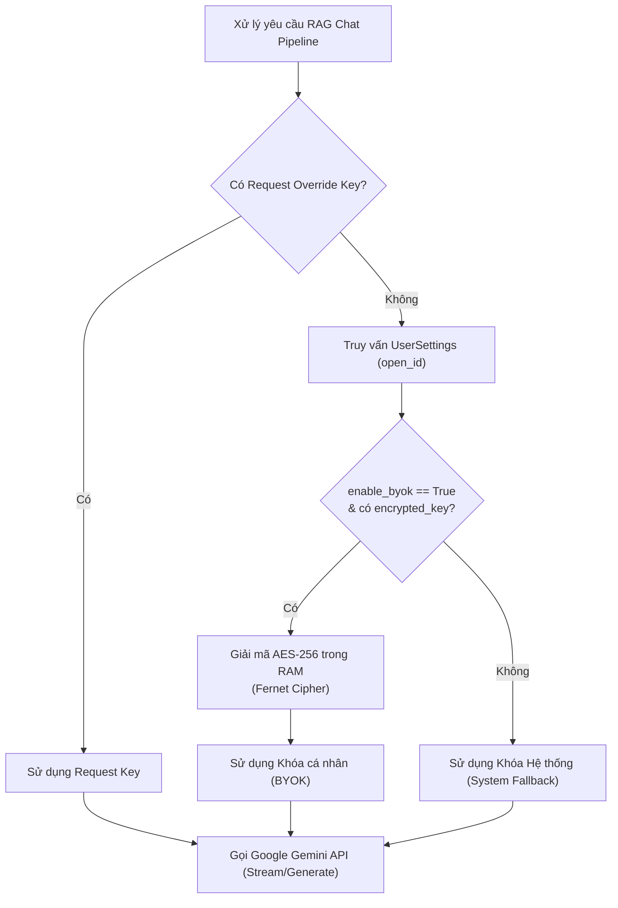

# Hướng dẫn Triển khai Sản xuất HiLark Enterprise AI Assistant
*(Production Deployment & BYOK Architecture Guide)*

---

## 1. Tổng quan Kiến trúc Sản xuất (Production Architecture)

HiLark được thiết kế theo tiêu chuẩn hệ thống bảo mật cấp doanh nghiệp (Enterprise-Grade Security), kết hợp sức mạnh xử lý ngôn ngữ tự nhiên của **Google Gemini** với kho lưu trữ tri thức nội bộ **WeKnora On-premise Vault** và nền tảng cộng tác **Lark Suite**.



### 1.1. Cổng Tiếp nhận Sự kiện HTTP Webhook Multi-Tenant
- HiLark giao tiếp chiều nhận sự kiện với Lark Open Platform qua **HTTP Webhook Gateway** (`POST /api/lark/events` & `/api/lark/card-action`, hoặc biến thể kèm `/{app_id}`).
- **Cơ chế bảo mật & cô lập:**
  1. Xác thực `Verification Token` và giải mã AES-256 (`Encrypt Key`) theo từng Custom App đăng ký trong MongoDB (`lark_app_credentials`).
  2. Định tuyến cô lập theo `tenant_key` thông qua `TenantContext` và `LarkAppRuntime`, không dùng chung state giữa các doanh nghiệp.
  3. Hỗ trợ triển khai sau Reverse Proxy / Cloudflare Tunnel trong mạng nội bộ.

---

## 2. Kiến trúc Hybrid BYOK (Bring Your Own Key)

HiLark hỗ trợ cơ chế quản trị API Key lai (Hybrid BYOK), cho phép linh hoạt giữa việc sử dụng khóa tập trung của tổ chức hoặc khóa riêng của từng dự án/lãnh đạo:

### 2.1. Phân cấp giải quyết khóa (3-Tier Key Hierarchy)
1. **Tier 1 (Request Override):** Khóa truyền trực tiếp theo từng API call (nếu có yêu cầu đặc biệt từ cron/job).
2. **Tier 2 (User BYOK):** Khóa riêng của người dùng lưu trong MongoDB (đã được giải mã an toàn trong bộ nhớ RAM lúc gọi).
3. **Tier 3 (System Default):** Khóa `gemini_api` cấu hình trong `.env` của hệ thống.



### 2.2. Tiêu chuẩn mã hóa AES-256 Fernet
- Khóa của người dùng **tuyệt đối không bao giờ được lưu trữ dưới dạng văn bản thô (plaintext)** trong Database hay Log.
- Thuật toán mã hóa: **AES-128-CBC với HMAC-SHA256 (Fernet specification)** sử dụng khóa dẫn xuất từ `ENCRYPTION_SECRET_KEY`.
- **Masking:** Khi trả về giao diện cấu hình, API Key chỉ hiển thị 6 ký tự đầu và 4 ký tự cuối (ví dụ: `AIzaSy...4xyz`), đảm bảo không lộ thông tin ngay cả khi mở màn hình trước đồng nghiệp.
- **Live Latency Ping Test:** Endpoint `/onboarding/api/test-key` thực hiện kiểm tra thực tế kết nối tới Google Gemini API và đo lường độ trễ mạng (latency tính bằng mili-giây) trước khi cho phép lưu.

---

## 3. Trình hướng dẫn thiết lập Screen Guide (Lark Modal Webview)

Thay vì yêu cầu người dùng truy cập một website rời rạc bên ngoài hay đọc tài liệu dài, HiLark mang đến trải nghiệm **Screen Guide 4 bước** ngay trong ứng dụng Lark:

1. **Bước 1: Chào mừng & Tổng quan (Welcome & Capabilities)**  
   Giới thiệu các trụ cột sức mạnh của Trợ lý HiLark: Bộ não WeKnora On-premise, Báo cáo Daily Digest, Tự động hóa tác vụ.
2. **Bước 2: Cấu hình AI Engine & BYOK (Engine Configuration)**  
   Lựa chọn chế độ *Dùng chung khóa hệ thống* hoặc *Sử dụng API Key cá nhân*, hỗ trợ nút **Kiểm tra kết nối trực tiếp** với đồng hồ đo ping.
3. **Bước 3: Lịch nhận Daily Digest & Duyệt nội dung HITL (Daily Schedule & Review)**  
   Cấu hình giờ nhận báo cáo tóm tắt hằng ngày (mặc định 23:00) và kích hoạt chế độ Human-in-the-loop (duyệt bản nháp trước khi trả lời).
4. **Bước 4: Xác thực Lark OAuth & Hoàn tất (1-Click Save)**  
   Ủy quyền an toàn qua Lark OAuth và tự động lưu cài đặt vào hệ thống. Cửa sổ tự động đóng sau khi hoàn tất.

### Cách mở Trình hướng dẫn từ Lark:
- Nhắn tin trực tiếp (DM 1-1) cho Bot các từ khóa: `cài đặt`, `config`, `setup`, `/config`, `byok`, `hướng dẫn`, hoặc `help`.
- Bot sẽ lập tức phản hồi một **Interactive Card** chứa nút bấm mở cửa sổ Screen Guide Popup.

---

## 4. Hướng dẫn Triển khai 1-Click (Deployment Steps)

### 4.1. Yêu cầu Tiên quyết (Prerequisites)
- Máy chủ Linux / macOS (x86_64 hoặc ARM64).
- Docker Engine >= 24.0 và Docker Compose v2.
- 1 Lark App đã bật Bot Capability và cấu hình quyền hạn.

### 4.2. Các bước triển khai

#### Bước 1: Sao chép tệp cấu hình môi trường
```bash
cp .env.production.example .env
```
Mở file `.env` và cập nhật các thông số quan trọng:
- `app_id`, `app_secret`: Thông tin ứng dụng Lark.
- `gemini_api`: Google Gemini API Key mặc định của hệ thống.
- `ENCRYPTION_SECRET_KEY`: Khóa bí mật mã hóa (tạo ngẫu nhiên bằng `openssl rand -base64 32`).
- `base_url`: Địa chỉ WeKnora API (`http://localhost:8080/api/v1` hoặc `http://host.docker.internal:8080/api/v1`).

#### Bước 2: Chạy Script Triển khai Tự động
```bash
./deploy.sh
```
Script sẽ tự động:
1. Kiểm tra Docker & Docker Compose.
2. Xác minh tệp cấu hình `.env`.
3. Kiểm tra kết nối WeKnora.
4. Build multi-stage Docker image cho HiLark Server với `uv` (nhẹ, nhanh và an toàn).
5. Khởi chạy MongoDB 7.0 và HiLark Server trong mạng cách ly `hilark-network`.
6. Chạy healthcheck xác nhận dịch vụ đã online 100%.

#### Bước 3: Xác minh trạng thái hoạt động
```bash
# Kiểm tra healthcheck endpoint
curl -f http://localhost:8000/health

# Xem logs hoạt động thời gian thực
docker compose -f docker-compose.prod.yml logs -f hilark-server
```

---

## 5. Vận hành & Quản trị Hệ thống

| Tác vụ | Câu lệnh |
| :--- | :--- |
| **Xem logs máy chủ** | `docker compose -f docker-compose.prod.yml logs -f hilark-server` |
| **Xem logs MongoDB** | `docker compose -f docker-compose.prod.yml logs -f mongodb` |
| **Khởi động lại cụm dịch vụ** | `docker compose -f docker-compose.prod.yml restart` |
| **Tạm dừng hệ thống** | `docker compose -f docker-compose.prod.yml down` |
| **Sao lưu dữ liệu MongoDB** | `docker exec -t hilark-mongodb mongodump --out /data/db/backup` |
| **Phục hồi dữ liệu MongoDB** | `docker exec -t hilark-mongodb mongorestore /data/db/backup` |

---

## 6. Chính sách An toàn & Xử lý sự cố (Disaster Recovery)

1. **Khóa API của User bị rò rỉ:**  
   Nếu người dùng nghi ngờ khóa bị lộ bên ngoài, họ chỉ cần mở lại Screen Guide và cập nhật khóa mới, hoặc tắt tùy chọn BYOK để quay về khóa hệ thống.
2. **WeKnora bảo trì tạm thời:**  
   Khi WeKnora tạm ngưng phục vụ, HiLark Server vẫn tiếp nhận Webhook từ Lark, trả lời các câu hỏi dựa trên Conversation Memory nội bộ trong MongoDB và thông báo lịch sự cho người dùng nếu cần truy xuất tri thức sâu.
3. **Xoay vòng khóa mã hóa (Key Rotation):**  
   Khi cần đổi `ENCRYPTION_SECRET_KEY`, chạy script migration chuyên dụng để giải mã bằng khóa cũ và mã hóa lại bằng khóa mới trước khi cập nhật `.env`.

