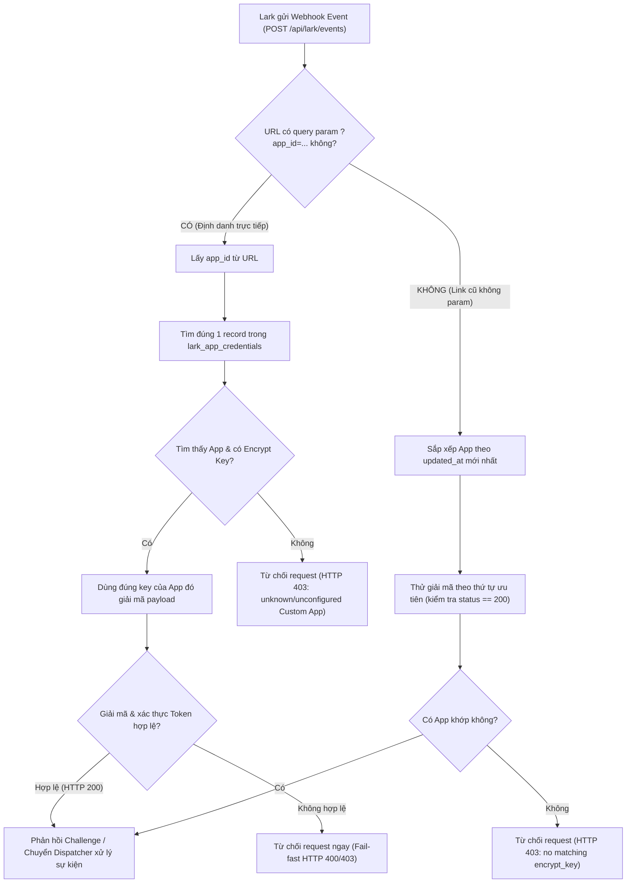

# Kế hoạch Triển khai: Định danh Webhook & Callback Đa Tenant Tuyệt đối Theo App ID
(Implementation Plan — Deterministic Multi-Tenant Custom App Webhook & Callback Routing)

## 1. Bối cảnh & Tuyên bố vấn đề (Problem Statement)

### 1.1. Hiện trạng & Lỗi kiến trúc cũ
- Khi ứng dụng Lark bật tính năng mã hóa (**Encryption Strategy**) với `Encrypt Key`, toàn bộ gói tin Webhook (gồm cả mã xác thực URL Verification Challenge, tin nhắn `im.message.receive_v1`, và tương tác thẻ `card.action.trigger`) đều được mã hóa bằng AES-CBC.
- Do gói tin JSON gửi sang chỉ chứa `{"encrypt": "..."}` mà không chứa `header.app_id` ở tầng plaintext, kiến trúc cũ trước đây đã giải quyết bằng cách:
  * Lấy danh sách toàn bộ các Custom App trong database (`list_registrations()`).
  * Chạy vòng lặp duyệt qua từng App và thử giải mã bằng `encrypt_key` của App đó (cơ chế brute-force / đoán mò).
- **Hậu quả nghiêm trọng:**
  1. **Lỗi logic làm tê liệt ứng dụng mới:** Thư viện `lark_oapi` bắt lỗi giải mã sai padding (`invalid PKCS7 padding`) trong nội bộ và trả về `HTTP 500`. Code cũ `return Response(...)` ngay lập tức mà không kiểm tra `status == 200`, khiến vòng lặp bị ngắt ngay ở App đầu tiên trong DB. Các App đăng ký sau bị kẹt cứng vĩnh viễn, không thể xác thực Webhook URL.
  2. **Vi phạm nguyên tắc cô lập dữ liệu (Zero-Trust Multi-Tenancy):** Gói tin bảo mật của Doanh nghiệp B lại được mang ra giải mã thử bằng chìa khóa bí mật của Doanh nghiệp A.
  3. **Nghịch lý thứ tự Onboarding (Chicken-and-Egg):** Giao diện Setup cũ đặt bước cấu hình Webhook URL (Bước 5) trước bước nhập Key vào HiLark (Bước 7), khiến người dùng không thể Save URL trên Lark Console.

### 1.2. Mục tiêu kỹ thuật (Objectives)
- Chuyển đổi toàn diện sang cơ chế **Định danh Tuyệt đối 1-1 (Deterministic Routing via App ID)**:
  * URL Webhook gắn trực tiếp danh tính App: `POST /api/lark/events?app_id={app_id}` (hoặc `/api/lark/events/{app_id}`).
  * URL Card Action gắn trực tiếp danh tính App: `POST /api/lark/card-action?app_id={app_id}` (hoặc chia sẻ chung endpoint events).
  * Server phân giải tức thì: Đọc `app_id` trên URL $\rightarrow$ Lấy duy nhất 1 bộ key của đúng App đó từ MongoDB `lark_app_credentials` $\rightarrow$ Giải mã/xác thực trực tiếp.
  * **Tuyệt đối không chạy vòng lặp, không đoán mò, không rò rỉ dữ liệu chéo.**
  * Quy chuẩn hóa OAuth Redirect URL: Giữ sạch `https://<domain>/setup/callback` để tuân thủ Strict URI Matching của Lark, truyền ngữ cảnh qua tham số chuẩn `state=setup_{task_id}` (RFC 6749).

---

## 2. Kiến trúc Định danh & Hợp đồng Kỹ thuật (Technical Contract)

### 2.1. Hợp đồng Ingress URLs

| Kênh tương tác | URL Cấu hình trên Lark Developer Console | Cơ chế định danh trên Server |
| :--- | :--- | :--- |
| **Event Subscriptions** | `https://<domain>/api/lark/events?app_id={app_id}` | Query parameter `app_id` $\rightarrow$ `lark_app_service.get_by_app_id` |
| **Interactive Card Action** | `https://<domain>/api/lark/card-action?app_id={app_id}` | Query parameter `app_id` $\rightarrow$ `lark_app_service.get_by_app_id` |
| **OAuth User Authorization** | `https://<domain>/setup/callback` | State parameter `state=setup_{task_id}` $\rightarrow$ `task.app_registration_id` |

### 2.2. Sơ đồ luồng xử lý Webhook Gateway (Ingress Flow)



---

## 3. Các giai đoạn triển khai chi tiết (Phases & Deliverables)

### Phase 1: Hoàn thiện Gateway Routing Core (`messenger.py` & `dispatcher.py`)
- [x] **Trích xuất `inbound_app_id` từ Query Param:**
  ```python
  inbound_app_id = (
      request.query_params.get("app_id")
      or (app_header.get("app_id", "") if isinstance(app_header, dict) else "")
  )
  ```
- [x] **Định danh giải mã trực tiếp 1-1 (Zero Looping):**
  Nếu có `inbound_app_id`: Chỉ lấy đúng cấu hình của App đó, khởi tạo runtime client và gọi `event_dispatcher.do(encrypted_raw_req)`. Nếu sai key hoặc không tìm thấy, từ chối ngay lập tức (Fail-fast).
- [x] **Sửa bug ngắt sớm vòng lặp fallback:**
  Nếu không có `app_id`: Sắp xếp danh sách App theo `updated_at` giảm dần (ưu tiên app vừa tạo/sửa). Chỉ `return Response` khi `candidate_response.status_code == 200`. Nếu candidate trước thất bại (HTTP 500 do sai key), tự động tiếp tục loop sang candidate tiếp theo.
- [x] **Đồng bộ Card Action Gateway:**
  Áp dụng cùng cơ chế trích xuất `app_id` cho `/api/lark/card-action`, đảm bảo khi người dùng bấm nút duyệt nháp trên thẻ, server gọi đúng runtime client của tenant đó.

### Phase 2: Hỗ trợ Path Parameter cho Webhook Routes (`routers/lark.py`)
- [x] Bổ sung route path-based `/api/lark/events/{app_id}` song song với query-param `/api/lark/events?app_id={app_id}` để hỗ trợ các proxy/firewall doanh nghiệp không cho phép query string trên webhook URL.
- [x] Bổ sung route path-based `/api/lark/card-action/{app_id}` song song với `/api/lark/card-action?app_id={app_id}`.

### Phase 3: Tối ưu hóa UI Setup & Onboarding Wizard (`setup_one_click.html` & `onboarding_wizard.html`)
- [x] **Đảo thứ tự các bước (Fix Chicken-and-Egg):**
  * **Bước 1 / 6:** Tạo Custom App trên Lark Developer.
  * **Bước 2 / 6:** Bật tính năng Bot.
  * **Bước 3 / 6:** Lấy 4 khóa & Kết nối với HiLark (Nhập `App ID`, `App Secret`, `Verification Token`, `Encrypt Key` $\rightarrow$ Bấm *"Xác thực & Lưu khóa vào HiLark"* $\rightarrow$ Lưu DB thành công).
  * **Bước 4 / 6:** Thêm quyền (Scopes) bằng JSON batch import.
  * **Bước 5 / 6:** Cấu hình Request URL & Sự kiện (HiLark đã có sẵn `Encrypt Key` nên khi bấm Save trên Lark, Challenge được giải mã và trả lời HTTP 200 thành công ngay lập tức).
  * **Bước 6 / 6:** Khai báo Redirect URL & Phát hành phiên bản 1.0.0.
  * **Trang cuối (Slide 7):** Hiển thị xác nhận App đã kết nối và nút duy nhất: *"Cài đặt HiLark cho Doanh nghiệp · cấp quyền user (OAuth)"*.
- [x] **Tự động sinh URL có `?app_id=cli_...`:**
  * Tại Bước 5, text hiển thị Request URL và nút "Sao chép" tự động gắn mã `?app_id=cli_xxx` của App mà user vừa nhập ở Bước 3.
  * Nút "Đã có key? Bỏ qua hướng dẫn →" dẫn thẳng tới Bước 3 để nạp key ngay lập tức.
  * Lưu trạng thái `app_id` và `registration_id` vào `localStorage` để không bị mất khi F5 tải lại trang.

### Phase 4: Bộ kiểm thử tự động & Bằng chứng xác minh (Automated Verification Suite)
- [x] Xây dựng test suite trong `server/tests/lark/test_multitenant_webhook_routing.py` (7/7 tests passed 100%):
  1. `test_inbound_encrypted_event_with_matching_app_id_param`: Gửi event mã hóa kèm `?app_id=cli_A` $\rightarrow$ giải mã thành công bằng key của A, trả về 200.
  2. `test_inbound_encrypted_event_with_mismatched_app_id_param`: Gửi event mã hóa của App A nhưng truyền `?app_id=cli_B` $\rightarrow$ từ chối ngay với 400/500, không thử key của App A.
  3. `test_inbound_encrypted_event_without_param_resolves_latest_app`: Gửi event không có query param $\rightarrow$ tự động giải mã thành công bằng App có `updated_at` mới nhất.
  4. `test_card_action_callback_with_app_id_param_routes_to_correct_tenant`: Gửi callback tương tác thẻ có `?app_id=cli_A` $\rightarrow$ nạp đúng context runtime của tenant A.
  5. `test_url_verification_challenge_responds_with_challenge_code`: Gửi challenge payload đã mã hóa $\rightarrow$ server trả về đúng `{"challenge": "..."}` với HTTP 200.
  6. `test_path_based_route_events_app_id_identical_to_query_param`: Kiểm tra tính tương đồng 100% giữa path-based và query-param.
  7. `test_path_based_route_card_action_app_id`: Kiểm tra Card Action path-based nạp đúng tenant context.

### Phase 5: Cập nhật Tài liệu & Project Memory
- [x] Cập nhật `docs/project-memory/HANDOFF.md` ghi nhận sự thay đổi kiến trúc và các lỗi đã fix.
- [x] Cập nhật `docs/lark_event_subscription.md` bổ sung hướng dẫn dùng URL có `?app_id=...` cho cả Event và Card Action.
- [x] Ghi nhận quyết định kỹ thuật vào `docs/project-memory/DECISIONS.md` (EDL-0072).

---

## 4. Tiêu chí Chấp nhận (Acceptance Criteria)

1. **URL Verification Pass 100%:** Khi user tạo App mới trên Lark (kèm Encrypt Key), lưu khóa ở Bước 3 của HiLark Setup, sau đó copy Request URL sang Lark và bấm **Save** $\rightarrow$ Lark báo tick xanh thành công ngay lập tức, không xuất hiện `Challenge code didn't get response`.
2. **Zero Cross-Talk:** Không có bất kỳ trường hợp nào dữ liệu của Tenant A được giải mã hoặc xử lý bằng runtime client của Tenant B.
3. **Deterministic Routing:** Khi URL chứa `?app_id=...`, server chỉ đọc duy nhất 1 bản ghi App từ database, không duyệt mảng, không brute-force.
4. **OAuth Safety:** OAuth flow sử dụng Redirect URL cố định không có query parameter để vượt qua kiểm tra nghiêm ngặt của Lark Console; liên kết phiên cài đặt 100% thông qua `state=setup_{task_id}`.

