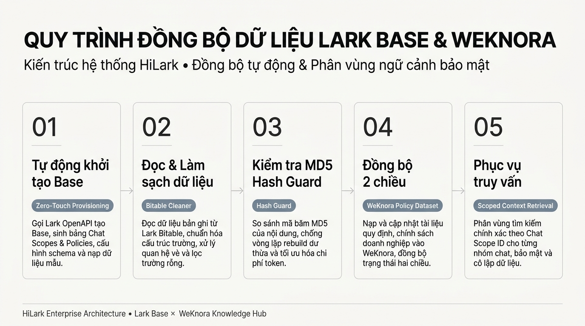
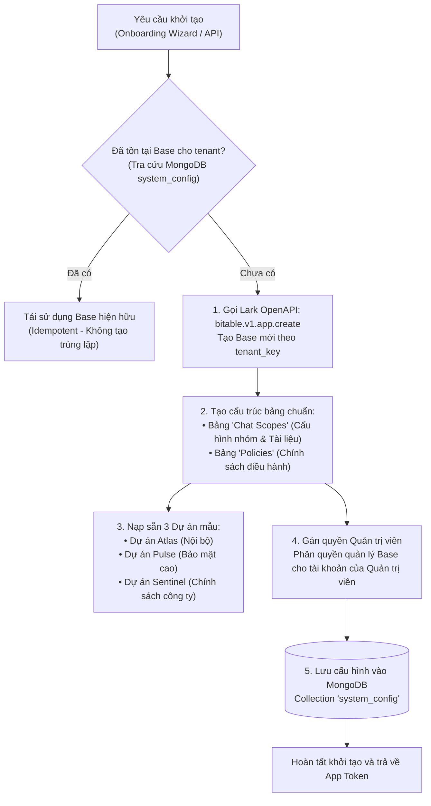

# Tích hợp & Đồng bộ Dữ liệu Lark Base (Bitable)

Tài liệu này ghi lại kiến trúc tích hợp Lark Base (Bitable), tính năng khởi tạo tự động (Zero-Touch Provisioning), cơ chế kiểm soát MD5 Hash Guard và quy trình đồng bộ hai chiều giữa Lark Base, MongoDB và WeKnora.

Mã nguồn liên quan:
- Cấp phát Lark Base tự động: [`server/services/lark/base_provision_service.py`](file:///Users/hoainam/Desktop/HiLark/server/services/lark/base_provision_service.py)
- Tương tác Bitable OpenAPI: [`server/services/lark/bitable.py`](file:///Users/hoainam/Desktop/HiLark/server/services/lark/bitable.py)
- Đồng bộ Chat Scope: [`server/services/knowledge/chat_scopes.py`](file:///Users/hoainam/Desktop/HiLark/server/services/knowledge/chat_scopes.py)
- Đồng bộ chính sách Policy: [`server/services/knowledge/policy_sync.py`](file:///Users/hoainam/Desktop/HiLark/server/services/knowledge/policy_sync.py)

---

## 1. Vai trò của Lark Base trong hệ thống

Trong kiến trúc HiLark Server, Lark Base đóng vai trò là giao diện quản trị phi tập trung (No-code Admin Control Plane):
- Quản trị viên quản lý cấu hình các nhóm chat trực tiếp trên giao diện bảng tính Lark Base mà không cần can thiệp vào mã nguồn hoặc file môi trường.
- Cho phép bật/tắt bot (`status = active / paused / inactive`), thiết lập cấp bảo mật (`standard` / `confidential`), quy định danh sách nhãn cấm (`forbidden_labels`) và gắn tệp tài liệu/thư mục Lark Drive cho từng nhóm chat.
- Hệ thống lắng nghe sự kiện thay đổi bản ghi trên Base để đồng bộ tự động sang MongoDB `chat_scopes` và nạp tài liệu vào kho WeKnora.

---

## 2. Quy trình đồng bộ Lark Base & WeKnora

Dưới đây là sơ đồ quy trình đồng bộ dữ liệu giữa Lark Base, MongoDB và WeKnora:

---

## 3. Khởi tạo Base tự động (Zero-Touch Provisioning)

Dịch vụ `BaseProvisionService` tự động hóa việc khởi tạo cấu trúc Lark Base qua OpenAPI:

### Đặc tính kỹ thuật:
- **Khởi tạo 1-chạm:** Tự động tạo toàn bộ cấu trúc bảng và trường dữ liệu qua OpenAPI trong vòng 2.5 giây.
- **Tính lũy biến (Idempotent):** Kiểm tra trạng thái trong collection `system_config` theo `tenant_key`, tái sử dụng Base đã tồn tại để tránh phát sinh bản ghi trùng lặp.
- **Phân giải động:** Ưu tiên phân giải `app_token` từ MongoDB theo tenant, không hardcode cố định trong mã nguồn.

---

## 4. Cơ chế kiểm soát MD5 Hash Guard (Chống vòng lặp Rebuild)

Trong quá trình đồng bộ tài liệu chính sách và tệp đính kèm từ Lark Base sang WeKnora, hệ thống áp dụng cơ chế MD5 Hash Guard để bảo vệ tài nguyên:
1. **Tính toán MD5:** Khi tải tệp đính kèm hoặc nội dung Markdown từ Lark DocX, hệ thống tính toán mã băm MD5 của nội dung.
2. **Đối chiếu bản ghi:** So sánh MD5 mới với bản ghi tài liệu đã nạp trên WeKnora.
3. **Bỏ qua khi không đổi:** Nếu MD5 trùng khớp hoàn toàn, hệ thống giữ nguyên bản ghi WeKnora hiện hữu (`force = False`) và bỏ qua bước upload/vectorize.
4. **Hiệu quả:** Ngăn chặn triệt để tình trạng re-index lặp đi lặp lại tài liệu không đổi sau mỗi chu kỳ quét định kỳ, tiết kiệm tối đa chi phí token embedding.

---

## 5. Các kênh đồng bộ dữ liệu

| Kênh đồng bộ | Tác nhân kích hoạt | Cơ chế kỹ thuật | Tần suất |
| :--- | :--- | :--- | :--- |
| **Sự kiện Bảng Base** | Quản trị viên sửa ô, đổi trạng thái hoặc đính kèm file mới trên Base. | Sự kiện webhook `drive.file.bitable_record_changed_v1` xử lý cập nhật tức thì. | Thời gian thực (~1 giây) |
| **Sự kiện Thêm Bot** | Thành viên mời Bot vào nhóm chat mới trên Lark. | Sự kiện webhook `im.chat.member.bot.added_v1`, tự động thêm dòng mới vào Base. | Thời gian thực (~0.5 giây) |
| **Đồng bộ chu kỳ (Worker Loop)** | Worker nền kiểm tra đồng bộ chính sách định kỳ. | Kiểm tra đối soát MD5 hash giữa Base và WeKnora Policy Dataset. | Chu kỳ 1800 giây (30 phút) |
| **Khởi động Server (Bootstrap)** | Khởi động server trong quá trình startup lifespan. | Nạp cấu hình các nhóm chat hiện hữu vào bộ nhớ cache. | 1 lần duy nhất lúc khởi động |
