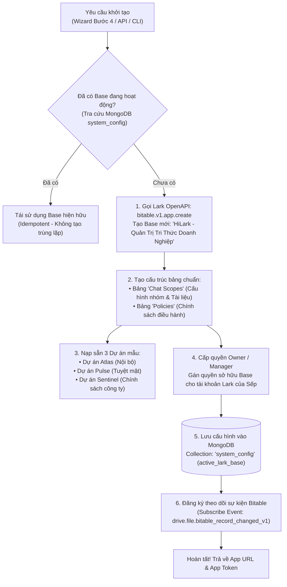

# 📘 TỔNG QUAN HỆ THỐNG ĐỒNG BỘ DỮ LIỆU & TỰ ĐỘNG KHỞI TẠO LARK BASE (BITABLE)
> **Dự án HiLark Server** — Trung tâm điều khiển quản trị (Admin Control Plane), Tự động khởi tạo 100% qua OpenAPI và Luồng đồng bộ đa nguồn.  
> **Vị trí thư mục:** [`server/docs/LarkBase/`](file:///Users/hoainam/Desktop/HiLark/server/docs/LarkBase), [`server/services/lark/base_provision_service.py`](file:///Users/hoainam/Desktop/HiLark/server/services/lark/base_provision_service.py)

---

## 🧭 1. LARK BASE LÀ GÌ TRONG HỆ THỐNG HILARk?

Trong kiến trúc HiLark Server, **Lark Base (Bitable)** đóng vai trò là **"Trung tâm điều khiển quản trị không chạm code" (No-code Admin Control Plane)**:

* **Không cần sửa file `.env` hay viết mã:** Sếp hoặc Quản trị viên chỉ cần mở ứng dụng Lark, truy cập vào bảng tính Lark Base để:
  1. Bật / Tắt hoạt động của bot trong từng nhóm (`status = active / paused / inactive`).
  2. Thiết lập chính sách bảo mật cho từng dự án (`security_level = standard / confidential`).
  3. Đặt danh sách các chủ đề cấm hỏi (`forbidden_labels = ["Ngân sách", "Lương", "Hợp đồng"]`).
  4. Nạp tài liệu tri thức cho bot bằng cách **kéo thả trực tiếp file PDF/Word vào ô đính kèm** hoặc dán link thư mục Lark Drive Folder của bảng Base!
* **Dữ liệu được đồng bộ tự động 2 chiều:** Bất kỳ thao tác nào của Sếp trên Lark Base đều được hệ thống tự động đồng bộ sang **MongoDB** (lưu cấu hình nhóm) và **WeKnora RAG** (nạp và vector hóa tài liệu).

---

## 🚀 2. TÍNH NĂNG TỰ ĐỘNG KHỞI TẠO 100% (ZERO-TOUCH AUTO-PROVISIONING)

Trước đây, quản trị viên phải tự tay vào Lark Suite tạo Base thủ công, đặt tên bảng, tạo từng cột dữ liệu và copy app token dán vào `.env`.  
Hiện tại, hệ thống cung cấp dịch vụ **`BaseProvisionService`** tự động hóa hoàn toàn 100%:



### Ưu điểm vượt trội:
- **Zero-Touch:** 1 click duy nhất trên giao diện Screen Guide (Bước 4), toàn bộ cơ sở dữ liệu Bitable được khởi tạo chỉ sau **2.5 giây**.
- **Idempotency tuyệt đối:** Nếu kiểm tra đã có Base trong MongoDB hoặc `.env`, hệ thống trả về ngay Base hiện hữu, tuyệt đối không tạo rác nhiều Base.
- **Dynamic Fallback:** Ưu tiên nạp Base ID động từ MongoDB `system_config`. Nếu MongoDB chưa có thì tự động fallback về cấu hình tĩnh trong file `.env`.

---

## 🏗️ 3. KIẾN TRÚC 3 TẦNG ĐỒNG BỘ (BITABLE SYNC ARCHITECTURE)

```mermaid
flowchart TD
    classDef stepBox fill:#1e293b,stroke:#3b82f6,stroke-width:2px,color:#f8fafc;
    classDef utilBox fill:#0f172a,stroke:#10b981,stroke-width:1px,color:#e2e8f0;
    classDef alertBox fill:#450a0a,stroke:#ef4444,stroke-width:1px,color:#fecaca;
    classDef successBox fill:#064e3b,stroke:#10b981,stroke-width:2px,color:#a7f3d0;

    subgraph UI["🖥️ GIAO DIỆN SẾP: BẢNG TÍNH LARK BASE (ADMIN NO-CODE)"]
        R1["ID Group (chat_id)"]
        R2["Dự án / Nhóm (chat_name)"]
        R3["Trạng thái (active / paused / inactive)"]
        R4["Mức độ bảo mật (standard / confidential)"]
        R5["Nhãn cấm (forbidden_labels)"]
        R6["Tài liệu đính kèm (File PDF / Word / Folder)"]
    end

    UI -->|Kênh 1: Webhook Event (Realtime)| EV["drive.file.bitable_record_changed_v1<br/>(Sếp sửa Base ➔ Tức thời ~0.5s)"]
    IM["Lark IM Group Event<br/>(im.chat.member.bot.added_v1)"] -->|Kênh 2: Webhook Event (Realtime)| BOT["_internal_on_bot_added_event()<br/>(Tự tạo dòng mới tức thì trên Base ~0.5s)"]
    BOT -.-> UI
    BOOT["Khởi động Server<br/>(One-off Bootstrap Sync)"] -.->|Nạp dữ liệu ban đầu| S1

    subgraph SYNC["⚙️ ĐỘNG CƠ ĐỒNG BỘ: scope_service.py & larkbase.py"]
        direction TB
        S1["1. Bóc tách & Làm sạch Cell Values<br/>clean_field_value(raw_val)"]:::utilBox
        S2["2. Phân giải Nhãn cấm & Bảo mật<br/>parse_labels() & Nhóm Tuyệt mật"]:::utilBox
        S3["3. Tải file, quét Folder & Đẩy WeKnora<br/>adownload_attachment() ➔ upload_file()"]:::utilBox
        S4["4. Lưu trữ MongoDB 'chat_scopes'<br/>Upsert ChatScopeRecord"]:::utilBox
        
        S1 --> S2 --> S3 --> S4
    end

    EV --> S1
    BOT -->|sync_group_from_base_record| S1

    S3 -->|File bytes & Folder docs| WK[("📚 KHO TRI THỨC WEKNORA<br/>Phân đoạn văn bản & Vector hóa<br/>Trả về 'knowledge_id'")]:::successBox
    WK -->|Gán knowledge_ids| S4

    S4 --> MG[("💾 CƠ SỞ DỮ LIỆU MONGODB<br/>Collection: 'chat_scopes'<br/>Cung cấp dữ liệu < 1ms cho Layer 2 & 3")]:::successBox
```

---

## 🔄 4. CƠ CHẾ ĐỒNG BỘ 100% EVENT-DRIVEN (REALTIME SYNC)

Hệ thống hoạt động theo kiến trúc **100% Hướng sự kiện (Event-Driven)**, triệt tiêu hoàn toàn cơ chế Polling ngầm để không lãng phí API Quota và đảm bảo dữ liệu phản ứng tức thì trong **~0.5 giây**:

| Kênh đồng bộ | Tác nhân kích hoạt | Cơ chế kỹ thuật | Tốc độ phản ứng |
| :--- | :--- | :--- | :---: |
| **1. Kênh Sự kiện Bảng Base** *(Base Record Changed)* | Sếp sửa một ô, đổi trạng thái hoặc kéo thả file mới vào bảng Base. | Sự kiện `drive.file.bitable_record_changed_v1` qua WebSocket/Webhook $\rightarrow$ `scope_service.handle_bitable_record_changed_event()`. | **Tức thì (~0.5 - 1s)** |
| **2. Kênh Sự kiện Nhóm Chat** *(Bot Added to Group)* | Thành viên mời Bot vào nhóm chat mới trên ứng dụng Lark. | Sự kiện `im.chat.member.bot.added_v1` $\rightarrow$ `_internal_on_bot_added_event()` tự tạo record Base và sync sang Mongo. | **Tức thì (~0.5s)** |
| **3. Khởi tạo khi Start Server** *(One-off Bootstrap Sync)* | Khi khởi động FastAPI server (`bot_runner.py`). | Quét `sync_bot_chats()` và `sync_all_groups_from_base()` **1 lần duy nhất** lúc bật server để nạp toàn bộ cấu hình ban đầu. | **1 lần duy nhất lúc khởi động** |

---

## 🗂️ 5. DANH MỤC TÀI LIỆU BÓC TÁCH KỸ THUẬT

1. **[`sync_pipeline_deep_dive.md`](file:///Users/hoainam/Desktop/HiLark/server/docs/LarkBase/sync_pipeline_deep_dive.md)**: Bản đặc tả kỹ thuật chi tiết toàn bộ luồng đồng bộ dữ liệu.
2. **[`base_provision_service.py`](file:///Users/hoainam/Desktop/HiLark/server/services/lark/base_provision_service.py)**: Module tự động khởi tạo Bitable, sinh bảng, tạo fields và nạp seed data mẫu qua Lark OpenAPI.
3. **[`scope_service.py`](file:///Users/hoainam/Desktop/HiLark/server/services/scope_service.py)**: Điều phối luồng nạp file sang WeKnora và lưu trữ vào MongoDB.
4. **[`larkbase.py`](file:///Users/hoainam/Desktop/HiLark/server/services/larkbase.py)**: Driver cấp thấp giao tiếp trực tiếp với Bitable OpenAPI của Lark Suite.
