# 🏛️ HỆ THỐNG TRỢ LÝ DOANH NGHIỆP HILARK (HILARK SERVER)
## TÀI LIỆU KIẾN TRÚC KỸ THUẬT TOÀN DIỆN (SYSTEM ARCHITECTURE DOCUMENTATION)

> **Phiên bản:** Production-Ready 2.0 (Kiến trúc 4 Lớp, Hybrid BYOK, Đa Nhà Cung Cấp LLM & Tự Động Khởi Tạo Lark Base)  
> **Ngôn ngữ diễn đạt:** Tiếng Việt kỹ thuật chuẩn xác, thực tế, mạch lạc, có liên kết trực tiếp tới mã nguồn thực thi.

---

## 🧭 1. TỔNG QUAN KIẾN TRÚC & NGUYÊN TẮC THIẾT KẾ

HiLark Server là hệ thống trợ lý điều hành doanh nghiệp thông minh tích hợp sâu vào hệ sinh thái **Lark Suite (Lark IM, Bitable, Drive, DocX, Wiki)** và kho tri thức bảo mật on-premise **WeKnora RAG**:
- **Đại diện danh tính Lãnh đạo:** Hoạt động dưới tư cách tài khoản cá nhân của Lãnh đạo (`as_user=True`) để trả lời câu hỏi nghiệp vụ, giữ văn phong điềm tĩnh, dứt khoát ("anh - em") và bảo vệ tuyệt đối bí mật kinh doanh.
- **Zero Ingress Attack Surface:** Giao tiếp 2 chiều với Lark Suite hoàn toàn qua kênh bảo mật **WebSocket Persistent Connection** (`lark.ws.Client`), không yêu cầu mở cổng public Internet hay domain webhook phức tạp.
- **Bảo mật Vùng cấm & Human-in-the-Loop (Strict HITL):** Chặn đứng nguy cơ lộ lọt ngân sách, lương bổng bằng chốt chặn 2 tầng (Regex siêu tốc + JEV phân tích ngữ nghĩa sâu), tự động chuyển thành bản nháp gửi riêng Lãnh đạo duyệt trước khi phát ngôn.
- **Kiến trúc Tri thức Kép (Hybrid Dual Knowledge):** Kết hợp tài liệu tĩnh trên WeKnora RAG và tri thức động thời gian thực (Dynamic Claims) trong MongoDB với nguyên tắc **"Thực tế chốt mới nhất là chân lý số 1" (Fact Override)**.
- **Đa Nhà Cung Cấp Trí Tuệ Nhân Tạo (Multi-Provider LLM Engine):** Hỗ trợ linh hoạt **Google Gemini**, **OpenAI ChatGPT**, **Anthropic Claude**, và **Tùy chỉnh (OpenAI-compatible)** với cơ chế Hybrid BYOK mã hóa chuẩn quân đội AES-256 Fernet.

---

## 🗺️ 2. BẢN ĐỒ TÀI LIỆU HỆ THỐNG (DOCUMENTATION SITEMAP)

| Thư mục / Tài liệu | Nội dung chính | Mô tả kỹ thuật |
| :--- | :--- | :--- |
| [`server/docs/so_do_luong_hoat_dong_4_lop.md`](file:///Users/hoainam/Desktop/HiLark/server/docs/so_do_luong_hoat_dong_4_lop.md) | **Sơ đồ dòng chảy 4 Lớp** | 24 bước tuần tự từ khi nhận tin nhắn tới khi phát ngôn, đánh dấu các điểm gắn JEV và LLM. |
| [`server/docs/layer1/`](file:///Users/hoainam/Desktop/HiLark/server/docs/layer1) | **Lớp 1: Cửa ngõ tiếp nhận & Điều tiết** | Pure WebSocket, Dedup Cache, Throttled Chat Queue, Inbound Message Parsing, Thu hồi tin nhắn 4 tầng. |
| [`server/docs/layer2/`](file:///Users/hoainam/Desktop/HiLark/server/docs/layer2) | **Lớp 2: Vọng gác an ninh & Ý định** | Bộ lọc kích thước, Quét vùng cấm ngân sách/lương, Phân loại 5 nhánh JEV, Kế thừa ngữ cảnh Thread (JEV Tier 2). |
| [`server/docs/layer3/`](file:///Users/hoainam/Desktop/HiLark/server/docs/layer3) | **Lớp 3: Tri thức đa nguồn & Bối cảnh** | AnyDoc gRPC Reader, DocX/Wiki OpenAPI Markdown, Dynamic Claims MongoDB, Rule Engine RAM 0ms, Context Composer. |
| [`server/docs/layer4/`](file:///Users/hoainam/Desktop/HiLark/server/docs/layer4) | **Lớp 4: Sinh câu trả lời & Persona Sếp** | Multi-Provider LLM (`LLMClient`), Grounded QA, Bản nháp Interactive Card V2, Điều hành bằng Chat, Master Daily Digest. |
| [`server/docs/LarkBase/`](file:///Users/hoainam/Desktop/HiLark/server/docs/LarkBase) | **Lark Base: Trung tâm điều khiển No-code** | Tự động khởi tạo 100% Lark Base qua OpenAPI (Zero-Touch Provisioning), đồng bộ 2 chiều Bitable và WeKnora. |
| [`server/docs/permission/`](file:///Users/hoainam/Desktop/HiLark/server/docs/permission) | **Bảo mật & Phân quyền dữ liệu** | 5 tầng cách ly dữ liệu, Phân quyền thăng hạng Claims theo vai trò, Quản lý nhãn cấm theo từng nhóm chat. |
| [`server/docs/jev/`](file:///Users/hoainam/Desktop/HiLark/server/docs/jev) | **Mô hình phân loại JEV** | Phân loại tin nhắn rác 0ms, phát hiện ý định 5 nhánh, chấm điểm liên quan và tái sắp xếp đoạn trích tri thức. |
| [`server/docs/onboarding/`](file:///Users/hoainam/Desktop/HiLark/server/docs/onboarding) | **Trình hướng dẫn Screen Guide & BYOK** | Stepper Wizard 4 bước mở trong Lark Applink Webview Modal, Apple Minimalist UI, Tách rời Template và Models. |

---

## 🏛️ 3. SƠ ĐỒ PHÂN RÃ HỆ THỐNG 4 LỚP TỔNG QUAN

```mermaid
flowchart TB
    subgraph L1["🚪 LỚP 1: CỬA NGÕ TIẾP NHẬN & ĐIỀU TIẾT (INBOUND GATEWAY)"]
        WS["Lark Pure WebSocket<br/>(Zero Ingress Port)"] --> Parser["Lark Message Parser<br/>& Dedup Cache (1000 msgs)"]
        DocInbound["Phân giải Tài liệu / Folder<br/>(DocX, Wiki, AnyDoc gRPC)"] --> Parser
        RecallInbound["Thu hồi tin nhắn Cascade<br/>(im.message.recalled_v1)"] --> Parser
        Parser --> Staging[("MongoDB Staging<br/>conversation_staging")]
        Parser --> Debounce["Bộ gom ngắt dòng<br/>(Debounce 1.75s)"]
        Debounce --> Queue["Hàng đợi Throttling<br/>(Giãn cách 4s / Sếp 0s)"]
    end

    subgraph L2["🛡️ LỚP 2: VỌNG GÁC AN NINH & PHÂN LOẠI Ý ĐỊNH (SECURITY & INTENT)"]
        Queue --> LengthCheck["Kiểm tra độ dài & Dọn rác<br/>(text_filter.py: 2-1000 từ)"]
        LengthCheck --> ScopeCheck{"Trạng thái Scope nhóm?<br/>(active / paused)"}
        ScopeCheck -->|Active| ThreatScan{"Quét vùng cấm Ngân sách/Lương?<br/>(Regex thô + JEV Semantic Scan)"}
        ThreatScan -->|Vi phạm| ThreatAction["Chuyển Bản nháp Strict HITL<br/>+ Cảnh báo ngầm Sếp"]
        ThreatScan -->|An toàn| JEVClassify["Phân loại 5 nhánh ý định JEV<br/>(IGNORE / MEMORY / REPLY / DRAFT)"]
        JEVClassify --> ThreadInherit["Kế thừa ngữ cảnh Thread<br/>(JEV Tier 2 Smart Reply)"]
    end

    subgraph L3["📚 LỚP 3: KHO TRI THỨC ĐA NGUỒN & HỢP NHẤT BỐI CẢNH (KNOWLEDGE ENGINE)"]
        ThreadInherit -->|MEMORY_ONLY| Extractor["Bóc tách Thực thể & Sự thật<br/>(LLM Extractor -> MongoDB Claims)"]
        ThreadInherit -->|REPLY_ONLY / DRAFT| QueryEngine["Truy vấn tri thức đa nguồn"]
        
        subgraph Sources["2 Nguồn Tri thức Cách ly"]
            DocRAG[("WeKnora On-premise<br/>Tài liệu văn bản gốc")]
            LiveClaims[("MongoDB Dynamic Claims<br/>Sự thật chốt mới nhất")]
        end
        QueryEngine --> DocRAG
        QueryEngine --> LiveClaims
        DocRAG --> RuleEngine["Rule Engine (RAM 0ms)<br/>Lọc nhãn cấm & bảo mật vùng cấm"]
        LiveClaims --> RuleEngine
        RuleEngine --> JEVRerank["JEV Reranker & Chấm điểm liên quan"]
        JEVRerank --> Composer["Context Composer (Hạn mức 16.000 ký tự)<br/>Phần 0: Hồ sơ nhóm | Phần 1: Tài liệu | Phần 2: Claims mới nhất"]
    end

    subgraph L4["🗣️ LỚP 4: SINH CÂU TRẢ LỜI & ĐÓNG VAI SẾP (EXECUTIVE DELIVERY)"]
        Composer --> MultiLLM["Bộ động cơ Đa Nhà Cung Cấp LLM<br/>(Google Gemini, OpenAI, Claude, Custom)"]
        MultiLLM --> PersonaFilter["Nạp Executive Persona ('anh - em')<br/>& Dọn sạch định dạng văn bản"]
        PersonaFilter --> DeliverySwitch{"Loại hình gửi tin?"}
        
        DeliverySwitch -->|An toàn: REPLY_ONLY| DirectSend["Gửi thẳng vào nhóm chat Lark<br/>(as_user=True nhân danh Sếp)"]
        DeliverySwitch -->|Bảo mật / Nhạy cảm| DraftSend["Lưu MongoDB draft_logs<br/>& Bắn thẻ Interactive Card V2 tới Sếp"]
        DraftSend --> BossActions{"Sếp điều khiển bằng nút bấm / chat:<br/>[Duyệt gửi] / [Bỏ] / [Sửa: ...] / [Sửa AI: ...]"}
    end

    subgraph Ecosystem["⚙️ HỆ SINH THÁI ĐIỀU HÀNH BỔ TRỢ"]
        BaseProvision["Zero-Touch Auto-Provision Lark Base<br/>(Tự tạo Bitable + Cấu hình Scopes qua OpenAPI)"]
        ScreenGuide["Onboarding Screen Guide Wizard 4 Bước<br/>(Apple Minimalist UI, No Emoji, Tách rời Template)"]
        DailyDigest["Master Daily Digest Daemon (Chạy lúc giờ hẹn)<br/>(Bóc tách Bộ ba tri thức: Quyết định, Cam kết, Trạng thái)"]
    end

    L1 --> L2 --> L3 --> L4
```



---

## 🚀 4. CÁC TÍNH NĂNG ĐỘT PHÁ ĐÃ ĐƯỢC CHỨNG THỰC (EVIDENCE-BASED)

1. **AnyDoc gRPC Multimodal Ingestion (`WeKnora-docreader:50051`):**
   - Đọc và chuyển đổi tự động 17 định dạng tệp (`.docx`, `.pdf`, `.xlsx`, `.pptx`, `.md`...).
   - Đọc Markdown trực tiếp từ Lark DocX và Wiki qua OpenAPI, tiêu tốn **0 token** LLM.
   - Quét đệ quy toàn bộ cây thư mục Lark Drive Folder và tự động đồng bộ tài liệu sang WeKnora.
2. **Message Recall Cascade Sync (Thu hồi tin nhắn 4 tầng):**
   - Đón bắt sự kiện `im.message.recalled_v1` theo thời gian thực.
   - Tự động xóa sạch cascade qua 4 tầng: `conversation_staging` -> `claims` -> bộ nhớ tạm MongoDB -> `draft_logs`.
3. **Phân quyền Tri thức & Strict HITL:**
   - Bảo mật thông tin ngân sách, tài chính, bảng lương. Khi vi phạm, hệ thống tự động chuyển sang chế độ im lặng tuyệt đối vào nhóm và tạo bản nháp gửi riêng Lãnh đạo.
   - Thăng hạng tri thức có phân quyền: Chỉ Sếp mới có quyền thăng hạng thông tin dự án từ *Đề xuất* (`proposed`) thành *Chính thức* (`active`).
4. **Master Daily Digest & Knowledge Triad:**
   - Tự động bóc tách 3 nhánh tri thức: **Quyết định (Decisions)**, **Cam kết (Commitments)**, **Thay đổi trạng thái (Status Changes)**.
   - Lưu vết nguồn tin 100% kèm liên kết Applink mở đúng ngữ cảnh tin nhắn gốc trên Lark.
   - Kế thừa mạch lạc bối cảnh ngày hôm trước $K-1$ sang ngày hiện tại $K$.
5. **Zero-Touch Lark Base Auto-Provisioning:**
   - Khởi tạo 100% tự động cơ sở dữ liệu Lark Base cho doanh nghiệp thông qua OpenAPI.
   - Tự động sinh bảng Chat Scopes, bảng Policies, nạp sẵn 3 dự án mẫu (Atlas, Pulse, Sentinel) và gán quyền Lãnh đạo làm Owner.
6. **Hybrid BYOK & Multi-Provider LLM Engine:**
   - Mã hóa chuẩn quân đội AES-256 Fernet cho khóa cá nhân của người dùng.
   - Cơ chế chọn khóa 3 tầng: `Request Override` -> `User BYOK` -> `System Fallback`.
   - Hỗ trợ đa dạng nhà cung cấp: **Google Gemini**, **ChatGPT (OpenAI)**, **Anthropic Claude**, và **Custom (OpenAI-compatible)** với timeout tùy chỉnh và Base URL linh hoạt.
7. **Kiến trúc Tách biệt Template & Apple Minimalist UI:**
   - Giao diện Onboarding Wizard 4 bước được chuẩn hóa hoàn toàn theo phong cách Apple Native SF Pro, loại bỏ 100% icon và emoji gây rối mắt.
   - Tách biệt rành mạch giữa giao diện [`server/templates/onboarding_wizard.html`](file:///Users/hoainam/Desktop/HiLark/server/templates/onboarding_wizard.html) và mô hình dữ liệu [`server/models/onboarding.py`](file:///Users/hoainam/Desktop/HiLark/server/models/onboarding.py).

---

## 🛠️ 5. HƯỚNG DẪN TRIỂN KHAI & VẬN HÀNH NHANH

Mọi quy trình triển khai sản xuất được gói gọn trong script 1-click:

```bash
# 1. Kiểm tra biến môi trường
cp .env.production.example .env
# Chỉnh sửa thông tin Lark App ID, App Secret, và Gemini/OpenAI API Keys

# 2. Khởi chạy toàn bộ hạ tầng (HiLark Server + MongoDB + WeKnora Stack)
./deploy.sh
```

- **API Server & Healthcheck:** `http://localhost:8000/health`
- **Giao diện Screen Guide:** `http://localhost:8000/onboarding/wizard`
- **Swagger API Docs:** `http://localhost:8000/docs`
- **Kiểm thử tự động:** `cd server && .venv/bin/python -m pytest tests/final_test/ -v` (Đạt 52/52 test cases).
