# Tài liệu Kiến trúc Hệ thống HiLark Server

Tài liệu này ghi lại kiến trúc kỹ thuật, luồng xử lý và cấu trúc vận hành của HiLark Server. Tài liệu được cập nhật dựa trên mã nguồn thực tế và các quyết định kỹ thuật đã được kiểm chứng trong hệ thống.

---

## 1. Tổng quan hệ thống

HiLark là trợ lý điều hành doanh nghiệp tích hợp trực tiếp với hệ sinh thái Lark / Feishu và kho tri thức WeKnora:

- **Mô hình kiến trúc:** Modular monolith phát triển bằng Python (FastAPI), vận hành song song với WeKnora RAG engine (Go) trên mạng nội bộ.
- **Kiến trúc đa doanh nghiệp (Multi-Tenant):** Mọi tài nguyên, phiên làm việc, token xác thực, dữ liệu lưu trữ và kho tri thức đều được cô lập tuyệt đối theo `tenant_key`. Hỗ trợ cả hai mô hình Custom App và ISV Store App.
- **Tiếp nhận sự kiện qua Webhook Gateway:** Tiếp nhận sự kiện từ Lark qua cổng Webhook `/api/lark/events`, khử trùng lặp và điều phối qua hàng đợi xử lý bất đồng bộ.
- **Kiểm duyệt an toàn và phân loại ý định (JEV System 1):** Phân loại phản xạ nhanh tin nhắn người dùng, ngắt sớm các tin nhắn ngoài phạm vi để tối ưu độ trễ và chi phí token.
- **Ký ức động và tri thức kép (Hybrid Knowledge & Claims):** Kết hợp tài liệu tĩnh trên WeKnora và sự thật mới bóc tách từ hội thoại trong MongoDB. Áp dụng nguyên tắc ưu tiên dữ kiện mới nhất (`CURRENT Claims > Static WeKnora Baseline`).
- **Giao diện điều phối 100% nút bấm (Interactive Cards):** Toàn bộ tương tác điều hành, phê duyệt bản nháp và tổng hợp báo cáo ngày được xử lý qua Thẻ tương tác nút bấm của Lark, không sử dụng cú pháp lệnh văn bản trong tin nhắn riêng.
- **Đa nhà cung cấp LLM và mã hóa khóa cá nhân (BYOK):** Hỗ trợ Google Gemini, OpenAI ChatGPT, Anthropic Claude và các mô hình tương thích OpenAI (DeepSeek, vLLM). Khóa API cá nhân được mã hóa AES-256 Fernet.

---

## 2. Bản đồ tài liệu (Sitemap)

| Tài liệu / Thư mục | Nội dung | Trọng tâm kỹ thuật |
| :--- | :--- | :--- |
| [`so_do_luong_hoat_dong_4_lop.md`](so_do_luong_hoat_dong_4_lop.md) | **Sơ đồ luồng 4 lớp** | 24 bước tuần tự từ tiếp nhận webhook tới phản hồi, kèm các điểm tích hợp JEV và LLM. |
| [`layer1/`](layer1/) | **Lớp 1: Cổng tiếp nhận & Điều tiết** | Webhook Inbound Gateway, Dedup Cache, ChatQueue (Debounce 1.75s, Cooldown 4.0s), Inbound Handlers. |
| [`layer2/`](layer2/) | **Lớp 2: Kiểm soát an toàn & Ý định** | Bộ lọc độ dài, Quét vùng cấm ngân sách/lương (Strict HITL), Phân loại 5 nhánh ý định JEV. |
| [`layer3/`](layer3/) | **Lớp 3: Động cơ tri thức & Ký ức** | WeKnora AnyDoc gRPC (`:50051`), Gemini Vision OCR, MongoDB Dynamic Claims, Rule Engine (Line-level Redaction), Context Composer. |
| [`layer4/`](layer4/) | **Lớp 4: Cổng thực thi & Phê duyệt** | Multi-Provider LLM Engine, Thẻ tương tác phê duyệt nháp (HITL), Executive Control Hub V2, Master Daily Digest. |
| [`permission/`](permission/) | **Bảo mật & Cô lập dữ liệu** | Kiến trúc cô lập 5 tầng, `TokenBroker` 3 chiều, `TenantResolver` fail-closed, quản lý vòng đời tenant. |
| [`jev/`](jev/) | **Mô hình phân loại ý định JEV** | Kiến trúc System 1 Gatekeeper, phân loại 5 nhánh ý định, chấm điểm liên quan (Reranker). |
| [`LarkBase/`](LarkBase/) | **Tích hợp Lark Base (Bitable)** | Khởi tạo Base tự động qua OpenAPI (Zero-Touch Provisioning), đồng bộ 2 chiều Chat Scopes và Policies, MD5 hash guard. |
| [`onboarding/`](onboarding/) | **Trình hướng dẫn thiết lập & BYOK** | Onboarding Screen Guide Wizard 4 bước dạng Webview Modal, cấu hình 1-chạm cho Custom App và ISV App. |

---

## 3. Kiến trúc tổng quan 4 lớp

Sơ đồ khối dưới đây thể hiện luồng xử lý tuần tự qua 4 lớp của hệ thống:

```mermaid
flowchart TB
    subgraph L1["LỚP 1: CỔNG TIẾP NHẬN & ĐIỀU TIẾT (INBOUND GATEWAY)"]
        Webhook["Lark Webhook Gateway<br/>(/api/lark/events)"] --> Parser["Lark Message Parser<br/>& Dedup Cache (1.000 msgs)"]
        DocInbound["Phân giải Tài liệu / Folder<br/>(Lark DocX, Wiki, AnyDoc gRPC)"] --> Parser
        RecallInbound["Thu hồi tin nhắn Cascade<br/>(im.message.recalled_v1)"] --> Parser
        Parser --> Staging[("MongoDB Staging<br/>conversation_staging")]
        Parser --> Debounce["Bộ gom ngắt dòng<br/>(Debounce 1.75s)"]
        Debounce --> Queue["Hàng đợi điều tiết<br/>(Giãn cách 4.0s / Sếp 0s)"]
    end

    subgraph L2["LỚP 2: KIỂM SOÁT AN TOÀN & Ý ĐỊNH (SECURITY & INTENT)"]
        Queue --> LengthCheck["Kiểm tra độ dài & Dọn rác<br/>(2 đến 1.000 từ)"]
        LengthCheck --> ScopeCheck{"Trạng thái Scope nhóm?<br/>(active / paused)"}
        ScopeCheck -->|Active| ThreatScan{"Quét vùng cấm Ngân sách/Lương?<br/>(Regex + JEV Semantic Scan)"}
        ThreatScan -->|Vi phạm| ThreatAction["Chuyển Thẻ nháp Strict HITL<br/>gửi riêng Quản trị viên"]
        ThreatScan -->|An toàn| JEVClassify["Phân loại 5 nhánh ý định JEV<br/>(IGNORE / MEMORY / REPLY / DRAFT)"]
        JEVClassify --> ThreadInherit["Kế thừa ngữ cảnh Thread<br/>(JEV Tier 2 Smart Reply)"]
    end

    subgraph L3["LỚP 3: ĐỘNG CƠ TRI THỨC & KÝ ỨC ĐỘNG (COGNITIVE ENGINE)"]
        ThreadInherit -->|MEMORY_ONLY| Extractor["Bóc tách Thực thể & Sự thật<br/>(LLM Extractor -> MongoDB Claims)"]
        ThreadInherit -->|REPLY_ONLY / DRAFT| QueryEngine["Truy vấn tri thức đa nguồn"]
        
        subgraph Sources["2 Nguồn Tri thức Cách ly"]
            DocRAG[("WeKnora Hybrid RAG<br/>Vector + BM25 tĩnh")]
            LiveClaims[("MongoDB Dynamic Claims<br/>Sự thật mới nhất")]
        end
        QueryEngine --> DocRAG
        QueryEngine --> LiveClaims
        DocRAG --> RuleEngine["Rule Engine (Line-level Redaction)<br/>Che thông tin bảo mật"]
        LiveClaims --> RuleEngine
        RuleEngine --> JEVRerank["JEV Reranker & Chấm điểm liên quan"]
        JEVRerank --> Composer["Context Composer (Hạn mức 16.000 ký tự)<br/>CURRENT Claims > WeKnora Documents"]
    end

    subgraph L4["LỚP 4: CỔNG THỰC THI & PHÊ DUYỆT (EXECUTIVE DELIVERY)"]
        Composer --> MultiLLM["Động cơ Đa Nhà Cung Cấp LLM<br/>(Gemini, OpenAI, Claude, Custom)"]
        MultiLLM --> PersonaFilter["Áp dụng phong cách phản hồi<br/>và làm sạch định dạng"]
        PersonaFilter --> DeliverySwitch{"Phân loại gửi tin?"}
        
        DeliverySwitch -->|An toàn: REPLY_ONLY| DirectSend["Gửi trực tiếp vào nhóm chat Lark"]
        DeliverySwitch -->|Cần duyệt: DRAFT| DraftSend["Lưu MongoDB draft_logs<br/>và gửi Thẻ tương tác vào DM"]
        DraftSend --> CardActions{"Tương tác 1-chạm trên thẻ:<br/>[Duyệt gửi] / [Hủy bỏ] / [Sửa trực tiếp] / [Nhờ AI sửa]"}
    end

    subgraph Subsystems["CÁC PHÂN HỆ HỖ TRỢ"]
        BaseProvision["Tự động khởi tạo Lark Base<br/>(Tạo Bitable, phân quyền OpenAPI)"]
        ScreenGuide["Onboarding Screen Guide Wizard<br/>(Lark Webview modal 4 bước)"]
        DailyDigest["Master Daily Digest Daemon<br/>(Gom nhóm đề xuất, duyệt 1-chạm)"]
    end

    L1 --> L2 --> L3 --> L4
```

---

## 4. Các thành phần kỹ thuật chính

### Phân giải tài liệu đa phương thức (Document Parsing Layer)
- **Tệp nhị phân:** Kết nối gRPC tới `WeKnora-docreader:50051` để bóc tách 17 định dạng tệp (`.pdf`, `.docx`, `.xlsx`, `.pptx`...) thành cấu trúc Markdown sạch.
- **Tệp hình ảnh:** Tích hợp Gemini Vision Multimodal OCR trích xuất nội dung ảnh với chi phí token tối ưu.
- **Lark Docs và Wiki:** Đọc trực tiếp qua Lark OpenAPI thành Markdown thuần (tiêu tốn 0 token LLM).
- **MD5 Hash Guard:** So sánh mã băm MD5 trước khi nạp tệp vào WeKnora, ngăn chặn vòng lặp re-index tài liệu không thay đổi.

### Quản lý token và cách ly đa khách thuê (TokenBroker & Scoped Tenancy)
- **TokenBroker:** Quản lý tập trung token với cache 3 chiều `(tenant_key, app_id, kind)`, single-flight lock chống tranh chấp tài nguyên và tự động làm mới trước 300 giây.
- **TenantResolver:** Cung cấp thông tin xác thực và tài nguyên fail-closed, không fallback về `.env` trong môi trường sản xuất.
- **Vòng đời Tenant:** Quản lý trạng thái rõ ràng (`provisioning`, `ready`, `provisioning_failed`, `inactive`, `uninstalled`).

### Tương tác điều hành bằng thẻ nút bấm (Interactive Cards)
- **Executive Control Hub Card V2:** Giao diện điều khiển trung tâm trong tin nhắn riêng với Quản trị viên, gồm 2 hàng nút 1-chạm mở Lark Base, WeKnora Console, Screen Guide, Báo cáo ngày, Trạng thái vận hành và Tài khoản.
- **Master Daily Digest Card:** Báo cáo tổng kết ngày gom toàn bộ các sự thật đề xuất từ thành viên, tích hợp nút duyệt 1-chạm thăng hạng dữ kiện và đồng bộ sang WeKnora.
- **Thẻ phê duyệt nháp (HITL):** Cho phép duyệt, sửa trực tiếp hoặc nhờ AI viết lại câu trả lời ngay trên giao diện thẻ trước khi phát ngôn vào nhóm.

---

## 5. Danh mục mã nguồn liên quan

- Cổng tiếp nhận và điều phối: [`server/routers/lark.py`](file:///Users/hoainam/Desktop/HiLark/server/routers/lark.py), [`server/services/lark/dispatcher.py`](file:///Users/hoainam/Desktop/HiLark/server/services/lark/dispatcher.py)
- Kiểm soát an toàn và JEV: [`server/services/ai/jev_classifier.py`](file:///Users/hoainam/Desktop/HiLark/server/services/ai/jev_classifier.py)
- Động cơ tri thức và bóc tách: [`server/services/knowledge/doc_parser.py`](file:///Users/hoainam/Desktop/HiLark/server/services/knowledge/doc_parser.py), [`server/services/knowledge/weknora_client.py`](file:///Users/hoainam/Desktop/HiLark/server/services/knowledge/weknora_client.py), [`server/services/knowledge/context_composer.py`](file:///Users/hoainam/Desktop/HiLark/server/services/knowledge/context_composer.py)
- Quy trình hội thoại và phê duyệt: [`server/services/workflows/chat_workflow.py`](file:///Users/hoainam/Desktop/HiLark/server/services/workflows/chat_workflow.py), [`server/services/workflows/draft_workflow.py`](file:///Users/hoainam/Desktop/HiLark/server/services/workflows/draft_workflow.py)
- Quản trị xác thực và đa doanh nghiệp: [`server/services/auth/tenant_token_manager.py`](file:///Users/hoainam/Desktop/HiLark/server/services/auth/tenant_token_manager.py), [`server/services/tenancy/tenant_resolver.py`](file:///Users/hoainam/Desktop/HiLark/server/services/tenancy/tenant_resolver.py)
- Cơ sở dữ liệu và Index: [`server/database/db.py`](file:///Users/hoainam/Desktop/HiLark/server/database/db.py), [`server/database/indexes.py`](file:///Users/hoainam/Desktop/HiLark/server/database/indexes.py)
