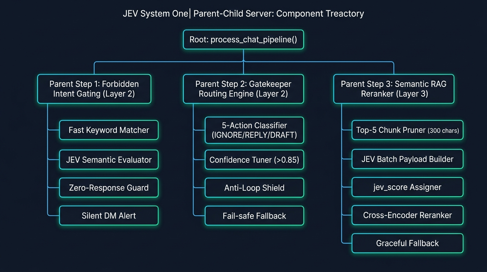
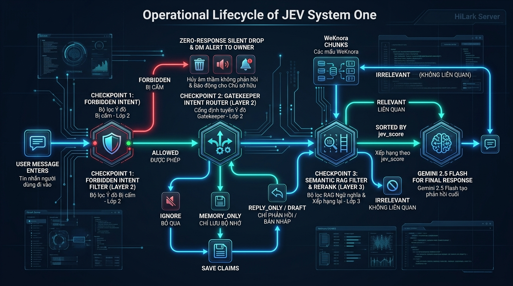
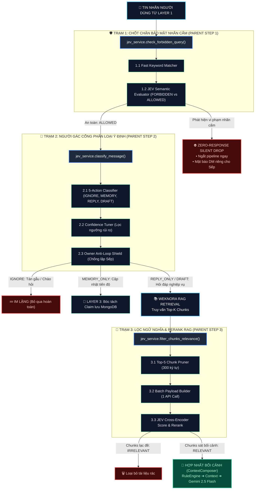

# 📘 TỔNG QUAN KIẾN TRÚC JEV SYSTEM ONE (HI-LARK SERVER)
> **HiLark Server** — Mô hình tư duy phản xạ nhanh (System 1) gác cổng an ninh, phân luồng ý định và tái sắp xếp ngữ nghĩa RAG.  
> **Vị trí thư mục:** [`server/docs/jev/`](file:///Users/hoainam/Desktop/HiLark/server/docs/jev)

---

## 🧭 1. JEV SYSTEM ONE LÀ GÌ TRONG HỆ THỐNG HILARk?

Trong kiến trúc HiLark Server, **JEV (System One)** đóng vai trò là **"Bộ não phản xạ nhanh" (Fast Probabilistic Classifier)**:
* **Tư duy nhị phân & Xác suất:** JEV không phải là một LLM sinh văn bản dài dòng (như Gemini hay GPT), mà là mô hình chuyên sâu đưa ra các phán quyết xác suất định lượng (`probabilities` từ `0.0` đến `1.0`) cho các câu hỏi phân loại có cấu trúc.
* **Mô hình Tư duy Kép (Dual-Brain Architecture):**
  * **JEV (System 1 - Phản xạ nhanh):** Gác cổng đầu nguồn, phát hiện câu hỏi cấm, phân loại 5 hành động của tin nhắn và lọc tài liệu lạc đề với độ trễ thấp và chi phí token cực rẻ.
  * **Gemini 2.5 Flash (System 2 - Tư duy sâu):** Chỉ được gọi ở bước cuối cùng tại Layer 4 để tổng hợp bối cảnh, đóng vai Sếp và sinh câu trả lời tự nhiên.
* **Hiệu quả kinh tế & bảo mật:** Nhờ 3 điểm chặn của JEV, hệ thống cắt giảm **60% – 70%** chi phí gọi Gemini và ngăn chặn **100%** nguy cơ rò rỉ dữ liệu mật vào phòng chat công cộng.

---

## 🌲 2. SƠ ĐỒ PHÂN CẤP QUAN HỆ PARENT - CHILD LOGIC

Dưới đây là sơ đồ cấu trúc phả hệ: **Root Pipeline (`process_chat_pipeline`) ➔ 3 Parent Steps (3 Trạm kiểm soát) ➔ Các Child Engines / Utilities thực thi**:

### Bảng phân rã chi tiết Parent - Child Logic:

| Cấp độ | Tên thành phần | File & Dòng mã nguồn | Vai trò kỹ thuật |
| :--- | :--- | :--- | :--- |
| **ROOT PIPELINE** | **`process_chat_pipeline()`** | [`services/chat_service.py:L268-688`](file:///Users/hoainam/Desktop/HiLark/server/services/chat_service.py#L268-L688) | Điều phối toàn bộ dòng chảy từ lúc nhận tin nhắn đến lúc phát ngôn hoặc lưu nháp. |
| **PARENT STEP 1** | **Chốt chặn Bảo mật & Nhãn cấm** *(Forbidden Intent Gating)* | [`services/chat_service.py:L323-370`](file:///Users/hoainam/Desktop/HiLark/server/services/chat_service.py#L323-L370) [`services/jev.py:L198-388`](file:///Users/hoainam/Desktop/HiLark/server/services/jev.py#L198-L388) | Ngăn chặn câu hỏi tra cứu thông tin bảo mật/nhãn cấm từ Lark Base (Lương, Ngân sách, Chi phí...). |
| ↳ Child 1.1 | `Fast Keyword Matcher` | [`services/jev.py:L253-260`](file:///Users/hoainam/Desktop/HiLark/server/services/jev.py#L253-L260) | Quét chuỗi trực tiếp từ khóa cấm để chặn tức thì (< 0.1ms) không cần tốn mạng. |
| ↳ Child 1.2 | `JEV Semantic Choice Evaluator` | [`services/jev.py:L280-368`](file:///Users/hoainam/Desktop/HiLark/server/services/jev.py#L280-L368) | Gửi payload sang JEV System One phân tích ngữ nghĩa sâu (NLU): nhận diện câu hỏi ẩn ý, hỏi vòng vo né từ khóa, hoặc tiếng lóng (*"ting ting", "mấy chục củ", "đút túi", "hoa hồng"*...) thành 2 nhãn `FORBIDDEN` vs `ALLOWED`. |
| ↳ Child 1.3 | `Zero-Response Guard` | [`services/chat_service.py:L359-367`](file:///Users/hoainam/Desktop/HiLark/server/services/chat_service.py#L359-L367) | Cắt đứt luồng ngay lập tức, trả về `status="forbidden_query"`, Bot im lặng hoàn toàn. |
| ↳ Child 1.4 | `Silent DM Alert Dispatcher` | [`services/chat_service.py:L342-358`](file:///Users/hoainam/Desktop/HiLark/server/services/chat_service.py#L342-L358) | Bắn tin cảnh báo ngầm tới Lark DM của Sếp báo cáo hành vi tra cứu trái phép. |
| **PARENT STEP 2** | **Người gác cổng Phân loại Ý định** *(Gatekeeper Router)* | [`services/chat_service.py:L371-404`](file:///Users/hoainam/Desktop/HiLark/server/services/chat_service.py#L371-L404) [`services/jev.py:L18-103`](file:///Users/hoainam/Desktop/HiLark/server/services/jev.py#L18-L103) | Phân tích tin nhắn thành 1 trong 5 hành động điều phối chiến lược. |
| ↳ Child 2.1 | `5-Choice Action Classifier` | [`services/jev.py:L22-66`](file:///Users/hoainam/Desktop/HiLark/server/services/jev.py#L22-L66) | Phân loại `IGNORE`, `MEMORY_ONLY`, `REPLY_ONLY`, `MEMORY_AND_DRAFT`, `DRAFT_PENDING_APPROVAL`. |
| ↳ Child 2.2 | `Confidence Tuner Engine` | [`services/jev.py:L67-98`](file:///Users/hoainam/Desktop/HiLark/server/services/jev.py#L67-L98) | Lọc độ tự tin: ép về DRAFT nếu `prob_draft >= 0.85`, hạ cấp về MEMORY nếu tự tin thấp. |
| ↳ Child 2.3 | `Owner Anti-Loop Shield` | [`services/chat_service.py:L382-394`](file:///Users/hoainam/Desktop/HiLark/server/services/chat_service.py#L382-L394) | Nếu Sếp chat trong nhóm: ép `REPLY` ➔ `IGNORE` để triệt tiêu 100% vòng lặp bot tự trả lời Sếp. |
| ↳ Child 2.4 | `Fail-safe Safety Fallback` | [`services/chat_service.py:L376-381`](file:///Users/hoainam/Desktop/HiLark/server/services/chat_service.py#L376-L381) | Nếu JEV API timeout: tự động chuyển sang `DRAFT_PENDING_APPROVAL` để Sếp duyệt tay an toàn. |
| **PARENT STEP 3** | **Lọc ngữ nghĩa & Tái sắp xếp RAG** *(Semantic Reranker)* | [`services/chat_service.py:L486-497`](file:///Users/hoainam/Desktop/HiLark/server/services/chat_service.py#L486-L497) [`services/jev.py:L104-197`](file:///Users/hoainam/Desktop/HiLark/server/services/jev.py#L104-L197) | Đánh giá độ phù hợp của từng đoạn trích từ WeKnora và sắp xếp đoạn chuẩn nhất lên đầu. |
| ↳ Child 3.1 | `Candidate Chunk Pruner` | [`services/jev.py:L125-140`](file:///Users/hoainam/Desktop/HiLark/server/services/jev.py#L125-L140) | Lấy tối đa 5 chunks, cắt ngắn mỗi đoạn $\le 300$ ký tự để tiết kiệm băng thông. |
| ↳ Child 3.2 | `Batch Payload Builder` | [`services/jev.py:L140-165`](file:///Users/hoainam/Desktop/HiLark/server/services/jev.py#L140-L165) | Gộp 5 câu hỏi đánh giá vào 1 lượt gọi HTTP request duy nhất tới JEV System One. |
| ↳ Child 3.3 | `jev_score Assigner` | [`services/jev.py:L176-187`](file:///Users/hoainam/Desktop/HiLark/server/services/jev.py#L176-L187) | Trích xuất xác suất `RELEVANT`, loại bỏ hoàn toàn các đoạn bị đánh dấu `IRRELEVANT`. |
| ↳ Child 3.4 | `Cross-Encoder Reranker` | [`services/jev.py:L189-192`](file:///Users/hoainam/Desktop/HiLark/server/services/jev.py#L189-L192) | Tái sắp xếp mảng chunks theo điểm số `jev_score` giảm dần đưa đoạn chuẩn nhất lên đầu. |
| ↳ Child 3.5 | `Graceful Empty Fallback` | [`services/jev.py:L193-196`](file:///Users/hoainam/Desktop/HiLark/server/services/jev.py#L193-L196) | Nếu JEV lọc quá tay làm rỗng danh sách: tự động giữ lại chunks gốc để không crash RAG. |

---

## ⚡ 3. SƠ ĐỒ LUỒNG HOẠT ĐỘNG THỰC TẾ (OPERATIONAL LIFECYCLE)

Dưới đây là vòng đời thực tế của một tin nhắn khi di chuyển qua 3 trạm kiểm soát của JEV:

### Quy trình dòng chảy chi tiết (Mermaid Flowchart):

---

## 🗂️ DANH MỤC TÀI LIỆU CHI TIẾT

1. **[`jev_architecture_spec.md`](file:///Users/hoainam/Desktop/HiLark/server/docs/jev/jev_architecture_spec.md)**:
   * Bản đặc tả kỹ thuật chi tiết (Spec).
   * Phân tích sâu từng trường Payload API (`https://api.typesafe.ai/v1/systemone`), cấu trúc JSON questions, ma trận phân bổ xác suất và cơ chế tự phục hồi mạng.
   * Đối chiếu mã nguồn thực tế [`server/services/jev.py`](file:///Users/hoainam/Desktop/HiLark/server/services/jev.py) và [`server/services/chat_service.py`](file:///Users/hoainam/Desktop/HiLark/server/services/chat_service.py).
