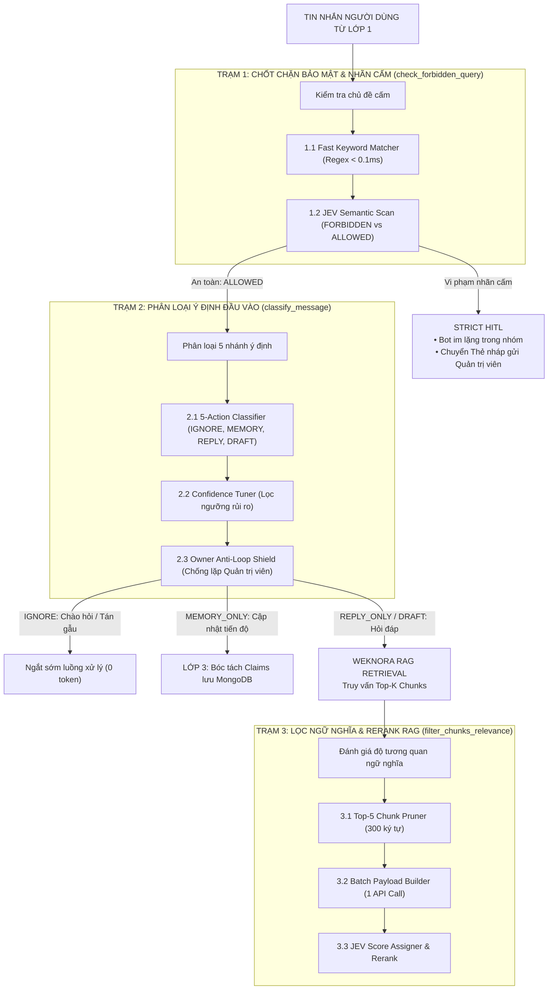

# Kiến trúc Bộ phân loại Ý định JEV (System 1 Gatekeeper)

Tài liệu này ghi lại kiến trúc, các trạm kiểm soát kỹ thuật và cơ chế chấm điểm xác suất của mô hình phân loại JEV System 1 trong HiLark Server.

Mã nguồn liên quan:
- Dịch vụ JEV: [`server/services/ai/jev_classifier.py`](file:///Users/hoainam/Desktop/HiLark/server/services/ai/jev_classifier.py)
- Điều phối luồng chat: [`server/services/workflows/chat_workflow.py`](file:///Users/hoainam/Desktop/HiLark/server/services/workflows/chat_workflow.py)
- Ngoại lệ JEV: [`server/core/http_client.py`](file:///Users/hoainam/Desktop/HiLark/server/core/http_client.py)

---

## 1. Vai trò của JEV System 1 trong hệ thống

Trong kiến trúc HiLark Server, JEV System 1 đóng vai trò là bộ não phản xạ nhanh (Fast Intent & Guardrail Classifier):
- **Phân loại xác suất định lượng:** JEV đưa ra phán quyết xác suất cho các câu hỏi phân loại có cấu trúc (probabilities từ 0.0 đến 1.0) với độ trễ thấp và chi phí tối thiểu.
- **Mô hình hai tầng (Dual-System Architecture):**
  - **JEV (System 1 - Phản xạ nhanh):** Gác cổng đầu vào, phát hiện câu hỏi vi phạm vùng cấm, phân loại 5 nhánh ý định và xếp hạng đoạn trích tài liệu.
  - **Multi-Provider LLM (System 2 - Tư duy sâu):** Chỉ được kích hoạt khi câu hỏi hợp lệ và an toàn để sinh phản hồi tự nhiên.
- **Hiệu quả:** Cắt giảm 60% – 70% số lượt gọi LLM không cần thiết đối với các tin nhắn chào hỏi, cập nhật tiến độ hoặc vi phạm chính sách.

---

## 2. 3 Trạm kiểm soát của JEV

---

## 3. Chi tiết các trạm kiểm soát

### Trạm 1: Chốt chặn bảo mật và nhãn cấm (`check_forbidden_query`)
- **Mục tiêu:** Phát hiện câu hỏi chạm vào thông tin bảo mật nội bộ (Ngân sách, Bảng lương, Chi phí, Hợp đồng đối tác).
- **Cơ chế 2 vòng:**
  1. *Fast Keyword Matcher:* Quét nhanh danh sách từ khóa cấm đã cấu hình trong `forbidden_labels` (< 0.1ms).
  2. *JEV Semantic Evaluator:* Phân tích ngữ nghĩa để phát hiện các câu hỏi gián tiếp hoặc tiếng lóng nhằm khai thác thông tin mật.
- **Hành vi:** Ngắt luồng xử lý tức thì, bot không phản hồi vào nhóm và chuyển sang Thẻ nháp gửi riêng Quản trị viên.

---

### Trạm 2: Người gác cổng phân loại ý định (`classify_message`)
- **5 Nhánh phân loại:**
  1. `IGNORE`: Lời chào hỏi xã giao, cảm ơn, tán gẫu $\rightarrow$ Bỏ qua hoàn toàn.
  2. `MEMORY_ONLY`: Thông báo tiến độ, cập nhật nhân sự, thay đổi deadline $\rightarrow$ Chuyển sang `llm_extractor` lưu Claims vào MongoDB.
  3. `REPLY_ONLY`: Câu hỏi nghiệp vụ được chứng thực bởi tài liệu $\rightarrow$ Chuyển tiếp tới WeKnora RAG và LLM.
  4. `MEMORY_AND_DRAFT`: Vừa có thông tin cập nhật vừa có câu hỏi nhạy cảm $\rightarrow$ Ghi nhận Claims và soạn Thẻ nháp gửi Quản trị viên.
  5. `DRAFT_PENDING_APPROVAL`: Câu hỏi có độ rủi ro hoặc thiếu tài liệu đối soát $\rightarrow$ Soạn Thẻ nháp gửi Quản trị viên duyệt.
- **Confidence Tuner:** Nếu độ tự tin của JEV thấp hơn ngưỡng quy định, hệ thống tự động ép chuyển sang Thẻ nháp để bảo đảm an toàn.
- **Chống lặp Quản trị viên:** Ép tin nhắn của Quản trị viên về `MEMORY_ONLY` hoặc `IGNORE` để tránh bot xen ngang lời nói của Quản trị viên.

---

### Trạm 3: Lọc ngữ nghĩa và tái sắp xếp RAG (`filter_chunks_relevance`)
- **Mục tiêu:** Chấm điểm độ tương quan của các đoạn trích từ WeKnora với câu hỏi của người dùng.
- **Tối ưu hóa băng thông:** Cắt ngắn mỗi đoạn trích $\le 300$ ký tự và gộp tối đa 5 đoạn trích vào một lượt gọi HTTP duy nhất.
- **Reranking:** Trích xuất xác suất `RELEVANT`, loại bỏ các đoạn lạc đề (`IRRELEVANT`), sắp xếp mảng đoạn trích theo điểm tương quan giảm dần.

---

## 4. Tham số và cấu hình liên quan

| Biến cấu hình | Vị trí | Mô tả kỹ thuật |
| :--- | :--- | :--- |
| `JEV_API_KEY` | Biến môi trường `.env` | Khóa API truy cập dịch vụ JEV System 1. |
| `CONFIDENCE_THRESHOLD` | Hằng số mã nguồn (`0.85`) | Ngưỡng tin cậy tối thiểu để kích hoạt phản hồi tự động. |
| `MAX_RERANK_CHUNKS` | Hằng số mã nguồn (`5`) | Số lượng đoạn trích tối đa gửi sang JEV để đánh giá độ tương quan. |
