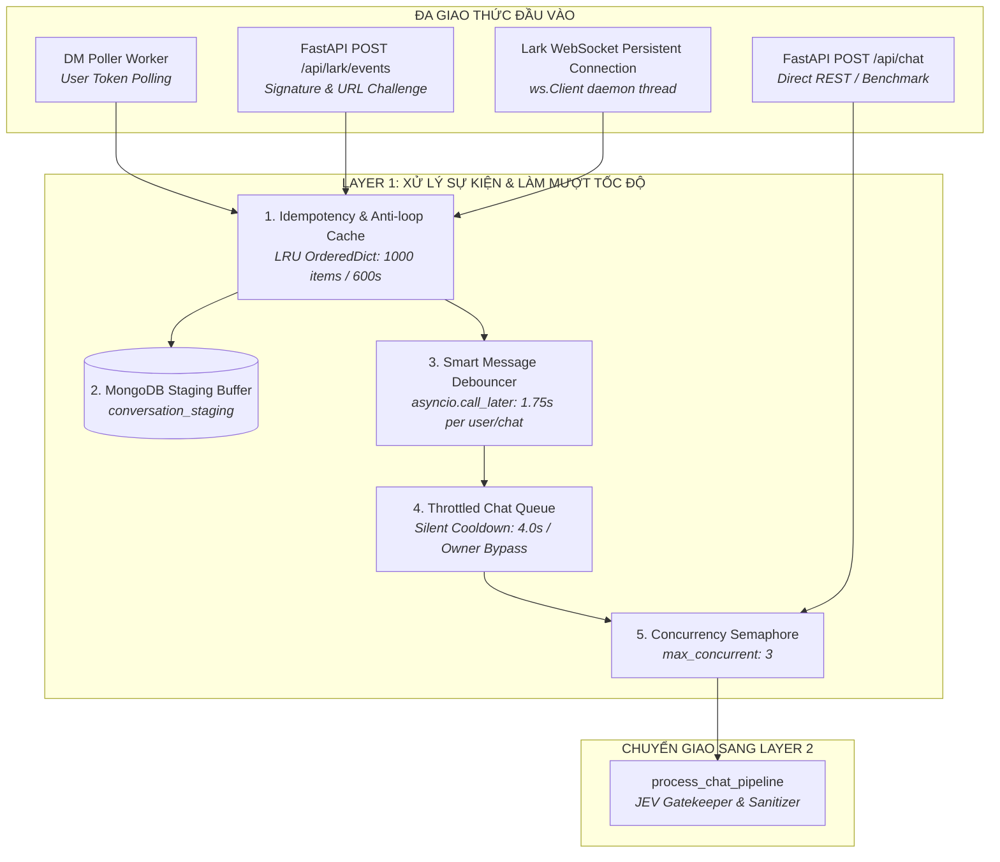

# 🏛️ TÀI LIỆU KỸ THUẬT CHUYÊN SÂU: LAYER 1 - INBOUND GATEWAY LAYER
> **Hệ thống HiLark Server - Kiến trúc Tiếp nhận & Điều phối Thời gian thực**  
> Phiên bản: 1.0.0 | Module: Inbound Gateway & Event Infrastructure

---

## 📌 1. TỔNG QUAN VỊ TRÍ & VAI TRÒ CỦA LAYER 1


Trong kiến trúc tổng thể 5 lớp của **HiLark Server**, **Layer 1 (Inbound Gateway Layer)** đóng vai trò là "cửa ngõ tiền tuyến" (Front Door), chịu trách nhiệm:



### Mục tiêu thiết kế cốt lõi:
1. **Đa giao thức đồng nhất (Protocol Agnostic):** Tiếp nhận sự kiện từ WebSocket, Webhook, REST API và DM Poller, chuẩn hóa về cấu trúc duy nhất `LarkMessage`.
2. **Tuyệt đối chống trùng lặp (Strict Idempotency):** Khử trùng lặp do Lark gửi lại (retry timeout 3s) và triệt tiêu vòng lặp phản hồi (anti-echo loop).
3. **Bảo tồn toàn vẹn dữ liệu cho Daily Digest:** Ghi nhận tức thì tin nhắn vào MongoDB `conversation_staging` trước khi xử lý logic hội thoại.
4. **Mô phỏng hành vi tự nhiên (Human-like Typing Debounce):** Gom các tin nhắn gõ ngắt dòng liên tiếp (1.75s) của người dùng thành một câu hỏi hoàn chỉnh.
5. **Điều tiết tải im lặng (Silent Throttling):** Giãn cách 4.0s giữa các câu hỏi của cùng một user mà không gửi tin nhắn rác cảnh báo vào nhóm; đặc quyền ưu tiên (bypass) cho Chủ nhân.
6. **Bảo vệ hạn ngạch tài nguyên (Concurrency Shield):** Giới hạn tối đa 3 tác vụ LLM chạy song song, loại bỏ triệt để lỗi HTTP 429 và cạn kiệt tài nguyên hệ thống.

---

## 🧱 2. CHI TIẾT CÁC MODULE VÀ SERVICES THÀNH PHẦN

### Module 1.1: Adapter Tiếp Nhận Sự Kiện Đa Kênh

| Cổng giao tiếp | File mã nguồn | Công nghệ | Mục đích sử dụng |
| :--- | :--- | :--- | :--- |
| **WebSocket Client** | [`server/services/lark.py`](file:///Users/hoainam/Desktop/HiLark/server/services/lark.py#L974) | Lark SDK `ws.Client` | Nhận sự kiện thời gian thực 0-delay, không cần Public IP/Domain (rất tối ưu cho Local Dev). |
| **FastAPI Webhook** | [`server/routers/lark.py`](file:///Users/hoainam/Desktop/HiLark/server/routers/lark.py#L17) | FastAPI `POST /api/lark/events` | Nhận webhook từ Lark Open Platform trên server production có domain công khai. |
| **REST Chat API** | [`server/routers/chat.py`](file:///Users/hoainam/Desktop/HiLark/server/routers/chat.py#L30) | FastAPI `POST /api/chat` | Endpoint cho tích hợp bên thứ ba, test kịch bản tự động và đo lường benchmark RAG. |
| **DM Polling Fallback** | [`server/services/lark.py`](file:///Users/hoainam/Desktop/HiLark/server/services/lark.py#L1191) | `client.im.v1.message.list` | Quét tin nhắn riêng 1-1 bằng User Access Token (`ENABLE_DM_POLLING=True`). |

#### Ghi chú mã nguồn đặc biệt:
- **Tách biệt Event Loop trong WebSocket Background Thread:**  
  Trong [`server/services/lark.py:L989-992`](file:///Users/hoainam/Desktop/HiLark/server/services/lark.py#L989-L992), background thread khởi tạo một asyncio event loop hoàn toàn độc lập (`new_loop = asyncio.new_event_loop()`), gán tường minh vào `lark_oapi.ws.client.loop` để ngăn ngừa triệt để lỗi `RuntimeError: This event loop is already running` do xung đột với Uvicorn.
- **Tự động xử lý URL Challenge & Fallback an toàn:**  
  Webhook router tự động nhận diện và phản hồi mã `challenge` trong vòng <3s. Khi gặp lỗi xác thực chữ ký phức tạp, hàm fallback `_do_without_validation` được kích hoạt để đảm bảo luôn trả về HTTP 200, ngăn chặn việc Lark khóa webhook hoặc gửi lại hàng loạt.

---

### Module 1.2: Bộ Đệm Chống Trùng Lặp & Vòng Lặp Phản Hồi (Deduplication & Anti-loop)

- **Vị trí mã nguồn:** [`server/services/lark.py:L375-390`](file:///Users/hoainam/Desktop/HiLark/server/services/lark.py#L375-L390)
- **Cấu trúc dữ liệu:** `OrderedDict[str, float]` với cơ chế Sliding Window LRU.
- **Thông số kỹ thuật:**
  - `TTL = 600.0s` (10 phút).
  - `Max Capacity = 1000` items.

```python
def _is_duplicate_message(self, message_id: str) -> bool:
    if not message_id:
        return False
    now = time.time()
    # 1. Thu hồi các entry quá 600s từ đỉnh OrderedDict
    while self._processed_msg_ids and (now - next(iter(self._processed_msg_ids.values())) > 600):
        self._processed_msg_ids.popitem(last=False)
    # 2. Kiểm tra trùng
    if message_id in self._processed_msg_ids:
        return True
    # 3. Ghi nhận mới & khống chế kích thước tối đa 1000
    self._processed_msg_ids[message_id] = now
    if len(self._processed_msg_ids) > 1000:
        self._processed_msg_ids.popitem(last=False)
    return False
```

#### 3 chốt chặn lọc tin nhắn rác & vòng lặp trong `_internal_on_message_event`:
1. **Lọc tin nhắn từ Bot (`msg.is_bot`):** Bỏ qua mọi tin nhắn do Bot/App phát ra để tránh Bot tự nói chuyện với nhau.
2. **Lọc tin nhắn do chính Server phát ngôn (`_sent_message_ids`):** Khi HiLark gửi câu trả lời nhân danh User (`as_user=True`), Lark sẽ bắn ngược lại sự kiện tin nhắn mới. Bộ lọc kiểm tra nếu `message_id` nằm trong `_sent_message_ids` thì hủy bỏ ngay lập tức.
3. **Lọc tin trùng lặp (`_is_duplicate_message`):** Hủy các gói tin gửi lại do sự cố mạng giữa Lark Cloud và Server.

---

### Module 1.3: Vùng Đệm Staging Tin Nhắn MongoDB (Data Staging Buffer)

- **Vị trí mã nguồn:** [`server/services/digest_service.py:L137-174`](file:///Users/hoainam/Desktop/HiLark/server/services/digest_service.py#L137-L174) & [`server/services/bot_service.py:L295-309`](file:///Users/hoainam/Desktop/HiLark/server/services/bot_service.py#L295-L309)
- **Collection MongoDB:** `conversation_staging`
- **Data Model:** `StagingMessage`

```python
class StagingMessage(BaseModel):
    id: str = Field(default_factory=lambda: f"stg_{uuid.uuid4().hex[:12]}")
    message_id: str
    chat_id: str
    chat_name: str
    speaker_name: str
    speaker_id: str
    text: str
    timestamp: str  # ISO-8601 UTC+7
    message_link: Optional[str] = None
    project_tag: Optional[str] = None
    processed: bool = False
```

#### Logic thực thi:
- Mọi tin nhắn trong nhóm (`chat_type == "group"`) có nội dung văn bản đều được lưu vào Staging ngay lập tức bằng lệnh `update_one({"message_id": message_id}, {"$set": staging_item.to_dict()}, upsert=True)`.
- **Mục đích chiến lược:** Đảm bảo 100% hội thoại được lưu vết độc lập với việc tin nhắn đó có được AI trả lời hay không. Dữ liệu này là đầu vào của daemon tổng hợp `DailyDigestScheduler` chạy vào **23:00 hàng ngày** để trích xuất Quyết định & Cam kết nạp vào WeKnora Wiki.

---

### Module 1.4: Smart Message Debouncer (Gom tin nhắn gõ ngắt dòng)

- **Vị trí mã nguồn:** [`server/utils/chat_queue.py:L27-120`](file:///Users/hoainam/Desktop/HiLark/server/utils/chat_queue.py#L27-L120)
- **Cấu hình:** `settings.DEBOUNCE_DELAY_SECONDS = 1.75s`
- **Khóa định danh gom tin:** `key = (msg.chat_id, msg.sender_id)`

#### Vấn đề giải quyết:
Người dùng có thói quen gõ ngắt dòng liên tiếp:
> *Dòng 1:* "Alo anh Nam" *(Enter)*  
> *Dòng 2:* "Dự án HiLark khi nào test xong" *(Enter)*  
> *Dòng 3:* "để em báo khách ạ?" *(Enter)*

Nếu không có Debouncer, hệ thống sẽ kích hoạt 3 pipeline song song, tiêu tốn 3 lần quota LLM và trả lời cụt lủn.

#### Nguyên lý vận hành:
1. Mỗi khi có tin nhắn từ user trong nhóm, gọi `debouncer.push(msg, ...)`.
2. Hủy bỏ timer cũ nếu còn đang đếm (`old_timer.cancel()`).
3. Thêm `LarkMessage` vào bộ nhớ đệm `_buffers[key]`.
4. Thiết lập timer mới: `loop.call_later(1.75, _flush)`.
5. Khi hết 1.75s không có thêm tin nhắn mới: hàm `_flush` lấy ra toàn bộ danh sách, ghép các dòng bằng dấu `\n`, chọn `anchor_message_id` là tin nhắn cuối cùng để reply trích dẫn, và đóng gói thành `ChatQueueItem`.

---

### Module 1.5: Throttled Chat Queue (Hàng đợi điều phối & Silent Cooldown)

- **Vị trí mã nguồn:** [`server/utils/chat_queue.py:L121-207`](file:///Users/hoainam/Desktop/HiLark/server/utils/chat_queue.py#L121-L207)
- **Cấu hình:** `settings.USER_COOLDOWN_SECONDS = 4.0s`
- **Cơ chế:** Worker loop tiêu thụ bất đồng bộ (`asyncio.Queue[ChatQueueItem]`).

#### Cơ chế Silent Throttling (Điều tiết im lặng):
- Lưu vết mốc thời gian xử lý gần nhất của từng user: `_last_user_processed: Dict[str, float]`.
- Khi lấy một item ra khỏi hàng đợi:
  ```python
  elapsed = now - last_time
  if elapsed < self.cooldown_seconds and not item.is_owner:
      delay = self.cooldown_seconds - elapsed
      print(f"⏳ [QUEUE COOLDOWN] Giãn cách {delay:.1f}s cho user '{item.user_name}'...")
      await asyncio.sleep(delay)
  ```
- **Điểm ưu việt:** Không bắn tin nhắn cảnh báo rác (*"Bạn chat quá nhanh, vui lòng chờ..."*) gây phiền toái cho nhóm chat doanh nghiệp. Hệ thống chỉ âm thầm trì hoãn xử lý trong hàng đợi.

#### Cơ chế VIP Bypass cho Chủ nhân (Owner Privilege):
- Nếu `item.is_owner == True` (Chủ nhân/Sếp ra lệnh): Điều kiện `and not item.is_owner` trả về `False`.
- Tin nhắn của Chủ nhân được xử lý **ngay lập tức**, độ trễ cooldown bằng `0.0s`.

---

### Module 1.6: Giới Hạn Tải Song Song (Concurrency Control Semaphore)

- **Vị trí mã nguồn:**  
  - Trong Queue: [`server/utils/chat_queue.py:L136, L196-206`](file:///Users/hoainam/Desktop/HiLark/server/utils/chat_queue.py#L136)
  - Trong Chat Service: [`server/services/chat_service.py:L44`](file:///Users/hoainam/Desktop/HiLark/server/services/chat_service.py#L44)
- **Cấu hình:** `settings.MAX_CONCURRENT_CHAT_PIPELINES = 3`
- **Công nghệ:** `asyncio.Semaphore(3)`

```python
async def _process_with_semaphore(self, item: ChatQueueItem) -> None:
    async with self.semaphore:
        if self.pipeline_executor:
            await self.pipeline_executor(item)
```

#### Giá trị kỹ thuật:
Dù trong giờ cao điểm có hàng chục thành viên hỏi bài cùng lúc trên nhiều nhóm khác nhau:
- Tối đa chỉ có **3 pipeline LLM/RAG** chạy song song.
- Các yêu cầu còn lại kiên nhẫn xếp hàng trong `asyncio.Queue`.
- Ngăn ngừa triệt để lỗi chạm trần Rate Limit (HTTP 429) của Gemini API và WeKnora Vector Database.

---

### Module 1.7: Bot Service Orchestrator & Fast Lifespan

- **Vị trí mã nguồn:** [`server/services/bot_service.py`](file:///Users/hoainam/Desktop/HiLark/server/services/bot_service.py)
- **Tích hợp:** [`server/main.py:L14-21`](file:///Users/hoainam/Desktop/HiLark/server/main.py#L14-L21) (`lifespan`)

#### Chu trình khởi động (`start_bot_service`):
1. **Đăng ký Event Handler:** Gán `handle_lark_incoming_message` làm bộ phân phối chính.
2. **Kích hoạt Queue Worker:** Khởi động worker ngầm của `chat_queue_service`.
3. **Kích hoạt Daily Digest Daemon:** Tạo thread daemon canh giờ hẹn **23:00** (`DIGEST_SCHEDULE_TIME`).
4. **Kiểm tra Token an toàn:** Gọi `check_and_warn_token()` xác thực hạn dùng User Access Token.
5. **Khởi động WebSocket Client:** Khởi tạo thread lắng nghe kết nối với Lark Open Platform.
6. **Đồng bộ Lark Base (Bitable):** Đăng ký theo dõi sự kiện bảng Base và đồng bộ cấu hình nhóm chat.

#### Chu trình dừng an toàn (`stop_bot_service`):
- Gửi tín hiệu dừng `_scheduler_stop_event`.
- Dừng hàng đợi `chat_queue_service.stop()`.
- Dừng worker quét Lark Base.
- Bảo toàn dữ liệu đang ghi dở dang.

---

## 🔬 3. KIỂM THỬ TỰ ĐỘNG & BẢNG THÔNG SỐ CẤU HÌNH

Hệ thống Layer 1 đã được bao phủ bởi bộ unit test toàn diện tại [`server/tests/01/test_chat_queue.py`](file:///Users/hoainam/Desktop/HiLark/server/tests/01/test_chat_queue.py):

| Test Case | Mục đích kiểm tra | Kết quả kiểm chứng |
| :--- | :--- | :---: |
| `test_debouncer_aggregates_rapid_messages` | Gom 3 tin nhắn gõ liên tiếp thành 1 text hoàn chỉnh | `PASS` |
| `test_debouncer_separates_different_users_and_chats` | Cô lập tuyệt đối giữa các user và các phòng chat | `PASS` |
| `test_throttled_queue_enforces_cooldown_for_members` | Giãn cách cooldown $\ge 0.25s$ giữa các câu hỏi thành viên | `PASS` |
| `test_throttled_queue_bypasses_cooldown_for_owner` | Miễn trừ cooldown cho Chủ nhân, phản hồi ngay lập tức | `PASS` |
| `test_concurrency_semaphore_limits_parallel_executions` | Đẩy 4 câu hỏi cùng lúc, đỉnh song song đo được chính xác bằng 2 | `PASS` |
| `test_chat_queue_service_push_and_lifecycle` | Kiểm tra chu trình khởi động, push tin và shutdown an toàn | `PASS` |

### Bảng tra cứu tham số môi trường (.env / config.py):

| Tên biến cấu hình | Giá trị mặc định | Giải thích chức năng trong Layer 1 |
| :--- | :---: | :--- |
| `DEBOUNCE_DELAY_SECONDS` | `1.75` (giây) | Cửa sổ thời gian gom tin nhắn gõ ngắt dòng của 1 user. |
| `USER_COOLDOWN_SECONDS` | `4.0` (giây) | Thời gian giãn cách tối thiểu giữa 2 câu hỏi của 1 thành viên. |
| `MAX_CONCURRENT_CHAT_PIPELINES` | `3` (tác vụ) | Số lượng pipeline RAG/LLM tối đa được chạy đồng thời. |
| `ENABLE_DM_POLLING` | `false` | Bật/tắt chế độ Hybrid Runner quét DM 1-1 bằng User Token. |
| `DM_POLL_INTERVAL` | `60.0` (giây) | Chu kỳ polling kiểm tra tin nhắn DM 1-1 mới. |
| `DIGEST_SCHEDULE_TIME` | `23:00` | Giờ cố định trong ngày kích hoạt Daemon tổng hợp Staging. |
| `MONGO_STAGING_COLLECTION` | `conversation_staging` | Tên collection MongoDB lưu trữ tin nhắn chờ tổng hợp. |
