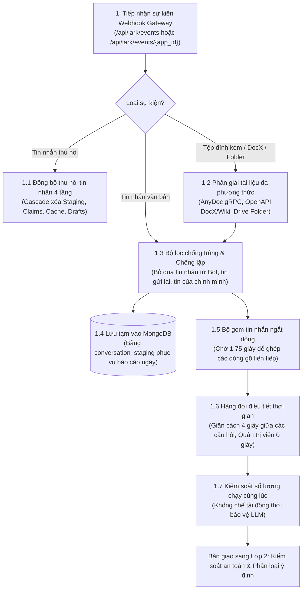

# Lớp 1: Cổng tiếp nhận & Điều tiết tin nhắn (Inbound Gateway)

Tài liệu này thuyết minh nguyên lý hoạt động, cấu trúc thành phần và các bước xử lý kỹ thuật của Lớp 1 trong hệ thống HiLark Server.

Mã nguồn liên quan:
- Cổng Webhook: [`server/routers/lark.py`](file:///Users/hoainam/Desktop/HiLark/server/routers/lark.py)
- Bộ điều phối sự kiện: [`server/services/lark/dispatcher.py`](file:///Users/hoainam/Desktop/HiLark/server/services/lark/dispatcher.py)
- Xử lý tài liệu: [`server/services/lark/handlers/document_handler.py`](file:///Users/hoainam/Desktop/HiLark/server/services/lark/handlers/document_handler.py)
- Hàng đợi hội thoại: [`server/services/workflows/chat_workflow.py`](file:///Users/hoainam/Desktop/HiLark/server/services/workflows/chat_workflow.py)

---

## 1. Mục tiêu và phạm vi trách nhiệm

Lớp 1 đóng vai trò là cửa ngõ tiếp nhận toàn bộ các tương tác từ người dùng và hệ thống Lark Open Platform:
- Tiếp nhận an toàn các sự kiện tin nhắn qua Webhook Gateway (`/api/lark/events`), thiết lập ngữ cảnh khách thuê (`tenant_key`) ngay tại cổng vào.
- Phân giải đa phương thức cho các tệp đính kèm (`.docx`, `.pdf`, `.xlsx`, `.pptx`), trích xuất Markdown từ liên kết Lark DocX/Wiki và quét thư mục Lark Drive.
- Đồng bộ cascade khi phát hiện sự kiện thu hồi tin nhắn (`im.message.recalled_v1`), loại bỏ kịp thời dữ liệu khỏi staging, claims và bản nháp chờ duyệt.
- Khử trùng lặp sự kiện và bỏ qua tin nhắn từ bot hoặc chính hệ thống phát ra.
- Lưu tin nhắn vào vùng đệm `conversation_staging` trong MongoDB phục vụ tổng hợp báo cáo ngày.
- Điều tiết nhịp độ tin nhắn: gom ngắt dòng (debounce 1.75s), giãn cách người dùng (cooldown 4.0s) và khống chế tải đồng thời (concurrency semaphore).

---

## 2. Sơ đồ luồng xử lý Lớp 1

---

## 3. Chi tiết các bước xử lý kỹ thuật

### Bước 1: Tiếp nhận sự kiện qua Webhook Gateway & Phân định Tenant
- **Vị trí mã nguồn:** [`server/routers/lark.py`](file:///Users/hoainam/Desktop/HiLark/server/routers/lark.py)
- **Cách thức hoạt động:**
  1. Trong môi trường Multi-Tenant sản xuất, hệ thống tiếp nhận sự kiện độc quyền qua Webhook Gateway tại endpoint `/api/lark/events` (hoặc `/api/lark/events/{app_id}`).
  2. Hệ thống phân giải `tenant_key` từ thông tin sự kiện hoặc `app_id` được đăng ký trong collection `lark_app_credentials`, sau đó khởi tạo Scoped Execution Context cho toàn bộ luồng xử lý tiếp theo.

---

### Bước 2: Phân giải tệp đính kèm, liên kết DocX/Wiki & Thư mục Lark Drive
- **Vị trí mã nguồn:** [`server/services/lark/handlers/document_handler.py`](file:///Users/hoainam/Desktop/HiLark/server/services/lark/handlers/document_handler.py)
- **Cách thức hoạt động:**
  - Nhận diện URL: Khi tin nhắn chứa liên kết Lark DocX (`/docx/...`) hoặc Wiki (`/wiki/...`), hệ thống gọi OpenAPI của Lark để chuyển đổi trực tiếp sang Markdown cấu trúc thuần, tiêu tốn 0 token LLM.
  - Tải nhị phân & AnyDoc gRPC: Tải tệp đính kèm (`.docx`, `.pdf`, `.xlsx`, `.pptx`) và gửi sang `WeKnora-docreader:50051` qua kênh gRPC buffer 50MB.
  - Quét đệ quy thư mục Lark Drive: Duyệt cây thư mục và nạp toàn bộ tài liệu con vào kho tri thức của nhóm chat.
  - Áp dụng MD5 Hash Guard để so sánh mã băm trước khi upload vào WeKnora, ngăn ngừa việc nạp lại dữ liệu không đổi gây lãng phí chi phí embedding.

---

### Bước 3: Đồng bộ thu hồi tin nhắn nhiều tầng (Recall Cascade Sync)
- **Vị trí mã nguồn:** [`server/services/lark/dispatcher.py`](file:///Users/hoainam/Desktop/HiLark/server/services/lark/dispatcher.py)
- **Cách thức hoạt động:** Khi người dùng thu hồi tin nhắn trên Lark (`im.message.recalled_v1`), hệ thống dọn dẹp dữ liệu cascade qua 4 tầng:
  1. Xóa bản ghi tin nhắn khỏi bảng đệm `conversation_staging`.
  2. Vô hiệu hóa hoặc xóa các mệnh đề (claims) vừa bóc tách từ tin nhắn đó trong MongoDB.
  3. Xóa ngữ cảnh liên quan trong bộ nhớ cache.
  4. Hủy bỏ bản nháp câu trả lời đang chờ duyệt nếu bản nháp đó bắt nguồn từ tin nhắn vừa bị thu hồi.

---

### Bước 4: Lọc tin nhắn rác, tin trùng lặp và chống vòng lặp
- **Vị trí mã nguồn:** [`server/services/lark/dispatcher.py`](file:///Users/hoainam/Desktop/HiLark/server/services/lark/dispatcher.py)
- **Cách thức hoạt động:**
  1. Kiểm tra bot: Bỏ qua tin nhắn do các bot khác phát ra (`if lark_msg.is_bot: return`).
  2. Chống tự phản hồi: Vì bot có thể phản hồi nhân danh tài khoản người dùng (`as_user=True`), tin nhắn có ID nằm trong danh sách vừa phát (`_sent_message_ids`) sẽ bị bỏ qua ngay lập tức.
  3. Bộ nhớ khử trùng: Lưu trữ 1.000 message ID gần nhất trong 10 phút. Nếu message ID đã xuất hiện trong cache, sự kiện bị loại bỏ.

---

### Bước 5: Lưu vùng đệm tin nhắn (MongoDB Staging)
- **Vị trí mã nguồn:** [`server/services/workflows/digest_workflow.py`](file:///Users/hoainam/Desktop/HiLark/server/services/workflows/digest_workflow.py)
- **Bảng lưu trữ:** Collection `conversation_staging` trong MongoDB.
- **Cách thức hoạt động:** Tin nhắn trao đổi công việc trong nhóm chat được lưu lại kèm nhãn `tenant_key` và `chat_id`. Dữ liệu này được tiến trình nền đọc lại vào cuối ngày để tổng hợp thành bản Master Daily Digest.

---

### Bước 6: Gom tin nhắn ngắt dòng (Debouncer)
- **Vị trí mã nguồn:** [`server/services/lark/dispatcher.py`](file:///Users/hoainam/Desktop/HiLark/server/services/lark/dispatcher.py)
- **Thời gian chờ:** Mặc định `1.75` giây (`DEBOUNCE_DELAY_SECONDS = 1.75`).
- **Cách thức hoạt động:**
  - Gom tin nhắn theo từng người dùng trong từng nhóm chat `(tenant_key, chat_id, sender_id)`.
  - Khi người dùng gửi một dòng, bộ đếm 1.75 giây bắt đầu đếm ngược.
  - Nếu người dùng gửi tiếp dòng tiếp theo trước khi hết giờ, bộ đếm được đặt lại.
  - Khi quá 1.75 giây không có thêm dòng mới, hệ thống ghép nối các dòng thành một câu hoàn chỉnh duy nhất và chuyển tiếp.

---

### Bước 7: Hàng đợi điều tiết thời gian (Cooldown Queue)
- **Vị trí mã nguồn:** [`server/services/lark/dispatcher.py`](file:///Users/hoainam/Desktop/HiLark/server/services/lark/dispatcher.py)
- **Thời gian giãn cách:** Mặc định `4.0` giây (`USER_COOLDOWN_SECONDS = 4.0`).
- **Cách thức hoạt động:**
  - Giữ khoảng cách 4 giây giữa 2 câu hỏi liên tiếp của cùng một thành viên để tránh việc gửi liên tục gây dồn tải.
  - Không gửi tin nhắn thông báo phiền phức vào nhóm chat; câu hỏi được giữ lại trong hàng đợi và xử lý êm ái khi hết thời gian chờ.
  - Quản trị viên (Admin) được ưu tiên với thời gian chờ bằng 0 giây.

---

### Bước 8: Giới hạn xử lý đồng thời (Concurrency Semaphore)
- **Vị trí mã nguồn:** [`server/services/workflows/chat_workflow.py`](file:///Users/hoainam/Desktop/HiLark/server/services/workflows/chat_workflow.py)
- **Hạn mức:** Mặc định tối đa 3-5 tác vụ (`MAX_CONCURRENT_CHAT_PIPELINES = 3`).
- **Cách thức hoạt động:** Khống chế số lượng pipeline hội thoại chạy đồng thời bằng asyncio Semaphore. Các yêu cầu vượt quá hạn mức sẽ xếp hàng chờ, bảo vệ tài nguyên RAM của server và tránh vượt ngưỡng rate limit của các nhà cung cấp LLM.

---

## 4. Tham số cấu hình liên quan

| Tên biến cấu hình | Mặc định | Chức năng |
| :--- | :---: | :--- |
| `DEBOUNCE_DELAY_SECONDS` | `1.75` | Thời gian chờ gom các dòng gõ ngắt quãng của cùng một người dùng. |
| `USER_COOLDOWN_SECONDS` | `4.0` | Khoảng thời gian giãn cách tối thiểu giữa 2 câu hỏi của cùng một người. |
| `MAX_CONCURRENT_CHAT_PIPELINES` | `3` | Số pipeline hội thoại được phép chạy đồng thời trên toàn server. |
| `CHAT_QUEUE_MAX_SIZE` | `100` | Sức chứa tối đa của hàng đợi tin nhắn chờ xử lý. |
| `CHAT_QUEUE_ENQUEUE_TIMEOUT` | `2.0` | Thời gian tối đa chờ đưa tin nhắn vào hàng đợi khi hàng đợi đầy. |
| `DOCREADER_GRPC_HOST` | `127.0.0.1` | Địa chỉ máy chủ gRPC trích xuất văn bản WeKnora AnyDoc. |
| `DOCREADER_GRPC_PORT` | `50051` | Cổng dịch vụ gRPC AnyDoc DocReader. |
