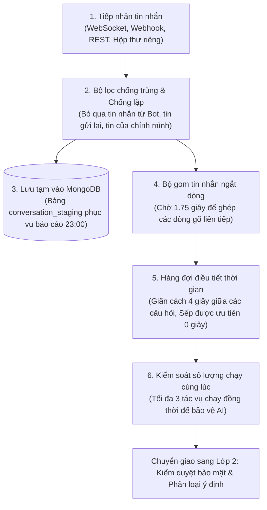

# 📘 TÀI LIỆU GIẢI THÍCH LỚP 1: CỬA NGÕ TIẾP NHẬN & ĐIỀU TIẾT TIN NHẮN (LAYER 1)
> **Dự án HiLark Server**  
> Tài liệu viết theo phong cách kỹ thuật thực tế, dễ hiểu, ưu tiên tiếng Việt và không dùng từ ngữ bóng bẩy.

---

## 🧭 1. LỚP 1 ĐỂ LÀM GÌ?

Hãy hình dung Lớp 1 giống như **"Bàn lễ tân và phòng chờ"** của toàn bộ hệ thống:
- Khi một người nhắn tin trên Lark, tin nhắn sẽ bay tới máy chủ HiLark đầu tiên ở Lớp 1.
- Nhiệm vụ của Lớp 1 là: **Nhận tin nhắn an toàn $\rightarrow$ Gom các câu gõ dở $\rightarrow$ Lưu tạm để tối làm báo cáo $\rightarrow$ Xếp hàng trật tự rồi mới gửi tiếp sang cho Lớp 2 (Bộ phận kiểm duyệt và phân loại)**.

Nếu không có Lớp 1, người dùng gõ ngắt dòng liên tục hoặc nhiều người cùng hỏi dồn dập sẽ khiến hệ thống bị quá tải, trí tuệ nhân tạo (Gemini AI) bị khóa tài khoản do gọi quá số lần cho phép trong một giây.

---

## 🖼️ SƠ ĐỒ PHÂN RÃ THÀNH PHẦN LỚP 1

### Quy trình 6 bước tuần tự:

---

## 🔍 2. CHI TIẾT 6 BƯỚC XỬ LÝ TRONG MÃ NGUỒN

### Bước 1: Tiếp nhận tin nhắn qua nhiều cổng (Protocol Adapters)
Hệ thống hỗ trợ 4 cách để nhận tin nhắn từ Lark về máy chủ:

1. **Kết nối WebSocket trực tiếp** ([`server/services/lark.py:L974`](file:///Users/hoainam/Desktop/HiLark/server/services/lark.py#L974)):
   - **Cách chạy:** Mở một đường truyền trực tiếp liên tục với máy chủ của Lark bằng luồng chạy ngầm riêng (`LarkWebSocketThread`).
   - **Ưu điểm:** Nhận tin nhắn ngay tức thì (dưới 0.1 giây), không tốn hạn ngạch API và khi lập trình thử nghiệm trên máy cá nhân không cần phải cài ngrok hay mua tên miền công khai.
   - **Điểm lưu ý trong mã nguồn:** Hệ thống tự tạo một vòng lặp sự kiện (`event loop`) riêng biệt cho luồng này để không bị xung đột với máy chủ web FastAPI.

2. **Cổng Webhook** ([`server/routers/lark.py:L17`](file:///Users/hoainam/Desktop/HiLark/server/routers/lark.py#L17)):
   - Dùng khi đưa lên máy chủ chính thức (Production).
   - Tự động nhận diện và trả lời mã xác thực đường dẫn (`challenge`) của Lark trong vòng dưới 3 giây. Nếu quá 3 giây, Lark sẽ coi như máy chủ bị lỗi và ngắt kết nối.

3. **Cổng REST API** ([`server/routers/chat.py:L30`](file:///Users/hoainam/Desktop/HiLark/server/routers/chat.py#L30)):
   - Đường dẫn `POST /api/chat`, dùng để lập trình viên tự kiểm thử hoặc cho các phần mềm khác gọi vào kiểm tra.

4. **Bộ quét hộp thư riêng (DM Polling)** ([`server/services/lark.py:L1191`](file:///Users/hoainam/Desktop/HiLark/server/services/lark.py#L1191)):
   - Chế độ dự phòng quét tin nhắn trong hộp thư 1-1 theo chu kỳ (mặc định 60 giây).

*Tất cả 4 cổng này khi nhận được dữ liệu đều chuyển đổi về một định dạng thống nhất duy nhất là `LarkMessage` (chứa mã tin, mã nhóm, tên người gửi, nội dung chữ).*

---

### Bước 2: Chống tin nhắn rác, tin trùng và chống vòng lặp tự nói
- **Vị trí trong mã nguồn:** [`server/services/lark.py:L375-415`](file:///Users/hoainam/Desktop/HiLark/server/services/lark.py#L375-L415)

Trước khi đem tin nhắn đi xử lý, hệ thống kiểm tra 3 điều kiện:
1. **Có phải tin nhắn do Bot phát ra không?**  
   Nếu là bot hoặc ứng dụng tự gửi thì bỏ qua ngay (`if lark_msg.is_bot: return`). Tránh việc 2 con bot nói chuyện qua lại với nhau không dứt.
2. **Có phải tin nhắn do chính hệ thống vừa gửi không?**  
   Vì bot phản hồi nhân danh tài khoản cá nhân, nên khi bot vừa gửi tin nhắn xong, máy chủ Lark sẽ phát ngược lại sự kiện tin nhắn mới. Bộ lọc kiểm tra nếu mã tin nhắn nằm trong danh sách vừa gửi đi (`_sent_message_ids`) thì hủy ngay, tránh việc bot tự trả lời câu nói của chính mình.
3. **Có phải tin nhắn bị gửi lặp không?**  
   Nếu mạng chập chờn, Lark sẽ tự động gửi lại tin nhắn đó lần thứ 2. Hệ thống lưu một bảng ghi nhớ 1.000 mã tin nhắn gần nhất trong vòng 10 phút (600 giây). Nếu thấy mã tin nhắn này đã xuất hiện rồi thì bỏ qua.

---

### Bước 3: Lưu tạm tin nhắn vào cơ sở dữ liệu (MongoDB Staging)
- **Vị trí trong mã nguồn:** [`server/services/digest_service.py:L137`](file:///Users/hoainam/Desktop/HiLark/server/services/digest_service.py#L137) và [`server/services/bot_service.py:L295`](file:///Users/hoainam/Desktop/HiLark/server/services/bot_service.py#L295)
- **Bảng lưu trữ:** `conversation_staging` trong MongoDB.

**Cách hoạt động:**
- Cứ có tin nhắn trao đổi trong nhóm chat công việc, hệ thống sẽ lưu ngay một bản sao vào bảng dữ liệu tạm thời này.
- **Mục đích:** Để phục vụ tiến trình tự động chạy vào lúc **23:00 mỗi đêm**. Lúc đó, AI sẽ đọc lại toàn bộ các tin nhắn đã diễn ra trong ngày để tổng hợp: Hôm nay ai hứa làm gì? Đã chốt quyết định nào? Có vướng mắc gì không?

---

### Bước 4: Gom các tin nhắn gõ ngắt dòng (Smart Message Debouncer)
- **Vị trí trong mã nguồn:** [`server/utils/chat_queue.py:L27-120`](file:///Users/hoainam/Desktop/HiLark/server/utils/chat_queue.py#L27-L120)
- **Tài liệu bóc tách kỹ thuật:** 👉 Xem [`ultis_docs/chat_queue.md`](file:///Users/hoainam/Desktop/HiLark/server/docs/layer1/ultis_docs/chat_queue.md) và tổng quan quan hệ Parent-Child tại [`ultis_docs/README.md`](file:///Users/hoainam/Desktop/HiLark/server/docs/layer1/ultis_docs/README.md).
- **Thời gian chờ:** Mặc định **1.75 giây** (`DEBOUNCE_DELAY_SECONDS = 1.75`).

**Vấn đề thực tế:**  
Mọi người khi chat thường có thói quen gõ từng câu ngắn rồi bấm Enter liên tiếp:
> *Dòng 1:* "Alo anh Nam" *(Enter)*  
> *Dòng 2:* "Dự án HiLark" *(Enter)*  
> *Dòng 3:* "Bao giờ xong để em báo khách ạ?" *(Enter)*

Nếu không gom lại, máy chủ sẽ kích hoạt AI trả lời 3 lần riêng biệt: câu 1 bot chào lại, câu 2 bot không hiểu, câu 3 bot trả lời thiếu chữ.

**Cách giải quyết của HiLark:**
- Hệ thống gom tin nhắn theo từng người trong từng nhóm chat riêng biệt `(mã nhóm, mã người gửi)`.
- Khi người đó gửi dòng 1, hệ thống bật đồng hồ đếm ngược 1.75 giây.
- Nếu trước khi hết 1.75 giây người đó gõ tiếp dòng 2, đồng hồ sẽ được đếm lại từ đầu.
- Khi người đó dừng gõ quá 1.75 giây, hệ thống ghép 3 dòng lại thành một câu duy nhất:  
  *"Alo anh Nam \n Dự án HiLark \n Bao giờ xong để em báo khách ạ?"*  
  và chuyển sang hàng đợi.

---

### Bước 5: Hàng đợi điều tiết thời gian (Throttled Chat Queue)
- **Vị trí trong mã nguồn:** [`server/utils/chat_queue.py:L121-210`](file:///Users/hoainam/Desktop/HiLark/server/utils/chat_queue.py#L121-L210)
- **Thời gian giãn cách:** Mặc định **4.0 giây** (`USER_COOLDOWN_SECONDS = 4.0`).
- **Giới hạn sức chứa hàng đợi:** Mặc định **100 tin nhắn** (`CHAT_QUEUE_MAX_SIZE = 100`).
- **Cơ chế khi hàng đợi đầy (Giai đoạn 1):** Hệ thống kiên nhẫn chờ tối đa **2.0 giây** (`CHAT_QUEUE_ENQUEUE_TIMEOUT = 2.0`). Nếu quá 2 giây mà hàng đợi vẫn đầy tải thì ghi log lỗi chi tiết, từ chối tin nhắn mới và **tạm thời giữ nguyên toàn bộ tin cũ** chứ chưa tự động xóa.

**Cách hoạt động:**
- Sau khi tin nhắn được gom xong, nó được xếp vào hàng đợi xử lý tuần tự.
- **Giãn cách im lặng:** Nếu cùng một người vừa hỏi xong lại hỏi tiếp câu khác trong vòng dưới 4 giây, hệ thống sẽ âm thầm giữ câu hỏi đó lại, chờ đủ 4 giây mới cho chạy tiếp.
- **Không làm phiền phòng chat:** Hệ thống **tuyệt đối không gửi tin nhắn cảnh báo rác** (như *"Bạn chat quá nhanh, vui lòng chờ 4s"*), mà xử lý hoàn toàn tự nhiên và êm ái.
- **Đặc quyền của Sếp (Chủ nhân):** Nếu người gửi là Sếp/Chủ nhân máy chủ, thời gian chờ sẽ bằng **0 giây** (được ưu tiên trả lời ngay tức khắc mà không phải xếp hàng chờ giãn cách).

---

### Bước 6: Giới hạn số lượng tác vụ chạy cùng lúc (Concurrency Semaphore)
- **Vị trí trong mã nguồn:** [`server/utils/chat_queue.py:L138`](file:///Users/hoainam/Desktop/HiLark/server/utils/chat_queue.py#L138) và [`server/services/chat_service.py:L44`](file:///Users/hoainam/Desktop/HiLark/server/services/chat_service.py#L44)
- **Số lượng tối đa:** **3 tác vụ** chạy cùng lúc (`MAX_CONCURRENT_CHAT_PIPELINES = 3`).

**Mục đích bảo vệ:**
- Trong giờ cao điểm, nếu có 10 hay 20 người cùng đặt câu hỏi trên nhiều nhóm chat khác nhau:
  - Máy chủ chỉ cho phép tối đa 3 câu hỏi được xử lý cùng một lúc.
  - Các câu hỏi còn lại kiên nhẫn xếp hàng chờ ở hàng đợi.
- Việc này giúp máy chủ không bị cạn kiệt bộ nhớ và quan trọng nhất là **không bị Google Gemini khóa tài khoản vì lỗi gọi quá nhiều lệnh cùng một giây (lỗi HTTP 429)**.

*Sau khi bước 6 hoàn tất, câu hỏi hoàn chỉnh sẽ được bàn giao sang **Lớp 2: Kiểm duyệt bảo mật & Phân loại ý định**.*

---

## ⚙️ 3. BẢNG CẤU HÌNH THAM SỐ (FILE .env / config.py)

Tất cả các con số điều khiển Lớp 1 đều có thể chỉnh sửa dễ dàng trong file `.env`:

| Tên biến cấu hình | Giá trị mặc định | Giải thích dễ hiểu |
| :--- | :---: | :--- |
| `DEBOUNCE_DELAY_SECONDS` | `1.75` | Số giây chờ để gom các dòng gõ ngắt quãng của một người. |
| `USER_COOLDOWN_SECONDS` | `4.0` | Số giây giãn cách tối thiểu giữa 2 lần hỏi của cùng một thành viên. |
| `MAX_CONCURRENT_CHAT_PIPELINES` | `3` | Số câu hỏi tối đa được xử lý cùng một lúc trên toàn bộ máy chủ. |
| `CHAT_QUEUE_MAX_SIZE` | `100` | Sức chứa tối đa của hàng đợi tin nhắn chờ (chống tràn bộ nhớ RAM). |
| `CHAT_QUEUE_ENQUEUE_TIMEOUT` | `2.0` | Số giây tối đa chờ chỗ trống khi hàng đợi đầy trước khi báo lỗi. |
| `DIGEST_SCHEDULE_TIME` | `23:00` | Giờ cố định mỗi đêm để gom tin nhắn làm báo cáo ngày. |
| `ENABLE_DM_POLLING` | `false` | Có bật chế độ tự động quét hộp thư riêng định kỳ hay không. |
| `DM_POLL_INTERVAL` | `60.0` | Chu kỳ quét hộp thư riêng (tính bằng giây). |

---

## ❓ 4. GIẢI ĐÁP CÁC CÂU HỎI KỸ THUẬT THƯỜNG GẶP

### Câu hỏi 1: Tại sao ở Lớp 1 chưa gọi JEV để lọc tin nhắn?
> **Trả lời:**  
> Lớp 1 là lớp **hạ tầng mạng và làm mượt dữ liệu**. Nếu gọi JEV ngay từ Lớp 1, khi người dùng gõ ngắt quãng ("Alo anh" rồi Enter), JEV sẽ nhận từng câu rời rạc và đoán sai ý nghĩa, đồng thời làm tốn tài nguyên gọi JEV gấp nhiều lần.  
> Do đó, Lớp 1 phải làm nhiệm vụ gom đủ câu, lọc sạch tin trùng và xếp hàng xong xuôi thì mới chuyển sang Lớp 2 cho JEV phân tích.

### Câu hỏi 2: Lưu tất cả tin nhắn nhóm vào MongoDB để làm báo cáo cuối ngày thì có bị rác dữ liệu không?
> **Trả lời:**  
> - **Tri thức không bị rác:** Khi đọc dữ liệu lúc 23:00, AI được chỉ thị rất nghiêm ngặt: chỉ nhặt ra Quyết định, Cam kết tiến độ và Người chịu trách nhiệm. Mọi câu chào hỏi, đùa cợt đều bị AI bỏ qua. Sau đó, bản báo cáo còn phải gửi cho Sếp duyệt thì mới được lưu vào kho tri thức.  
> - **Dữ liệu trong máy chủ:** Để database không bị nặng sau nhiều tháng hoạt động, hệ thống khuyến nghị cài đặt tự động xóa tin nhắn tạm sau 7 ngày (vì báo cáo ngày đã tổng hợp xong thì không cần giữ tin nhắn thô nữa).
