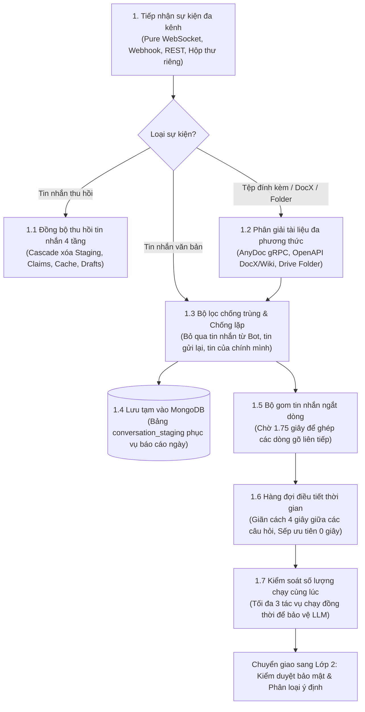

# 📘 TÀI LIỆU GIẢI THÍCH LỚP 1: CỬA NGÕ TIẾP NHẬN & ĐIỀU TIẾT TIN NHẮN (LAYER 1)
> **Dự án HiLark Server**  
> Tài liệu viết theo phong cách kỹ thuật thực tế, dễ hiểu, ưu tiên tiếng Việt và không dùng từ ngữ bóng bẩy.  
> **Vị trí mã nguồn:** [`server/services/lark/`](file:///Users/hoainam/Desktop/HiLark/server/services/lark), [`server/utils/chat_queue.py`](file:///Users/hoainam/Desktop/HiLark/server/utils/chat_queue.py)

---

## 🧭 1. LỚP 1 ĐỂ LÀM GÌ?

Hãy hình dung Lớp 1 giống như **"Bàn lễ tân và phòng chờ"** của toàn bộ hệ thống:
- Khi một người nhắn tin trên Lark, gửi tệp đính kèm hoặc thu hồi tin nhắn, sự kiện sẽ bay tới máy chủ HiLark đầu tiên ở Lớp 1.
- Nhiệm vụ của Lớp 1 là: **Nhận tin nhắn an toàn $\rightarrow$ Phân giải tệp đính kèm/link DocX/Wiki $\rightarrow$ Đồng bộ thu hồi tin nhắn $\rightarrow$ Gom các câu gõ dở $\rightarrow$ Lưu tạm để tối làm báo cáo $\rightarrow$ Xếp hàng trật tự rồi mới gửi tiếp sang cho Lớp 2 (Bộ phận kiểm duyệt và phân loại)**.

Nếu không có Lớp 1, người dùng gõ ngắt dòng liên tục hoặc nhiều người cùng hỏi dồn dập sẽ khiến hệ thống bị quá tải, trí tuệ nhân tạo (LLM API) bị khóa tài khoản do gọi quá số lần cho phép trong một giây (HTTP 429).

---

## 🖼️ SƠ ĐỒ PHÂN RÃ THÀNH PHẦN LỚP 1

---

## 🔍 2. CHI TIẾT CÁC BƯỚC XỬ LÝ TRONG MÃ NGUỒN

### Bước 1: Tiếp nhận sự kiện qua kênh bảo mật Pure WebSocket
- **Vị trí trong mã nguồn:** [`server/services/lark/runner.py`](file:///Users/hoainam/Desktop/HiLark/server/services/lark/runner.py) và [`server/services/lark/bot_runner.py`](file:///Users/hoainam/Desktop/HiLark/server/services/lark/bot_runner.py)
- **Cách thức hoạt động:**
  1. **Kết nối WebSocket trực tiếp:** Mở một đường truyền trực tiếp liên tục với máy chủ Lark bằng luồng chạy ngầm riêng (`LarkWebSocketThread`).
  2. **Zero Ingress Port:** Không cần mở cổng public Internet, không cần cài ngrok hay mua tên miền công khai. Nhận tin nhắn ngay tức thì (dưới 0.1 giây), tiết kiệm 100% hạn ngạch API.
  3. **Event Loop độc lập:** Tự tạo một `asyncio.new_event_loop()` riêng biệt cho luồng WebSocket để không gây nghẽn máy chủ web FastAPI.
  4. **Cổng dự phòng:** Vẫn hỗ trợ Webhook (`/api/lark/webhook`), REST API (`/api/chat`) và quét hộp thư riêng (DM Polling).

---

### Bước 2: Phân giải tệp đính kèm, liên kết DocX/Wiki & Thư mục Lark Drive
- **Vị trí trong mã nguồn:** [`server/services/lark/handlers/document_handler.py`](file:///Users/hoainam/Desktop/HiLark/server/services/lark/handlers/document_handler.py)
- **Cách thức hoạt động:**
  - **Tự động nhận diện URL:** Phát hiện các liên kết Lark DocX (`https://.../docx/...`) và Wiki (`https://.../wiki/...`). Hệ thống gọi trực tiếp OpenAPI của Lark lấy nội dung Markdown sạch, tiêu tốn **0 token LLM**.
  - **Tải file đính kèm & AnyDoc gRPC:** Tải nhị phân các file `.docx`, `.pdf`, `.xlsx`, `.pptx`, `.md` gửi sang `WeKnora-docreader:50051` qua gRPC để trích xuất văn bản cấu trúc.
  - **Quét đệ quy Lark Drive Folder:** Tự động duyệt qua cây thư mục, tải toàn bộ tài liệu con và nạp vào kho tri thức của dự án.
  - **Bóc tách Claims tức thì:** Chuyển văn bản tài liệu sang LLM Extractor để tự động sinh các sự thật/quy định lưu vào MongoDB.

---

### Bước 3: Đồng bộ thu hồi tin nhắn 4 tầng (Message Recall Cascade Sync)
- **Vị trí trong mã nguồn:** [`server/services/lark/dispatcher.py`](file:///Users/hoainam/Desktop/HiLark/server/services/lark/dispatcher.py)
- **Nguyên tắc an toàn:** Khi một thành viên hoặc Lãnh đạo thu hồi (recall/unsend) tin nhắn trên Lark, hệ thống lập tức đón bắt sự kiện `im.message.recalled_v1` và kích hoạt chuỗi dọn dẹp cascade qua 4 tầng:
  1. **Tầng 1 (Staging):** Xóa tin nhắn khỏi bảng tạm `conversation_staging` (không để tin bị thu hồi lọt vào báo cáo Daily Digest cuối ngày).
  2. **Tầng 2 (Tri thức động Claims):** Vô hiệu hóa hoặc xóa các Facts/Claims vừa được bóc tách từ tin nhắn đó trong MongoDB.
  3. **Tầng 3 (Cache):** Xóa bỏ ngữ cảnh tin nhắn khỏi bộ nhớ đệm RAM.
  4. **Tầng 4 (Bản nháp Drafts):** Đánh dấu hủy bản nháp câu trả lời đang chờ duyệt nếu bản nháp đó bắt nguồn từ tin nhắn vừa bị thu hồi.

---

### Bước 4: Chống tin nhắn rác, tin trùng và chống vòng lặp tự nói
- **Vị trí trong mã nguồn:** [`server/services/lark/dispatcher.py`](file:///Users/hoainam/Desktop/HiLark/server/services/lark/dispatcher.py)

Trước khi đem tin nhắn đi xử lý, hệ thống kiểm tra 3 điều kiện:
1. **Có phải tin nhắn do Bot phát ra không?**  
   Nếu là bot hoặc ứng dụng tự gửi thì bỏ qua ngay (`if lark_msg.is_bot: return`). Tránh việc 2 con bot nói chuyện qua lại với nhau không dứt.
2. **Có phải tin nhắn do chính hệ thống vừa gửi không?**  
   Vì bot phản hồi nhân danh tài khoản cá nhân của Lãnh đạo, nên khi bot vừa gửi tin nhắn xong, máy chủ Lark sẽ phát ngược lại sự kiện tin nhắn mới. Bộ lọc kiểm tra nếu mã tin nhắn nằm trong danh sách vừa gửi đi (`_sent_message_ids`) thì hủy ngay, tránh việc bot tự trả lời câu nói của chính mình.
3. **Có phải tin nhắn bị gửi lặp không?**  
   Nếu mạng chập chờn, Lark sẽ tự động gửi lại tin nhắn đó lần thứ 2. Hệ thống lưu một bảng ghi nhớ 1.000 mã tin nhắn gần nhất trong vòng 10 phút (600 giây). Nếu thấy mã tin nhắn này đã xuất hiện rồi thì bỏ qua.

---

### Bước 5: Lưu tạm tin nhắn vào cơ sở dữ liệu (MongoDB Staging)
- **Vị trí trong mã nguồn:** [`server/services/digest_service.py`](file:///Users/hoainam/Desktop/HiLark/server/services/digest_service.py) và [`server/services/lark/bot_runner.py`](file:///Users/hoainam/Desktop/HiLark/server/services/lark/bot_runner.py)
- **Bảng lưu trữ:** `conversation_staging` trong MongoDB.

**Cách hoạt động:**
- Cứ có tin nhắn trao đổi trong nhóm chat công việc, hệ thống sẽ lưu ngay một bản sao vào bảng dữ liệu tạm thời này.
- **Mục đích:** Để phục vụ tiến trình tự động tổng hợp **Master Daily Digest** theo giờ hẹn của Lãnh đạo (mặc định 18:00). Lúc đó, AI sẽ đọc lại toàn bộ các tin nhắn đã diễn ra trong ngày để tổng hợp: Hôm nay ai hứa làm gì? Đã chốt quyết định nào? Có vướng mắc gì không?

---

### Bước 6: Gom các tin nhắn gõ ngắt dòng (Smart Message Debouncer)
- **Vị trí trong mã nguồn:** [`server/utils/chat_queue.py`](file:///Users/hoainam/Desktop/HiLark/server/utils/chat_queue.py)
- **Thời gian chờ:** Mặc định **1.75 giây** (`DEBOUNCE_DELAY_SECONDS = 1.75`).

**Vấn đề thực tế:**  
Mọi người khi chat thường có thói quen gõ từng câu ngắn rồi bấm Enter liên tiếp:
> *Dòng 1:* "Alo anh Nam" *(Enter)*  
> *Dòng 2:* "Dự án HiLark" *(Enter)*  
> *Dòng 3:* "Bao giờ xong để em báo khách ạ?" *(Enter)*

Nếu không gom lại, máy chủ sẽ kích hoạt AI trả lời 3 lần riêng biệt: câu 1 bot chào lại, câu 2 bot không hiểu, câu 3 bot trả lời thiếu chữ.

**Cách giải quyết của HiLark:**
- Hệ thống gom tin nhắn theo từng người trong từng nhóm chat riêng biệt `(chat_id, sender_id)`.
- Khi người đó gửi dòng 1, hệ thống bật đồng hồ đếm ngược 1.75 giây.
- Nếu trước khi hết 1.75 giây người đó gõ tiếp dòng 2, đồng hồ sẽ được đếm lại từ đầu.
- Khi người đó dừng gõ quá 1.75 giây, hệ thống ghép 3 dòng lại thành một câu duy nhất:  
  *"Alo anh Nam \n Dự án HiLark \n Bao giờ xong để em báo khách ạ?"*  
  và chuyển sang hàng đợi.

---

### Bước 7: Hàng đợi điều tiết thời gian (Throttled Chat Queue)
- **Vị trí trong mã nguồn:** [`server/utils/chat_queue.py`](file:///Users/hoainam/Desktop/HiLark/server/utils/chat_queue.py)
- **Thời gian giãn cách:** Mặc định **4.0 giây** (`USER_COOLDOWN_SECONDS = 4.0`).
- **Giới hạn sức chứa hàng đợi:** Mặc định **100 tin nhắn** (`CHAT_QUEUE_MAX_SIZE = 100`).
- **Giãn cách im lặng:** Nếu cùng một người vừa hỏi xong lại hỏi tiếp câu khác trong vòng dưới 4 giây, hệ thống sẽ âm thầm giữ câu hỏi đó lại, chờ đủ 4 giây mới cho chạy tiếp.
- **Không làm phiền phòng chat:** Hệ thống **tuyệt đối không gửi tin nhắn cảnh báo rác** (như *"Bạn chat quá nhanh, vui lòng chờ 4s"*), mà xử lý hoàn toàn tự nhiên và êm ái.
- **Đặc quyền của Sếp (Lãnh đạo):** Nếu người gửi là Sếp, thời gian chờ sẽ bằng **0 giây** (được ưu tiên xử lý ngay tức khắc mà không phải xếp hàng chờ giãn cách).

---

### Bước 8: Giới hạn số lượng tác vụ chạy cùng lúc (Concurrency Semaphore)
- **Vị trí trong mã nguồn:** [`server/utils/chat_queue.py`](file:///Users/hoainam/Desktop/HiLark/server/utils/chat_queue.py) và [`server/services/chat_service.py`](file:///Users/hoainam/Desktop/HiLark/server/services/chat_service.py)
- **Số lượng tối đa:** **3 tác vụ** chạy cùng lúc (`MAX_CONCURRENT_CHAT_PIPELINES = 3`).

**Mục đích bảo vệ:**
- Trong giờ cao điểm, nếu có 10 hay 20 người cùng đặt câu hỏi trên nhiều nhóm chat khác nhau:
  - Máy chủ chỉ cho phép tối đa 3 câu hỏi được xử lý cùng một lúc.
  - Các câu hỏi còn lại kiên nhẫn xếp hàng chờ ở hàng đợi.
- Việc này giúp máy chủ không bị cạn kiệt bộ nhớ và quan trọng nhất là **không bị các nhà cung cấp LLM khóa tài khoản do lỗi gọi quá nhiều lệnh cùng một giây (HTTP 429)**.

*Sau khi bước 8 hoàn tất, câu hỏi hoàn chỉnh sẽ được bàn giao sang **Lớp 2: Kiểm duyệt bảo mật & Phân loại ý định**.*

---

## ⚙️ 3. BẢNG CẤU HÌNH THAM SỐ (FILE .env / config.py)

| Tên biến cấu hình | Giá trị mặc định | Giải thích dễ hiểu |
| :--- | :---: | :--- |
| `DEBOUNCE_DELAY_SECONDS` | `1.75` | Số giây chờ để gom các dòng gõ ngắt quãng của một người. |
| `USER_COOLDOWN_SECONDS` | `4.0` | Số giây giãn cách tối thiểu giữa 2 lần hỏi của cùng một thành viên. |
| `MAX_CONCURRENT_CHAT_PIPELINES` | `3` | Số câu hỏi tối đa được xử lý cùng một lúc trên toàn bộ máy chủ. |
| `CHAT_QUEUE_MAX_SIZE` | `100` | Sức chứa tối đa của hàng đợi tin nhắn chờ (chống tràn bộ nhớ RAM). |
| `CHAT_QUEUE_ENQUEUE_TIMEOUT` | `2.0` | Số giây tối đa chờ chỗ trống khi hàng đợi đầy trước khi báo lỗi. |
| `DIGEST_SCHEDULE_TIME` | `18:00` | Giờ cố định mỗi ngày để gom tin nhắn làm báo cáo Master Daily Digest. |
| `ENABLE_DM_POLLING` | `false` | Có bật chế độ tự động quét hộp thư riêng định kỳ hay không. |
| `DM_POLL_INTERVAL` | `60.0` | Chu kỳ quét hộp thư riêng (tính bằng giây). |
| `DOCREADER_GRPC_HOST` | `127.0.0.1` | Địa chỉ máy chủ gRPC trích xuất văn bản đa phương thức AnyDoc. |
| `DOCREADER_GRPC_PORT` | `50051` | Cổng dịch vụ gRPC AnyDoc DocReader. |
