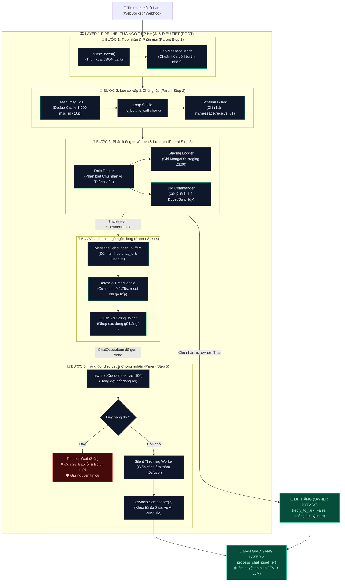

# 🛠️ TỔNG QUAN BỘ CÔNG CỤ (UTILS) CỦA LAYER 1
> **HiLark Server Architecture** — Bóc tách chi tiết các module tiện ích thuộc Lớp 1 (Cửa ngõ tiếp nhận & Điều tiết tin nhắn).

---

## 🧭 1. KIẾN TRÚC PHÂN CẤP: UTILS (CHILD) ➔ STEPS (PARENT) ➔ LAYER 1 (ROOT)

Trong Layer 1, toàn bộ luồng xử lý tin nhắn từ Lark Open Platform được tổ chức theo cấu trúc phân cấp nghiêm ngặt. Mỗi **Bước xử lý (Step)** được vận hành bởi các **Tiện ích con (Child Utils / Components)** chuyên trách:

```
                      ┌─────────────────────────────────────────────────────────────┐
                      │              LAYER 1: INBOUND GATEWAY PIPELINE              │
                      │               (Cửa ngõ tiếp nhận & Điều tiết)               │
                      └──────────────────────────────┬──────────────────────────────┘
                                                     │
         ┌───────────────────┬───────────────────────┼───────────────────────┬───────────────────┐
         ▼                   ▼                       ▼                       ▼                   ▼
┌─────────────────┐ ┌─────────────────┐     ┌─────────────────┐     ┌─────────────────┐ ┌─────────────────┐
│     BƯỚC 1      │ │     BƯỚC 2      │     │     BƯỚC 3      │     │     BƯỚC 4      │ │     BƯỚC 5      │
│  Tiếp nhận &    │ │ Lọc sơ cấp &    │     │  Phân luồng &   │     │  Gom ngắt dòng  │ │  Hàng đợi &     │
│  Phân giải      │ │ Chống lặp       │     │  Lưu tạm        │     │  (Debouncing)   │ │  Điều tiết tải  │
│  (Parent Step)  │ │ (Parent Step)   │     │  (Parent Step)  │     │  (Parent Step)  │ │  (Parent Step)  │
└────────┬────────┘ └────────┬────────┘     └────────┬────────┘     └────────┬────────┘ └────────┬────────┘
         │                   │                       │                       │                   │
         │ (Child Utils)     │ (Child Utils)         │ (Child Utils)         │ (Child Utils)     │ (Child Utils)
         ▼                   ▼                       ▼                       ▼                   ▼
┌─────────────────┐ ┌─────────────────┐     ┌─────────────────┐     ┌─────────────────┐ ┌─────────────────┐
│ • parse_event() │ │ • Dedup Cache   │     │ • Role Router   │     │ • TimerHandle   │ │ • asyncio.Queue │
│ • LarkMessage   │ │   (1.000 msg_id)│     │   (Owner vs Mbr)│     │   (1.75s timer) │   (100 slots)   │
│   Builder       │ │ • Loop Shield   │     │ • Staging Logger│     │ • User-Group    │ │ • Timeout Wait  │
│ • JSON Extractor│ │   (is_bot/self) │     │   (Mongo 23:00) │     │   Buffer Lock   │   (2s & Log ERR)│
│                 │ │ • Schema Guard  │     │ • DM Commander  │     │ • String Joiner │ │ • Cooldown 4s   │
│                 │ │   (p2p/group)   │     │   (1-1 Control) │     │   (\\n merger)   │ │ • Semaphore(3)  │
└─────────────────┘ └─────────────────┘     └─────────────────┘     └─────────────────┘ └─────────────────┘
```

---

## 🧩 2. BẢNG MỐI QUAN HỆ PARENT - CHILD CHI TIẾT

| Bước xử lý (Parent Step) | Vai trò của Bước trong Layer 1 | Tiện ích thực thi con (Child Utils / Functions) | Vị trí mã nguồn |
| :--- | :--- | :--- | :--- |
| **BƯỚC 1: Tiếp nhận & Phân giải sự kiện** *(Event Ingestion & Parsing)* | Tiếp nhận raw JSON từ WebSocket hoặc Webhook, giải mã cấu trúc gói tin Lark. | • `parse_event()`: Rút trích `event_type`, `message_id`, `chat_id`, `content`.<br/>• `LarkMessage` Data Class: Chuẩn hóa kiểu dữ liệu tin nhắn toàn server. | [`services/larkServices/lark_dispatcher.py:L70-130`](file:///Users/hoainam/Desktop/HiLark/server/services/larkServices/lark_dispatcher.py#L70-L130) |
| **BƯỚC 2: Lọc sơ cấp & Chống lặp** *(Primary Filtering & Dedup)* | Chặn đứng tin rác, chống vòng lặp vô tận và chống xử lý trùng khi Lark bắn lại webhook. | • `_seen_msg_ids` (Dedup Cache): Bộ nhớ đệm lưu 1.000 `msg_id` trong 10 phút.<br/>• Loop Shield: Kiểm tra `is_bot == True` hoặc `is_self == True` để ngắt ngay.<br/>• Schema Guard: Bỏ qua các sự kiện không phải tin nhắn văn bản (`im.message.receive_v1`). | [`services/larkServices/lark_dispatcher.py:L135-185`](file:///Users/hoainam/Desktop/HiLark/server/services/larkServices/lark_dispatcher.py#L135-L185) |
| **BƯỚC 3: Phân luồng quyền lực & Lưu tạm** *(Role Routing & Staging)* | Phân biệt Chủ nhân với Thành viên; lưu trữ dữ liệu thời gian thực cho báo cáo tổng kết ngày. | • `Role Router`: Chủ nhân (`is_owner=True`) đi thẳng vào pipeline, Thành viên đẩy vào Queue.<br/>• `Staging Logger`: Gọi `digest_service.add_staging_message()` lưu vào MongoDB `conversation_staging`.<br/>• `DM Commander`: Bắt riêng tin nhắn 1-1 của Sếp để nhận lệnh Duyệt/Sửa/Hủy Daily Digest. | [`services/bot_service.py:L200-364`](file:///Users/hoainam/Desktop/HiLark/server/services/bot_service.py#L200-L364) |
| **BƯỚC 4: Gom tin gõ ngắt dòng** *(Message Debouncing)* | Gom nhiều dòng gõ ngắt quãng của cùng một người trong một nhóm thành một câu hoàn chỉnh. | • `MessageDebouncer`: Khởi tạo bộ đệm theo cặp `(chat_id, sender_id)`.<br/>• `asyncio.TimerHandle`: Cửa sổ chờ 1.75s, reset timer nếu người dùng tiếp tục gõ.<br/>• `_flush()`: Nối các dòng chat bằng dấu xuống dòng `\n`, đóng gói thành `ChatQueueItem`. | [`utils/chat_queue.py:L27-119`](file:///Users/hoainam/Desktop/HiLark/server/utils/chat_queue.py#L27-L119) |
| **BƯỚC 5: Hàng đợi điều tiết & Chống nghẽn hạ tầng** *(Throttled Queue & Traffic Control)* | Điều tiết tốc độ xử lý, giới hạn tải đồng thời, chống sập hệ thống và bảo vệ quota LLM. | • `asyncio.Queue(maxsize=100)`: Hàng đợi bất đồng bộ sức chứa 100 gói tin.<br/>• Cơ chế chống tràn: Chờ 2.0s, quá hạn ghi log lỗi rõ ràng, bỏ qua tin mới, bảo toàn tin cũ.<br/>• Silent Throttling: Giãn cách 4.0s/user, tự động chờ ngầm, không spam nhóm.<br/>• `asyncio.Semaphore(3)`: Khóa tối đa 3 tác vụ AI chạy song song toàn server. | [`utils/chat_queue.py:L121-236`](file:///Users/hoainam/Desktop/HiLark/server/utils/chat_queue.py#L121-L236) |

---

## 🗂️ DANH MỤC TÀI LIỆU BÓC TÁCH KỸ THUẬT

1. **[`chat_queue.md`](file:///Users/hoainam/Desktop/HiLark/server/docs/layer1/ultis_docs/chat_queue.md)**:
   * **Mã nguồn:** [`server/utils/chat_queue.py`](file:///Users/hoainam/Desktop/HiLark/server/utils/chat_queue.py) *(335 dòng, 14.5 KB)*.
   * **Nội dung:** Bóc tách sâu từng class: `MessageDebouncer`, `ThrottledChatQueue`, `ChatQueueService`.
   * **Phân tích chi tiết:** Cơ chế gom ngắt dòng 1.75s, cơ chế xử lý tràn queue (Giai đoạn 1: chờ 2s, log ERROR, giữ tin cũ), cơ chế Silent Throttling 4s, Semaphore 3 luồng và quy trình bàn giao an toàn sang Layer 2 (`process_chat_pipeline`).

---

## 🔄 3. SƠ ĐỒ KẾT NỐI LUỒNG DỮ LIỆU: UTILS ➔ STEPS ➔ LAYER 1


### Quy trình dòng chảy chi tiết (Mermaid Flowchart):


