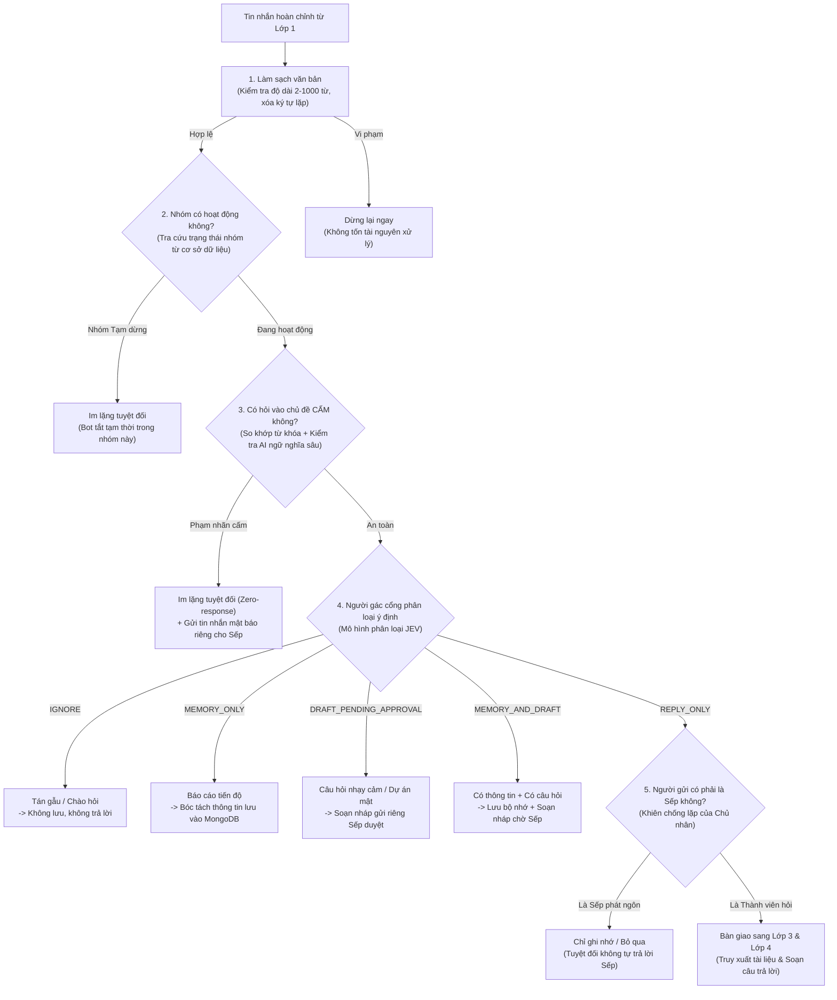

# 📘 TÀI LIỆU GIẢI THÍCH LỚP 2: VỌNG GÁC AN NINH & PHÂN LOẠI Ý ĐỊNH (LAYER 2)
> **Dự án HiLark Server**  
> Tài liệu viết theo phong cách kỹ thuật thực tế, dễ hiểu, ưu tiên tiếng Việt và không dùng từ ngữ bóng bẩy.

---

## 🧭 1. LỚP 2 ĐỂ LÀM GÌ?

Nếu **Lớp 1** giống như **"Bàn lễ tân và phòng chờ"** (tiếp nhận tin nhắn, gom các câu gõ dở và xếp hàng điều tiết), thì **Lớp 2** chính là **"Vọng gác an ninh & Người phân luồng ý định"**:

* Khi một câu hỏi được đưa ra khỏi hàng đợi Lớp 1, nó **chưa bao giờ được phép đi thẳng tới Trí tuệ nhân tạo (Gemini) hay tìm kiếm tài liệu ngay**.
* Trước hết, câu hỏi phải đi qua Lớp 2 để trả lời 3 câu hỏi sống còn:
  1. **Câu này có an toàn không?** (Có hỏi lén về bảng lương, ngân sách, hợp đồng bí mật hay không?)
  2. **Nhóm chat này có đang mở quyền trả lời không?** (Nhóm đang hoạt động hay đã bị tắt?)
  3. **Tin nhắn này thuộc loại gì?** (Là lời chào xã giao, báo cáo tiến độ cần ghi nhớ, hay một câu hỏi nghiệp vụ cần trả lời?)

> [!IMPORTANT]
> **Quy tắc an ninh tối cao của Lớp 2:**  
> **"Thà im lặng hoặc soạn nháp chờ Sếp duyệt, tuyệt đối không bao giờ phát ngôn bừa bãi hoặc làm lộ bí mật kinh doanh vào nhóm chat."**

---

## 🖼️ SƠ ĐỒ PHÂN RÃ THÀNH PHẦN LỚP 2


### Quy trình 6 chốt chặn an ninh tuần tự:


---

## 🔍 2. CHI TIẾT 6 CHỐT CHẶN TRONG MÃ NGUỒN

### Chốt chặn 1: Làm sạch & Kiểm tra kích thước văn bản
- **Vị trí trong mã nguồn:** [`server/utils/text_filter.py:L19-37`](file:///Users/hoainam/Desktop/HiLark/server/utils/text_filter.py#L19-L37) và [`server/services/chat_service.py:L264-276`](file:///Users/hoainam/Desktop/HiLark/server/services/chat_service.py#L264-L276)
- **Tài liệu bóc tách kỹ thuật:** 👉 Xem [`ultis_docs/text_filter.md`](file:///Users/hoainam/Desktop/HiLark/server/docs/layer2/ultis_docs/text_filter.md) và tổng quan quan hệ Parent-Child tại [`ultis_docs/README.md`](file:///Users/hoainam/Desktop/HiLark/server/docs/layer2/ultis_docs/README.md).
- **Quy tắc kiểm tra:**
  1. **Độ dài hợp lệ:** Câu nhắn phải có từ **2 từ trở lên** (`MIN_WORDS = 2`) và tối đa **1.000 từ** (`MAX_WORDS = 1000`). Nếu người dùng chỉ gõ đúng 1 chữ như "alo", "?" hoặc spam văn bản dài dằng dặc cả chục trang giấy, hệ thống lập tức từ chối.
  2. **Dọn rác ký tự lặp:** Chuyển các chuỗi gõ spam như `!!!!!!` thành `!`, `??????` thành `?`.
  3. **Chuẩn hóa khoảng trắng:** Gom nhiều dấu cách hoặc dòng trống thừa thành 1 khoảng trắng duy nhất.
- **Mục đích:** Chặn đứng ngay từ cửa các tin nhắn rác hoặc tấn công quá tải văn bản mà không làm tốn chi phí gọi trí tuệ nhân tạo.

---

### Chốt chặn 2: Kiểm tra trạng thái hoạt động của nhóm chat
- **Vị trí trong mã nguồn:** [`server/services/chat_service.py:L310-321`](file:///Users/hoainam/Desktop/HiLark/server/services/chat_service.py#L310-L321)
- **Cách thức hoạt động:**
  - Mỗi nhóm chat trên Lark được quản lý tập trung trên cơ sở dữ liệu (`chat_scopes`).
  - Khi có tin nhắn đến, hệ thống kiểm tra trường `status`. Nếu nhóm đang ở trạng thái **"Tạm dừng"** (`is_active = False`):
    - Máy chủ ghi log: `🛑 [GROUP INACTIVE] Nhóm đang ở trạng thái Tạm dừng. Bỏ qua hoàn toàn tin nhắn.`
    - Bot **im lặng hoàn toàn**, không tốn bất kỳ tài nguyên nào để tìm kiếm tài liệu hay trả lời.

---

### Chốt chặn 3: Kiểm soát an ninh & Chủ đề cấm (Zero-response)
- **Vị trí trong mã nguồn:** [`server/services/jev.py:L198-388`](file:///Users/hoainam/Desktop/HiLark/server/services/jev.py#L198-L388) và [`server/services/chat_service.py:L324-370`](file:///Users/hoainam/Desktop/HiLark/server/services/chat_service.py#L324-L370)
- **Bảo vệ nội dung gì:** Các chủ đề nhạy cảm do công ty quy định riêng cho từng nhóm (ví dụ: *Ngân sách, Chi phí, Bảng lương nhân viên, Thỏa thuận hợp đồng, Tranh chấp pháp lý*).
- **Cách nhận diện 2 vòng:**
  1. **Vòng 1 (So khớp từ khóa nhanh):** Quét trực tiếp xem câu hỏi có chứa các từ khóa cấm đã khai báo hay không.
  2. **Vòng 2 (Phân tích ngữ nghĩa sâu qua JEV):** Kể cả khi người hỏi dùng từ lóng, hỏi bóng gió hay cố tình né từ khóa (ví dụ: *"cho em xin con số tiền chuyển cho bên A tháng này"*), mô hình JEV vẫn nhận diện được ý đồ cố tình hỏi vào chủ đề cấm.
- **Hành vi xử lý đặc biệt khi vi phạm:**
  * **Im lặng tuyệt đối (Zero-response):** Bot tuyệt đối **không nói bất kỳ câu gì vào nhóm chat**, không nói *"Tôi không được phép trả lời"* (vì câu nói đó sẽ làm lộ rằng công ty có bí mật ở mảng đó).
  * **Mật báo riêng cho Sếp:** Nếu vi phạm diễn ra trong nhóm làm việc, hệ thống sẽ âm thầm gửi tin nhắn cảnh báo riêng vào hộp thư cá nhân của Sếp/Chủ nhân:
    ```text
    ⚠️ [CẢNH BÁO BẢO MẬT: TRUY CẬP TRÁI PHÉP]
    👥 Nhóm chat : Dự án Sàn Thanh Toán
    👤 Thành viên: Nguyễn Văn A
    💬 Câu hỏi   : "Lương tháng này của nhóm mình được bao nhiêu anh?"
    🚫 Nhãn cấm  : Bảng lương
    🛡️ Phản hồi  : Bot đã IM LẶNG HOÀN TOÀN, không phát ngôn vào nhóm.
    ```

---

### Chốt chặn 4: Người gác cổng phân loại ý định (JEV Gatekeeper)
- **Vị trí trong mã nguồn:** [`server/services/jev.py:L18-103`](file:///Users/hoainam/Desktop/HiLark/server/services/jev.py#L18-L103) và [`server/services/chat_service.py:L372-437`](file:///Users/hoainam/Desktop/HiLark/server/services/chat_service.py#L372-L437)
- **Vai trò:** Giống như một trợ lý riêng mẫn cán của Sếp, đọc lướt qua tin nhắn và phân loại chính xác vào 1 trong 5 ngăn xử lý:

| Nhãn hành động | Bản chất tin nhắn | Hành vi xử lý thực tế |
| :--- | :--- | :--- |
| `IGNORE` | Tin nhắn rác, chào hỏi xã giao, cảm ơn, tán gẫu. | **Bỏ qua hoàn toàn.** Không lưu vào cơ sở dữ liệu và không trả lời. |
| `MEMORY_ONLY` | Lời báo cáo tiến độ, thông báo thay đổi nhân sự, cập nhật công việc mới. | **Chỉ ghi nhớ.** Gọi bộ bóc tách thông tin để lưu vào MongoDB; **không trả lời** vào nhóm vì không ai hỏi. |
| `REPLY_ONLY` | Câu hỏi nghiệp vụ, tiến độ, tài liệu đã có trong kho tri thức của nhóm. | **Được phép trả lời.** Chuyển sang Lớp 3 & Lớp 4 để tự động tìm tài liệu và phản hồi vào nhóm. |
| `MEMORY_AND_DRAFT` | Tin nhắn vừa chứa thông tin quan trọng cần nhớ, vừa có câu hỏi kèm theo. | **Lưu tri thức + Soạn nháp.** Vừa ghi nhớ dữ liệu mới vào MongoDB, vừa tạo câu trả lời nháp gửi Sếp duyệt. |
| `DRAFT_PENDING_APPROVAL` | Câu hỏi nhạy cảm hoặc nhóm thuộc chế độ Tuyệt mật. | **Không tự trả lời.** Bắt buộc gửi bản nháp riêng cho Sếp duyệt trước qua nút `[Gửi]`, `[Sửa]`, `[Bỏ]`. |

---

### Chốt chặn 5: Khiên bảo vệ chống lặp của Chủ nhân (Owner Anti-loop)
- **Vị trí trong mã nguồn:** [`server/services/chat_service.py:L382-394`](file:///Users/hoainam/Desktop/HiLark/server/services/chat_service.py#L382-L394)
- **Vấn đề thực tế:** Khi chính Sếp (Chủ nhân máy chủ) nhắn tin vào nhóm chat, nếu bot nhảy vào trả lời Sếp thì sẽ xảy ra 2 hậu quả tai hại:
  1. Trợ lý cãi lại hoặc tranh nói với chính người điều hành.
  2. Dễ tạo ra vòng lặp vô tận (Bot nói nhân danh Sếp $\rightarrow$ Hệ thống tưởng Sếp nói $\rightarrow$ Lại trả lời tiếp).
- **Cách giải quyết thông minh:**
  * Nếu Sếp đưa ra thông tin công việc $\rightarrow$ Bot tự động ép hành động về `MEMORY_ONLY` (âm thầm học và ghi nhớ các quyết định của Sếp vào cơ sở tri thức).
  * Nếu Sếp hỏi han hoặc tán gẫu $\rightarrow$ Bot tự động ép hành động về `IGNORE` (im lặng, nhường sân khấu cho Sếp nói chuyện với đội ngũ).

---

### Chốt chặn 6: Cơ chế an toàn khi mất kết nối mạng (Safety Fallback)
- **Vị trí trong mã nguồn:** [`server/services/chat_service.py:L376-380`](file:///Users/hoainam/Desktop/HiLark/server/services/chat_service.py#L376-L380)
- **Nguyên tắc kỹ thuật:** Trong trường hợp đường truyền tới máy chủ kiểm duyệt JEV bị đứt đoạn, chập chờn hoặc timeout:
  * Nếu tin nhắn có dấu hiệu là câu hỏi (chứa dấu `?` hoặc có từ 4 từ trở lên) $\rightarrow$ Hệ thống tự động chuyển sang chế độ **Bản nháp chờ duyệt (`DRAFT_PENDING_APPROVAL`)** gửi về hộp thư riêng của Sếp.
  * Nếu tin nhắn quá ngắn $\rightarrow$ Bỏ qua (`IGNORE`).
  * **Cam kết an toàn:** Tuyệt đối không bao giờ để bot tự ý phát ngôn vào nhóm khi hệ thống phân loại chưa đưa ra chứng nhận an toàn.

---

## ⚙️ 3. BẢNG CẤU HÌNH BẢO MẬT TRONG CƠ SỞ DỮ LIỆU & .env

Các tham số và nhãn an ninh của Lớp 2 được quản lý trực tiếp qua file cấu hình và bảng phân quyền nhóm chat:

| Tham số / Trường dữ liệu | Vị trí lưu trữ | Ý nghĩa kỹ thuật |
| :--- | :--- | :--- |
| `status` | Bảng nhóm (`chat_scopes`) | Trạng thái nhóm: `"Hoạt động"` hoặc `"Tạm dừng"`. |
| `security_level` | Bảng nhóm (`chat_scopes`) | Mức độ bảo mật: `"Nội bộ"` hoặc `"Tuyệt mật"` (Nhóm Tuyệt mật sẽ khóa 100% việc tự động trả lời). |
| `forbidden_labels` | Bảng nhóm (`chat_scopes`) | Danh sách các chủ đề cấm xem (ngăn cách bởi dấu phẩy, ví dụ: *Ngân sách, Lương, Hợp đồng*). |
| `JEV_API_KEY` | File `.env` (`jev_api`) | Khóa bảo mật truy cập dịch vụ phân loại JEV System One. |
| `LARK_USER_OPEN_ID` | File `.env` | Mã tài khoản riêng của Chủ nhân/Sếp (để nhận tin nhắn cảnh báo mật và bản nháp duyệt). |

---

## ❓ 4. GIẢI ĐÁP CÁC TÌNH HUỐNG THỰC TẾ

### 1. Tại sao nhân viên hỏi *"Lương tháng này của em bao nhiêu?"* bot lại hoàn toàn im lặng thay vì trả lời *"Tôi không biết"?*
> Khi bot nói *"Tôi không biết"* hoặc *"Tôi không được phép nói về lương"*, nhân viên sẽ biết ngay rằng trong hệ thống đang có dữ liệu về lương và có thể cố gắng tìm cách hỏi vòng vo để khai thác (Prompt Injection). Hành vi **im lặng hoàn toàn (Zero-response)** kết hợp gửi mật báo cho Sếp là tiêu chuẩn an ninh cao nhất của các hệ thống doanh nghiệp thực tế.

### 2. Khi nào bot được tự động trả lời thẳng vào nhóm chat?
> Chỉ khi câu hỏi thỏa mãn **đồng thời 4 điều kiện**:
> 1. Nhóm chat đang ở trạng thái **Hoạt động**.
> 2. Nhóm chat thuộc mức độ bảo mật **Nội bộ** (không phải nhóm Tuyệt mật).
> 3. Câu hỏi **không vi phạm** bất kỳ nhãn cấm nào.
> 4. Mô hình JEV xác nhận đây là câu hỏi thông thường (`REPLY_ONLY`) với độ tin cậy cao ($\ge 75\%$).

*Sau khi vượt qua toàn bộ các cửa ải an ninh của Lớp 2, câu hỏi an toàn sẽ được bàn giao sang **Lớp 3: Tìm kiếm tài liệu & Hợp nhất bối cảnh (WeKnora & Context Composer)**.*
