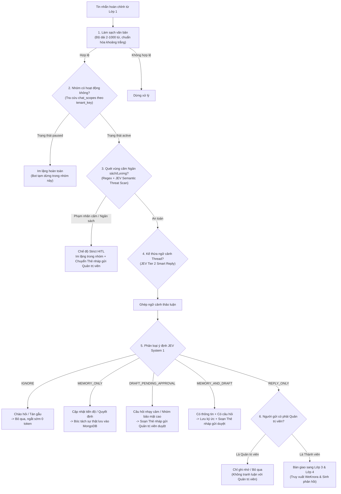

# Lớp 2: Kiểm soát an toàn & Phân loại ý định (System 1 Gatekeeper)

Tài liệu này thuyết minh nguyên lý kiểm duyệt an toàn, phân loại ý định người dùng và cơ chế bảo vệ thông tin mật của Lớp 2 trong hệ thống HiLark Server.

Mã nguồn liên quan:
- Phân loại ý định JEV: [`server/services/ai/jev_classifier.py`](file:///Users/hoainam/Desktop/HiLark/server/services/ai/jev_classifier.py)
- Quy trình hội thoại: [`server/services/workflows/chat_workflow.py`](file:///Users/hoainam/Desktop/HiLark/server/services/workflows/chat_workflow.py)
- Bộ lọc văn bản: [`server/services/knowledge/rule_engine.py`](file:///Users/hoainam/Desktop/HiLark/server/services/knowledge/rule_engine.py)
- Phân quyền nhóm chat: [`server/services/knowledge/chat_scopes.py`](file:///Users/hoainam/Desktop/HiLark/server/services/knowledge/chat_scopes.py)

---

## 1. Mục tiêu và phạm vi trách nhiệm

Lớp 2 tiếp nhận câu hỏi hoàn chỉnh từ Lớp 1 và thực hiện kiểm tra an toàn trước khi kích hoạt bất kỳ truy xuất tài liệu hay lời gọi mô hình ngôn ngữ lớn (LLM):
- Kiểm tra tính hợp lệ và độ dài văn bản (tối thiểu 2 từ, tối đa 1.000 từ).
- Kiểm tra trạng thái hoạt động của nhóm chat trong collection `chat_scopes`.
- Quét chủ đề cấm và thông tin mật (ngân sách, lương bổng, hợp đồng, chi phí) qua cơ chế Strict HITL.
- Kế thừa ngữ cảnh khi người dùng thảo luận lồng trong thread (`parent_id`).
- Phân loại ý định tin nhắn vào 1 trong 5 nhánh của JEV System 1 để định tuyến xử lý phù hợp.
- Áp dụng cơ chế chống vòng lặp phản hồi đối với Quản trị viên và chế độ dự phòng an toàn khi mất kết nối tới dịch vụ phân loại.

---

## 2. Sơ đồ phân rã Lớp 2

---

## 3. Chi tiết các chốt chặn kỹ thuật

### Chốt chặn 1: Làm sạch và kiểm tra kích thước văn bản
- **Vị trí mã nguồn:** [`server/services/knowledge/rule_engine.py`](file:///Users/hoainam/Desktop/HiLark/server/services/knowledge/rule_engine.py)
- **Quy tắc:**
  1. Độ dài hợp lệ: Tin nhắn phải có từ 2 đến 1.000 từ. Tin nhắn đơn ký tự ("?", "alo") hoặc văn bản spam quá dài sẽ bị dừng xử lý ngay lập tức.
  2. Khử chuỗi lặp: Chuẩn hóa các ký tự lặp dư thừa (`!!!`, `???`) và khoảng trắng thừa.
  3. Tiết kiệm tài nguyên: Chặn các tin nhắn không đạt chuẩn trước khi gọi các dịch vụ AI bên ngoài.

---

### Chốt chặn 2: Kiểm tra phạm vi nhóm chat (Chat Scope Check)
- **Vị trí mã nguồn:** [`server/services/knowledge/chat_scopes.py`](file:///Users/hoainam/Desktop/HiLark/server/services/knowledge/chat_scopes.py)
- **Cách thức hoạt động:**
  - Tra cứu cấu hình nhóm trong MongoDB `chat_scopes` theo cặp `(tenant_key, chat_id)`.
  - Nếu nhóm có trạng thái `paused`, bot giữ im lặng hoàn toàn và không thực hiện bất kỳ truy vấn hay lời gọi AI nào.

---

### Chốt chặn 3: Kiểm soát vùng cấm ngân sách và bảo mật (Strict HITL)
- **Vị trí mã nguồn:** [`server/services/ai/jev_classifier.py`](file:///Users/hoainam/Desktop/HiLark/server/services/ai/jev_classifier.py)
- **Đối tượng bảo vệ:** Các chủ đề nhạy cảm do doanh nghiệp quy định trong `forbidden_labels` (ví dụ: Ngân sách, Chi phí, Bảng lương, Hợp đồng, Thỏa thuận đối tác).
- **Cơ chế 2 lớp:**
  1. Vòng 1 (Regex): Quét nhanh các từ khóa nhạy cảm trong thời gian < 0.1ms.
  2. Vòng 2 (JEV Semantic Scan): Mô hình JEV phân tích ngữ nghĩa để phát hiện ngôn ngữ lóng hoặc câu hỏi gián tiếp có chủ đích khai thác thông tin mật.
- **Hành vi xử lý:**
  - Bot hoàn toàn không phát ngôn vào nhóm chat và không đưa ra thông báo từ chối lộ liễu.
  - Tự động chuyển nội dung thành Thẻ phê duyệt nháp gửi riêng vào DM của Quản trị viên kèm lý do phân loại.

---

### Chốt chặn 4: Kế thừa ngữ cảnh Thread (Smart Reply)
- **Vị trí mã nguồn:** [`server/services/lark/handlers/member_message_handler.py`](file:///Users/hoainam/Desktop/HiLark/server/services/lark/handlers/member_message_handler.py)
- **Cách thức hoạt động:**
  - Khi tin nhắn trả lời trong thread (`parent_id`), nội dung thường ngắn gọn (ví dụ: "Ai phụ trách việc này?").
  - Hệ thống tự động truy xuất tin nhắn gốc của thread qua Lark OpenAPI và ghép ngữ cảnh:
    `[Ngữ cảnh thảo luận]: "{parent_text}"\n[Câu hỏi hiện tại]: "{current_text}"`.
  - Giúp JEV phân loại chính xác ý định và cung cấp ngữ cảnh đầy đủ cho LLM.

---

### Chốt chặn 5: Phân loại 5 nhánh ý định (JEV Intent Classifier)
- **Vị trí mã nguồn:** [`server/services/ai/jev_classifier.py`](file:///Users/hoainam/Desktop/HiLark/server/services/ai/jev_classifier.py)

| Nhánh ý định | Tính chất tin nhắn | Hành vi xử lý thực tế |
| :--- | :--- | :--- |
| `IGNORE` | Lời chào hỏi, cảm ơn, tán gẫu ngoài lề. | Bỏ qua hoàn toàn, ngắt sớm luồng xử lý (0 token LLM). |
| `MEMORY_ONLY` | Báo cáo tiến độ, quyết định, thay đổi nhân sự/deadline. | Bóc tách thực thể và sự thật để lưu vào MongoDB Claims; không phản hồi vào nhóm. |
| `REPLY_ONLY` | Câu hỏi nghiệp vụ được hỗ trợ bởi tài liệu nhóm. | Cho phép chuyển tiếp sang Lớp 3 và Lớp 4 để truy xuất tài liệu và phản hồi vào nhóm. |
| `MEMORY_AND_DRAFT` | Tin nhắn vừa có thông tin mới vừa có câu hỏi nhạy cảm. | Ghi nhận dữ kiện vào MongoDB và chuẩn bị Thẻ nháp gửi Quản trị viên phê duyệt. |
| `DRAFT_PENDING_APPROVAL` | Câu hỏi nhạy cảm, thiếu dữ liệu chứng thực hoặc nhóm bảo mật cao. | Soạn Thẻ tương tác gửi riêng Quản trị viên phê duyệt qua DM; không tự ý phản hồi vào nhóm. |

---

### Chốt chặn 6: Chống vòng lặp phản hồi từ Quản trị viên
- **Vị trí mã nguồn:** [`server/services/workflows/chat_workflow.py`](file:///Users/hoainam/Desktop/HiLark/server/services/workflows/chat_workflow.py)
- **Cách thức hoạt động:**
  - Khi tin nhắn phát ngôn từ tài khoản của Quản trị viên:
    - Nếu chứa thông tin công việc, hệ thống chuyển sang `MEMORY_ONLY` để ghi nhận vào ký ức động.
    - Nếu là câu chào hỏi hoặc giao tiếp thường ngày, chuyển sang `IGNORE` để tránh việc bot tự động xen ngang vào thảo luận của Quản trị viên.

---

### Chốt chặn 7: Dự phòng khi mất kết nối (Safety Fallback)
- **Vị trí mã nguồn:** [`server/services/workflows/chat_workflow.py`](file:///Users/hoainam/Desktop/HiLark/server/services/workflows/chat_workflow.py)
- **Nguyên tắc:** Nếu kết nối tới dịch vụ JEV bị gián đoạn hoặc timeout:
  - Tin nhắn có dấu hỏi (`?`) hoặc dài từ 4 từ trở lên tự động chuyển sang chế độ `DRAFT_PENDING_APPROVAL` gửi DM Quản trị viên.
  - Tin nhắn ngắn hơn được bỏ qua (`IGNORE`).
  - Đảm bảo hệ thống không bao giờ tự ý phản hồi công khai khi chưa có xác nhận an toàn từ bộ kiểm duyệt.

---

## 4. Tham số cấu hình liên quan

| Tên biến / Thuộc tính | Vị trí lưu trữ | Ý nghĩa kỹ thuật |
| :--- | :--- | :--- |
| `status` | Collection `chat_scopes` | Trạng thái nhóm: `"active"` (hoạt động) hoặc `"paused"` (tạm dừng). |
| `security_level` | Collection `chat_scopes` | Mức bảo mật: `"standard"` (tiêu chuẩn) hoặc `"confidential"` (tuyệt mật, luôn duyệt nháp). |
| `forbidden_labels` | Collection `chat_scopes` | Danh sách nhãn cấm (ngăn cách bằng dấu phẩy, ví dụ: Ngân sách, Lương, Hợp đồng). |
| `JEV_API_KEY` | Biến môi trường `.env` | Khóa API xác thực dịch vụ phân loại ý định JEV System 1. |
| `LARK_USER_OPEN_ID` | Biến môi trường `.env` / Tenant config | Open ID của Quản trị viên để nhận các thông báo cảnh báo và Thẻ nháp duyệt. |
