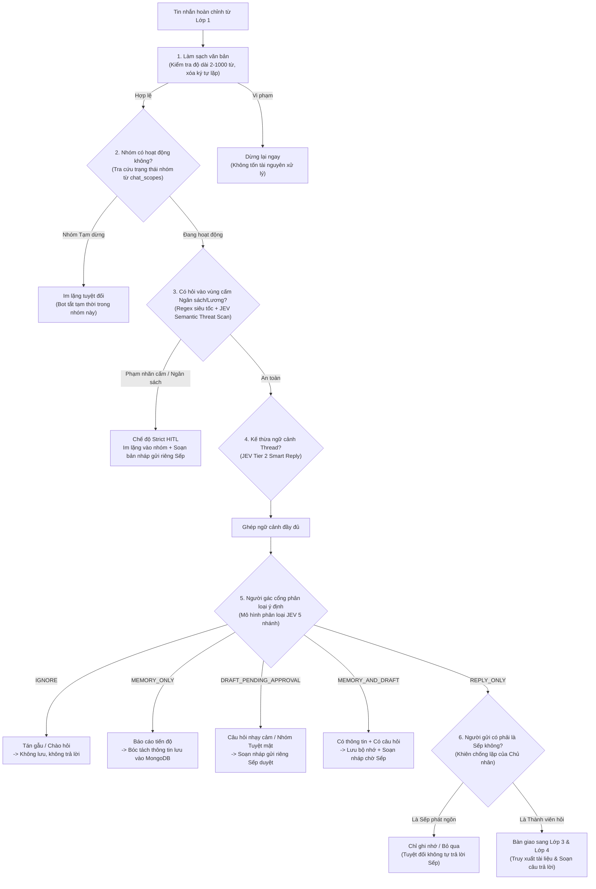

# 📘 TÀI LIỆU GIẢI THÍCH LỚP 2: VỌNG GÁC AN NINH & PHÂN LOẠI Ý ĐỊNH (LAYER 2)
> **Dự án HiLark Server**  
> Tài liệu viết theo phong cách kỹ thuật thực tế, dễ hiểu, ưu tiên tiếng Việt và không dùng từ ngữ bóng bẩy.  
> **Vị trí mã nguồn:** [`server/services/jev.py`](file:///Users/hoainam/Desktop/HiLark/server/services/jev.py), [`server/services/chat_service.py`](file:///Users/hoainam/Desktop/HiLark/server/services/chat_service.py), [`server/utils/text_filter.py`](file:///Users/hoainam/Desktop/HiLark/server/utils/text_filter.py)

---

## 🧭 1. LỚP 2 ĐỂ LÀM GÌ?

Nếu **Lớp 1** giống như **"Bàn lễ tân và phòng chờ"** (tiếp nhận tin nhắn, gom các câu gõ dở và xếp hàng điều tiết), thì **Lớp 2** chính là **"Vọng gác an ninh & Người phân luồng ý định"**:

* Khi một câu hỏi được đưa ra khỏi hàng đợi Lớp 1, nó **chưa bao giờ được phép đi thẳng tới Trí tuệ nhân tạo (LLM) hay tìm kiếm tài liệu ngay**.
* Trước hết, câu hỏi phải đi qua Lớp 2 để trả lời 4 câu hỏi sống còn:
  1. **Câu này có an toàn không?** (Có hỏi lén về bảng lương, ngân sách, chi phí hay hợp đồng bí mật hay không?)
  2. **Nhóm chat này có đang mở quyền trả lời không?** (Nhóm đang hoạt động hay đã bị tắt?)
  3. **Tin nhắn này thuộc loại gì?** (Là lời chào xã giao, báo cáo tiến độ cần ghi nhớ, hay một câu hỏi nghiệp vụ cần trả lời?)
  4. **Có đang thảo luận trong Thread không?** (Kế thừa ngữ cảnh của tin nhắn cha để phân loại chính xác).

> [!IMPORTANT]
> **Quy tắc an ninh tối cao của Lớp 2:**  
> **"Thà im lặng hoặc soạn bản nháp chờ Sếp duyệt, tuyệt đối không bao giờ phát ngôn bừa bãi hoặc làm lộ bí mật kinh doanh vào nhóm chat."**

---

## 🖼️ SƠ ĐỒ PHÂN RÃ THÀNH PHẦN LỚP 2

---

## 🔍 2. CHI TIẾT CÁC CHỐT CHẶN AN NINH TRONG MÃ NGUỒN

### Chốt chặn 1: Làm sạch & Kiểm tra kích thước văn bản
- **Vị trí trong mã nguồn:** [`server/utils/text_filter.py`](file:///Users/hoainam/Desktop/HiLark/server/utils/text_filter.py) và [`server/services/chat_service.py`](file:///Users/hoainam/Desktop/HiLark/server/services/chat_service.py)
- **Quy tắc kiểm tra:**
  1. **Độ dài hợp lệ:** Câu nhắn phải có từ **2 từ trở lên** (`MIN_WORDS = 2`) và tối đa **1.000 từ** (`MAX_WORDS = 1000`). Nếu người dùng chỉ gõ đúng 1 chữ như "alo", "?" hoặc spam văn bản dài dằng dặc cả chục trang giấy, hệ thống lập tức từ chối.
  2. **Dọn rác ký tự lặp:** Chuyển các chuỗi gõ spam như `!!!!!!` thành `!`, `??????` thành `?`.
  3. **Chuẩn hóa khoảng trắng:** Gom nhiều dấu cách hoặc dòng trống thừa thành 1 khoảng trắng duy nhất.
- **Mục đích:** Chặn đứng ngay từ cửa các tin nhắn rác hoặc tấn công quá tải văn bản mà không làm tốn chi phí gọi trí tuệ nhân tạo.

---

### Chốt chặn 2: Kiểm tra trạng thái hoạt động của nhóm chat (Chat Scopes)
- **Vị trí trong mã nguồn:** [`server/services/chat_service.py`](file:///Users/hoainam/Desktop/HiLark/server/services/chat_service.py)
- **Cách thức hoạt động:**
  - Mỗi nhóm chat trên Lark được quản lý tập trung trên cơ sở dữ liệu (`chat_scopes`).
  - Khi có tin nhắn đến, hệ thống kiểm tra trường `status`. Nếu nhóm đang ở trạng thái **"Tạm dừng"** (`is_active = False`):
    - Máy chủ ghi log: `🛑 [GROUP INACTIVE] Nhóm đang ở trạng thái Tạm dừng. Bỏ qua hoàn toàn tin nhắn.`
    - Bot **im lặng hoàn toàn**, không tốn bất kỳ tài nguyên nào để tìm kiếm tài liệu hay trả lời.

---

### Chốt chặn 3: Kiểm soát vùng cấm ngân sách & bí mật (Strict HITL)
- **Vị trí trong mã nguồn:** [`server/services/jev.py`](file:///Users/hoainam/Desktop/HiLark/server/services/jev.py) và [`server/services/chat_service.py`](file:///Users/hoainam/Desktop/HiLark/server/services/chat_service.py)
- **Bảo vệ nội dung gì:** Các chủ đề nhạy cảm do công ty quy định riêng cho từng nhóm (ví dụ: *Ngân sách, Chi phí, Bảng lương nhân viên, Thỏa thuận hợp đồng, Tranh chấp pháp lý*).
- **Cách nhận diện 2 vòng:**
  1. **Vòng 1 (So khớp từ khóa nhanh Regex):** Quét trực tiếp xem câu hỏi có chứa các từ khóa cấm đã khai báo hay không (độ trễ dưới 0.1ms).
  2. **Vòng 2 (Phân tích ngữ nghĩa sâu qua JEV):** Kể cả khi người hỏi dùng từ lóng, hỏi bóng gió hay cố tình né từ khóa (ví dụ: *"tháng này kế toán ting ting mấy chục củ"*), mô hình JEV vẫn nhận diện được ý đồ cố tình hỏi vào chủ đề cấm.
- **Hành vi xử lý đặc biệt khi vi phạm (Strict HITL):**
  * **Im lặng tuyệt đối (Zero-response) vào nhóm:** Bot tuyệt đối **không nói bất kỳ câu gì vào nhóm chat**, không nói *"Tôi không được phép trả lời"* (tránh làm lộ cho thành viên biết trong kho có tài liệu mật).
  * **Tự động chuyển thành Bản nháp chờ duyệt:** Thay vì trả lời trực tiếp, bot soạn sẵn câu trả lời nháp và gửi thẻ phê duyệt riêng vào hộp thư của Sếp với lý do: *"Câu hỏi thuộc chủ đề nhạy cảm: Ngân sách/Chi phí/Lương bổng cần Lãnh đạo thẩm định trước khi phát ngôn."*

---

### Chốt chặn 4: Kế thừa ngữ cảnh Thread (JEV Tier 2 Smart Reply)
- **Vị trí trong mã nguồn:** [`server/services/lark/handlers/member_message_handler.py`](file:///Users/hoainam/Desktop/HiLark/server/services/lark/handlers/member_message_handler.py)
- **Cơ chế hoạt động:**
  - Khi một thành viên hoặc Lãnh đạo trả lời lồng trong Thread (`msg.parent_id`), câu nhắn thường rất ngắn (ví dụ: *"Ai phụ trách mục này?"* hoặc *"Tiến độ thế nào rồi?"*). Nếu đọc riêng lẻ, bot sẽ không thể biết người hỏi đang ám chỉ nội dung gì.
  - Hệ thống tự động gọi API Lark lấy lại nội dung tin nhắn gốc của Thread (`parent_text`).
  - Ghép ngữ cảnh: `[Ngữ cảnh thảo luận]: "{parent_text}"\n[Câu hỏi hiện tại]: "{msg.text}"`.
  - Giúp JEV phân loại chính xác ý định và giúp LLM trả lời trúng trọng tâm vấn đề.

---

### Chốt chặn 5: Người gác cổng phân loại ý định (JEV Gatekeeper)
- **Vị trí trong mã nguồn:** [`server/services/jev.py`](file:///Users/hoainam/Desktop/HiLark/server/services/jev.py) và [`server/services/chat_service.py`](file:///Users/hoainam/Desktop/HiLark/server/services/chat_service.py)
- **Vai trò:** Giống như một trợ lý riêng mẫn cán của Sếp, đọc lướt qua tin nhắn và phân loại chính xác vào 1 trong 5 ngăn xử lý:

| Nhãn hành động | Bản chất tin nhắn | Hành vi xử lý thực tế |
| :--- | :--- | :--- |
| `IGNORE` | Tin nhắn rác, chào hỏi xã giao, cảm ơn, tán gẫu. | **Bỏ qua hoàn toàn.** Không lưu vào cơ sở dữ liệu và không trả lời. |
| `MEMORY_ONLY` | Lời báo cáo tiến độ, thông báo thay đổi nhân sự, cập nhật công việc mới. | **Chỉ ghi nhớ.** Gọi bộ bóc tách thông tin để lưu vào MongoDB; **không trả lời** vào nhóm vì không ai hỏi. |
| `REPLY_ONLY` | Câu hỏi nghiệp vụ, tiến độ, tài liệu đã có trong kho tri thức của nhóm. | **Được phép trả lời.** Chuyển sang Lớp 3 & Lớp 4 để tự động tìm tài liệu và phản hồi vào nhóm. |
| `MEMORY_AND_DRAFT` | Tin nhắn vừa chứa thông tin quan trọng cần nhớ, vừa có câu hỏi kèm theo. | **Lưu tri thức + Soạn nháp.** Vừa ghi nhớ dữ liệu mới vào MongoDB, vừa tạo câu trả lời nháp gửi Sếp duyệt. |
| `DRAFT_PENDING_APPROVAL` | Câu hỏi nhạy cảm hoặc nhóm thuộc chế độ Tuyệt mật. | **Không tự trả lời.** Bắt buộc gửi bản nháp riêng cho Sếp duyệt trước qua nút bấm hoặc lệnh chat. |

---

### Chốt chặn 6: Khiên bảo vệ chống lặp của Chủ nhân (Owner Anti-loop)
- **Vị trí trong mã nguồn:** [`server/services/chat_service.py`](file:///Users/hoainam/Desktop/HiLark/server/services/chat_service.py)
- **Cách giải quyết:**
  * Nếu Sếp đưa ra thông tin công việc $\rightarrow$ Bot tự động ép hành động về `MEMORY_ONLY` (âm thầm học và ghi nhớ các quyết định của Sếp vào cơ sở tri thức).
  * Nếu Sếp hỏi han hoặc tán gẫu $\rightarrow$ Bot tự động ép hành động về `IGNORE` (im lặng, nhường sân khấu cho Sếp nói chuyện với đội ngũ).

---

### Chốt chặn 7: Cơ chế an toàn khi mất kết nối mạng (Safety Fallback)
- **Vị trí trong mã nguồn:** [`server/services/chat_service.py`](file:///Users/hoainam/Desktop/HiLark/server/services/chat_service.py)
- **Nguyên tắc kỹ thuật:** Trong trường hợp đường truyền tới máy chủ kiểm duyệt JEV bị đứt đoạn, chập chờn hoặc timeout:
  * Nếu tin nhắn có dấu hiệu là câu hỏi (chứa dấu `?` hoặc có từ 4 từ trở lên) $\rightarrow$ Hệ thống tự động chuyển sang chế độ **Bản nháp chờ duyệt (`DRAFT_PENDING_APPROVAL`)** gửi về hộp thư riêng của Sếp.
  * Nếu tin nhắn quá ngắn $\rightarrow$ Bỏ qua (`IGNORE`).
  * **Cam kết an toàn:** Tuyệt đối không bao giờ để bot tự ý phát ngôn vào nhóm khi hệ thống phân loại chưa đưa ra chứng nhận an toàn.

---

## ⚙️ 3. BẢNG CẤU HÌNH BẢO MẬT TRONG CƠ SỞ DỮ LIỆU & .env

| Tham số / Trường dữ liệu | Vị trí lưu trữ | Ý nghĩa kỹ thuật |
| :--- | :--- | :--- |
| `status` | Bảng nhóm (`chat_scopes`) | Trạng thái nhóm: `"active"` (Hoạt động) hoặc `"paused"` (Tạm dừng). |
| `security_level` | Bảng nhóm (`chat_scopes`) | Mức độ bảo mật: `"standard"` (Nội bộ) hoặc `"confidential"` (Tuyệt mật - khóa 100% việc tự động trả lời). |
| `forbidden_labels` | Bảng nhóm (`chat_scopes`) | Danh sách các chủ đề cấm xem (ngăn cách bởi dấu phẩy, ví dụ: *Ngân sách, Lương, Hợp đồng*). |
| `JEV_API_KEY` | File `.env` (`jev_api`) | Khóa bảo mật truy cập dịch vụ phân loại JEV System One. |
| `LARK_USER_OPEN_ID` | File `.env` | Mã tài khoản riêng của Lãnh đạo (để nhận tin nhắn cảnh báo mật và bản nháp duyệt). |

*Sau khi vượt qua toàn bộ các cửa ải an ninh của Lớp 2, câu hỏi an toàn sẽ được bàn giao sang **Lớp 3: Tìm kiếm tài liệu & Hợp nhất bối cảnh (WeKnora & Context Composer)**.*
