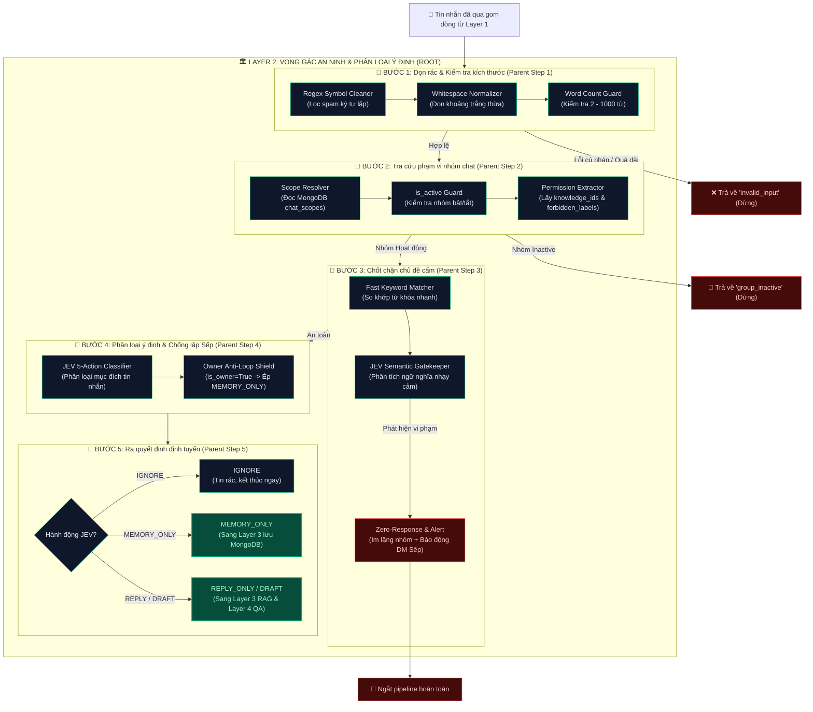

# 🛠️ TỔNG QUAN BỘ CÔNG CỤ (UTILS) CỦA LAYER 2
> **HiLark Server Architecture** — Bóc tách chi tiết các module tiện ích thuộc Lớp 2 (Vọng gác an ninh & Phân loại ý định).

---

## 🧭 1. KIẾN TRÚC PHÂN CẤP: UTILS (CHILD) ➔ STEPS (PARENT) ➔ LAYER 2 (ROOT)

Trong Layer 2, mọi yêu cầu hội thoại sau khi qua Layer 1 đều phải trải qua quy trình kiểm soát an ninh đa tầng trước khi được phép tiếp cận tài liệu hay mô hình trí tuệ nhân tạo. Mỗi **Chốt chặn / Bước xử lý (Parent Step)** được điều hành bởi các **Tiện ích con (Child Utils / Helpers)** chuyên trách:

```
                      ┌─────────────────────────────────────────────────────────────┐
                      │              LAYER 2: SECURITY GATING PIPELINE              │
                      │               (Vọng gác an ninh & Phân loại)                │
                      └──────────────────────────────┬──────────────────────────────┘
                                                     │
         ┌───────────────────┬───────────────────────┼───────────────────────┬───────────────────┐
         ▼                   ▼                       ▼                       ▼                   ▼
┌─────────────────┐ ┌─────────────────┐     ┌─────────────────┐     ┌─────────────────┐ ┌─────────────────┐
│     BƯỚC 1      │ │     BƯỚC 2      │     │     BƯỚC 3      │     │     BƯỚC 4      │ │     BƯỚC 5      │
│  Dọn rác &      │ │  Tra cứu phạm   │     │  Chốt chặn      │     │  Phân loại &    │ │  Định tuyến     │
│  Kiểm tra size  │ │  vi nhóm chat   │     │  chủ đề cấm     │     │  Chống lặp Sếp  │ │  hành động      │
│  (Parent Step)  │ │  (Parent Step)  │     │  (Parent Step)  │     │  (Parent Step)  │ │  (Parent Step)  │
└────────┬────────┘ └────────┬────────┘     └────────┬────────┘     └────────┬────────┘ └────────┬────────┘
         │                   │                       │                       │                   │
         │ (Child Utils)     │ (Child Utils)         │ (Child Utils)         │ (Child Utils)     │ (Child Utils)
         ▼                   ▼                       ▼                       ▼                   ▼
┌─────────────────┐ ┌─────────────────┐     ┌─────────────────┐     ┌─────────────────┐ ┌─────────────────┐
│ • Regex Symbol  │ │ • Scope Cache   │     │ • Fast Keyword  │     │ • JEV Classifier│ │ • IGNORE Drop   │
│   Cleaner       │ │   Resolver      │     │   Matcher       │     │   (5 actions)   │ │ • MEMORY_ONLY   │
│ • Whitespace    │ │ • is_active     │     │ • JEV Semantic  │     │ • Owner Anti-   │ │ • REPLY_ONLY    │
│   Normalizer    │ │   State Guard   │     │   Gatekeeper    │     │   Loop Shield   │ │ • DRAFT Mode    │
│ • Word Counter  │ │ • Permission    │     │ • Zero-Response │     │ • Confidence    │ │ • Error Fallback│
│   (2-1000 từ)   │ │   Validator     │     │   & DM Alert    │     │   Threshold     │ │   Dispatch      │
└─────────────────┘ └─────────────────┘     └─────────────────┘     └─────────────────┘ └─────────────────┘
```

---

## 🧩 2. BẢNG MỐI QUAN HỆ PARENT - CHILD CHI TIẾT

| Bước xử lý (Parent Step) | Vai trò của Bước trong Layer 2 | Tiện ích thực thi con (Child Utils / Functions) | Vị trí mã nguồn |
| :--- | :--- | :--- | :--- |
| **BƯỚC 1: Dọn rác & Kiểm tra kích thước** *(Syntactic Sanitization)* | Làm sạch các ký tự đặc biệt spam, chuẩn hóa khoảng trắng, chặn tin nhắn rác hoặc quá dài. | • `validate_and_clean()`: Loại bỏ spam ký tự liên tiếp (`[!@#$%^&*?]+` $\rightarrow$ 1 ký tự).<br/>• `Whitespace Normalizer`: Rút gọn khoảng trắng thừa `\s+` $\rightarrow$ 1 khoảng cách.<br/>• `Word Count Guard`: Kiểm tra giới hạn `MIN_WORDS = 2` và `MAX_WORDS = 1000` từ. | [`utils/text_filter.py:L19-37`](file:///Users/hoainam/Desktop/HiLark/server/utils/text_filter.py#L19-L37) |
| **BƯỚC 2: Tra cứu phạm vi nhóm** *(Scope & Permission Resolution)* | Đọc thông tin phân quyền của nhóm chat trong Lark Base & MongoDB `chat_scopes`. | • `get_scope_by_chat_id()`: Tra cứu cấu hình nhóm từ cơ sở dữ liệu.<br/>• `is_active Guard`: Nếu nhóm đang tạm dừng hoạt động (`inactive`) $\rightarrow$ ngắt pipeline ngay.<br/>• `Permission Validator`: Xác định `project_tag`, `knowledge_ids` và `forbidden_labels`. | [`services/scope_service.py:L26-70`](file:///Users/hoainam/Desktop/HiLark/server/services/scope_service.py#L26-L70)<br/>[`services/chat_service.py:L293-321`](file:///Users/hoainam/Desktop/HiLark/server/services/chat_service.py#L293-L321) |
| **BƯỚC 3: Chốt chặn chủ đề cấm** *(Forbidden Intent Gating)* | Phát hiện các câu hỏi dò hỏi thông tin nhạy cảm (Lương, Ngân sách, Hợp đồng, Mật khẩu). | • `Fast Keyword Matcher`: Quét nhanh từ khóa cấm trong câu hỏi (`lbl.lower() in query.lower()`).<br/>• `check_forbidden_query()`: Gửi sang mô hình JEV System One phân tích ngữ nghĩa sâu.<br/>• `Zero-Response & Alert`: Im lặng tuyệt đối trong nhóm + gửi DM báo động khẩn cấp tới Sếp. | [`services/jev.py:L198-388`](file:///Users/hoainam/Desktop/HiLark/server/services/jev.py#L198-L388)<br/>[`services/chat_service.py:L324-370`](file:///Users/hoainam/Desktop/HiLark/server/services/chat_service.py#L324-L370) |
| **BƯỚC 4: Phân loại ý định & Chống lặp** *(Intent Classification & Anti-Loop)* | Phân loại mục đích của câu chat và ngăn chặn bot nói leo vào nhóm thay lời Sếp. | • `classify_message()`: Gọi JEV phân loại ra 5 nhãn hành động kinh doanh.<br/>• `Owner Anti-Loop Shield`: Nếu Sếp chat trong nhóm (`is_owner=True`), cấm `REPLY_ONLY`, ép hạ cấp thành `MEMORY_ONLY`.<br/>• `Confidence Threshold`: Đánh giá độ tin cậy để xử lý tin không rõ ý. | [`services/jev.py:L400-580`](file:///Users/hoainam/Desktop/HiLark/server/services/jev.py#L400-L580)<br/>[`services/chat_service.py:L373-437`](file:///Users/hoainam/Desktop/HiLark/server/services/chat_service.py#L373-L437) |
| **BƯỚC 5: Ra quyết định định tuyến** *(Action Triage & Dispatch)* | Kích hoạt đúng nhánh xử lý tiếp theo dựa trên kết quả kiểm duyệt của Layer 2. | • `IGNORE Drop`: Kết thúc ngay, không lưu, không trả lời.<br/>• `MEMORY_ONLY Dispatch`: Chuyển sang Layer 3 lưu MongoDB.<br/>• `REPLY / DRAFT Dispatch`: Bàn giao sang Layer 3 (RAG) và Layer 4 (LLM QA). | [`services/chat_service.py:L400-440`](file:///Users/hoainam/Desktop/HiLark/server/services/chat_service.py#L400-L440) |

---

## 🗂️ DANH MỤC TÀI LIỆU BÓC TÁCH KỸ THUẬT

1. **[`text_filter.md`](file:///Users/hoainam/Desktop/HiLark/server/docs/layer2/ultis_docs/text_filter.md)**:
   * **Mã nguồn:** [`server/utils/text_filter.py`](file:///Users/hoainam/Desktop/HiLark/server/utils/text_filter.py) *(117 dòng, 4.5 KB)*.
   * **Nội dung:** Bóc tách sâu class `TextFilter`: Tiền xử lý `validate_and_clean()` tại Layer 2 và Hậu xử lý `clean_output()`, `extract_kb_citations()` tại Layer 4.
   * **Triết lý kiến trúc:** Giải thích lý do tại sao `text_filter` chỉ dọn dẹp mặt cú pháp/ký tự mà **tuyệt đối không lọc theo từ điển cấm**, nhường việc phân tích ngữ nghĩa cho JEV Gatekeeper để tránh chặn nhầm nghiệp vụ.

---

## 🔄 3. SƠ ĐỒ KẾT NỐI LUỒNG DỮ LIỆU: UTILS ➔ STEPS ➔ LAYER 2


### Quy trình dòng chảy chi tiết (Mermaid Flowchart):


