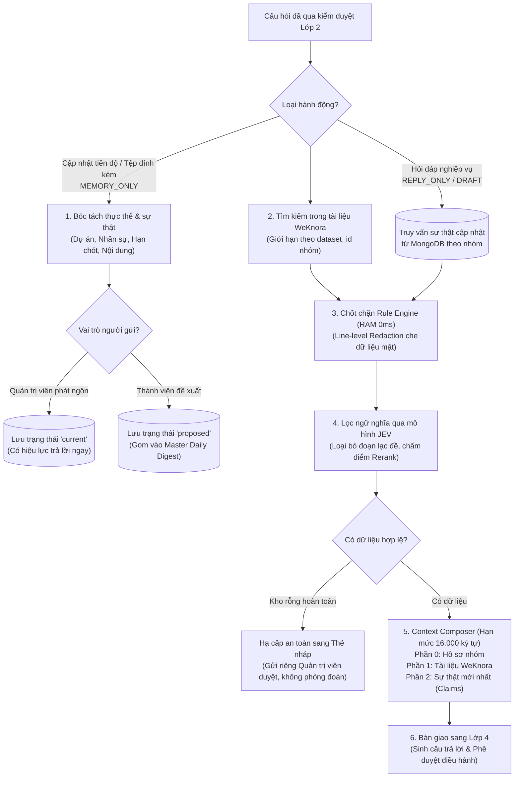

# Lớp 3: Kho tri thức đa nguồn & Hợp nhất bối cảnh (Cognitive Engine)

Tài liệu này thuyết minh nguyên lý vận hành của Lớp 3 (Động cơ nhận thức và Quản lý tri thức) trong HiLark Server, bao gồm bóc tách tài liệu đa phương thức, truy xuất WeKnora Hybrid RAG, quản trị ký ức động (Claims) và hợp nhất bối cảnh có thứ tự ưu tiên.

Mã nguồn liên quan:
- Bộ đọc tệp AnyDoc gRPC: [`server/services/knowledge/docreader_client.py`](file:///Users/hoainam/Desktop/HiLark/server/services/knowledge/docreader_client.py)
- Trích xuất tài liệu & OCR: [`server/services/knowledge/doc_parser.py`](file:///Users/hoainam/Desktop/HiLark/server/services/knowledge/doc_parser.py)
- Tra cứu WeKnora Hybrid RAG: [`server/services/knowledge/weknora_client.py`](file:///Users/hoainam/Desktop/HiLark/server/services/knowledge/weknora_client.py)
- Bóc tách thực thể & sự thật: [`server/services/ai/llm_extractor.py`](file:///Users/hoainam/Desktop/HiLark/server/services/ai/llm_extractor.py)
- Hợp nhất bối cảnh: [`server/services/knowledge/context_composer.py`](file:///Users/hoainam/Desktop/HiLark/server/services/knowledge/context_composer.py)
- Kiểm duyệt an toàn tri thức: [`server/services/knowledge/rule_engine.py`](file:///Users/hoainam/Desktop/HiLark/server/services/knowledge/rule_engine.py)
- Quản lý vòng đời sự thật: [`server/services/workflows/claim_workflow.py`](file:///Users/hoainam/Desktop/HiLark/server/services/workflows/claim_workflow.py)

---

## 1. Mục tiêu và phạm vi trách nhiệm

Lớp 3 kết hợp hai nguồn dữ liệu tri thức độc lập:
1. **Tri thức tĩnh (Static WeKnora Baseline):** Các tài liệu chính sách, sổ tay, đặc tả dự án dạng tệp (`.docx`, `.pdf`, `.xlsx`, `.pptx`), trang Wiki hoặc DocX trên Lark Cloud đã được nạp vào kho WeKnora.
2. **Ký ức động thời gian thực (MongoDB Dynamic Claims):** Các dữ kiện phát sinh trong trao đổi hàng ngày (thay đổi người phụ trách, cập nhật tiến độ, chốt lịch họp). Những thông tin này được lưu trữ trong MongoDB với compound index `(tenant_key, id)`.
3. **Nguyên tắc ưu tiên Context Composer:** `CURRENT Claims > Static WeKnora Baseline`. Nếu tài liệu văn bản ghi thông tin cũ nhưng trong nhóm chat Quản trị viên vừa chốt thông tin mới, hệ thống tự động ưu tiên dữ kiện mới nhất mà không cần re-index toàn bộ tài liệu.
4. **Line-level Redaction:** Che giấu các dòng dữ liệu nhạy cảm (bảng lương, chi phí bảo mật) mà vẫn bảo toàn bối cảnh nghiệp vụ xung quanh.

---

## 2. Sơ đồ luồng hoạt động Lớp 3

---

## 3. Chi tiết các bước kỹ thuật

### Bước 1: Bóc tách tài liệu đa phương thức AnyDoc gRPC & Lark DocX/Wiki
- **Vị trí mã nguồn:** [`server/services/knowledge/doc_parser.py`](file:///Users/hoainam/Desktop/HiLark/server/services/knowledge/doc_parser.py), [`server/services/knowledge/docreader_client.py`](file:///Users/hoainam/Desktop/HiLark/server/services/knowledge/docreader_client.py)
- **Cách thức hoạt động:**
  - **Lark DocX & Wiki OpenAPI:** Đọc nội dung Markdown cấu trúc trực tiếp qua Lark OpenAPI (0 token LLM).
  - **AnyDoc gRPC (`WeKnora-docreader:50051`):** Đối với tệp đính kèm nhị phân (`.docx`, `.pdf`, `.xlsx`, `.pptx`), hệ thống chuyển dữ liệu qua kênh gRPC buffer 50MB để bóc tách bảng biểu và cấu trúc phân đoạn.
  - **Gemini Vision OCR:** Xử lý các tệp hình ảnh (`.png`, `.jpg`, `.webp`) trích xuất thông tin ảnh sang Markdown.
  - **MD5 Hash Guard:** Tính toán mã băm MD5 của tài liệu trước khi cập nhật sang WeKnora. Nếu tệp không đổi nội dung, hệ thống bỏ qua việc upload lại để tránh kích hoạt pipeline embedding gây lãng phí chi phí.

---

### Bước 2: Bóc tách và quản trị ký ức động (Claims Governance)
- **Vị trí mã nguồn:** [`server/services/ai/llm_extractor.py`](file:///Users/hoainam/Desktop/HiLark/server/services/ai/llm_extractor.py), [`server/services/workflows/claim_workflow.py`](file:///Users/hoainam/Desktop/HiLark/server/services/workflows/claim_workflow.py)
- **Cơ chế Entity-Claim:**
  - Trích xuất Thực thể (Entities) làm mỏ neo định danh (Dự án, Module, Nhân sự) trước khi gắn Mệnh đề sự thật (Claims) vào thực thể đó.
  - Entity ID được băm kết hợp `f"{clean_tenant}:{clean_ws}:{clean_name}"` và bảo vệ bởi compound unique index `[("tenant_key", ASCENDING), ("id", ASCENDING)]` để ngăn ngừa va chạm ID giữa các tenant.
- **Phân cấp thăng hạng tri thức:**
  - Thông tin do thành viên gửi lên được lưu ở trạng thái `proposed` trong im lặng, không gửi thông báo spam Quản trị viên.
  - Thông tin do Quản trị viên phát ngôn hoặc được duyệt qua Master Daily Digest sẽ được thăng hạng thành `current`.
  - Thông tin cũ bị thay thế được gắn nhãn `superseded` để bảo toàn lịch sử thay đổi.

---

### Bước 3: Tìm kiếm tài liệu cách ly theo nhóm (WeKnora Hybrid RAG)
- **Vị trí mã nguồn:** [`server/services/knowledge/weknora_client.py`](file:///Users/hoainam/Desktop/HiLark/server/services/knowledge/weknora_client.py)
- **Đặc điểm kỹ thuật:**
  - Kết hợp Dense Vector Search và BM25 Keyword Search trên cơ sở dữ liệu ParadeDB/pgvector.
  - Cô lập tuyệt đối: Mỗi nhóm chat Lark chỉ được cấp phép truy xuất các tập tin tài liệu thuộc `knowledge_ids` cấu hình trong `chat_scopes`. Không truy vấn chéo giữa các nhóm khác nhau.
  - Tự động mở rộng bối cảnh: Tự động bổ sung tên dự án vào câu truy vấn tìm kiếm để tăng độ chính xác của kết quả ngữ nghĩa.

---

### Bước 4: Chốt chặn an ninh tri thức (Rule Engine Line-level Redaction)
- **Vị trí mã nguồn:** [`server/services/knowledge/rule_engine.py`](file:///Users/hoainam/Desktop/HiLark/server/services/knowledge/rule_engine.py)
- **Thực thi In-Memory:**
  - Quét toàn bộ chunks từ WeKnora và claims từ MongoDB đối chiếu với danh sách nhãn cấm (`forbidden_labels`).
  - Áp dụng Line-level Redaction: Che các dòng chứa thông tin nhạy cảm (ví dụ: số liệu lương, chi phí mật) mà vẫn giữ nguyên các dòng mô tả quy trình nghiệp vụ xung quanh.

---

### Bước 5: Lọc ngữ nghĩa và tái sắp xếp (JEV Reranker)
- **Vị trí mã nguồn:** [`server/services/ai/jev_classifier.py`](file:///Users/hoainam/Desktop/HiLark/server/services/ai/jev_classifier.py)
- **Cách thức hoạt động:**
  - Gửi các đoạn văn bản đã qua làm sạch sang mô hình JEV để chấm điểm độ tương quan (`RELEVANT` / `IRRELEVANT`).
  - Sắp xếp đoạn trích có điểm tương quan cao nhất lên đầu danh sách; loại bỏ các đoạn không liên quan.
  - Hạ cấp an toàn khi kho rỗng: Nếu câu hỏi không tìm thấy tài liệu phù hợp trong cả WeKnora và MongoDB Claims, hệ thống tự động chuyển sang luồng soạn Thẻ nháp gửi Quản trị viên, không để AI tự phỏng đoán thông tin.

---

### Bước 6: Hợp nhất bối cảnh có thứ tự ưu tiên (Context Composer)
- **Vị trí mã nguồn:** [`server/services/knowledge/context_composer.py`](file:///Users/hoainam/Desktop/HiLark/server/services/knowledge/context_composer.py)
- **Hạn mức 16.000 ký tự:** Mở rộng hạn mức bối cảnh lên 16.000 ký tự (`max_chunk_chars: 16000`) nhằm đảm bảo đọc trọn vẹn các tài liệu quy định dài.
- **Cấu trúc 3 phần chuẩn hóa:**
  1. **Phần 0 (Hồ sơ nhóm):** Tên nhóm chat, dự án liên kết và danh sách tài liệu đính kèm.
  2. **Phần 1 (Tài liệu gốc WeKnora):** Các đoạn trích tài liệu văn bản tĩnh từ kho RAG.
  3. **Phần 2 (Sự thật cập nhật MongoDB):** Các mệnh đề `CURRENT Claims` chốt mới nhất, được gắn cờ ưu tiên số 1 để ghi đè lên tài liệu cũ nếu có xung đột.

---

## 4. Bảng tham số và cấu trúc lưu trữ Lớp 3

| Thành phần | Vị trí lưu | Vai trò kỹ thuật |
| :--- | :--- | :--- |
| `memories` | Collection MongoDB | Lưu trữ danh mục thực thể (Dự án, Module, Nhân sự) kèm compound unique `(tenant_key, id)`. |
| `claims` | Collection MongoDB | Lưu trữ các mệnh đề sự thật động kèm trạng thái (`current`, `proposed`, `superseded`). |
| `knowledge_ids` | Collection `chat_scopes` | Danh sách ID tài liệu được phép truy cập trên WeKnora của từng nhóm chat. |
| `retrieve_count` | Cấu hình mặc định: `5` | Số lượng đoạn trích tối đa lấy ra từ WeKnora trong một lần tìm kiếm. |
| `max_chunk_chars`| Cấu hình mặc định: `16000` | Số ký tự tối đa của tài liệu hợp nhất trong Context Composer. |
