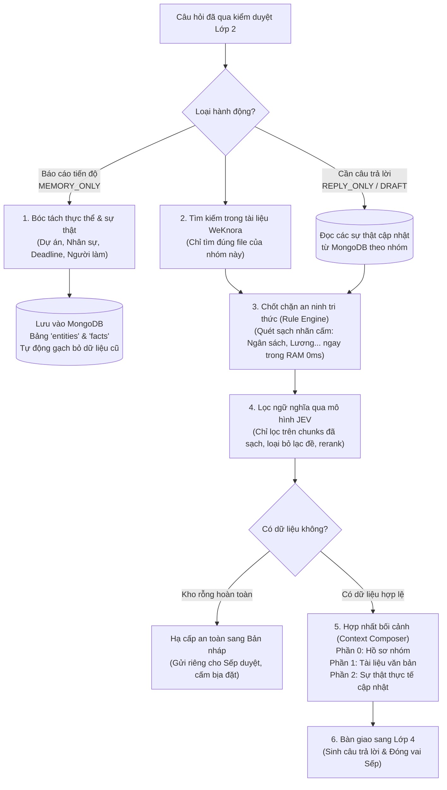

# 📘 TÀI LIỆU GIẢI THÍCH LỚP 3: KHO TRI THỨC ĐA NGUỒN & HỢP NHẤT BỐI CẢNH (LAYER 3)
> **Dự án HiLark Server**  
> Tài liệu viết theo phong cách kỹ thuật thực tế, dễ hiểu, ưu tiên tiếng Việt và không dùng từ ngữ bóng bẩy.

---

## 🧭 1. LỚP 3 ĐỂ LÀM GÌ?

Sau khi một tin nhắn đã vượt qua cổng kiểm duyệt an ninh ở **Lớp 2** (không hỏi vào chủ đề cấm, nhóm đang mở quyền hoạt động), câu hỏi sẽ được đưa tới **Lớp 3**.

Hãy hình dung Lớp 3 giống như **"Thư viện tài liệu kết hợp cuốn Sổ tay ghi nhớ sống"** của người trợ lý:

* **Tài liệu văn bản (Sách vở tĩnh):** Bao gồm các file PDF, tài liệu Word, sơ đồ hệ thống, quy trình công ty đã được tải lên trước đó (lưu trữ trên kho tri thức WeKnora).
* **Sổ tay ghi nhớ thực tế (Tri thức động thời gian thực):** Trong quá trình làm việc hàng ngày trên nhóm chat, mọi người liên tục chốt việc: đổi deadline, đổi người phụ trách, báo cáo sự cố... Những thông tin này **chưa kịp cập nhật vào tài liệu Word**, nhưng đã được Lớp 3 âm thầm ghi nhớ vào cơ sở dữ liệu MongoDB.
* **Nhiệm vụ cốt lõi của Lớp 3:**
  1. **Lấy đúng tài liệu của đúng nhóm:** Không bao giờ lấy nhầm tài liệu của dự án A đem trả lời cho nhóm dự án B.
  2. **Ghép 2 nguồn tri thức lại với nhau:** Đem tài liệu gốc đối chiếu với cập nhật mới nhất từ tin nhắn chat.
  3. **Quy tắc sự thật cập nhật (Fact Override):** Nếu tài liệu gốc ghi một đằng, nhưng thực tế trong chat Sếp vừa chốt một nẻo $\rightarrow$ **Thực tế mới chốt luôn luôn là chân lý số 1!**

---

## 🖼️ SƠ ĐỒ PHÂN RÃ THÀNH PHẦN LỚP 3


### Quy trình dòng chảy dữ liệu Lớp 3:


---

## 🔍 2. CHI TIẾT 6 BƯỚC XỬ LÝ TRONG MÃ NGUỒN

### Bước 1: Bóc tách và ghi nhớ tri thức động (Dynamic Memory Extraction)
- **Vị trí trong mã nguồn:** [`server/utils/llm_extractor.py`](file:///Users/hoainam/Desktop/HiLark/server/utils/llm_extractor.py) và [`server/services/chat_service.py:L133-188`](file:///Users/hoainam/Desktop/HiLark/server/services/chat_service.py#L133-L188)
- **Tài liệu bóc tách chi tiết:** 👉 Xem [`ultis_docs/llm_extractor.md`](file:///Users/hoainam/Desktop/HiLark/server/docs/layer3/ultis_docs/llm_extractor.md)
- **Khi nào kích hoạt:** Khi thành viên hoặc Sếp gửi tin nhắn mang tính báo cáo, cập nhật tiến độ (`MEMORY_ONLY` hoặc `MEMORY_AND_DRAFT`).
- **Bài toán cốt lõi: Tại sao phải bóc tách Thực thể (Entity) trước?**
  * Nếu chỉ bóc tách sự thật đơn lẻ (ví dụ: `deadline = 30/10`, `assignee = Nguyên`), các sự thật này sẽ trở thành **"mồ côi"** vì hệ thống không biết deadline 30/10 là của Dự án Sàn hay Tính năng Quét QR!
  * **Giải pháp:** Bóc tách **Thực thể (Entities)** làm mỏ neo trước (Dự án Sàn, Tính năng QR). Sau đó móc chính xác từng **Sự thật (Claims)** vào đúng thực thể cha đó, giúp hệ thống không bao giờ bị nhầm lẫn "râu ông nọ cắm cằm bà kia".
- **Cách bóc tách thông minh:**
  1. **Nhánh Thực thể (Entities - Mỏ neo):** Nhận diện các đối tượng cốt lõi: Tên dự án, Nhân sự tham gia, Tính năng phần mềm, Khách hàng đối tác.
  2. **Nhánh Sự thật (Facts / Claims - Thuộc tính):** Gắn các mệnh đề khẳng định (ai làm gì, tiến độ ra sao, hạn chót khi nào) vào đúng ID của thực thể cha.
  3. **Cơ chế ghi đè dữ liệu cũ (Superseded Tracking):**
     * Ví dụ ban đầu: *"Dự án Sàn do Nam phụ trách lead"* $\rightarrow$ Lưu trạng thái `[CURRENT]`.
     * Hôm sau Sếp nhắn: *"Từ tuần này Nguyên sẽ thay Nam làm lead dự án Sàn"* $\rightarrow$ Hệ thống tự động chuyển mệnh đề của Nam thành `[SUPERSEDED]` (đã hết hiệu lực) và tạo mệnh đề mới của Nguyên là `[CURRENT]`.

---

### Bước 2: Tìm kiếm tài liệu văn bản với cơ chế cách ly tuyệt đối (WeKnora RAG)
- **Vị trí trong mã nguồn:** [`server/services/chat_service.py:L450-485`](file:///Users/hoainam/Desktop/HiLark/server/services/chat_service.py#L450-L485) và [`server/services/weknora.py`](file:///Users/hoainam/Desktop/HiLark/server/services/weknora.py)
- **2 Giải pháp kỹ thuật quan trọng:**
  1. **Cách ly dữ liệu tuyệt đối (RAG Hard Isolation):** 
     - Mỗi nhóm chat được liên kết với một danh sách mã tài liệu cụ thể (`knowledge_ids`).
     - Khi thành viên hỏi, hệ thống **chỉ gửi truy vấn vào đúng các file tài liệu của nhóm đó**, hoàn toàn ngăn chặn tình trạng lộ bí mật của dự án khác sang nhóm này.
  2. **Tự động bổ sung bối cảnh dự án (Context-driven Query Expansion):**
     - Thành viên trong nhóm thường hỏi cộc lốc: *"tiến độ thế nào rồi?"*, *"ai đang làm lead?"*.
     - Hệ thống tự động ghép thêm tên dự án vào câu tìm kiếm: *"tiến độ thế nào rồi Dự án Sàn Thanh Toán"* $\rightarrow$ Giúp thuật toán tìm kiếm tài liệu của WeKnora tìm trúng đích 100%.

---

### Bước 3: Chốt chặn an ninh tri thức tập trung (Unified Rule Engine Sanitization)
- **Vị trí trong mã nguồn:** [`server/utils/rule_engine.py`](file:///Users/hoainam/Desktop/HiLark/server/utils/rule_engine.py) và [`server/services/chat_service.py:L501-511`](file:///Users/hoainam/Desktop/HiLark/server/services/chat_service.py#L501-L511)
- **Tài liệu bóc tách chi tiết:** 👉 Xem [`ultis_docs/rule_engine.md`](file:///Users/hoainam/Desktop/HiLark/server/docs/layer3/ultis_docs/rule_engine.md)
- **Thực thi In-Memory (0ms) trước JEV Filter:**
  * Ngay sau khi WeKnora trả về chunks và MongoDB trả về claims, **Rule Engine** lập tức quét toàn bộ nội dung đối chiếu với danh sách nhãn cấm (`forbidden_labels`).
  * Thực thi trên RAM hoàn toàn miễn phí, **độ trễ 0ms**, không tốn token LLM.
  * Nếu một đoạn trích hoặc mệnh đề chứa thông tin vi phạm (ví dụ: lương, chi phí mật) $\rightarrow$ Bị **DROP** ngay lập tức, **ngăn chặn tuyệt đối việc gửi dữ liệu nhạy cảm qua mạng sang JEV Filter**.

---

### Bước 4: Lọc ngữ nghĩa & Tái sắp xếp đoạn trích qua JEV (Relevance Filtering & Reranking)
- **Vị trí trong mã nguồn:** [`server/services/jev.py:L104-197`](file:///Users/hoainam/Desktop/HiLark/server/services/jev.py#L104-L197) và [`server/services/chat_service.py:L512-524`](file:///Users/hoainam/Desktop/HiLark/server/services/chat_service.py#L512-L524)
- **Vấn đề thực tế:** Tìm kiếm tài liệu theo từ khóa thường trả về nhiều đoạn văn bản na ná nhau nhưng thực chất là tài liệu mẫu, quy trình chung chung hoặc lạc đề.
- **Cách JEV xử lý trên tập chunks đã khử trùng sạch:**
  * Chỉ nhận các chunks đã vượt qua chốt chặn Rule Engine an toàn.
  * Gửi 1 lượt duy nhất sang mô hình JEV để chấm điểm: Đoạn này có thực sự liên quan (`RELEVANT`) hay lạc đề (`IRRELEVANT`)?
  * **Tái sắp xếp (Rerank):** Đoạn nào có điểm ngữ nghĩa sát nhất với câu hỏi sẽ được đẩy lên trên cùng; đoạn lạc đề bị vứt bỏ hoàn toàn.
  * **Cơ chế an toàn:** Nếu JEV gặp trục trặc mạng, hệ thống tự động giữ lại các đoạn trích ban đầu để không làm đứt đoạn quy trình.
- **2 Chốt chặn hạ cấp bảo vệ tiếp theo:**
  1. **Kho tri thức rỗng (RAG Gate Empty Downgrade):** Nếu câu hỏi cần trả lời nhưng tìm trong kho không thấy tài liệu và cũng không có sự thật nào (`not clean_chunks and not clean_claims`) $\rightarrow$ Ép chuyển sang **Bản nháp chờ duyệt (`DRAFT_PENDING_APPROVAL`)** để Sếp tự xem xét, cấm bot tự bịa đặt thông tin.
  2. **Nhóm Tuyệt mật (Strict Confidential):** Nếu nhóm được đánh dấu bảo mật cao $\rightarrow$ Khóa 100% quyền tự động phát ngôn vào nhóm, bắt buộc gửi nháp về DM của Sếp duyệt.

---

### Bước 5: Hợp nhất ngữ cảnh 3 phần (Context Composer)
- **Vị trí trong mã nguồn:** [`server/utils/context_composer.py`](file:///Users/hoainam/Desktop/HiLark/server/utils/context_composer.py) và [`server/services/chat_service.py:L543-566`](file:///Users/hoainam/Desktop/HiLark/server/services/chat_service.py#L543-L566)
- **Tài liệu bóc tách chi tiết:** 👉 Xem [`ultis_docs/context_composer.md`](file:///Users/hoainam/Desktop/HiLark/server/docs/layer3/ultis_docs/context_composer.md)
- **Cấu trúc ngữ cảnh chuẩn mực bàn giao cho AI:**
  ```text
  === PHẦN 0: BỐI CẢNH DỰ ÁN & HỒ SƠ TÀI LIỆU CỦA NHÓM ===
  • Tên nhóm chat: Dự án Sàn Thanh Toán
  • Danh sách tài liệu đính kèm: Kế hoạch triển khai.pdf, Kiến trúc cổng thanh toán.docx

  === PHẦN 1: TÀI LIỆU DỰ ÁN & VĂN BẢN HỆ THỐNG (WEKNORA) ===
  [Tài liệu: Kế hoạch triển khai.pdf]
  Mục tiêu dự án là xây dựng cổng thanh toán trực tuyến. Trưởng nhóm phụ trách ban đầu là Nam...

  === PHẦN 2: THỰC TẾ CẬP NHẬT & MỆNH ĐỀ ĐỘNG (MONGODB CLAIMS) ===
  ⭐ [QUYẾT ĐỊNH CHÍNH THỨC TỪ CEO / BAN ĐIỀU HÀNH] [CURRENT]:
  • Người phụ trách hiện tại: Nguyên (Thay thế cho: Nam)
  • Hạn chót mới: Ngày 25/10/2026
  ```

---

### Bước 6: Bàn giao sang Lớp 4 (Soạn câu trả lời)
- **Vị trí trong mã nguồn:** [`server/services/chat_service.py:L567-587`](file:///Users/hoainam/Desktop/HiLark/server/services/chat_service.py#L567-L587)
- Sau khi ngữ cảnh được đóng gói hoàn hảo, nó được trao tay sang **Lớp 4 (Mô hình ngôn ngữ Gemini)** cùng với lời nhắc đóng vai (*Persona: Giám đốc điều hành điềm tĩnh, thực tế, xưng anh - gọi em, không xưng là AI*).

---

## ⚙️ 3. BẢNG THAM SỐ CẤU HÌNH & BỘ NHỚ LỚP 3

| Thành phần | Vị trí lưu trữ | Vai trò kỹ thuật |
| :--- | :--- | :--- |
| `entities` | MongoDB Collection | Lưu trữ danh mục các thực thể: Dự án, Nhân sự, Tính năng, Khách hàng. |
| `facts` | MongoDB Collection | Lưu trữ các mệnh đề sự thật động kèm trạng thái (`current` vs `superseded`). |
| `knowledge_ids` | Bảng nhóm (`chat_scopes`) | Danh sách ID tài liệu được phép truy cập của nhóm trên WeKnora. |
| `retrieve_count` | Mặc định: `5` | Số lượng đoạn trích tối đa lấy ra từ WeKnora mỗi lần tìm kiếm. |
| `max_snippet_chars`| Mặc định: `300` | Số ký tự tối đa của mỗi đoạn trích gửi sang JEV để chấm điểm liên quan. |

---

## ❓ 4. GIẢI ĐÁP CÁC TÌNH HUỐNG THỰC TẾ

### 1. Tại sao trong tài liệu cũ ghi Nam làm Lead, nhưng khi nhân viên hỏi bot lại trả lời là Nguyên?
> Đây chính là sức mạnh của **Nguyên tắc ưu tiên sự thật (Fact Override)**. Lớp 3 không chỉ đọc tài liệu tĩnh mà còn liên tục đọc các sự thật cập nhật từ cuộc trò chuyện trong MongoDB. Khi phát hiện mệnh đề mới nhất có trạng thái `[CURRENT]`, Lớp 3 hướng dẫn AI ưu tiên tuyệt đối dữ liệu này và giải thích rõ quá trình chuyển giao cho người hỏi.

### 2. Tại sao người dùng hỏi chung chung: *"Dự án này làm gì?"* bot không hỏi lại *"Bạn hỏi dự án nào?"* mà trả lời được ngay?
> Nhờ cơ chế **Tự động bổ sung bối cảnh (Context-Driven Expansion)**: Lớp 3 tự biết câu hỏi được gửi từ nhóm chat nào, tự động gắn tên dự án của nhóm đó vào câu truy vấn và trả lời thẳng vào trọng tâm thay vì hỏi ngược lại gây khó chịu cho người dùng.

*Sau khi toàn bộ tri thức được chọn lọc và đóng gói mạch lạc, câu hỏi sẽ được bàn giao sang **Lớp 4: Soạn thảo câu trả lời & Đóng vai người điều hành (Executive Persona & Grounded QA)**.*
