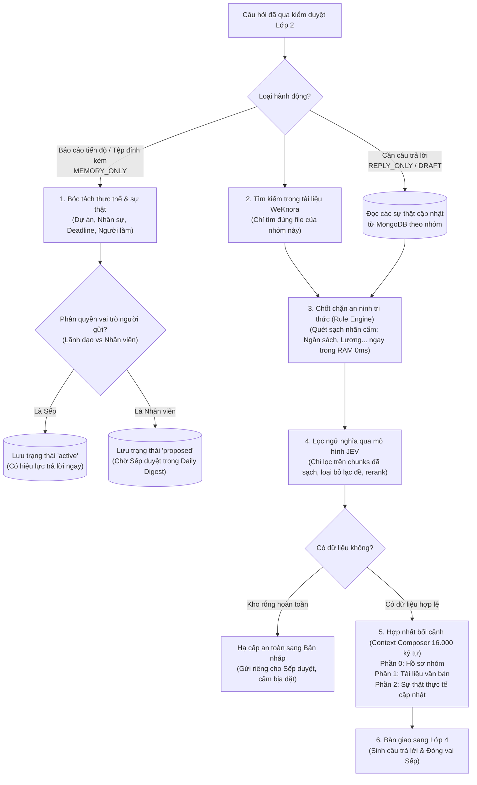

# 📘 TÀI LIỆU GIẢI THÍCH LỚP 3: KHO TRI THỨC ĐA NGUỒN & HỢP NHẤT BỐI CẢNH (LAYER 3)
> **Dự án HiLark Server**  
> Tài liệu viết theo phong cách kỹ thuật thực tế, dễ hiểu, ưu tiên tiếng Việt và không dùng từ ngữ bóng bẩy.  
> **Vị trí mã nguồn:** [`server/services/docreader_service.py`](file:///Users/hoainam/Desktop/HiLark/server/services/docreader_service.py), [`server/services/weknora.py`](file:///Users/hoainam/Desktop/HiLark/server/services/weknora.py), [`server/utils/llm_extractor.py`](file:///Users/hoainam/Desktop/HiLark/server/utils/llm_extractor.py), [`server/utils/context_composer.py`](file:///Users/hoainam/Desktop/HiLark/server/utils/context_composer.py), [`server/utils/rule_engine.py`](file:///Users/hoainam/Desktop/HiLark/server/utils/rule_engine.py)

---

## 🧭 1. LỚP 3 ĐỂ LÀM GÌ?

Sau khi một tin nhắn đã vượt qua cổng kiểm duyệt an ninh ở **Lớp 2** (không hỏi vào chủ đề cấm, nhóm đang mở quyền hoạt động), câu hỏi sẽ được đưa tới **Lớp 3**.

Hãy hình dung Lớp 3 giống như **"Thư viện tài liệu đa phương thức kết hợp cuốn Sổ tay ghi nhớ sống"** của người trợ lý:

* **Tài liệu văn bản (Sách vở tĩnh):** Bao gồm các file PDF, Word, Excel, Slide, thư mục Lark Drive, trang Wiki hoặc văn bản DocX của công ty đã được nạp lên kho tri thức WeKnora RAG.
* **Sổ tay ghi nhớ thực tế (Tri thức động thời gian thực - Dynamic Claims):** Trong quá trình làm việc hàng ngày trên nhóm chat, mọi người liên tục chốt việc: đổi deadline, đổi người phụ trách, báo cáo sự cố... Những thông tin này **chưa kịp cập nhật vào tài liệu Word**, nhưng đã được Lớp 3 âm thầm ghi nhớ vào cơ sở dữ liệu MongoDB.
* **Nhiệm vụ cốt lõi của Lớp 3:**
  1. **Đọc hiểu đa phương thức:** Tự động đọc và bóc tách cấu trúc 17 loại định dạng file qua AnyDoc gRPC Reader, đọc trực tiếp Lark DocX/Wiki OpenAPI 0 token.
  2. **Cách ly dữ liệu tuyệt đối:** Chỉ lấy tài liệu được phân quyền cho nhóm chat này, không đọc nhầm tài liệu của dự án khác.
  3. **Lọc bảo mật 0ms trong RAM:** Rule Engine quét sạch nhãn cấm trước khi gửi qua mạng.
  4. **Quy tắc sự thật cập nhật (Fact Override):** Nếu tài liệu gốc ghi một đằng, nhưng thực tế trong chat Sếp vừa chốt một nẻo $\rightarrow$ **Thực tế mới chốt luôn luôn là chân lý số 1!**
  5. **Hợp nhất bối cảnh toàn vẹn:** Hạn mức mở rộng lên **16.000 ký tự** (`max_chunk_chars: 16000`), chống hoàn toàn lỗi cắt cụt các tài liệu dài như Sổ tay Nhân viên.

---

## 🖼️ SƠ ĐỒ PHÂN RÃ THÀNH PHẦN LỚP 3



---

## 🔍 2. CHI TIẾT CÁC BƯỚC XỬ LÝ TRONG MÃ NGUỒN

### Bước 1: Trích xuất tài liệu đa phương thức AnyDoc gRPC & Lark DocX/Wiki
- **Vị trí trong mã nguồn:** [`server/services/docreader_service.py`](file:///Users/hoainam/Desktop/HiLark/server/services/docreader_service.py) và [`server/services/lark/client.py`](file:///Users/hoainam/Desktop/HiLark/server/services/lark/client.py)
- **Cơ chế phân giải tài liệu:**
  1. **Lark DocX & Wiki OpenAPI:** Khi người dùng gửi liên kết tài liệu Lark Cloud, hệ thống gọi trực tiếp OpenAPI của Lark (`client.docx.v1.document.araw_content` và `client.wiki.v2.space.aget_node`) để lấy toàn bộ nội dung Markdown gốc. Tốc độ cực nhanh (dưới 100ms) và **hoàn toàn miễn phí 0 token LLM**.
  2. **AnyDoc gRPC Engine (`WeKnora-docreader:50051`):** Đối với các tệp đính kèm nhị phân (`.docx`, `.pdf`, `.xlsx`, `.pptx`, `.md`, `.txt`, `.png`, `.jpg`...), hệ thống chuyển stream qua kênh gRPC buffer 50MB. Trích xuất bảng biểu, văn bản đa cột và công thức toán học sang Markdown sạch sẽ.
  3. **Lark Drive Folder Recursive Scan:** Tự động duyệt qua cây thư mục Lark Drive được gán cho nhóm, nạp toàn bộ các tài liệu con vào cơ sở tri thức của dự án.

---

### Bước 2: Bóc tách và quản trị tri thức động (Dynamic Claims Governance)
- **Vị trí trong mã nguồn:** [`server/utils/llm_extractor.py`](file:///Users/hoainam/Desktop/HiLark/server/utils/llm_extractor.py) và [`server/services/claim_service.py`](file:///Users/hoainam/Desktop/HiLark/server/services/claim_service.py)
- **Bài toán cốt lõi: Tại sao phải bóc tách Thực thể (Entity) làm mỏ neo?**
  * Nếu chỉ bóc tách sự thật đơn lẻ (ví dụ: `deadline = 30/10`, `assignee = Nguyên`), các sự thật này sẽ trở thành **"mồ côi"** vì hệ thống không biết deadline 30/10 là của Dự án Atlas hay Dự án Pulse!
  * **Giải pháp:** Bóc tách **Thực thể (Entities)** làm mỏ neo trước (Dự án Sàn, Tính năng QR). Sau đó móc chính xác từng **Sự thật (Claims)** vào đúng thực thể cha đó, giúp hệ thống không bao giờ bị nhầm lẫn giữa các dự án.
- **Phân quyền thăng hạng tri thức (Role-Based Claims Promotion):**
  * **Thông tin từ Nhân viên:** Lưu ở trạng thái `proposed` (đề xuất). Thông tin này chỉ mang tính tham khảo nội bộ, chưa được dùng để trả lời chính thức vào nhóm.
  * **Thông tin từ Lãnh đạo hoặc đã duyệt trong Daily Digest:** Tự động thăng hạng thành `active` (chính thức). Lúc này câu trả lời của bot mới được phép trích dẫn thông tin này.
  * **Cơ chế ghi đè dữ liệu cũ (Superseded Tracking):** Khi có quyết định mới chốt, thông tin cũ tự động chuyển thành `superseded` (hết hiệu lực) và thông tin mới là `active`.

---

### Bước 3: Tìm kiếm tài liệu văn bản với cơ chế cách ly tuyệt đối (WeKnora RAG)
- **Vị trí trong mã nguồn:** [`server/services/weknora.py`](file:///Users/hoainam/Desktop/HiLark/server/services/weknora.py) và [`server/services/chat_service.py`](file:///Users/hoainam/Desktop/HiLark/server/services/chat_service.py)
- **2 Giải pháp kỹ thuật quan trọng:**
  1. **Cách ly dữ liệu tuyệt đối (RAG Hard Isolation):** Mỗi nhóm chat được liên kết với một danh sách mã tài liệu cụ thể (`knowledge_ids`). Khi thành viên hỏi, hệ thống **chỉ gửi truy vấn vào đúng các file tài liệu của nhóm đó**, hoàn toàn ngăn chặn tình trạng lộ bí mật của dự án khác sang nhóm này.
  2. **Tự động bổ sung bối cảnh dự án (Context-driven Query Expansion):** Thành viên trong nhóm thường hỏi cộc lốc: *"tiến độ thế nào rồi?"*, *"ai đang làm lead?"*. Hệ thống tự động ghép thêm tên dự án vào câu tìm kiếm: *"tiến độ thế nào rồi Dự án Sàn Thanh Toán"* $\rightarrow$ Giúp thuật toán tìm kiếm tài liệu của WeKnora tìm trúng đích 100%.

---

### Bước 4: Chốt chặn an ninh tri thức tập trung (Rule Engine RAM 0ms)
- **Vị trí trong mã nguồn:** [`server/utils/rule_engine.py`](file:///Users/hoainam/Desktop/HiLark/server/utils/rule_engine.py)
- **Thực thi In-Memory (0ms) trước JEV Filter:**
  * Ngay sau khi WeKnora trả về chunks và MongoDB trả về claims, **Rule Engine** lập tức quét toàn bộ nội dung đối chiếu với danh sách nhãn cấm (`forbidden_labels`).
  * Thực thi trên RAM hoàn toàn miễn phí, **độ trễ 0ms**, không tốn token LLM.
  * Nếu một đoạn trích hoặc mệnh đề chứa thông tin vi phạm (ví dụ: lương, chi phí mật) $\rightarrow$ Bị **DROP** ngay lập tức, **ngăn chặn tuyệt đối việc gửi dữ liệu nhạy cảm qua mạng sang bước tiếp theo**.

---

### Bước 5: Lọc ngữ nghĩa & Tái sắp xếp đoạn trích qua JEV (Relevance & Reranking)
- **Vị trí trong mã nguồn:** [`server/services/jev.py`](file:///Users/hoainam/Desktop/HiLark/server/services/jev.py)
- **Cách JEV xử lý trên tập chunks đã khử trùng sạch:**
  * Chỉ nhận các chunks đã vượt qua chốt chặn Rule Engine an toàn.
  * Gửi 1 lượt duy nhất sang mô hình JEV để chấm điểm: Đoạn này có thực sự liên quan (`RELEVANT`) hay lạc đề (`IRRELEVANT`)?
  * **Tái sắp xếp (Rerank):** Đoạn nào có điểm ngữ nghĩa sát nhất với câu hỏi sẽ được đẩy lên trên cùng; đoạn lạc đề bị loại bỏ hoàn toàn.
- **Chốt chặn hạ cấp an toàn khi kho rỗng (RAG Gate Empty Downgrade):**
  * Nếu câu hỏi cần trả lời nhưng tìm trong kho không thấy tài liệu và cũng không có sự thật nào (`not clean_chunks and not clean_claims`) $\rightarrow$ Ép chuyển sang **Bản nháp chờ duyệt (`DRAFT_PENDING_APPROVAL`)** để Sếp tự xem xét, cấm bot tự bịa đặt thông tin.

---

### Bước 6: Hợp nhất ngữ cảnh 3 phần (Context Composer 16.000 ký tự)
- **Vị trí trong mã nguồn:** [`server/utils/context_composer.py`](file:///Users/hoainam/Desktop/HiLark/server/utils/context_composer.py)
- **Mở rộng hạn mức 16.000 ký tự (`max_chunk_chars: 16000`):**
  * Trong thực tế kiểm thử, các tài liệu quy định công ty (như Sổ tay Nhân viên dài hơn 10.000 ký tự) từng bị cắt cụt đoạn sau nếu dùng giới hạn cũ 4.000 ký tự, khiến bot trả lời sai ngày trả lương.
  * Việc nâng trần lên 16.000 ký tự giải quyết triệt để vấn đề này, đảm bảo AI đọc trọn vẹn ngữ cảnh điều hành.
- **Cấu trúc ngữ cảnh chuẩn mực 3 phần bàn giao cho AI:**
  ```text
  === PHẦN 0: BỐI CẢNH DỰ ÁN & HỒ SƠ TÀI LIỆU CỦA NHÓM ===
  • Tên nhóm chat: Dự án Sàn Thanh Toán
  • Danh sách tài liệu đính kèm: Kế hoạch triển khai.pdf, Kiến trúc cổng thanh toán.docx

  === PHẦN 1: TÀI LIỆU DỰ ÁN & VĂN BẢN HỆ THỐNG (WEKNORA) ===
  [Tài liệu: Kế hoạch triển khai.pdf]
  Mục tiêu dự án là xây dựng cổng thanh toán trực tuyến. Trưởng nhóm phụ trách ban đầu là Nam...

  === PHẦN 2: THỰC TẾ CẬP NHẬT & MỆNH ĐỀ ĐỘNG (MONGODB CLAIMS) ===
  ⭐ [QUYẾT ĐỊNH CHÍNH THỨC TỪ CEO / BAN ĐIỀU HÀNH] [CURRENT]:
  • Người phụ trách hiện tại: Nguyên (Thay thế cho: Nam)
  • Hạn chót mới: Ngày 25/10/2026
  ```

---

## ⚙️ 3. BẢNG THAM SỐ CẤU HÌNH & BỘ NHỚ LỚP 3

| Thành phần | Vị trí lưu trữ | Vai trò kỹ thuật |
| :--- | :--- | :--- |
| `entities` | MongoDB Collection | Lưu trữ danh mục các thực thể: Dự án, Nhân sự, Tính năng, Khách hàng. |
| `claims` | MongoDB Collection | Lưu trữ các mệnh đề sự thật động kèm trạng thái (`active`, `proposed`, `superseded`). |
| `knowledge_ids` | Bảng nhóm (`chat_scopes`) | Danh sách ID tài liệu được phép truy cập của nhóm trên WeKnora. |
| `retrieve_count` | Mặc định: `5` | Số lượng đoạn trích tối đa lấy ra từ WeKnora mỗi lần tìm kiếm. |
| `max_chunk_chars` | Mặc định: `16000` | Số ký tự tối đa của tài liệu hợp nhất trong Context Composer. |

*Sau khi toàn bộ tri thức được chọn lọc và đóng gói mạch lạc, câu hỏi sẽ được bàn giao sang **Lớp 4: Soạn thảo câu trả lời & Đóng vai người điều hành (Executive Persona & Grounded QA)**.*
