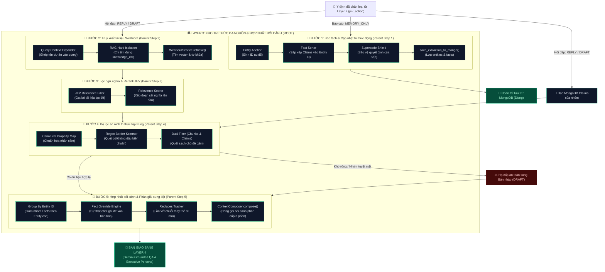

# 🛠️ TỔNG QUAN BỘ CÔNG CỤ (UTILS) CỦA LAYER 3
> **HiLark Server Architecture** — Bóc tách chi tiết các module tiện ích thuộc Lớp 3 (Kho tri thức đa nguồn & Hợp nhất bối cảnh).

---

## 🧭 1. KIẾN TRÚC PHÂN CẤP: UTILS (CHILD) ➔ STEPS (PARENT) ➔ LAYER 3 (ROOT)

Trong Layer 3, dữ liệu từ hai thế giới khác nhau — **Tài liệu văn bản tĩnh (WeKnora RAG)** và **Sự thật động thời gian thực (MongoDB Claims)** — được truy xuất, làm sạch an ninh và hợp nhất lại làm một. Mỗi **Bước xử lý (Parent Step)** được vận hành bởi các **Tiện ích con (Child Utils / Components)** chuyên trách:

```
                      ┌─────────────────────────────────────────────────────────────┐
                      │              LAYER 3: KNOWLEDGE CONTEXT PIPELINE            │
                      │         (Kho tri thức đa nguồn & Hợp nhất bối cảnh)         │
                      └──────────────────────────────┬──────────────────────────────┘
                                                     │
         ┌───────────────────┬───────────────────────┼───────────────────────┬───────────────────┐
         ▼                   ▼                       ▼                       ▼                   ▼
┌─────────────────┐ ┌─────────────────┐     ┌─────────────────┐     ┌─────────────────┐ ┌─────────────────┐
│     BƯỚC 1      │ │     BƯỚC 2      │     │     BƯỚC 3      │     │     BƯỚC 4      │ │     BƯỚC 5      │
│  Bóc tách & Cập │ │  Truy xuất tài  │     │  Lọc ngữ nghĩa  │     │  Bộ lọc an ninh │ │  Hợp nhất bối   │
│  nhật sự thật   │ │  liệu WeKnora   │     │  & Rerank (JEV) │     │  tri thức tập   │ │  cảnh & Ghi đè  │
│  (Parent Step)  │ │  (Parent Step)  │     │  (Parent Step)  │     │  trung (Parent) │ │  (Parent Step)  │
└────────┬────────┘ └────────┬────────┘     └────────┬────────┘     └────────┬────────┘ └────────┬────────┘
         │                   │                       │                       │                   │
         │ (Child Utils)     │ (Child Utils)         │ (Child Utils)         │ (Child Utils)     │ (Child Utils)
         ▼                   ▼                       ▼                       ▼                   ▼
┌─────────────────┐ ┌─────────────────┐     ┌─────────────────┐     ┌─────────────────┐ ┌─────────────────┐
│ • Entity Anchor │ │ • Query Context │     │ • JEV Relevance │     │ • Canonical Map │ │ • Group By      │
│   (uuid5 ID)    │ │   Expander      │     │   Filter        │     │   (budget, sal) │   Entity ID       │
│ • Fact Sorter   │ │ • RAG Hard      │     │ • Relevance     │     │ • Regex Border  │ │ • Fact Override │
│   (Gán vào ID)  │ │   Isolation     │     │   Scorer        │     │   (vn accented) │   Engine          │
│ • Supersede     │ │ • WeKnora API   │     │ • Empty Chunk   │     │ • Dual Scanner  │ │ • Replaces      │
│   Shield        │ │   Retriever     │     │   Pruner        │     │   (Chunk/Claim) │   Tracker         │
│ • VN Time Norm  │ │                 │     │                 │     │ • Quality Guard │ │ • 3-Part Context│
│ • Mongo Storer  │ │                 │     │                 │     │   Filter        │   Packer          │
└─────────────────┘ └─────────────────┘     └─────────────────┘     └─────────────────┘ └─────────────────┘
```

---

## 🧩 2. BẢNG MỐI QUAN HỆ PARENT - CHILD CHI TIẾT

| Bước xử lý (Parent Step) | Vai trò của Bước trong Layer 3 | Tiện ích thực thi con (Child Utils / Functions) | Vị trí mã nguồn |
| :--- | :--- | :--- | :--- |
| **BƯỚC 1: Bóc tách & Cập nhật tri thức động** *(Memory Extraction & Lineage)* | Bóc tách Thực thể làm mỏ neo định danh, sắp xếp Claims con vào đúng thực thể cha; bảo vệ quyết định của Sếp. | • `generate_stable_entity_id()`: Sinh ID ổn định (uuid5) cho Thực thể.<br/>• `extract_facts_async()`: Móc từng Claim vào đúng `entity_id` cha.<br/>• `Supersede Shield`: Cấm thành viên ghi đè Sếp, hạ cấp về `PROPOSED`.<br/>• `normalize_time_value()`: Chuẩn hóa lịch và giờ Việt Nam (UTC+7).<br/>• `save_extraction_to_mongo()`: Lưu trữ phân vùng `entities` & `facts`. | [`utils/llm_extractor.py:L1-1332`](file:///Users/hoainam/Desktop/HiLark/server/utils/llm_extractor.py)<br/>[`services/chat_service.py:L133-188`](file:///Users/hoainam/Desktop/HiLark/server/services/chat_service.py#L133-L188) |
| **BƯỚC 2: Truy xuất tài liệu WeKnora** *(WeKnora RAG Hard Isolation)* | Tìm kiếm đoạn trích trong tài liệu tĩnh với cơ chế cách ly tuyệt đối theo nhóm chat. | • `Query Context Expander`: Tự động bổ sung tên dự án vào câu hỏi cộc lốc.<br/>• `RAG Hard Isolation`: Chỉ tìm kiếm trong đúng các `knowledge_ids` của nhóm.<br/>• `WeKnoraService.retrieve()`: Gọi API WeKnora tìm kiếm vector & từ khóa. | [`services/chat_service.py:L450-485`](file:///Users/hoainam/Desktop/HiLark/server/services/chat_service.py#L450-L485)<br/>[`services/weknora.py:L30-80`](file:///Users/hoainam/Desktop/HiLark/server/services/weknora.py#L30-L80) |
| **BƯỚC 3: Bộ lọc an ninh tri thức tập trung** *(Unified Rule Engine)* | Quét sạch các đoạn văn bản hoặc sự thật chứa chủ đề cấm ngay trong RAM (0ms) trước khi đưa vào AI. | • `Canonical Property Map`: Ánh xạ thuộc tính chuẩn (`budget`, `salary`...).<br/>• `Regex Border Scanner`: Quét regex biên từ có/không dấu, chống bắt nhầm từ.<br/>• `is_chunk_violating()` & `is_claim_violating()`: Quét đồng thời Chunks và Claims.<br/>• `SanitizeResult`: Đóng gói dữ liệu sạch và kích hoạt hạ cấp nếu kho rỗng. | [`utils/rule_engine.py:L1-489`](file:///Users/hoainam/Desktop/HiLark/server/utils/rule_engine.py)<br/>[`services/chat_service.py:L513-522`](file:///Users/hoainam/Desktop/HiLark/server/services/chat_service.py#L513-L522) |
| **BƯỚC 4: Lọc ngữ nghĩa & Tái sắp xếp** *(Semantic Filter & Rerank)* | Loại bỏ tài liệu rác lạc đề trên danh sách chunks đã sạch và xếp đoạn sát nghĩa nhất lên đầu. | • `JevService.filter_chunks_relevance()`: Đánh giá độ liên quan ngữ nghĩa (`RELEVANT` vs `IRRELEVANT`).<br/>• `Relevance Scorer`: Chấm điểm và sắp xếp lại thứ tự ưu tiên đoạn trích.<br/>• `Empty Chunk Pruner`: Loại bỏ các đoạn văn bản rác hoặc rỗng nội dung. | [`services/jev.py:L104-197`](file:///Users/hoainam/Desktop/HiLark/server/services/jev.py#L104-L197)<br/>[`services/chat_service.py:L524-535`](file:///Users/hoainam/Desktop/HiLark/server/services/chat_service.py#L524-L535) |
| **BƯỚC 5: Hợp nhất bối cảnh & Phân giải xung đột** *(Context Composer & Fact Override)* | Đóng gói tri thức thành văn bản phân cấp 3 phần, áp dụng quy tắc sự thật chat ghi đè tài liệu tĩnh. | • `Group By Entity ID`: Gom nhóm toàn bộ Facts con theo Thực thể cha.<br/>• `Fact Override Engine`: Sự thật hội thoại `[CURRENT]` ghi đè văn bản tĩnh WeKnora.<br/>• `Replaces Tracker`: Lần vết lịch sử thay thế của các sự thật cũ (`superseded`).<br/>• `ContextComposer.compose()`: Đóng gói 3 phần bàn giao sang Layer 4. | [`utils/context_composer.py:L1-687`](file:///Users/hoainam/Desktop/HiLark/server/utils/context_composer.py)<br/>[`services/chat_service.py:L568-605`](file:///Users/hoainam/Desktop/HiLark/server/services/chat_service.py#L568-L605) |

---

## 🗂️ DANH MỤC TÀI LIỆU BÓC TÁCH KỸ THUẬT

1. **[`llm_extractor.md`](file:///Users/hoainam/Desktop/HiLark/server/docs/layer3/ultis_docs/llm_extractor.md)**:
   * **Mã nguồn:** [`server/utils/llm_extractor.py`](file:///Users/hoainam/Desktop/HiLark/server/utils/llm_extractor.py) *(1332 dòng, 53.9 KB)*.
   * **Nhiệm vụ cốt lõi:** Bóc tách **Thực thể (Entities)** làm mỏ neo định danh (`entity_id`), từ đó cho hệ thống biết chính xác để **sắp xếp các Mệnh đề sự thật (Claims/Facts) vào đúng thực thể cha**; triệt tiêu hoàn toàn vấn đề claims mồ côi hay hiện tượng "râu ông nọ cắm cằm bà kia".
   * **Điểm sáng kỹ thuật:** Bóc tách 2 nhánh độc lập (Entities & Facts), thuật toán giải quyết Coreference Resolution, chuẩn hóa giờ Việt Nam (UTC+7), cơ chế `SUPERSEDE SHIELD` (chống nhân sự ghi đè quyết định của Sếp) và lưu trữ phân vùng vào MongoDB.

2. **[`rule_engine.md`](file:///Users/hoainam/Desktop/HiLark/server/docs/layer3/ultis_docs/rule_engine.md)**:
   * **File mã nguồn:** [`server/utils/rule_engine.py`](file:///Users/hoainam/Desktop/HiLark/server/utils/rule_engine.py) *(489 dòng, 21.2 KB)*.
   * **Nhiệm vụ:** Bộ lọc an ninh tri thức đa tầng (Unified Rule Engine), làm sạch cả WeKnora Chunks và MongoDB Claims đối chiếu với danh sách nhãn cấm (`forbidden_labels`) từ Lark Base.
   * **Điểm sáng kỹ thuật:** Tầng 1 (Ánh xạ thuộc tính chuẩn), Tầng 2 (Quét Regex chuỗi con có dấu & không dấu với biên từ chuẩn tiếng Việt, chống bắt nhầm từ), Tầng 3 (Kiểm tra chất lượng dữ liệu).

3. **[`context_composer.md`](file:///Users/hoainam/Desktop/HiLark/server/docs/layer3/ultis_docs/context_composer.md)**:
   * **File mã nguồn:** [`server/utils/context_composer.py`](file:///Users/hoainam/Desktop/HiLark/server/utils/context_composer.py) *(687 dòng, 30.5 KB)*.
   * **Nhiệm vụ:** Nhận dữ liệu đa nguồn từ Retriever và Claims Store, chuẩn hóa và đóng gói thành một bối cảnh phân cấp hoàn chỉnh (Hierarchical Unified Context) bàn giao cho Gemini AI.
   * **Điểm sáng kỹ thuật:** Cấu trúc 3 phần rõ ràng, thuật toán phân loại và nhóm Facts theo Entity cha, cơ chế lần vết thay thế (`replaces`), và bộ quy tắc giải quyết xung đột tri thức (Fact Override Rules).

---

## 🔄 3. SƠ ĐỒ KẾT NỐI LUỒNG DỮ LIỆU: UTILS ➔ STEPS ➔ LAYER 3


### Quy trình dòng chảy chi tiết (Mermaid Flowchart):



---

## 🔄 4. MA TRẬN PHỐI HỢP GIỮA CÁC UTILS TRONG LAYER 3

| Hành động trong Pipeline | `llm_extractor.py` | `rule_engine.py` | `context_composer.py` |
| :--- | :---: | :---: | :---: |
| **Báo cáo tiến độ (`MEMORY_ONLY`)** | 🟢 Chạy chính (Bóc tách & Lưu) | ⚪ Không kích hoạt | ⚪ Không kích hoạt |
| **Hỏi đáp thông thường (`REPLY_ONLY`)** | ⚪ Không trích xuất mới | 🟢 Làm sạch Chunks & Claims | 🟢 Đóng gói bối cảnh 3 phần |
| **Vừa báo cáo vừa hỏi (`MEMORY_AND_DRAFT`)** | 🟢 Bóc tách & Lưu MongoDB | 🟢 Làm sạch Chunks & Claims | 🟢 Đóng gói bối cảnh 3 phần |
| **Dự án Tuyệt mật / Kho rỗng** | ⚪ Không trích xuất mới | 🟢 Quét cấm & Kích hoạt hạ cấp | 🟢 Đóng gói bối cảnh dự phòng |
