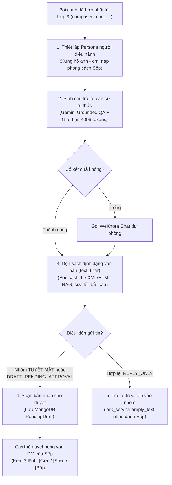

# 📘 TÀI LIỆU GIẢI THÍCH LỚP 4: SINH CÂU TRẢ LỜI & ĐÓNG VAI NGƯỜI ĐIỀU HÀNH (LAYER 4)
> **Dự án HiLark Server**  
> Tài liệu viết theo phong cách kỹ thuật thực tế, dễ hiểu, ưu tiên tiếng Việt và không dùng từ ngữ bóng bẩy.

---

## 🧭 1. LỚP 4 ĐỂ LÀM GÌ?

Sau khi câu hỏi của thành viên đã được kiểm tra an toàn (Lớp 2) và bối cảnh tri thức đã được hợp nhất đầy đủ (Lớp 3), dữ liệu sẽ được bàn giao sang **Lớp 4** — chặng cuối cùng của toàn bộ hệ thống.

Hãy hình dung Lớp 4 giống như **"Vị Tổng thư ký kiêm Người phát ngôn riêng của Sếp"**:

1. **Đóng vai Sếp (Executive Persona):** Trả lời nhân danh chính tài khoản cá nhân của Sếp trên Lark, dùng văn phong của một người quản lý điềm tĩnh, dứt khoát, xưng "anh - em" tự nhiên và tôn trọng đồng nghiệp.
2. **Nói như kiến thức của chính mình:** Tuyệt đối không nói *"theo tài liệu..."* hay *"theo cơ sở dữ liệu..."*. Sếp nắm rõ công việc thì trả lời tự nhiên như kiến thức trong đầu.
3. **Ưu tiên sự thật mới nhất (Fact Override):** Nếu trong tài liệu ghi một đằng nhưng thực tế Sếp vừa chốt trong chat một nẻo, câu trả lời sẽ tự động lấy mốc chốt mới nhất và giải thích ngắn gọn quá trình thay đổi.
4. **Bảo vệ tuyệt đối danh tính:** Không nhầm lẫn người hỏi với người khác; coi đề xuất của nhân viên chỉ là ý kiến cá nhân chờ duyệt chứ chưa phải quyết định chính thức.
5. **Cơ chế Phê duyệt bản nháp (Draft Approval):**
   * Nếu nhóm chat thuộc diện **Tuyệt mật** hoặc câu hỏi có yếu tố rủi ro $\rightarrow$ **Bot tuyệt đối không tự ý phát ngôn vào nhóm!**
   * Thay vào đó, AI soạn sẵn một bản nháp chỉn chu và gửi riêng vào tin nhắn (DM) của Sếp kèm 3 lựa chọn: **[Gửi]** / **[Sửa]** / **[Bỏ]**. Chỉ khi Sếp duyệt thì tin nhắn mới được gửi vào nhóm.

---

## 🖼️ SƠ ĐỒ DÒNG CHẢY HOẠT ĐỘNG LỚP 4



---

## 🔍 2. CHI TIẾT 5 BƯỚC XỬ LÝ TRONG MÃ NGUỒN

### Bước 1: Thiết lập vai diễn người điều hành (Persona Prompting)
- **Vị trí trong mã nguồn:** [`server/services/chat_service.py:L78-126`](file:///Users/hoainam/Desktop/HiLark/server/services/chat_service.py#L78-L126) và [`L209-221`](file:///Users/hoainam/Desktop/HiLark/server/services/chat_service.py#L209-L221)
- **Cơ chế:** Nạp mẫu nhắc lệnh `GROUNDED_QA_USER_PERSONA_PROMPT` với các tham số đích danh:
  * `user_name`: Tên người hỏi (ví dụ: *"Trí"*, *"Nguyên"*).
  * `responder_name`: Tên của Sếp (lấy từ cấu hình `LARK_USER_NAME`).
  * `role`: Chức danh điều hành (Founder / CEO / CTO).
- **7 Nguyên tắc vàng của phong cách điều hành (Chuẩn 10/10):**
  1. *Xưng hô:* Tự xưng là "anh", gọi người hỏi là "em" hoặc gọi thẳng tên; dùng từ đệm tự nhiên (*"nhé"*, *"sớm nhé"*, *"vướng gì báo anh"*).
  2. *Nói như kiến thức của mình:* Không để lộ từ ngữ máy móc như *"theo tài liệu WeKnora..."*.
  3. *Fact Override:* Nêu rõ các biến động công việc nếu thông tin cũ đã bị thay thế.
  4. *Khi thiếu thông tin:* Trả lời điềm tĩnh như người thật (*"Phần này anh chưa nắm được số liệu mới nhất, để anh kiểm tra lại rồi nhắn em sau nhé"*), tuyệt đối không trả lời máy móc.
  5. *Bảo toàn danh tính:* Không gán ghép trách nhiệm của người khác sang người đang hỏi.
  6. *Thẩm quyền:* Coi các ý kiến của thành viên chỉ là đề xuất chờ duyệt, không xem là quyết định chính thức.
  7. *Mặc định dự án:* Thành viên hỏi cộc lốc về dự án thì tự động lấy tài liệu dự án của nhóm đó trả lời ngay, không hỏi ngược lại.

---

### Bước 2: Sinh câu trả lời căn cứ tri thức (Gemini Grounded QA)
- **Vị trí trong mã nguồn:** [`server/services/chat_service.py:L190-235`](file:///Users/hoainam/Desktop/HiLark/server/services/chat_service.py#L190-L235)
- **Khóa an toàn tải trọng:** Được bảo vệ bởi `GLOBAL_LLM_SEMAPHORE` để đảm bảo server không bị nghẽn khi nhiều nhóm hỏi cùng lúc.
- **Giới hạn độ dài:** Cấp hạn mức tối đa `max_output_tokens = 4096` để câu trả lời luôn trọn vẹn, không bao giờ bị cụt câu giữa chừng.
- **Động cơ dự phòng (Fallback):** Nếu Gemini gặp trục trặc mạng hoặc trả về chuỗi rỗng, hệ thống tự động kích hoạt `weknora_service.get_chat_response()` để đảm bảo người dùng luôn nhận được thông tin.

---

### Bước 3: Làm sạch định dạng & Bóc tách thẻ trích dẫn
- **Vị trí trong mã nguồn:** [`server/utils/text_filter.py:L39-91`](file:///Users/hoainam/Desktop/HiLark/server/utils/text_filter.py#L39-L91) và [`chat_service.py:L586`](file:///Users/hoainam/Desktop/HiLark/server/services/chat_service.py#L586)
- **Tài liệu bóc tách kỹ thuật:** 👉 Xem [`ultis_docs/output_sanitizer.md`](file:///Users/hoainam/Desktop/HiLark/server/docs/layer4/ultis_docs/output_sanitizer.md) và tổng quan quan hệ Parent-Child tại [`ultis_docs/README.md`](file:///Users/hoainam/Desktop/HiLark/server/docs/layer4/ultis_docs/README.md).
- **Quy trình làm sạch qua hàm `text_filter.clean_output()`:**
  1. Quét và xóa sạch các thẻ XML/HTML của RAG: `<kb .../>`, `<doc ...>`, `<chunk ...>`, `<citation ...>`.
  2. Xóa các cụm ngoặc trích dẫn nguồn lộ liễu nếu AI tự ý sinh ra: `[Cập nhật hội thoại: ...]`, `[Tài liệu: ...]`.
  3. Chữa lỗi hở khoảng cách trước dấu câu (chuyển `"Dự án , deadline"` thành `"Dự án, deadline"`).
  4. Rút gọn các dòng trống liên tiếp (giữ tối đa 2 dấu xuống dòng `\n\n`), giúp tin nhắn hiển thị sang trọng, chỉn chu trên app Lark.

---

### Bước 4: Trả lời tự động vào nhóm chat (Auto Reply)
- **Vị trí trong mã nguồn:** [`server/services/chat_service.py:L654-665`](file:///Users/hoainam/Desktop/HiLark/server/services/chat_service.py#L654-L665)
- **Điều kiện kích hoạt:**
  * Ý định được phân loại là `REPLY_ONLY`.
  * Nhóm chat đang mở và không thuộc diện Tuyệt mật.
  * Cờ `reply_to_lark = True`.
- **Cơ chế gửi:** Gọi `lark_service.areply_text(message_id, answer, as_user=True)`. Tin nhắn được bắn vào nhóm chat **dưới danh nghĩa tài khoản cá nhân của Sếp**, trích dẫn đúng tin nhắn của người hỏi.

---

### Bước 5: Luồng phê duyệt bản nháp riêng tư (Draft Approval Workflow)
- **Vị trí trong mã nguồn:** [`server/services/chat_service.py:L589-651`](file:///Users/hoainam/Desktop/HiLark/server/services/chat_service.py#L589-L651)
- **Khi nào kích hoạt:**
  1. Nhóm chat được đánh dấu là **Tuyệt mật** (`security_level == 'confidential'`).
  2. Hoặc mô hình an ninh JEV phân loại câu hỏi có rủi ro (`DRAFT_PENDING_APPROVAL` hoặc `MEMORY_AND_DRAFT`).
- **Cách thức hoạt động:**
  1. Lưu trữ bản ghi vào MongoDB bảng `pending_drafts` với trạng thái `pending`.
  2. Định dạng thẻ tin nhắn duyệt nháp gửi thẳng vào tin nhắn riêng (DM) của Sếp:
     ```
     📝 [SOẠN NHÁP CHỜ DUYỆT - DỰ ÁN TUYỆT MẬT]
     ━━━━━━━━━━━━━━━━━━━━━━━━━━━━━━
     👥 Nhóm chat : Dự án Sàn Thanh Toán
     🛡️ Bảo mật   : TUYỆT MẬT (Khóa auto-reply)
     👤 Người hỏi : Trí
     💬 Câu hỏi   : "Bao giờ thì tính năng Quét QR chạy chính thức?"

     💡 Bản nháp AI soạn sẵn:
     "Chào Trí, tính năng Quét QR hiện đang thử nghiệm nội bộ, dự kiến ngày 20/10 sẽ chạy chính thức em nhé."

     ⚠️ Lý do: Nhóm thuộc mức độ TUYỆT MẬT (100% câu trả lời phải được Sếp duyệt).
     👉 Hành động chờ duyệt: Nhắn lại [Gửi] / [Sửa: <nội dung>] / [Bỏ]
     🆔 Message ID gốc: om_xxxxxxxxxxxx
     ━━━━━━━━━━━━━━━━━━━━━━━━━━━━━━
     ```
  3. Khi Sếp gõ `Gửi`, `Sửa: ...` hoặc `Bỏ` trong tin nhắn riêng, hệ thống sẽ thực thi tương ứng mà nhóm chat không hề hay biết sự hiện diện của AI.
