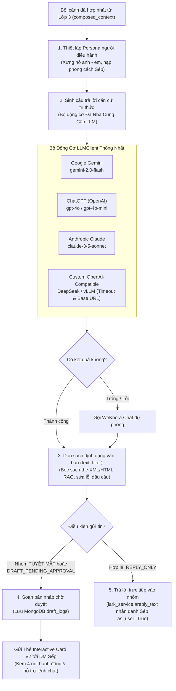

# 📘 TÀI LIỆU GIẢI THÍCH LỚP 4: SINH CÂU TRẢ LỜI & ĐÓNG VAI NGƯỜI ĐIỀU HÀNH (LAYER 4)
> **Dự án HiLark Server**  
> Tài liệu viết theo phong cách kỹ thuật thực tế, dễ hiểu, ưu tiên tiếng Việt và không dùng từ ngữ bóng bẩy.  
> **Vị trí mã nguồn:** [`server/services/ai/gemini_client.py`](file:///Users/hoainam/Desktop/HiLark/server/services/ai/gemini_client.py), [`server/services/chat_service.py`](file:///Users/hoainam/Desktop/HiLark/server/services/chat_service.py), [`server/services/draft_service.py`](file:///Users/hoainam/Desktop/HiLark/server/services/draft_service.py), [`server/services/lark/card_builder.py`](file:///Users/hoainam/Desktop/HiLark/server/services/lark/card_builder.py), [`server/services/lark/handlers/owner_command_handler.py`](file:///Users/hoainam/Desktop/HiLark/server/services/lark/handlers/owner_command_handler.py)

---

## 🧭 1. LỚP 4 ĐỂ LÀM GÌ?

Sau khi câu hỏi của thành viên đã được kiểm tra an toàn (Lớp 2) và bối cảnh tri thức đã được hợp nhất đầy đủ (Lớp 3), dữ liệu sẽ được bàn giao sang **Lớp 4** — chặng cuối cùng của toàn bộ hệ thống.

Hãy hình dung Lớp 4 giống như **"Vị Tổng thư ký kiêm Người phát ngôn riêng của Sếp"**:

1. **Đóng vai Sếp (Executive Persona):** Trả lời nhân danh chính tài khoản cá nhân của Sếp trên Lark (`as_user=True`), dùng văn phong của một người quản lý điềm tĩnh, dứt khoát, xưng "anh - em" tự nhiên và tôn trọng đồng nghiệp.
2. **Đa Nhà Cung Cấp LLM (Multi-Provider Engine):** Không phụ thuộc vào một nhà cung cấp duy nhất. Hỗ trợ linh hoạt **Google Gemini**, **OpenAI ChatGPT**, **Anthropic Claude**, hoặc **Tùy chỉnh (OpenAI-compatible)** với cơ chế Hybrid BYOK mã hóa chuẩn quân đội AES-256 Fernet.
3. **Nói như kiến thức của chính mình:** Tuyệt đối không nói *"theo tài liệu..."* hay *"theo cơ sở dữ liệu..."*. Sếp nắm rõ công việc thì trả lời tự nhiên như kiến thức trong đầu.
4. **Ưu tiên sự thật mới nhất (Fact Override):** Nếu trong tài liệu ghi một đằng nhưng thực tế Sếp vừa chốt trong chat một nẻo, câu trả lời sẽ tự động lấy mốc chốt mới nhất và giải thích ngắn gọn quá trình thay đổi.
5. **Cơ chế Phê duyệt bản nháp linh hoạt (Interactive Card V2 & Conversational Control):**
   * Nếu nhóm chat thuộc diện **Tuyệt mật** hoặc câu hỏi có yếu tố rủi ro $\rightarrow$ **Bot tuyệt đối không tự ý phát ngôn vào nhóm!**
   * Thay vào đó, AI soạn sẵn một bản nháp chỉn chu và gửi riêng vào tin nhắn (DM) của Sếp kèm 4 lựa chọn: **[Duyệt và gửi]** / **[Nhờ AI sửa lại]** / **[Tự sửa]** / **[Hủy bỏ]**.
   * Ngoài ra, Sếp có thể ra lệnh trực tiếp bằng chat tự nhiên: `Gửi`, `Bỏ`, `Sửa: <nội dung>`, hoặc `Sửa AI: <chỉ đạo>`.
6. **Master Daily Digest Đa Dự Án:** Tiến trình ngầm định kỳ tổng hợp nhật ký ngày, bóc tách bộ ba tri thức (Quyết định, Cam kết, Trạng thái), giữ 100% Applink truy vết nguồn tin và đồng bộ WeKnora sau khi duyệt.

---

## 🖼️ SƠ ĐỒ DÒNG CHẢY HOẠT ĐỘNG LỚP 4

---

## 🔍 2. CHI TIẾT CÁC BƯỚC XỬ LÝ TRONG MÃ NGUỒN

### Bước 1: Thiết lập vai diễn người điều hành (Executive Persona Prompting)
- **Vị trí trong mã nguồn:** [`server/services/chat_service.py`](file:///Users/hoainam/Desktop/HiLark/server/services/chat_service.py)
- **Cơ chế:** Nạp mẫu nhắc lệnh `GROUNDED_QA_USER_PERSONA_PROMPT` với các tham số đích danh:
  * `user_name`: Tên người hỏi (ví dụ: *"Trí"*, *"Nguyên"*).
  * `responder_name`: Tên của Sếp (lấy từ cấu hình `LARK_USER_NAME` hoặc hồ sơ người dùng).
  * `role`: Chức danh điều hành (Founder / CEO / CTO).
- **7 Nguyên tắc vàng của phong cách điều hành (Chuẩn 10/10):**
  1. *Xưng hô:* Tự xưng là "anh", gọi người hỏi là "em" hoặc gọi thẳng tên; dùng từ đệm tự nhiên (*"nhé"*, *"sớm nhé"*, *"vướng gì báo anh"*).
  2. *Nói như kiến thức của mình:* Không để lộ từ ngữ máy móc như *"theo tài liệu WeKnora..."*.
  3. *Fact Override:* Nêu rõ các biến động công việc nếu thông tin cũ đã bị thay thế.
  4. *Khi thiếu thông tin:* Trả lời điềm tĩnh như người thật (*"Phần này anh chưa nắm được số liệu mới nhất, để anh kiểm tra lại rồi nhắn em sau nhé"*), tuyệt đối không trả lời máy móc.
  5. *Bảo toàn danh tính:* Không gán ghép trách nhiệm của người khác sang người đang hỏi.
  6. *Thẩm quyền:* Coi các ý kiến của thành viên chỉ là đề xuất chờ duyệt, không xem là quyết định chính thức.
  7. *Mặc định dự án:* Thành viên hỏi cộc lốc về dự án thì tự động lấy tài liệu dự án của nhóm đó trả lời ngay, không hỏi ngược lại.

---

### Bước 2: Sinh câu trả lời căn cứ tri thức qua Multi-Provider LLM Engine
- **Vị trí trong mã nguồn:** [`server/services/ai/gemini_client.py`](file:///Users/hoainam/Desktop/HiLark/server/services/ai/gemini_client.py) và [`server/services/user_settings_service.py`](file:///Users/hoainam/Desktop/HiLark/server/services/user_settings_service.py)
- **Kiến trúc `LLMClient`:**
  * Thống nhất giao diện gọi AI cho 4 dòng mô hình hàng đầu: Google Gemini, OpenAI, Anthropic Claude, và Custom OpenAI-Compatible.
  * Hỗ trợ cấu hình `llm_base_url` và `llm_timeout` tùy biến riêng cho từng tổ chức hoặc từng người dùng.
- **Phân cấp ưu tiên khóa 3 tầng (3-Tier Key Hierarchy):**
  * `Tier 1: Request Override Key`: Ưu tiên cao nhất khi gọi API thử nghiệm.
  * `Tier 2: User BYOK Key`: Khóa riêng của người dùng được giải mã an toàn từ MongoDB (`AES-256 Fernet`).
  * `Tier 3: System Fallback Key`: Khóa chung của hệ thống cấu hình trong `.env`.
- **Khóa an toàn tải trọng:** Được bảo vệ bởi `GLOBAL_LLM_SEMAPHORE` để đảm bảo server không bị nghẽn khi nhiều nhóm hỏi cùng lúc.
- **Giới hạn độ dài:** Cấp hạn mức tối đa `max_output_tokens = 4096` để câu trả lời luôn trọn vẹn, không bao giờ bị cụt câu giữa chừng.

---

### Bước 3: Làm sạch định dạng & Bóc tách thẻ trích dẫn (Sanitizer)
- **Vị trí trong mã nguồn:** [`server/utils/text_filter.py`](file:///Users/hoainam/Desktop/HiLark/server/utils/text_filter.py)
- **Quy trình làm sạch qua hàm `clean_output()`:**
  1. Quét và xóa sạch các thẻ XML/HTML của RAG: `<kb .../>`, `<doc ...>`, `<chunk ...>`, `<citation ...>`.
  2. Xóa các cụm ngoặc trích dẫn nguồn lộ liễu nếu AI tự ý sinh ra: `[Cập nhật hội thoại: ...]`, `[Tài liệu: ...]`.
  3. Chữa lỗi hở khoảng cách trước dấu câu (chuyển `"Dự án , deadline"` thành `"Dự án, deadline"`).
  4. Rút gọn các dòng trống liên tiếp (giữ tối đa 2 dấu xuống dòng `\n\n`), giúp tin nhắn hiển thị trang trọng, chỉn chu trên app Lark.

---

### Bước 4: Trả lời tự động vào nhóm chat (Auto Reply)
- **Vị trí trong mã nguồn:** [`server/services/chat_service.py`](file:///Users/hoainam/Desktop/HiLark/server/services/chat_service.py)
- **Điều kiện kích hoạt:**
  * Ý định được phân loại là `REPLY_ONLY`.
  * Nhóm chat đang mở và không thuộc diện Tuyệt mật (`security_level != 'confidential'`).
  * Cờ `reply_to_lark = True`.
- **Cơ chế gửi:** Gọi `lark_service.areply_text(message_id, answer, as_user=True)`. Tin nhắn được bắn vào nhóm chat **dưới danh nghĩa tài khoản cá nhân của Sếp**, trích dẫn đúng tin nhắn của người hỏi.

---

### Bước 5: Luồng phê duyệt bản nháp linh hoạt (Draft Approval Workflow)
- **Vị trí trong mã nguồn:** [`server/services/draft_service.py`](file:///Users/hoainam/Desktop/HiLark/server/services/draft_service.py), [`server/services/lark/card_builder.py`](file:///Users/hoainam/Desktop/HiLark/server/services/lark/card_builder.py), [`server/services/lark/handlers/owner_command_handler.py`](file:///Users/hoainam/Desktop/HiLark/server/services/lark/handlers/owner_command_handler.py)
- **Khi nào kích hoạt:**
  1. Nhóm chat được đánh dấu là **Tuyệt mật** (`security_level == 'confidential'`).
  2. Câu hỏi vi phạm vùng cấm ngân sách/lương (Strict HITL).
  3. Hoặc mô hình an ninh JEV phân loại câu hỏi có rủi ro (`DRAFT_PENDING_APPROVAL` hoặc `MEMORY_AND_DRAFT`).
- **Cách thức hoạt động kép (Interactive Card V2 + Conversational Control):**
  1. Lưu trữ bản ghi vào MongoDB bảng `draft_logs` với trạng thái `pending`.
  2. Bắn thẻ **Interactive Card V2** gửi thẳng vào DM của Sếp kèm 4 nút bấm tương tác:
     * **[Duyệt và gửi]:** Bắn câu trả lời ngay vào nhóm chat dưới danh nghĩa Sếp.
     * **[Nhờ AI sửa lại]:** Mở hộp thoại nhập chỉ đạo, AI tự động viết lại câu trả lời và cập nhật thẻ tại chỗ.
     * **[Tự sửa]:** Mở form cho Sếp tự gõ lại nội dung theo ý muốn.
     * **[Hủy bỏ]:** Hủy bản nháp an toàn, không phát ngôn vào nhóm.
  3. **Điều khiển trực tiếp bằng tin nhắn chat (không cần bấm nút):**
     * Sếp nhắn: `Gửi` / `OK` $\rightarrow$ Duyệt và gửi ngay.
     * Sếp nhắn: `Bỏ` / `Hủy` $\rightarrow$ Hủy bản nháp.
     * Sếp nhắn: `Sửa: <nội dung mới>` $\rightarrow$ Gửi nội dung mới vào nhóm.
     * Sếp nhắn: `Sửa AI: <yêu cầu chỉ đạo>` $\rightarrow$ Gọi LLM viết lại theo chỉ đạo của Sếp.

---

### Bước 6: Tiến trình Master Daily Digest Đa Dự Án
- **Vị trí trong mã nguồn:** [`server/services/digest_service.py`](file:///Users/hoainam/Desktop/HiLark/server/services/digest_service.py) và [`server/services/workflows/digest_workflow.py`](file:///Users/hoainam/Desktop/HiLark/server/services/workflows/digest_workflow.py)
- **Hoạt động thực tế:**
  1. Định kỳ theo giờ hẹn (mặc định 18:00), hệ thống quét toàn bộ tin nhắn trong ngày tại `conversation_staging`.
  2. Bóc tách **Bộ ba tri thức (Knowledge Triad):** Quyết định, Cam kết, Thay đổi trạng thái.
  3. Gắn Applink mở đúng vị trí tin nhắn gốc trên Lark để Lãnh đạo kiểm chứng tức thì.
  4. Nối tiếp bối cảnh ngày hôm trước $K-1$ sang ngày hiện tại $K$.
  5. Gửi thẻ duyệt Master Digest tới Sếp. Khi duyệt, tri thức từng nhóm được nạp chính xác vào từng thư viện WeKnora tương ứng.

---

## ⚙️ 3. BẢNG CẤU HÌNH THAM SỐ LỚP 4

| Tham số cấu hình | Giá trị mặc định | Giải thích ý nghĩa |
| :--- | :---: | :--- |
| `DEFAULT_LLM_PROVIDER` | `google` | Nhà cung cấp LLM mặc định (`google`, `openai`, `anthropic`, `custom`). |
| `GEMINI_MODEL` | `gemini-2.0-flash` | Tên mô hình Gemini mặc định. |
| `OPENAI_MODEL` | `gpt-4o-mini` | Tên mô hình OpenAI mặc định. |
| `ANTHROPIC_MODEL` | `claude-3-5-sonnet-20241022` | Tên mô hình Anthropic mặc định. |
| `LLM_DEFAULT_TIMEOUT` | `60.0` | Thời gian chờ tối đa khi gọi LLM (giây). |
| `MAX_OUTPUT_TOKENS` | `4096` | Giới hạn độ dài sinh từ của LLM (chống cụt câu). |
| `DIGEST_SCHEDULE_TIME` | `18:00` | Giờ cố định mỗi ngày để tổng hợp Master Daily Digest. |
| `LARK_USER_NAME` | `Hoài Nam` | Danh tính Lãnh đạo hiển thị khi bot đại diện trả lời. |
