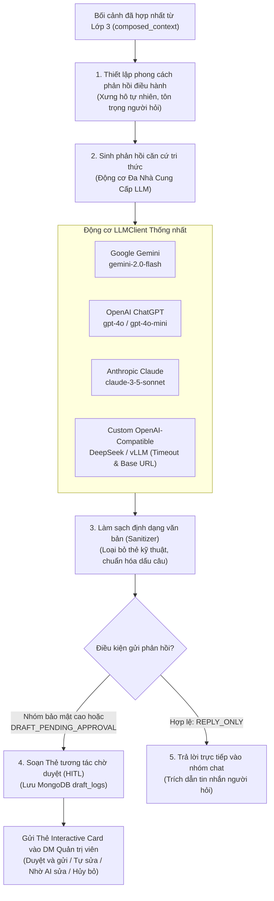

# Lớp 4: Cổng thực thi & Phê duyệt điều hành (Execution & Delivery)

Tài liệu này thuyết minh nguyên lý vận hành của Lớp 4 trong HiLark Server, bao gồm điều phối Đa Nhà Cung Cấp LLM, áp dụng phong cách phản hồi chuẩn mực, cơ chế phê duyệt Human-in-the-Loop (HITL) qua Thẻ tương tác và tiến trình Master Daily Digest.

Mã nguồn liên quan:
- Điều phối LLM: [`server/services/ai/gemini_client.py`](file:///Users/hoainam/Desktop/HiLark/server/services/ai/gemini_client.py)
- Quy trình hội thoại: [`server/services/workflows/chat_workflow.py`](file:///Users/hoainam/Desktop/HiLark/server/services/workflows/chat_workflow.py)
- Vòng đời bản nháp: [`server/services/workflows/draft_workflow.py`](file:///Users/hoainam/Desktop/HiLark/server/services/workflows/draft_workflow.py)
- Thẻ tương tác Lark: [`server/services/lark/card_builder.py`](file:///Users/hoainam/Desktop/HiLark/server/services/lark/card_builder.py)
- Xử lý bấm nút thẻ: [`server/services/lark/handlers/card_action_handler.py`](file:///Users/hoainam/Desktop/HiLark/server/services/lark/handlers/card_action_handler.py)
- Bảng điều khiển Quản trị: [`server/services/lark/handlers/owner_command_handler.py`](file:///Users/hoainam/Desktop/HiLark/server/services/lark/handlers/owner_command_handler.py)
- Tiến trình Daily Digest: [`server/services/workflows/digest_workflow.py`](file:///Users/hoainam/Desktop/HiLark/server/services/workflows/digest_workflow.py)

---

## 1. Mục tiêu và phạm vi trách nhiệm

Lớp 4 là chặng cuối cùng của pipeline hội thoại:
1. **Phong cách phản hồi điều hành:** Phản hồi đại diện cho Quản trị viên, văn phong điềm tĩnh, dứt khoát, xưng hô tự nhiên và tôn trọng đồng nghiệp.
2. **Đa Nhà Cung Cấp LLM (Multi-Provider LLM Engine):** Hỗ trợ linh hoạt Google Gemini, OpenAI ChatGPT, Anthropic Claude và Custom OpenAI-Compatible (DeepSeek, vLLM).
3. **Mã hóa và phân giải khóa BYOK 4 tầng:** Phân cấp giải quyết API key: Request Override > User BYOK > Project Chat Scope > System Default. Khóa người dùng được mã hóa bằng AES-256 Fernet.
4. **Điều hướng phản hồi:**
   - Khi câu hỏi an toàn và nhóm ở chế độ tiêu chuẩn: Gửi trực tiếp câu trả lời vào nhóm chat.
   - Khi câu hỏi nhạy cảm, thiếu dữ liệu chứng thực hoặc nhóm ở chế độ tuyệt mật: Soạn Thẻ tương tác phê duyệt nháp gửi vào DM của Quản trị viên.
5. **Giao diện điều phối 100% nút bấm (Interactive Cards):** Toàn bộ thao tác phê duyệt, chỉnh sửa bản nháp hoặc điều hành báo cáo ngày được xử lý bằng nút bấm trên thẻ, không dùng cú pháp lệnh văn bản.
6. **Master Daily Digest:** Tiến trình nền định kỳ tổng hợp hoạt động ngày, gom các sự thật đề xuất từ thành viên và hỗ trợ duyệt 1-chạm để thăng hạng tri thức.

---

## 2. Sơ đồ dòng chảy Lớp 4

---

## 3. Chi tiết các bước kỹ thuật

### Bước 1: Thiết lập phong cách phản hồi điều hành
- **Vị trí mã nguồn:** [`server/services/workflows/chat_workflow.py`](file:///Users/hoainam/Desktop/HiLark/server/services/workflows/chat_workflow.py)
- **Nguyên tắc phong cách:**
  - Trả lời như kiến thức của chính mình, tránh các cách diễn đạt máy móc như "theo tài liệu hệ thống...".
  - Áp dụng nguyên tắc Fact Override: Nếu có sự thay đổi giữa tài liệu cũ và quyết định mới chốt, nêu rõ mốc thay đổi mới nhất.
  - Khi thiếu dữ liệu: Phản hồi điềm tĩnh và rõ ràng ("Phần này mình chưa có số liệu mới nhất, để mình kiểm tra lại rồi thông tin sau nhé").
  - Phân định thẩm quyền: Coi ý kiến từ thành viên là đề xuất tham khảo, không xem là chính sách chính thức nếu chưa qua phê duyệt.

---

### Bước 2: Động cơ Đa Nhà Cung Cấp LLM & Phân giải BYOK
- **Vị trí mã nguồn:** [`server/services/ai/gemini_client.py`](file:///Users/hoainam/Desktop/HiLark/server/services/ai/gemini_client.py), [`server/services/user_settings_service.py`](file:///Users/hoainam/Desktop/HiLark/server/services/user_settings_service.py)
- **Thống nhất giao diện:** Lớp `LLMClient` đóng gói các API của Gemini, OpenAI, Claude và các máy chủ OpenAI-Compatible.
- **Phân cấp giải quyết khóa 4 tầng:**
  1. `Request Override`: Khóa truyền trực tiếp trong API request (kiểm thử).
  2. `User BYOK`: Khóa của người dùng giải mã từ MongoDB `user_settings` (AES-256 Fernet).
  3. `Project Chat Scope`: Khóa được cấu hình riêng cho từng nhóm chat/dự án trong `chat_scopes`.
  4. `System Default`: Khóa mặc định của hệ thống trong `.env`.
- **Hạn mức độ dài:** Cấu hình `max_output_tokens = 4096` đảm bảo câu trả lời không bị cắt cụt giữa chừng.

---

### Bước 3: Làm sạch định dạng văn bản (Sanitizer)
- **Vị trí mã nguồn:** [`server/services/knowledge/rule_engine.py`](file:///Users/hoainam/Desktop/HiLark/server/services/knowledge/rule_engine.py)
- **Quy trình làm sạch:**
  1. Loại bỏ các thẻ XML/HTML kỹ thuật còn sót lại: `<kb .../>`, `<doc ...>`, `<chunk ...>`.
  2. Xóa các cụm ngoặc trích dẫn nguồn thô: `[Cập nhật hội thoại: ...]`, `[Tài liệu: ...]`.
  3. Chuẩn hóa khoảng trắng trước dấu câu (chấm, phẩy) và rút gọn các dòng trống liên tiếp.

---

### Bước 4: Trả lời trực tiếp vào nhóm chat (Direct Auto-Reply)
- **Vị trí mã nguồn:** [`server/services/workflows/chat_workflow.py`](file:///Users/hoainam/Desktop/HiLark/server/services/workflows/chat_workflow.py)
- **Điều kiện kích hoạt:**
  - Nhánh ý định là `REPLY_ONLY`.
  - Nhóm chat không ở chế độ tuyệt mật (`security_level != 'confidential'`).
  - Điểm tương quan tri thức đạt chuẩn.
- **Cơ chế gửi:** Gọi Lark OpenAPI gửi câu trả lời vào nhóm chat, trích dẫn chính xác tin nhắn của người hỏi.

---

### Bước 5: Luồng phê duyệt bản nháp qua Thẻ tương tác (HITL Draft Card)
- **Vị trí mã nguồn:** [`server/services/workflows/draft_workflow.py`](file:///Users/hoainam/Desktop/HiLark/server/services/workflows/draft_workflow.py), [`server/services/lark/card_builder.py`](file:///Users/hoainam/Desktop/HiLark/server/services/lark/card_builder.py), [`server/services/lark/handlers/card_action_handler.py`](file:///Users/hoainam/Desktop/HiLark/server/services/lark/handlers/card_action_handler.py)
- **Điều kiện kích hoạt:**
  - Nhóm chat ở chế độ tuyệt mật (`security_level == 'confidential'`).
  - Câu hỏi vi phạm vùng cấm ngân sách/lương (Strict HITL).
  - JEV phân loại câu hỏi có rủi ro (`DRAFT_PENDING_APPROVAL` hoặc `MEMORY_AND_DRAFT`).
- **Giao diện thẻ phê duyệt:**
  1. Lưu trữ bản ghi vào MongoDB collection `draft_logs` với trạng thái `pending`.
  2. Gửi Thẻ tương tác vào tin nhắn riêng (DM) của Quản trị viên gồm 4 nút hành động:
     - **`[Duyệt và gửi]`:** Bắn câu trả lời ngay vào nhóm chat và cập nhật trạng thái thẻ.
     - **`[Nhờ AI sửa lại]`:** Mở hộp thoại nhập chỉ đạo, LLM viết lại nội dung và cập nhật trực tiếp trên thẻ.
     - **`[Tự sửa]`:** Mở form chỉnh sửa nội dung trực tiếp trên giao diện Lark.
     - **`[Hủy bỏ]`:** Hủy bản nháp an toàn, không phát ngôn vào nhóm.

---

### Bước 6: Executive Control Hub Card V2 trong tin nhắn riêng
- **Vị trí mã nguồn:** [`server/services/lark/handlers/owner_command_handler.py`](file:///Users/hoainam/Desktop/HiLark/server/services/lark/handlers/owner_command_handler.py)
- **Cơ chế:** Khi Quản trị viên nhắn tin riêng với bot, hệ thống phản hồi bằng Thẻ bảng điều khiển 2 hàng nút 1-chạm:
  - *Hàng 1:* Lark Base Quản trị, WeKnora Console, Screen Guide Onboarding.
  - *Hàng 2:* Báo cáo ngày (Daily Digest), Trạng thái vận hành hệ thống, Tài khoản WeKnora.
- Loại bỏ hoàn toàn việc phân tích câu lệnh văn bản trong tin nhắn riêng.

---

### Bước 7: Tiến trình Master Daily Digest
- **Vị trí mã nguồn:** [`server/services/workflows/digest_workflow.py`](file:///Users/hoainam/Desktop/HiLark/server/services/workflows/digest_workflow.py)
- **Hoạt động:**
  1. Khởi chạy tự động theo lịch hẹn (mặc định 18:00), quét tin nhắn trong ngày tại `conversation_staging`.
  2. Bóc tách bộ ba thông tin: Quyết định, Cam kết và Thay đổi tiến độ.
  3. Kèm liên kết Applink mở đúng vị trí tin nhắn gốc trên Lark.
  4. Gửi Thẻ tổng kết Master Digest tới Quản trị viên kèm nút **`[Duyệt toàn bộ thông tin hôm nay]`**. Khi bấm duyệt, các sự thật đề xuất được thăng hạng thành `current` và đồng bộ sang WeKnora.

---

## 4. Bảng tham số cấu hình Lớp 4

| Tham số | Giá trị mặc định | Mô tả kỹ thuật |
| :--- | :---: | :--- |
| `DEFAULT_LLM_PROVIDER` | `google` | Nhà cung cấp LLM mặc định (`google`, `openai`, `anthropic`, `custom`). |
| `GEMINI_MODEL` | `gemini-2.0-flash` | Tên mô hình Gemini mặc định. |
| `OPENAI_MODEL` | `gpt-4o-mini` | Tên mô hình OpenAI mặc định. |
| `ANTHROPIC_MODEL` | `claude-3-5-sonnet-20241022` | Tên mô hình Anthropic mặc định. |
| `LLM_DEFAULT_TIMEOUT` | `60.0` | Thời gian chờ tối đa khi gọi LLM (giây). |
| `MAX_OUTPUT_TOKENS` | `4096` | Hạn mức độ dài sinh phản hồi của LLM. |
| `DIGEST_SCHEDULE_TIME` | `18:00` | Giờ cố định hàng ngày để kích hoạt Master Daily Digest. |
