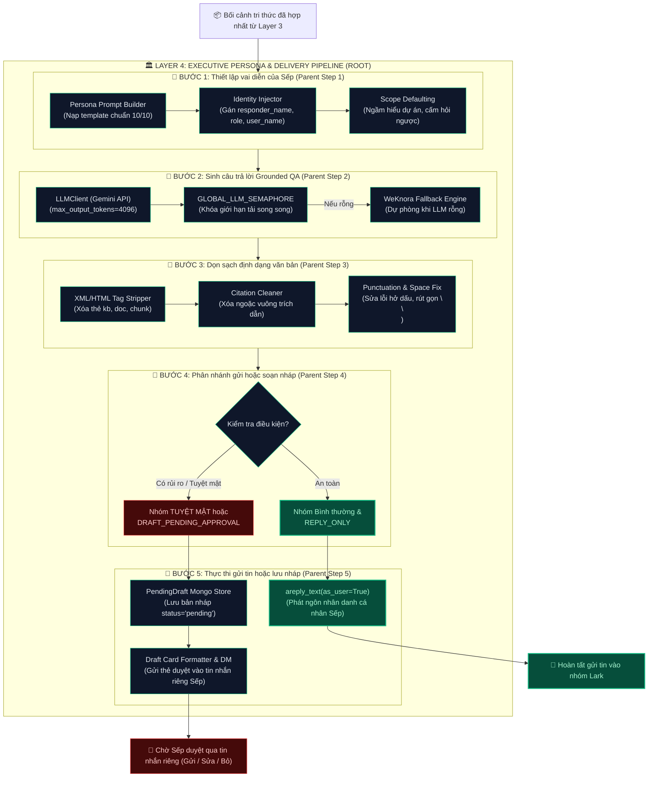

# 🛠️ TỔNG QUAN BỘ CÔNG CỤ (UTILS) CỦA LAYER 4
> **HiLark Server Architecture** — Bóc tách chi tiết các module tiện ích thuộc Lớp 4 (Sinh câu trả lời & Đóng vai người điều hành).

---

## 🧭 1. KIẾN TRÚC PHÂN CẤP: UTILS (CHILD) ➔ STEPS (PARENT) ➔ LAYER 4 (ROOT)

Trong Layer 4, câu trả lời từ AI được biến hóa để khoác lên phong cách của một nhà điều hành thực tế, làm sạch định dạng văn bản và phân phối an toàn vào phòng chat hoặc luồng duyệt riêng tư. Mỗi **Bước xử lý (Parent Step)** được vận hành bởi các **Tiện ích con (Child Utils / Helpers)** chuyên trách:

```
                      ┌─────────────────────────────────────────────────────────────┐
                      │              LAYER 4: EXECUTIVE PERSONA PIPELINE            │
                      │               (Đóng vai điều hành & Phân phối)              │
                      └──────────────────────────────┬──────────────────────────────┘
                                                     │
         ┌───────────────────┬───────────────────────┼───────────────────────┬───────────────────┐
         ▼                   ▼                       ▼                       ▼                   ▼
┌─────────────────┐ ┌─────────────────┐     ┌─────────────────┐     ┌─────────────────┐ ┌─────────────────┐
│     BƯỚC 1      │ │     BƯỚC 2      │     │     BƯỚC 3      │     │     BƯỚC 4      │ │     BƯỚC 5      │
│  Thiết lập vai  │ │  Sinh câu trả   │     │  Dọn sạch định  │     │  Phân nhánh gửi │ │  Lưu nháp &     │
│  diễn của Sếp   │ │  lời Grounded   │     │  dạng văn bản   │     │  hoặc soạn nháp │ │  Sếp phê duyệt  │
│  (Parent Step)  │ │  (Parent Step)  │     │  (Parent Step)  │     │  (Parent Step)  │ │  (Parent Step)  │
└────────┬────────┘ └────────┬────────┘     └────────┬────────┘     └────────┬────────┘ └────────┬────────┘
         │                   │                       │                       │                   │
         │ (Child Utils)     │ (Child Utils)         │ (Child Utils)         │ (Child Utils)     │ (Child Utils)
         ▼                   ▼                       ▼                       ▼                   ▼
┌─────────────────┐ ┌─────────────────┐     ┌─────────────────┐     ┌─────────────────┐ ┌─────────────────┐
│ • Persona       │ │ • LLMClient     │     │ • XML/HTML Tag  │     │ • Policy Check  │ │ • PendingDraft  │
│   Prompt Builder│ │   (Gemini API)  │     │   Stripper      │     │   (Tuyệt mật)   │   Mongo Store   │
│ • Identity &    │ │ • GLOBAL_LLM_   │     │ • Citation Tag  │     │ • areply_text   │ │ • Draft Card    │
│   Tone Injector │ │   SEMAPHORE     │     │   Cleaner       │     │   (as_user=True)│   Formatter     │
│ • Scope         │ │ • Fallback      │     │ • Punctuation & │     │ • Direct Reply  │ │ • send_bot_dm   │
│   Defaulting    │ │   WeKnora Chat  │     │   Whitespace Fix│     │   Dispatcher    │   _to_owner()   │
└─────────────────┘ └─────────────────┘     └─────────────────┘     └─────────────────┘ └─────────────────┘
```

---

## 🧩 2. BẢNG MỐI QUAN HỆ PARENT - CHILD CHI TIẾT

| Bước xử lý (Parent Step) | Vai trò của Bước trong Layer 4 | Tiện ích thực thi con (Child Utils / Functions) | Vị trí mã nguồn |
| :--- | :--- | :--- | :--- |
| **BƯỚC 1: Thiết lập vai diễn của Sếp** *(Persona Injection)* | Nạp phong cách điều hành 10/10: xưng "anh - em", không nói dông dài, nói như kiến thức của mình. | • `Persona Prompt Builder`: Nạp template `GROUNDED_QA_USER_PERSONA_PROMPT`.<br/>• `Identity Injector`: Điền `{responder_name}`, `{role}`, `{user_name}`.<br/>• `Scope Defaulting`: Tự động ngầm hiểu dự án của nhóm, cấm hỏi ngược. | [`services/chat_service.py:L78-126`](file:///Users/hoainam/Desktop/HiLark/server/services/chat_service.py#L78-L126)<br/>[`services/chat_service.py:L209-221`](file:///Users/hoainam/Desktop/HiLark/server/services/chat_service.py#L209-L221) |
| **BƯỚC 2: Sinh câu trả lời Grounded** *(Gemini QA & Fallback)* | Gọi mô hình ngôn ngữ lớn để trả lời dựa trên bối cảnh tri thức, có giới hạn tải trọng. | • `LLMClient.generate_text_async()`: Gọi Gemini API với `max_output_tokens=4096`.<br/>• `GLOBAL_LLM_SEMAPHORE`: Khóa an toàn giới hạn số tác vụ AI chạy song song.<br/>• `WeKnora Fallback Engine`: Tự động gọi WeKnora Chat nếu LLM rỗng. | [`services/chat_service.py:L190-235`](file:///Users/hoainam/Desktop/HiLark/server/services/chat_service.py#L190-L235)<br/>[`services/chat_service.py:L576-584`](file:///Users/hoainam/Desktop/HiLark/server/services/chat_service.py#L576-L584) |
| **BƯỚC 3: Dọn sạch định dạng văn bản** *(Output Sanitization)* | Quét sạch toàn bộ các thẻ trích dẫn nội bộ của RAG/WeKnora, sửa lỗi dấu câu và markdown. | • `XML/HTML Tag Stripper`: Xóa `<kb .../>`, `<doc ...>`, `<chunk ...>`.<br/>• `Citation Tag Cleaner`: Xóa `[Tài liệu: ...]`, `[Cập nhật hội thoại: ...]`.<br/>• `Punctuation & Whitespace Fix`: Chữa lỗi hở dấu câu, rút gọn `\n\n`. | [`utils/text_filter.py:L39-91`](file:///Users/hoainam/Desktop/HiLark/server/utils/text_filter.py#L39-L91)<br/>[`services/chat_service.py:L586`](file:///Users/hoainam/Desktop/HiLark/server/services/chat_service.py#L586) |
| **BƯỚC 4: Phân nhánh gửi hoặc soạn nháp** *(Delivery Branching)* | Quyết định phát ngôn trực tiếp hay chuyển sang luồng soạn nháp dựa trên chính sách bảo mật. | • `Policy Check`: Kiểm tra cờ `is_confidential_group` hoặc `jev_action`.<br/>• `areply_text(as_user=True)`: Phát ngôn nhân danh tài khoản User của Sếp.<br/>• `Direct Reply Dispatcher`: Gửi tin phản hồi kèm trích dẫn tin nhắn gốc. | [`services/chat_service.py:L588-615`](file:///Users/hoainam/Desktop/HiLark/server/services/chat_service.py#L588-L615)<br/>[`services/chat_service.py:L653-665`](file:///Users/hoainam/Desktop/HiLark/server/services/chat_service.py#L653-L665) |
| **BƯỚC 5: Lưu nháp & Sếp phê duyệt** *(Draft Approval Workflow)* | Lưu bản nháp vào MongoDB và gửi thẻ thông báo riêng vào DM của Sếp kèm 3 nút lệnh. | • `PendingDraft Store`: Lưu bản ghi vào MongoDB bảng `pending_drafts`.<br/>• `Draft Card Formatter`: Đóng gói thẻ tin nhắn kèm lý do bảo mật và ID gốc.<br/>• `send_bot_dm_to_owner()`: Gửi tin nhắn riêng (DM) tới Sếp để duyệt. | [`services/chat_service.py:L596-636`](file:///Users/hoainam/Desktop/HiLark/server/services/chat_service.py#L596-L636)<br/>[`services/larkServices/lark_messenger.py`](file:///Users/hoainam/Desktop/HiLark/server/services/larkServices/lark_messenger.py) |

---

## 🗂️ DANH MỤC TÀI LIỆU BÓC TÁCH KỸ THUẬT

1. **[`output_sanitizer.md`](file:///Users/hoainam/Desktop/HiLark/server/docs/layer4/ultis_docs/output_sanitizer.md)**:
   * **Mã nguồn:** [`server/utils/text_filter.py`](file:///Users/hoainam/Desktop/HiLark/server/utils/text_filter.py) *(các hàm hậu xử lý: `clean_output()`, `extract_kb_citations()`)* và logic format bản nháp tại [`server/services/chat_service.py`](file:///Users/hoainam/Desktop/HiLark/server/services/chat_service.py).
   * **Nội dung:** Bóc tách sâu thuật toán Regex 5 tầng làm sạch thẻ trích dẫn RAG, định dạng thẻ tin nhắn duyệt nháp (Interactive Card), và cơ chế gửi tin nhắn Lark dưới danh nghĩa cá nhân Sếp (`as_user=True`).

---

## 🔄 3. SƠ ĐỒ KẾT NỐI LUỒNG DỮ LIỆU: UTILS ➔ STEPS ➔ LAYER 4


### Quy trình dòng chảy chi tiết (Mermaid Flowchart):


