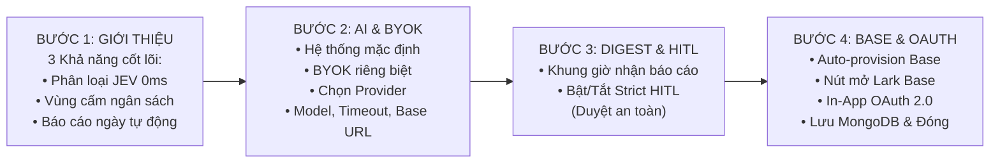
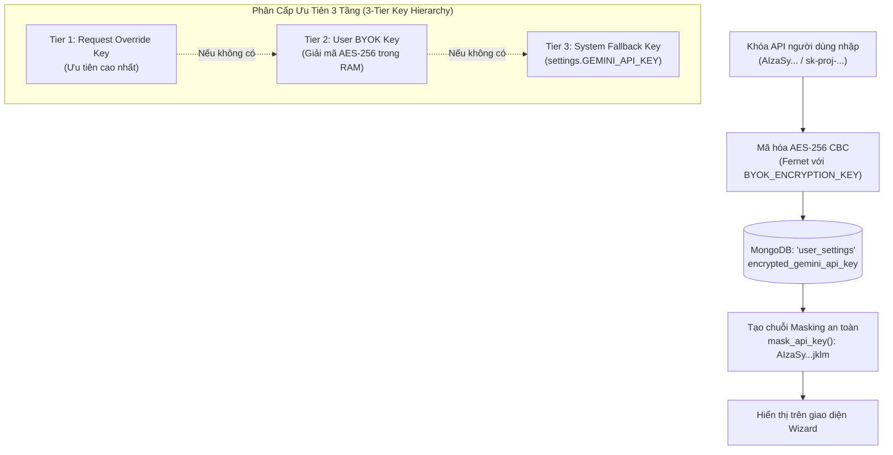

# 📘 TÀI LIỆU KIẾN TRÚC ONBOARDING SCREEN GUIDE & HYBRID BYOK
> **Dự án HiLark Server** — Module hướng dẫn cá nhân hóa, ủy quyền OAuth và quản lý khóa AI đa nhà cung cấp.  
> **Vị trí mã nguồn:** [`server/routers/onboarding.py`](file:///Users/hoainam/Desktop/HiLark/server/routers/onboarding.py), [`server/templates/onboarding_wizard.html`](file:///Users/hoainam/Desktop/HiLark/server/templates/onboarding_wizard.html), [`server/models/onboarding.py`](file:///Users/hoainam/Desktop/HiLark/server/models/onboarding.py)

---

## 🧭 1. MỤC TIÊU VÀ TẦM NHÌN THIẾT KẾ

Trình hướng dẫn **Onboarding Screen Guide** được thiết kế để giải quyết bài toán trải nghiệm người dùng (UX) và an toàn dữ liệu doanh nghiệp khi đưa Trợ lý AI vào vận hành:
1. **Thiết lập không chạm code (Zero-touch Setup):** Người dùng hoặc Lãnh đạo mới khi cài đặt ứng dụng không cần mở file cấu hình hay thao tác dòng lệnh. Tất cả được điều hướng qua một giao diện Stepper Wizard 4 bước mở trực tiếp trong cửa sổ pop-up (Webview Modal) của ứng dụng Lark.
2. **Nguyên tắc Thiết kế Apple Minimalist (Pure Typography):**
   - Loại bỏ 100% các icon, emoji và màu mè gây phân tâm.
   - Sử dụng bộ phông hệ thống chuẩn Apple: `-apple-system, BlinkMacSystemFont, "SF Pro Display", "SF Pro Text", "Helvetica Neue", sans-serif`.
   - Bảng màu tối giản, sang trọng: Nền xám nhạt `#F5F6F8`, thẻ trắng `#FFFFFF`, chữ đen xám `#111827`, viền `#E5E7EB`, điểm nhấn xanh `#2563EB`.
3. **Màn hình Khởi tạo mượt mà (`#initScreen`):**
   - Tự động hiển thị màn hình chờ với hiệu ứng spinner tối giản trong khi hệ thống nạp dữ liệu workspace, kiểm tra trạng thái token và nạp cấu hình cũ từ MongoDB.
   - Tự động giải phóng màn hình (`dismissInitScreen`) ngay khi toàn bộ dữ liệu nền sẵn sàng.

---

## 🏗️ 2. QUY TRÌNH 4 BƯỚC CỦA STEPPER WIZARD

### Chi tiết 4 Bước:
- **Bước 1: Giới thiệu (Overview):** Chào mừng đích danh người dùng (`effective_user_name`), giải thích 3 giá trị cốt lõi của Trợ lý AI HiLark.
- **Bước 2: Cấu hình Bộ não AI & BYOK (Multi-Provider Engine):**
  - Chế độ 1: Dùng hạn mức mặc định của tổ chức (System Fallback).
  - Chế độ 2: Tự cấu hình khóa riêng (BYOK). Hỗ trợ:
    * **Google (Gemini):** Mặc định mô hình `gemini-2.0-flash`.
    * **ChatGPT (OpenAI):** Mặc định mô hình `gpt-4o-mini`.
    * **Anthropic (Claude):** Mặc định mô hình `claude-3-5-sonnet-20241022`.
    * **Tùy chỉnh (Custom):** Hỗ trợ DeepSeek, vLLM hoặc các máy chủ OpenAI-compatible nội bộ.
  - Tùy chỉnh thông số nâng cao: `Timeout (giây)` và `Base URL`.
  - Nút bấm **Kiểm tra kết nối**: Gửi yêu cầu AJAX đo độ trễ mạng thực tế (latency ms) và kiểm tra tính hợp lệ của API Key trước khi lưu.
- **Bước 3: Lịch nhận báo cáo & Kiểm duyệt an toàn (Daily Digest & HITL):**
  - Lựa chọn khung giờ nhận Master Daily Digest gửi riêng vào DM (mặc định 18:00 cuối giờ làm việc).
  - Hộp kiểm kích hoạt chế độ duyệt an toàn nghiêm ngặt (**Strict HITL**).
- **Bước 4: Quản trị Base & Ủy quyền đại diện (Lark Base & OAuth):**
  - Trạng thái Lark Base doanh nghiệp: Tự động phát hiện nếu đã có Base. Nếu chưa có, cung cấp nút **Khởi tạo Base tự động** gọi OpenAPI tạo 100% bảng biểu và dự án mẫu.
  - Ủy quyền tài khoản đại diện: Tích hợp nút **Ủy quyền tài khoản Lark** mở cửa sổ OAuth 2.0 dạng pop-up, giao tiếp qua `window.postMessage` và tự động cập nhật trạng thái kết nối ngay tại chỗ không cần reload trang.

---

## 🔒 3. CƠ CHẾ BẢO MẬT HYBRID BYOK (AES-256 FERNET)

Hệ thống bảo vệ khóa API cá nhân của người dùng qua mô hình bảo mật chuẩn quân đội:

---

## 📂 4. CẤU TRÚC PHÂN TÁCH MÃ NGUỒN (MODULAR CODE STRUCTURE)

| Thành phần | Vị trí tệp | Trách nhiệm |
| :--- | :--- | :--- |
| **Domain Models** | [`server/models/onboarding.py`](file:///Users/hoainam/Desktop/HiLark/server/models/onboarding.py) | Định nghĩa Pydantic schema: `TestKeyRequest`, `SaveSettingsRequest`, `ProvisionBaseRequest`. |
| **HTML/CSS/JS Template** | [`server/templates/onboarding_wizard.html`](file:///Users/hoainam/Desktop/HiLark/server/templates/onboarding_wizard.html) | Standalone single-page responsive UI, Vanilla JS, Apple Minimalist design, `#initScreen`. |
| **API Router** | [`server/routers/onboarding.py`](file:///Users/hoainam/Desktop/HiLark/server/routers/onboarding.py) | Endpoint GET `/wizard`, POST `/api/test-key`, POST `/api/save`, POST `/api/provision-base`. |
| **Core Service** | [`server/services/user_settings_service.py`](file:///Users/hoainam/Desktop/HiLark/server/services/user_settings_service.py) | Mã hóa/giải mã AES-256, ping test kết nối đa provider, lưu/đọc MongoDB `user_settings`. |
| **Card Navigation** | [`server/services/lark/card_builder.py`](file:///Users/hoainam/Desktop/HiLark/server/services/lark/card_builder.py) | Xây dựng Lark Interactive Card điều hướng mở modal qua liên kết Applink. |
| **Lark Command** | [`server/services/lark/handlers/owner_command_handler.py`](file:///Users/hoainam/Desktop/HiLark/server/services/lark/handlers/owner_command_handler.py) | Bắt lệnh chat của Sếp trong DM 1-1 (`cài đặt`, `config`, `/config`, `byok`) để bắn thẻ mở Wizard. |
