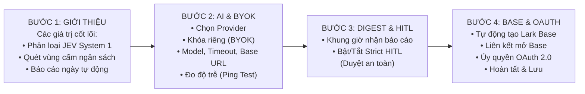
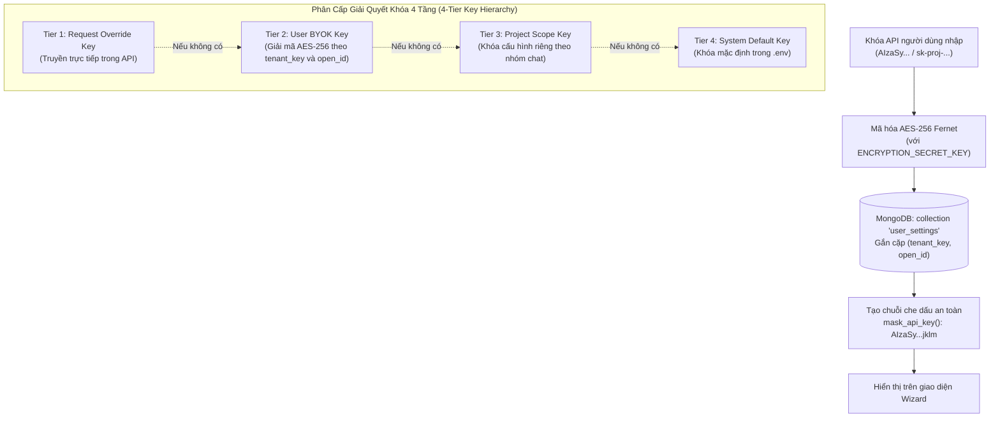

# Tài liệu Kiến trúc Onboarding Screen Guide & Hybrid BYOK

Tài liệu này ghi lại kiến trúc giao diện Onboarding Screen Guide, quy trình ủy quyền OAuth 2.0 và cơ chế mã hóa bảo mật khóa AI cá nhân (BYOK) trong HiLark Server.

Mã nguồn liên quan:
- API Router: [`server/routers/onboarding.py`](file:///Users/hoainam/Desktop/HiLark/server/routers/onboarding.py)
- Giao diện HTML/CSS/JS: [`server/templates/onboarding_wizard.html`](file:///Users/hoainam/Desktop/HiLark/server/templates/onboarding_wizard.html)
- Quản lý cấu hình & mã hóa BYOK: [`server/services/user_settings_service.py`](file:///Users/hoainam/Desktop/HiLark/server/services/user_settings_service.py)
- Dựng thẻ điều hướng: [`server/services/lark/card_builder.py`](file:///Users/hoainam/Desktop/HiLark/server/services/lark/card_builder.py)

---

## 1. Mục tiêu và tầm nhìn thiết kế

Trình hướng dẫn Onboarding Screen Guide giải quyết bài toán trải nghiệm thiết lập ban đầu và bảo vệ quyền riêng tư khóa API:
1. **Thiết lập trực quan không cần code:** Người dùng hoặc Quản trị viên mới không cần chỉnh sửa tệp cấu hình hay gõ lệnh. Toàn bộ quy trình được điều hướng qua giao diện Stepper Wizard mở trong Lark Applink Webview modal.
2. **Phong cách thiết kế tối giản (Minimal Editorial):**
   - Loại bỏ các icon và emoji trang trí gây phân tâm, tập trung vào typography và khoảng trắng thoáng đãng.
   - Bảng màu trung tính: Nền mềm `#FAFAFA`, thẻ trắng `#FFFFFF`, chữ than chì `#292929`, đường viền nhạt `#E8E8E8`.
3. **Màn hình khởi tạo (`#initScreen`):**
   - Tự động hiển thị trạng thái tải trong khi hệ thống nạp dữ liệu workspace, kiểm tra trạng thái token và đọc cấu hình từ MongoDB.
   - Giải phóng màn hình chờ ngay khi dữ liệu sẵn sàng.

---

## 2. Quy trình 4 bước của Stepper Wizard

### Chi tiết từng bước:
- **Bước 1: Giới thiệu (Overview):** Chào mừng đích danh người dùng (`effective_user_name`), giải thích các năng lực cốt lõi của hệ thống.
- **Bước 2: Cấu hình AI Provider & BYOK:**
  - Hỗ trợ 4 nhóm: Google Gemini (`gemini-2.0-flash`), OpenAI (`gpt-4o-mini`), Claude (`claude-3-5-sonnet`), hoặc Custom OpenAI-Compatible (DeepSeek, vLLM).
  - Tùy chỉnh tham số nâng cao: `Timeout (giây)` và `Base URL`.
  - Nút **Kiểm tra kết nối**: Gửi yêu cầu đo độ trễ mạng thực tế (latency ms) và xác thực tính hợp lệ của API Key trước khi lưu.
- **Bước 3: Lịch nhận báo cáo & Phê duyệt (Daily Digest & HITL):**
  - Tùy chỉnh khung giờ nhận Master Daily Digest (mặc định 18:00).
  - Bật/tắt chế độ phê duyệt an toàn nghiêm ngặt (**Strict HITL**).
- **Bước 4: Quản trị Base & Ủy quyền đại diện (Lark Base & OAuth):**
  - Trạng thái Lark Base doanh nghiệp: Tự động nhận diện nếu đã có Base. Nếu chưa có, cung cấp nút **Khởi tạo Base tự động** qua OpenAPI.
  - Ủy quyền tài khoản: Tích hợp nút **Ủy quyền tài khoản Lark** mở cửa sổ OAuth 2.0 dạng pop-up, giao tiếp qua `window.postMessage` và tự động cập nhật trạng thái kết nối tại chỗ.

---

## 3. Cơ chế bảo mật Hybrid BYOK (AES-256 Fernet)

Hệ thống bảo vệ khóa API cá nhân của người dùng bằng mã hóa đối xứng AES-256:

---

## 4. Bảng phân rã các module liên quan

| Thành phần | Vị trí tệp | Trách nhiệm |
| :--- | :--- | :--- |
| **API Router** | [`server/routers/onboarding.py`](file:///Users/hoainam/Desktop/HiLark/server/routers/onboarding.py) | Cung cấp endpoints: `GET /wizard`, `POST /api/test-key`, `POST /api/save`, `POST /api/provision-base`. |
| **Giao diện Webview** | [`server/templates/onboarding_wizard.html`](file:///Users/hoainam/Desktop/HiLark/server/templates/onboarding_wizard.html) | Giao diện đơn trang độc lập, tương thích Lark Webview modal, thiết kế tối giản, hỗ trợ `#initScreen`. |
| **Dịch vụ User Settings** | [`server/services/user_settings_service.py`](file:///Users/hoainam/Desktop/HiLark/server/services/user_settings_service.py) | Mã hóa/giải mã AES-256 Fernet, đo độ trễ kết nối AI provider, lưu trữ cấu hình theo `(tenant_key, open_id)`. |
| **Điều hướng Thẻ tương tác**| [`server/services/lark/card_builder.py`](file:///Users/hoainam/Desktop/HiLark/server/services/lark/card_builder.py) | Tạo nút bấm 1-chạm "Screen Guide" trên Executive Control Hub Card V2 để mở giao diện Wizard. |
