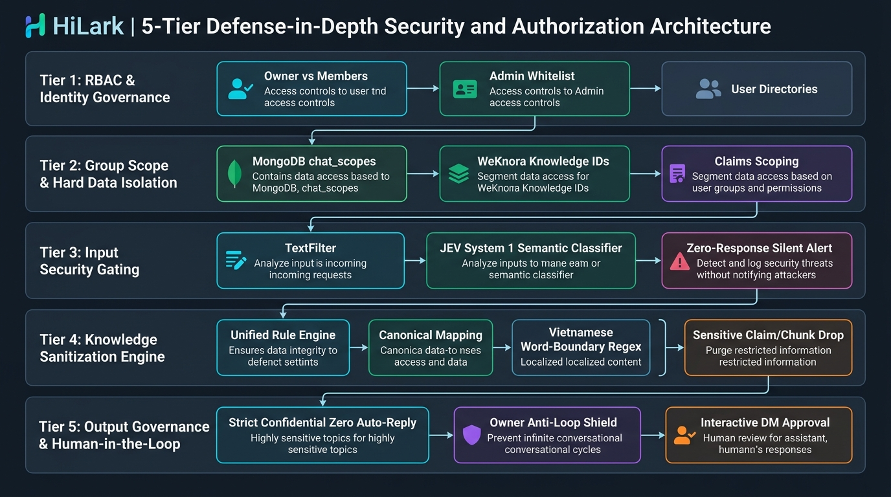
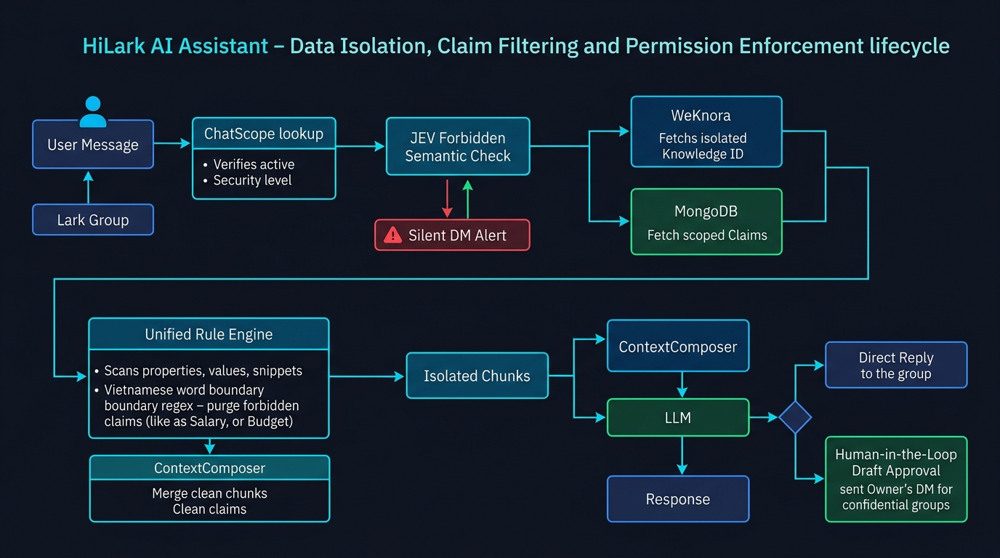
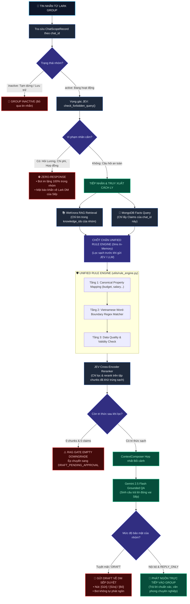

# 🛡️ KIẾN TRÚC PHÂN QUYỀN & BẢO MẬT DỮ LIỆU (HI-LARK SERVER)
> **HiLark Server** — Hệ thống phòng thủ chiều sâu 5 tầng (5-Tier Defense-in-Depth Security & Authorization Architecture).  
> **Vị trí thư mục:** [`server/docs/permission/`](file:///Users/hoainam/Desktop/HiLark/server/docs/permission)

---

## 🧭 1. TỔNG QUAN HỆ THỐNG AN NINH HILARk

Trong môi trường doanh nghiệp sử dụng Lark Suite, rủi ro lớn nhất của một Trợ lý AI là **rò rỉ dữ liệu chéo giữa các phòng ban** (*ví dụ: nhân viên dự án này đọc được tài liệu dự án khác*) hoặc **tiết lộ thông tin nhạy cảm** (*bảng lương, ngân sách, hoa hồng, hợp đồng mật*).

Hệ thống bảo mật của HiLark được xây dựng dựa trên 3 nguyên tắc bất di bất dịch:
1. **Phòng thủ chiều sâu (Defense-in-Depth):** Không bao giờ tin tưởng một chốt chặn duy nhất. Một câu hỏi hay mẩu dữ liệu phải vượt qua 5 trạm kiểm soát độc lập mới được phép đến tay người dùng.
2. **Cách ly cứng tại tầng dữ liệu (Hard Data Scoping):** Tri thức của từng nhóm chat được khoanh vùng ở cấp độ truy vấn cơ sở dữ liệu (Database Query) và định danh tài liệu (Knowledge IDs).
3. **Bảo mật tất định (Deterministic Enforcement):** Tuyệt đối không giao quyền kiểm soát dữ liệu mật cho mô hình AI mang tính xác suất. Toàn bộ cơ chế lọc nhãn cấm được thực thi bởi thuật toán Logic & Regex In-memory với độ trễ 0ms.

---

## 🏛️ 2. SƠ ĐỒ 5 TẦNG PHÒNG THỦ AN NINH & PHÂN QUYỀN

Dưới đây là sơ đồ kiến trúc tổng thể 5 tầng phòng thủ bảo mật của hệ thống:

### Bảng phân rã Parent - Child Logic 5 Tầng Bảo mật:

| Tầng kiểm soát | Module phụ trách | File & Dòng mã nguồn | Cơ chế kỹ thuật |
| :--- | :--- | :--- | :--- |
| **TẦNG 1: RBAC & IDENTITY GOVERNANCE** | **Phân quyền Danh tính & Vai trò** | [`server/services/scope_service.py:L53-75`](file:///Users/hoainam/Desktop/HiLark/server/services/scope_service.py#L53-L75) [`server/routers/scope.py:L1-98`](file:///Users/hoainam/Desktop/HiLark/server/routers/scope.py#L1-L98) | Phân định Sếp (Owner/Admin) vs Thành viên (Members). Chặn API ngoài bằng `403 Forbidden`. |
| ↳ Child 1.1 | `Admin Whitelist Validator` | [`services/scope_service.py:L70-75`](file:///Users/hoainam/Desktop/HiLark/server/services/scope_service.py#L70-L75) | Đối chiếu `operator_open_id` với danh sách quản trị viên hệ thống. |
| ↳ Child 1.2 | `Owner Special Privileges` | [`services/bot_service.py:L74-260`](file:///Users/hoainam/Desktop/HiLark/server/services/bot_service.py#L74-L260) | Đặc quyền độc nhất: Duyệt Master Daily Digest và duyệt nháp câu trả lời qua DM. |
| ↳ Child 1.3 | `Thin Controller Guard` | [`routers/scope.py:L55-97`](file:///Users/hoainam/Desktop/HiLark/server/routers/scope.py#L55-L97) | Cổng REST API mở ngoài kiểm soát quyền cấu hình nóng Knowledge Base. |
| **TẦNG 2: GROUP SCOPE & HARD ISOLATION** | **Cách ly Dữ liệu cấp Nhóm** | [`server/models/chat_scope.py:L18-40`](file:///Users/hoainam/Desktop/HiLark/server/models/chat_scope.py#L18-L40) [`server/database/db.py:L229-260`](file:///Users/hoainam/Desktop/HiLark/server/database/db.py#L229-L260) | Khóa cứng phạm vi tài liệu và tri thức động của từng nhóm chat riêng biệt. |
| ↳ Child 2.1 | `ChatScopeRecord Entity` | [`models/chat_scope.py:L18-40`](file:///Users/hoainam/Desktop/HiLark/server/models/chat_scope.py#L18-L40) | Mô hình lưu trữ quyền nhóm chat trong MongoDB collection `chat_scopes`. |
| ↳ Child 2.2 | `RAG Hard Isolation` | [`services/chat_service.py:L459-466`](file:///Users/hoainam/Desktop/HiLark/server/services/chat_service.py#L459-L466) | Giới hạn WeKnora chỉ tìm kiếm trong mảng `knowledge_ids` của nhóm. |
| ↳ Child 2.3 | `Claims Query Scoping` | [`database/db.py:L244-255`](file:///Users/hoainam/Desktop/HiLark/server/database/db.py#L244-L255) | Query MongoDB facts lọc bắt buộc: `chat_id == chat_id` hoặc `scope_type == 'global'`. |
| **TẦNG 3: INPUT SECURITY GATING** | **Vọng gác Ý định Đầu vào** | [`server/utils/text_filter.py:L19-37`](file:///Users/hoainam/Desktop/HiLark/server/utils/text_filter.py#L19-L37) [`server/services/chat_service.py:L310-370`](file:///Users/hoainam/Desktop/HiLark/server/services/chat_service.py#L310-L370) | Kiểm duyệt văn phong, trạng thái nhóm và chặn đứng các câu hỏi chủ đề cấm. |
| ↳ Child 3.1 | `Syntactic Sanitizer` | [`utils/text_filter.py:L19-37`](file:///Users/hoainam/Desktop/HiLark/server/utils/text_filter.py#L19-L37) | Dọn dẹp ký tự lạ, lọc regex lặp spam, giới hạn từ 2 đến 1000 từ. |
| ↳ Child 3.2 | `Group Inactive Shield` | [`services/chat_service.py:L310-321`](file:///Users/hoainam/Desktop/HiLark/server/services/chat_service.py#L310-L321) | Nếu nhóm `inactive` (Tạm dừng/Lưu trữ) -> Ngắt pipeline ngay, không xử lý. |
| ↳ Child 3.3 | `JEV Forbidden AI Evaluator` | [`services/jev.py:L198-388`](file:///Users/hoainam/Desktop/HiLark/server/services/jev.py#L198-L388) | Đọc hiểu ngữ nghĩa sâu: nhận diện tiếng lóng (*"ting ting", "củ"*) và câu hỏi ẩn ý. |
| ↳ Child 3.4 | `Zero-Response & Silent Alert`| [`services/chat_service.py:L342-367`](file:///Users/hoainam/Desktop/HiLark/server/services/chat_service.py#L342-L367) | Bot câm nín trong nhóm + Báo động khẩn cấp vào DM riêng của Sếp. |
| **TẦNG 4: KNOWLEDGE SANITIZATION** | **Chốt chặn An ninh Tri thức** | [`server/utils/rule_engine.py:L1-489`](file:///Users/hoainam/Desktop/HiLark/server/utils/rule_engine.py#L1-L489) [`server/services/chat_service.py:L501-524`](file:///Users/hoainam/Desktop/HiLark/server/services/chat_service.py#L501-L524) | Thanh lọc dữ liệu nội bộ trước khi nạp vào LLM; thực thi In-Memory (0ms) TRƯỚC JEV Filter để trảm nhãn cấm và tiết kiệm token. |
| ↳ Child 4.1 | `Canonical Property Mapping` | [`utils/rule_engine.py:L96-130`](file:///Users/hoainam/Desktop/HiLark/server/utils/rule_engine.py#L96-L130) | Quy đổi nhãn tiếng Việt ("Lương", "Chi phí") sang tập thuộc tính chuẩn tiếng Anh. |
| ↳ Child 4.2 | `Word-Boundary Regex Scanner` | [`utils/rule_engine.py:L210-227`](file:///Users/hoainam/Desktop/HiLark/server/utils/rule_engine.py#L210-L227) | Quét chuỗi có/không dấu, bảo vệ biên từ Unicode, chống bắt nhầm từ nghiệp vụ. |
| ↳ Child 4.3 | `Sensitive Claim / Chunk Drop`| [`utils/rule_engine.py:L388-443`](file:///Users/hoainam/Desktop/HiLark/server/utils/rule_engine.py#L388-L443) | Gạch bỏ ngay lập tức phần tử vi phạm, ghi log cảnh báo chi tiết. |
| ↳ Child 4.4 | `Safety RAG Gate Downgrade` | [`services/chat_service.py:L525-533`](file:///Users/hoainam/Desktop/HiLark/server/services/chat_service.py#L525-L533) | Nếu KB rỗng sau khi lọc sạch: ép hạ cấp sang `DRAFT_PENDING_APPROVAL`, cấm bịa đặt. |
| **TẦNG 5: OUTPUT GOVERNANCE & HITL** | **Kiểm soát Phát ngôn & Người duyệt** | [`server/services/draft_service.py:L1-150`](file:///Users/hoainam/Desktop/HiLark/server/services/draft_service.py#L1-L150) [`server/services/chat_service.py:L534-543`](file:///Users/hoainam/Desktop/HiLark/server/services/chat_service.py#L534-L543) | Đảm bảo an toàn phát ngôn, chống lặp hội thoại và quy trình duyệt nháp tương tác. |
| ↳ Child 5.1 | `Strict Confidential Guard` | [`services/chat_service.py:L534-543`](file:///Users/hoainam/Desktop/HiLark/server/services/chat_service.py#L534-L543) | Chế độ Tuyệt mật: Kích hoạt Zero Auto-reply, ép 100% câu hỏi sang Draft Sếp duyệt. |
| ↳ Child 5.2 | `Owner Anti-Loop Shield` | [`services/chat_service.py:L382-394`](file:///Users/hoainam/Desktop/HiLark/server/services/chat_service.py#L382-L394) | Bot cấm tự reply Sếp trong group (ép `IGNORE`), triệt tiêu 100% vòng lặp vô tận. |
| ↳ Child 5.3 | `Interactive DM Approval` | [`services/bot_service.py:L185-260`](file:///Users/hoainam/Desktop/HiLark/server/services/bot_service.py#L185-L260) | Sếp duyệt câu trả lời qua DM trên app Lark: `[Gửi]`, `[Sửa: ...]`, `[Bỏ]`. |

---

## ⚡ 3. SƠ ĐỒ CHU TRÌNH CÁCH LY & THANH LỌC DỮ LIỆU

Dưới đây là sơ đồ luồng hoạt động thực tế minh họa cách một tin nhắn di chuyển qua các chốt chặn cách ly và thanh lọc dữ liệu:

### Quy trình dòng chảy chi tiết (Mermaid Flowchart):

---

## 📚 4. TÀI LIỆU LIÊN QUAN TRONG DỰ ÁN

* 📘 **Bản đặc tả kỹ thuật chuyên sâu:** 👉 Xem [`security_architecture_spec.md`](./security_architecture_spec.md)
* 📘 **Bóc tách kỹ thuật Unified Rule Engine:** 👉 Xem [`server/docs/layer3/ultis_docs/rule_engine.md`](file:///Users/hoainam/Desktop/HiLark/server/docs/layer3/ultis_docs/rule_engine.md)
* 📘 **Kiến trúc đồng bộ bảo mật từ Lark Base:** 👉 Xem [`server/docs/LarkBase/README.md`](file:///Users/hoainam/Desktop/HiLark/server/docs/LarkBase/README.md)
* 📘 **Đặc tả kiểm soát ý định JEV System One:** 👉 Xem [`server/docs/jev/jev_architecture_spec.md`](file:///Users/hoainam/Desktop/HiLark/server/docs/jev/jev_architecture_spec.md)
