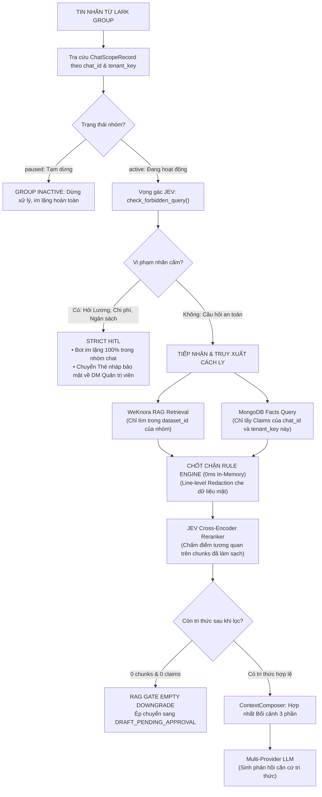

# Kiến trúc Bảo mật & Cô lập Dữ liệu Đa Doanh nghiệp

Tài liệu này ghi lại kiến trúc bảo mật 5 tầng và cơ chế cô lập dữ liệu đa doanh nghiệp (Multi-Tenant Zero Data Leakage) trong hệ thống HiLark Server.

Mã nguồn liên quan:
- Quản lý phân quyền nhóm: [`server/services/knowledge/chat_scopes.py`](file:///Users/hoainam/Desktop/HiLark/server/services/knowledge/chat_scopes.py)
- Kiểm duyệt quy tắc: [`server/services/knowledge/rule_engine.py`](file:///Users/hoainam/Desktop/HiLark/server/services/knowledge/rule_engine.py)
- Quản trị token khách thuê: [`server/services/auth/tenant_token_manager.py`](file:///Users/hoainam/Desktop/HiLark/server/services/auth/tenant_token_manager.py)
- Phân giải tài nguyên khách thuê: [`server/services/tenancy/tenant_resolver.py`](file:///Users/hoainam/Desktop/HiLark/server/services/tenancy/tenant_resolver.py)
- Ngoại lệ bảo mật có kiểu: [`server/core/tenant_errors.py`](file:///Users/hoainam/Desktop/HiLark/server/core/tenant_errors.py)

---

## 1. Nguyên tắc bảo mật cốt lõi

1. **Phòng thủ theo chiều sâu (Defense-in-Depth):** Hệ thống không tin tưởng vào một chốt chặn đơn lẻ. Một truy vấn hoặc mẩu dữ liệu phải vượt qua 5 tầng kiểm soát độc lập trước khi phản hồi tới người dùng.
2. **Cô lập dữ liệu tuyệt đối (Multi-Tenant Scoped Execution Context):** Mọi thao tác truy vấn, bộ nhớ đệm, tài liệu RAG, ký ức Claims và cấu hình BYOK đều được gắn nhãn bắt buộc theo `tenant_key`. Cấm hoàn toàn việc dùng chung hoặc mượn chéo cấu hình giữa các doanh nghiệp.
3. **Tra cứu có hợp đồng (Fail-Closed Contract):** Nếu thiếu thông tin xác thực, token hết hạn hoặc tài nguyên chưa sẵn sàng, hệ thống lập tức ngắt luồng và trả về exception có kiểu mang mã lỗi cụ thể (`TenantContextMissing`, `TenantNotFound`, `TokenUnavailable`), tuyệt đối không fallback về `.env` trong môi trường sản xuất.
4. **Kiểm duyệt tất định In-Memory:** Quy tắc loại bỏ nhãn cấm được thực thi trực tiếp trên RAM bằng Rule Engine (độ trễ 0ms) trước khi gửi qua mạng sang các dịch vụ AI.

---

## 2. Sơ đồ 5 tầng bảo mật & cô lập

Dưới đây là sơ đồ kiến trúc 5 tầng phòng thủ bảo mật của HiLark:

### Bảng phân rã chi tiết 5 tầng bảo mật:

| Tầng kiểm soát | Module phụ trách | Cơ chế kỹ thuật |
| :--- | :--- | :--- |
| **Tầng 1: Nhận diện & Ngữ cảnh thực thi** | `services/tenancy/tenant_resolver.py` `services/auth/oauth_state_service.py` | Trích xuất và xác thực `tenant_key` từ webhook/API. Sử dụng collection `oauth_states` với state dùng 1 lần và TTL index 10 phút chống CSRF. |
| **Tầng 2: Quản lý Token tập trung** | `services/auth/tenant_token_manager.py` | `TokenBroker` cache 3 chiều `(tenant_key, app_id, kind)`. Single-flight lock chống tranh chấp phân tán, tự động làm mới trước 300s, không fallback `.env`. |
| **Tầng 3: Cô lập Kho tri thức RAG** | `services/knowledge/weknora_client.py` `services/knowledge/chat_scopes.py` | Giới hạn WeKnora chỉ tìm kiếm trong danh sách `dataset_id` được gán riêng cho nhóm chat trong `chat_scopes`. Không truy vấn chéo giữa các nhóm. |
| **Tầng 4: Cô lập Cơ sở dữ liệu** | `server/database/indexes.py` `server/database/db.py` | 13 collections trong MongoDB được bảo vệ bằng Compound Unique Index có `tenant_key` (ví dụ: `(tenant_key, id)` trên `memories`), loại trừ va chạm ID. |
| **Tầng 5: Bảo vệ Khóa cá nhân & HITL** | `services/user_settings_service.py` `services/workflows/draft_workflow.py` | Khóa BYOK người dùng được mã hóa bằng AES-256 Fernet. Luồng Strict HITL tự động chuyển các câu hỏi chạm vùng cấm sang Thẻ tương tác gửi DM Quản trị viên. |

---

## 3. Chu trình cách ly và thanh lọc dữ liệu

---

## 4. Danh mục lỗi có kiểu của tầng Tenant (Tenant Errors)

Khi có vi phạm hoặc thiếu hụt thông tin trong tầng đa doanh nghiệp, hệ thống trả về exception có kiểu tương ứng:

| Exception Class | HTTP Status | Error Code | Ý nghĩa |
| :--- | :---: | :--- | :--- |
| `TenantContextMissing` | 400 | `TENANT_CONTEXT_MISSING` | Request không cung cấp hoặc không phân giải được `tenant_key`. |
| `TenantNotFound` | 409 | `TENANT_NOT_FOUND` | Doanh nghiệp chưa được đăng ký trong hệ thống. |
| `TenantNotReady` | 409 | `TENANT_NOT_READY` | Doanh nghiệp đang trong trạng thái `provisioning` hoặc `provisioning_failed`. |
| `TenantConfigIncomplete`| 409 | `TENANT_CONFIG_INCOMPLETE` | Thiếu cấu hình tài nguyên cần thiết (WeKnora, Bitable). |
| `AppCredentialMissing` | 409 | `APP_CREDENTIAL_MISSING` | Thiếu App ID hoặc App Secret của Lark App doanh nghiệp. |
| `UserTokenMissing` | 401 | `USER_TOKEN_MISSING` | Quản trị viên chưa hoàn tất cấp quyền OAuth user token. |
| `TokenUnavailable` | 503 | `TOKEN_UNAVAILABLE` | Không thể lấy hoặc làm mới token tại thời điểm gọi. |
