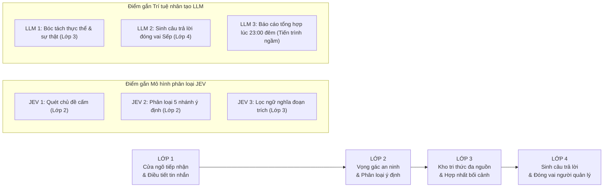

# 🏛️ SƠ ĐỒ LUỒNG HOẠT ĐỘNG CHI TIẾT 4 LỚP - HỆ THỐNG HILARk

> **Dự án HiLark Server**  
> Bản thuyết minh kỹ thuật chi tiết kèm ảnh sơ đồ trực quan độ phân giải cao.  
> Toàn bộ nội dung được diễn đạt bằng **tiếng Việt dễ hiểu, chú thích hoạt động thực tế, không dùng từ ngữ bóng bẩy hay thuật ngữ tiếng Anh rườm rà**.

---

## 🖼️ 1. ẢNH SƠ ĐỒ TRỰC QUAN LUỒNG HOẠT ĐỘNG CHI TIẾT

Dưới đây là ảnh sơ đồ kỹ thuật chi tiết phân rã 4 lớp xử lý, bóc tách toàn bộ 24 bước con tuần tự và làm nổi bật các điểm gắn **Mô hình phân loại (JEV)** và **Trí tuệ nhân tạo (LLM)**:

---

## 🧭 2. TỔNG QUAN LUỒNG CHẢY GIỮA 4 LỚP

Toàn bộ quá trình tiếp nhận một tin nhắn cho tới khi trả lời được vận hành qua 4 lớp tuần tự:

---

## 🔍 3. CHI TIẾT TỪNG BƯỚC TRONG TỪNG LỚP & ĐÁNH DẤU ĐIỂM GẮN JEV / LLM

---

### 🚪 LỚP 1: CỬA NGÕ TIẾP NHẬN & ĐIỀU TIẾT TIN NHẮN
* **Nhiệm vụ:** Tiếp nhận tin nhắn an toàn, gom các câu gõ dở, xếp hàng trật tự, bảo vệ hệ thống không bị quá tải.
* **Điểm gắn JEV / LLM:** **KHÔNG CÓ**. Toàn bộ lớp 1 sử dụng mã nguồn lập trình logic thông thường chạy ngay trên máy chủ để tối ưu tốc độ và không tốn chi phí.

| Bước | Tên bước | Vị trí mã nguồn | Hoạt động thực tế |
| :---: | :--- | :--- | :--- |
| **1.1** | **Tiếp nhận tin nhắn đa kênh** | [`services/lark.py`](file:///Users/hoainam/Desktop/HiLark/server/services/lark.py) | Nhận tin nhắn qua 4 đường: kết nối trực tiếp liên tục (WebSocket), cổng nhận sự kiện máy chủ (Webhook), cổng kiểm thử nội bộ (REST API), hoặc quét định kỳ hòm thư cá nhân. |
| **1.2** | **Lọc chống tin rác & Chống lặp** | [`services/lark.py`](file:///Users/hoainam/Desktop/HiLark/server/services/lark.py) | Bỏ qua tin nhắn do Bot khác phát ra; bỏ qua tin nhắn do chính máy chủ gửi ra (tránh tự nói chuyện với chính mình); nhớ 1.000 mã tin trong 10 phút để tránh bị mạng gửi lặp lại. |
| **1.3** | **Lưu tạm vào cơ sở dữ liệu** | [`services/digest_service.py`](file:///Users/hoainam/Desktop/HiLark/server/services/digest_service.py) | Lưu ngay một bản sao tin nhắn vào bảng tạm `conversation_staging` trong MongoDB để đêm 23:00 tiến trình tự động đọc lại làm báo cáo tổng kết ngày. |
| **1.4** | **Gom các câu gõ ngắt dòng** | [`utils/chat_queue.py`](file:///Users/hoainam/Desktop/HiLark/server/utils/chat_queue.py) | Khi người dùng gõ ngắt quãng bấm Enter nhiều dòng liên tiếp, máy chủ bật bộ đệm chờ 1.75 giây để gom toàn bộ các dòng thành một câu hoàn chỉnh duy nhất trước khi đem xử lý. |
| **1.5** | **Hàng đợi điều tiết thời gian** | [`utils/chat_queue.py`](file:///Users/hoainam/Desktop/HiLark/server/utils/chat_queue.py) | Giữ giãn cách 4.0 giây giữa 2 câu hỏi của cùng một thành viên để tránh dồn dập. Riêng Sếp (người quản lý) được ưu tiên thời gian chờ bằng 0 giây (xử lý ngay lập tức). |
| **1.6** | **Kiểm soát số lượng chạy cùng lúc** | [`services/chat_service.py`](file:///Users/hoainam/Desktop/HiLark/server/services/chat_service.py) | Khống chế tối đa 3 câu hỏi được xử lý đồng thời trên toàn máy chủ để bảo vệ bộ nhớ RAM và không bị khóa tài khoản do gọi quá tải. |

---

### 🛡️ LỚP 2: VỌNG GÁC AN NINH & PHÂN LOẠI Ý ĐỊNH
* **Nhiệm vụ:** Kiểm tra độ dài, kiểm soát chủ đề cấm để bảo vệ bí mật công ty, phân loại đúng mục đích của tin nhắn trước khi đi tìm tài liệu.
* **Điểm gắn JEV / LLM:** **GẮN 2 ĐIỂM JEV** (Không gắn LLM để tiết kiệm chi phí và phản hồi siêu nhanh).

| Bước | Tên bước | Vị trí mã nguồn | Hoạt động thực tế |
| :---: | :--- | :--- | :--- |
| **2.1** | **Làm sạch & Kiểm tra kích thước** | [`utils/text_filter.py`](file:///Users/hoainam/Desktop/HiLark/server/utils/text_filter.py) | Kiểm tra câu hỏi phải có từ 2 đến 1.000 từ. Dọn dẹp các ký tự lặp rác (như "???", "!!!"), chuẩn hóa khoảng trắng thừa. |
| **2.2** | **Kiểm tra trạng thái nhóm chat** | [`services/chat_service.py`](file:///Users/hoainam/Desktop/HiLark/server/services/chat_service.py) | Tra cứu trạng thái nhóm trong cơ sở dữ liệu (`chat_scopes`). Nếu nhóm đang ở chế độ "Tạm dừng" thì lập tức im lặng và dừng chu trình, không tốn tài nguyên. |
| **2.3** | ⭐ **[ĐIỂM GẮN JEV 1] Quét chủ đề cấm** | [`services/jev.py`](file:///Users/hoainam/Desktop/HiLark/server/services/jev.py) | **Ngăn chặn câu hỏi phạm vào bí mật công ty (như Ngân sách, Lương, Chi phí, Hợp đồng):** • *Vòng 1:* So khớp thô từ khóa đen trong vòng dưới 0.1 mili-giây. • *Vòng 2:* Gọi mô hình xác suất JEV phân tích ngữ nghĩa sâu, nhận diện tiếng lóng, cách nói ẩn ý, hỏi né (ví dụ: *"tháng này kế toán ting ting mấy chục củ"*). • *Hành vi vi phạm:* **Im lặng tuyệt đối (Zero-response)** không nói gì vào nhóm + **Gửi tin nhắn mật báo riêng vào hòm thư của Sếp**. |
| **2.4** | ⭐ **[ĐIỂM GẮN JEV 2] Phân loại ý định tin nhắn** | [`services/jev.py`](file:///Users/hoainam/Desktop/HiLark/server/services/jev.py) | **Gọi mô hình JEV phân tích ý định và xếp vào 1 trong 5 nhánh:** 1. `IGNORE` (Bỏ qua): Tán gẫu, chào hỏi $\rightarrow$ Không trả lời, không lưu. 2. `MEMORY_ONLY` (Chỉ nhớ): Báo cáo tiến độ $\rightarrow$ Chuyển sang Lớp 3 lưu bộ nhớ, không trả lời. 3. `REPLY_ONLY` (Trả lời): Câu hỏi nghiệp vụ $\rightarrow$ Chuyển tiếp sang Lớp 3 & 4 để tìm tài liệu và phản hồi. 4. `MEMORY_AND_DRAFT`: Vừa có thông tin vừa có câu hỏi $\rightarrow$ Lưu bộ nhớ + Soạn nháp chờ Sếp duyệt. 5. `DRAFT_PENDING_APPROVAL`: Câu hỏi nhạy cảm $\rightarrow$ Soạn nháp gửi riêng Sếp duyệt. |
| **2.5** | **Khiên bảo vệ chống lặp của Chủ nhân** | [`services/chat_service.py`](file:///Users/hoainam/Desktop/HiLark/server/services/chat_service.py) | Nếu người nhắn tin là chính Sếp: Đưa ra thông tin thì ép về *Chỉ nhớ*; nói chuyện hỏi han thì ép về *Bỏ qua*. Tuyệt đối không để máy tính tự động nhảy vào cướp lời hoặc tranh luận với Sếp. |
| **2.6** | **Chế độ an toàn khi mất mạng** | [`services/chat_service.py`](file:///Users/hoainam/Desktop/HiLark/server/services/chat_service.py) | Nếu đường truyền tới dịch vụ phân loại JEV bị gián đoạn: Câu hỏi có từ 4 từ trở lên tự động chuyển thành bản nháp gửi Sếp duyệt; tin nhắn quá ngắn thì bỏ qua. Tuyệt đối không để máy tính tự phát ngôn khi chưa có chứng nhận an toàn. |

---

### 📚 LỚP 3: KHO TRI THỨC ĐA NGUỒN & HỢP NHẤT BỐI CẢNH
* **Nhiệm vụ:** Tìm kiếm tài liệu của đúng nhóm, bóc tách sự thật mới từ cuộc trò chuyện, loại bỏ dữ liệu nhạy cảm, sắp xếp đoạn trích chuẩn xác và ưu tiên chốt mới nhất.
* **Điểm gắn JEV / LLM:** **GẮN 1 ĐIỂM LLM + 1 ĐIỂM JEV**.

| Bước | Tên bước | Vị trí mã nguồn | Hoạt động thực tế |
| :---: | :--- | :--- | :--- |
| **3.1** | 🧠 **[ĐIỂM GẮN LLM 1] Bóc tách thực thể & sự thật động** | [`utils/llm_extractor.py`](file:///Users/hoainam/Desktop/HiLark/server/utils/llm_extractor.py) | **Kích hoạt khi tin nhắn là báo cáo tiến độ (`MEMORY_ONLY`):** • Gọi mô hình ngôn ngữ lớn (Gemini) bóc tách Thực thể mỏ neo (Dự án, Nhân sự) và Sự thật (ai làm gì, thời hạn nào). • Móc thông tin vào đúng thực thể cha, tránh tình trạng nhầm lẫn giữa các dự án. • *Ghi đè thông tin cũ:* Nếu Sếp chốt người phụ trách mới, tự động đánh dấu người cũ là "đã hết hiệu lực" và lưu người mới là "đang có hiệu lực" vào MongoDB. |
| **3.2** | **Tìm kiếm tài liệu văn bản cách ly** | [`services/weknora.py`](file:///Users/hoainam/Desktop/HiLark/server/services/weknora.py) | Kích hoạt khi cần câu trả lời. Hệ thống tự động ghép thêm tên dự án vào câu hỏi và **chỉ tìm kiếm trong các tập tin tài liệu được chỉ định riêng cho nhóm này** trên kho WeKnora. Ngăn chặn tuyệt đối việc đọc nhầm tài liệu của dự án khác. |
| **3.3** | **Chốt chặn an ninh tri thức** | [`utils/rule_engine.py`](file:///Users/hoainam/Desktop/HiLark/server/utils/rule_engine.py) | Chạy ngay lập tức trong bộ nhớ RAM của máy chủ (độ trễ 0 mili-giây, không tốn chi phí AI). Quét sạch các đoạn trích tài liệu và mệnh đề vừa lấy ra. Đoạn nào dính từ khóa nhạy cảm (như bảng lương, chi phí mật) bị **loại bỏ ngay lập tức**, không cho phép gửi qua mạng sang bước tiếp theo. |
| **3.4** | ⭐ **[ĐIỂM GẮN JEV 3] Lọc ngữ nghĩa & Tái sắp xếp đoạn trích** | [`services/jev.py`](file:///Users/hoainam/Desktop/HiLark/server/services/jev.py) | Gửi các đoạn văn bản (đã được dọn sạch ở bước 3.3) sang mô hình JEV để chấm điểm độ liên quan với câu hỏi. Loại bỏ hoàn toàn các đoạn lạc đề, đẩy đoạn trích có ý nghĩa sát nhất lên đầu danh sách. • *Hạ cấp an toàn:* Nếu kho rỗng và không có sự thật nào trong bộ nhớ, tự động hạ cấp sang Bản nháp trình Sếp duyệt, cấm AI tự bịa đặt câu trả lời. |
| **3.5** | **Hợp nhất bối cảnh 3 phần mạch lạc** | [`utils/context_composer.py`](file:///Users/hoainam/Desktop/HiLark/server/utils/context_composer.py) | Đóng gói toàn bộ tri thức thành 3 phần rõ ràng: • *Phần 0:* Thông tin nhóm chat và danh sách tài liệu đính kèm. • *Phần 1:* Các đoạn trích từ tài liệu văn bản gốc. • *Phần 2:* Các sự thật mới nhất từ cuộc trò chuyện thực tế (được gắn nhãn ưu tiên số 1 để đè lên tài liệu cũ nếu có mâu thuẫn). |
| **3.6** | **Bàn giao bối cảnh sang Lớp 4** | [`services/chat_service.py`](file:///Users/hoainam/Desktop/HiLark/server/services/chat_service.py) | Chuyển giao toàn bộ bối cảnh hoàn chỉnh sang Lớp 4 để tiến hành soạn thảo câu trả lời. |

---

### 🗣️ LỚP 4: SINH CÂU TRẢ LỜI & ĐÓNG VAI NGƯỜI ĐIỀU HÀNH
* **Nhiệm vụ:** Đóng vai người quản lý điềm tĩnh, dứt khoát, sinh câu trả lời tự nhiên dựa trên tri thức đã kiểm chứng, dọn sạch lỗi định dạng, và điều phối gửi tin.
* **Điểm gắn JEV / LLM:** **GẮN 1 ĐIỂM LLM CHÍNH** (Mô hình ngôn ngữ lớn đóng vai Sếp).

| Bước | Tên bước | Vị trí mã nguồn | Hoạt động thực tế |
| :---: | :--- | :--- | :--- |
| **4.1** | **Nạp phong cách vai diễn Sếp** | [`services/chat_service.py`](file:///Users/hoainam/Desktop/HiLark/server/services/chat_service.py) | Nạp chỉ dẫn xưng hô "anh - em" tự nhiên, tôn trọng người hỏi; trả lời như kiến thức của chính mình (tuyệt đối không nói *"theo tài liệu..."*); khi thiếu số liệu thì trả lời điềm tĩnh như người thật, không nói máy móc. |
| **4.2** | 🧠 **[ĐIỂM GẮN LLM 2] Sinh câu trả lời căn cứ tri thức** | [`services/chat_service.py`](file:///Users/hoainam/Desktop/HiLark/server/services/chat_service.py) | **Gọi mô hình ngôn ngữ lớn (Gemini) để sinh câu trả lời:** • Nạp toàn bộ bối cảnh tri thức đã hợp nhất ở Lớp 3. • Cấp hạn mức 4.096 đơn vị từ để câu trả lời luôn trọn vẹn, không bị cụt câu. • *Động cơ dự phòng:* Nếu kết nối AI gặp trục trặc, hệ thống tự động chuyển sang gọi phương thức trò chuyện dự phòng từ kho tri thức. |
| **4.3** | **Dọn sạch định dạng văn bản** | [`utils/text_filter.py`](file:///Users/hoainam/Desktop/HiLark/server/utils/text_filter.py) | Quét sạch các thẻ kỹ thuật thừa thãi, xóa các cụm trích dẫn nguồn lộ liễu, sửa lỗi khoảng cách trước dấu câu (chấm, phẩy) và dòng trống thừa để câu văn trang nhã, chỉn chu. |
| **4.4A** | **Nhánh 1: Trả lời trực tiếp vào nhóm** | [`services/chat_service.py`](file:///Users/hoainam/Desktop/HiLark/server/services/chat_service.py) | Áp dụng khi câu hỏi an toàn và nhóm đang mở quyền hoạt động bình thường: Hệ thống gửi thẳng câu trả lời vào nhóm chat dưới danh nghĩa tài khoản cá nhân của Sếp, trích dẫn đúng câu hỏi của thành viên. |
| **4.4B** | **Nhánh 2: Soạn bản nháp chờ Sếp duyệt** | [`services/draft_service.py`](file:///Users/hoainam/Desktop/HiLark/server/services/draft_service.py) | Áp dụng khi nhóm thuộc diện Tuyệt mật hoặc câu hỏi có rủi ro: Lưu bản nháp vào MongoDB, gửi thẻ phê duyệt riêng vào hòm thư cá nhân của Sếp kèm 3 lựa chọn: **[Gửi ngay]**, **[Sửa nội dung]**, **[Hủy bỏ]**. Chỉ khi Sếp duyệt thì tin mới được phát ngôn. |
| **4.5** | **Hoàn tất chu trình phản hồi** | [`utils/chat_queue.py`](file:///Users/hoainam/Desktop/HiLark/server/utils/chat_queue.py) | Ghi nhật ký lịch sử, giải phóng chỗ trong hàng đợi điều tiết để sẵn sàng phục vụ câu hỏi tiếp theo của người dùng. |

---

### 🌙 TIẾN TRÌNH CHẠY NGẦM BAN ĐÊM (ĐIỂM GẮN LLM BỔ TRỢ)
* **Vị trí trong mã nguồn:** [`services/digest_service.py`](file:///Users/hoainam/Desktop/HiLark/server/services/digest_service.py)
* 🧠 **[ĐIỂM GẮN LLM 3 BỔ TRỢ] - Báo cáo tổng hợp ngày lúc 23:00 đêm:**
  - Cứ đúng **23:00 mỗi đêm**, một tiến trình tự động thức dậy.
  - Tiến trình đọc lại toàn bộ các tin nhắn đã gom trong ngày tại bảng tạm `conversation_staging` (được lưu từ Bước 1.3 của Lớp 1).
  - Gọi mô hình Gemini bóc tách 3 nhóm nội dung cốt lõi:
    1. *Việc cần làm (Tasks):* Ai nhận làm gì, hạn chót khi nào.
    2. *Sự thật mới chốt (Facts):* Các quyết định đã thống nhất trong ngày.
    3. *Vướng mắc phát sinh (Issues):* Khó khăn, trục trặc cần Sếp giải quyết.
  - Đóng gói thành một bản báo cáo tổng kết ngày và gửi riêng vào hòm thư cá nhân của Sếp.

---

## 📊 4. BẢNG TỔNG KẾT CÁC ĐIỂM GẮN JEV & LLM TRONG TOÀN HỆ THỐNG

| Mô hình | Vị trí | Điểm gắn | Vai trò hoạt động | Hành vi thực tế |
| :--- | :---: | :---: | :--- | :--- |
| **⚡ JEV** | Lớp 2 | **JEV 1** | Quét chủ đề cấm | Nhận diện tiếng lóng, hỏi né để bảo vệ bí mật công ty $\rightarrow$ **Im lặng tuyệt đối + Mật báo cho Sếp**. |
| **⚡ JEV** | Lớp 2 | **JEV 2** | Phân loại ý định | Phân loại 5 nhánh (Bỏ qua / Ghi nhớ / Trả lời / Soạn nháp) $\rightarrow$ Tiết kiệm 60-70% chi phí gọi AI sinh chữ. |
| **🧠 LLM** | Lớp 3 | **LLM 1** | Bóc tách tri thức động | Bóc tách Thực thể mỏ neo & Sự thật từ tin nhắn chat $\rightarrow$ Ghi nhớ vào MongoDB và gạch bỏ quyết định cũ. |
| **⚡ JEV** | Lớp 3 | **JEV 3** | Lọc ngữ nghĩa đoạn trích | Chấm điểm độ liên quan, loại bỏ đoạn lạc đề, đẩy đoạn sát nhất lên đầu danh sách trước khi đưa cho AI. |
| **🧠 LLM** | Lớp 4 | **LLM 2** | Sinh câu trả lời đóng vai | Đóng vai Sếp điềm tĩnh, xưng "anh - em", nạp bối cảnh tri thức để trả lời trọn vẹn (hạn mức 4.096 từ). |
| **🧠 LLM** | Chạy ngầm | **LLM 3** | Báo cáo ngày lúc 23:00 | Đọc toàn bộ tin nhắn trong ngày tại bảng tạm, bóc tách Việc cần làm, Sự thật mới và Vướng mắc gửi riêng cho Sếp. |

---

## 💡 5. NGUYÊN TẮC VẬN HÀNH "THỰC TẾ & BẢO MẬT" (KHÔNG DÙNG TỪ BÓNG BẨY)

1. **Thà im lặng chứ không nói bừa:** Khi gặp câu hỏi vào chủ đề cấm hoặc khi chưa có tài liệu kiểm chứng, hệ thống chọn im lặng hoặc soạn bản nháp để Sếp duyệt trước, tuyệt đối không tự bịa đặt câu trả lời.
2. **Quyết định mới nhất luôn là số 1 (Fact Override):** Nếu trong tài liệu Word cũ ghi một đằng, nhưng trong nhóm chat Sếp vừa chốt một nẻo, câu trả lời sẽ tự động lấy mốc mới nhất làm chân lý.
3. **Phân tầng chi phí thông minh:** Sử dụng mô hình phân loại JEV nhỏ gọn, siêu nhanh ở các cổng an ninh (Lớp 2, Lớp 3) để sàng lọc trước; chỉ khi câu hỏi thực sự an toàn và cần câu trả lời thì mới kích hoạt mô hình ngôn ngữ lớn (Gemini) ở Lớp 4.
