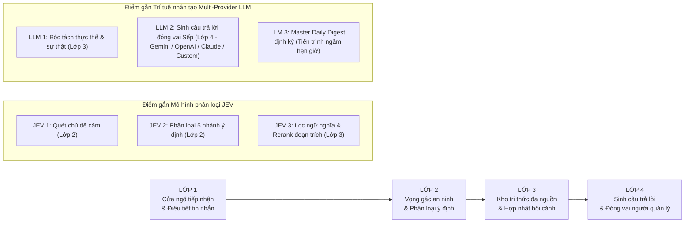

# 🏛️ SƠ ĐỒ LUỒNG HOẠT ĐỘNG CHI TIẾT 4 LỚP - HỆ THỐNG HILARk
## KIẾN TRÚC ĐIỀU HÀNH DOANH NGHIỆP THÔNG MINH (PRODUCTION 2.0)

> **Dự án HiLark Server**  
> Bản thuyết minh kỹ thuật chi tiết cập nhật toàn diện theo kiến trúc module hóa, hỗ trợ Đa Nhà Cung Cấp LLM, Hybrid BYOK, Khởi tạo Lark Base tự động và Xử lý tài liệu đa phương thức AnyDoc gRPC.  
> Toàn bộ nội dung được diễn đạt bằng **tiếng Việt kỹ thuật dễ hiểu, chú thích mã nguồn thực tế, minh bạch và có căn cứ kiểm chứng**.

---

## 🖼️ 1. ẢNH SƠ ĐỒ TRỰC QUAN LUỒNG HOẠT ĐỘNG CHI TIẾT

Dưới đây là ảnh sơ đồ kỹ thuật chi tiết phân rã 4 lớp xử lý, bóc tách toàn bộ 24 bước con tuần tự và làm nổi bật các điểm gắn **Mô hình phân loại (JEV)** và **Bộ động cơ Đa Nhà Cung Cấp Trí Tuệ Nhân Tạo (Multi-Provider LLM Engine)**:

---

## 🧭 2. TỔNG QUAN LUỒNG CHẢY GIỮA 4 LỚP

Toàn bộ quá trình tiếp nhận một tin nhắn cho tới khi trả lời được vận hành qua 4 lớp tuần tự:

---

## 🔍 3. CHI TIẾT TỪNG BƯỚC TRONG TỪNG LỚP & ĐÁNH DẤU ĐIỂM GẮN JEV / LLM

---

### 🚪 LỚP 1: CỬA NGÕ TIẾP NHẬN & ĐIỀU TIẾT TIN NHẮN (INBOUND GATEWAY)
* **Nhiệm vụ:** Tiếp nhận tin nhắn an toàn, bóc tách tệp đính kèm đa phương thức, đồng bộ thu hồi tin nhắn tức thì, gom các câu gõ dở, xếp hàng trật tự, bảo vệ hệ thống không bị quá tải.
* **Điểm gắn JEV / LLM:** **KHÔNG CÓ**. Toàn bộ lớp 1 sử dụng mã nguồn lập trình logic thông thường chạy ngay trên máy chủ để tối ưu tốc độ và không tốn chi phí.

| Bước | Tên bước | Vị trí mã nguồn | Hoạt động thực tế |
| :---: | :--- | :--- | :--- |
| **1.1** | **Tiếp nhận tin nhắn đa kênh & WebSocket Pure Mode** | [`services/lark/runner.py`](file:///Users/hoainam/Desktop/HiLark/server/services/lark/runner.py) | Mở kết nối trực tiếp liên tục (**Pure WebSocket**) với Lark gateway (`lark.ws.Client`), không cần mở cổng public Internet. Hỗ trợ dự phòng Webhook (`/api/lark/webhook`), REST API (`/api/chat`) và quét hộp thư riêng (DM Polling). |
| **1.2** | **Xử lý tệp đính kèm, DocX/Wiki & Thư mục Lark Drive** | [`services/lark/handlers/document_handler.py`](file:///Users/hoainam/Desktop/HiLark/server/services/lark/handlers/document_handler.py) | Tự động nhận diện URL Lark DocX/Wiki (đọc Markdown trực tiếp qua OpenAPI 0 token), tải binary tệp đính kèm gửi sang AnyDoc gRPC Reader, và quét đệ quy các thư mục Lark Drive Folder nạp tri thức tự động. |
| **1.3** | **Đồng bộ thu hồi tin nhắn 4 tầng (Message Recall Cascade Sync)** | [`services/lark/dispatcher.py`](file:///Users/hoainam/Desktop/HiLark/server/services/lark/dispatcher.py) | Bắt sự kiện `im.message.recalled_v1`, tự động xóa cascade toàn diện qua 4 tầng: `conversation_staging` (Staging) -> `claims` (Tri thức động) -> bộ nhớ đệm MongoDB -> `draft_logs` (Bản nháp chờ duyệt). |
| **1.4** | **Lọc chống tin rác & Chống lặp (Dedup Cache)** | [`services/lark/dispatcher.py`](file:///Users/hoainam/Desktop/HiLark/server/services/lark/dispatcher.py) | Bỏ qua tin nhắn do Bot khác phát ra (`is_bot`); bỏ qua tin nhắn do chính máy chủ gửi ra (`_sent_message_ids`); nhớ 1.000 mã tin trong 10 phút để tránh bị mạng gửi lặp lại. |
| **1.5** | **Lưu tạm vào cơ sở dữ liệu (Staging)** | [`services/digest_service.py`](file:///Users/hoainam/Desktop/HiLark/server/services/digest_service.py) | Lưu ngay một bản sao tin nhắn vào bảng tạm `conversation_staging` trong MongoDB để tiến trình tự động đọc lại làm báo cáo Master Daily Digest cuối ngày. |
| **1.6** | **Gom các câu gõ ngắt dòng (Debouncer)** | [`utils/chat_queue.py`](file:///Users/hoainam/Desktop/HiLark/server/utils/chat_queue.py) | Khi người dùng gõ ngắt quãng bấm Enter nhiều dòng liên tiếp, máy chủ bật bộ đệm chờ 1.75 giây để gom toàn bộ các dòng thành một câu hoàn chỉnh duy nhất trước khi đem xử lý. |
| **1.7** | **Hàng đợi điều tiết thời gian (Cooldown Queue)** | [`utils/chat_queue.py`](file:///Users/hoainam/Desktop/HiLark/server/utils/chat_queue.py) | Giữ giãn cách 4.0 giây giữa 2 câu hỏi của cùng một thành viên để tránh dồn dập. Riêng Sếp (Lãnh đạo) được ưu tiên thời gian chờ bằng 0 giây (xử lý ngay lập tức). |
| **1.8** | **Kiểm soát số lượng chạy cùng lúc (Concurrency Lock)** | [`services/chat_service.py`](file:///Users/hoainam/Desktop/HiLark/server/services/chat_service.py) | Khống chế tối đa 3 câu hỏi được xử lý đồng thời trên toàn máy chủ bằng asyncio Semaphore để bảo vệ bộ nhớ RAM và không bị khóa tài khoản do gọi quá tải API. |

---

### 🛡️ LỚP 2: VỌNG GÁC AN NINH & PHÂN LOẠI Ý ĐỊNH (SECURITY & INTENT GATEWAY)
* **Nhiệm vụ:** Kiểm tra độ dài, kiểm soát vùng cấm bảo vệ bí mật công ty (Ngân sách, Lương), kế thừa ngữ cảnh thread thảo luận và phân loại đúng mục đích tin nhắn trước khi đi tìm tài liệu.
* **Điểm gắn JEV / LLM:** **GẮN 2 ĐIỂM JEV** (Không gắn LLM để tiết kiệm chi phí và phản hồi siêu nhanh dưới 10ms).

| Bước | Tên bước | Vị trí mã nguồn | Hoạt động thực tế |
| :---: | :--- | :--- | :--- |
| **2.1** | **Làm sạch & Kiểm tra kích thước** | [`utils/text_filter.py`](file:///Users/hoainam/Desktop/HiLark/server/utils/text_filter.py) | Kiểm tra câu hỏi phải có từ 2 đến 1.000 từ. Dọn dẹp các ký tự lặp rác (như "???", "!!!"), chuẩn hóa khoảng trắng thừa. |
| **2.2** | **Kiểm tra trạng thái nhóm chat (Chat Scope Check)** | [`services/chat_service.py`](file:///Users/hoainam/Desktop/HiLark/server/services/chat_service.py) | Tra cứu trạng thái nhóm trong cơ sở dữ liệu (`chat_scopes`). Nếu nhóm đang ở chế độ "Tạm dừng" (`paused`) thì lập tức im lặng và dừng chu trình, không tốn tài nguyên. |
| **2.3** | ⭐ **[ĐIỂM GẮN JEV 1] Quét vùng cấm ngân sách & bí mật (Strict HITL)** | [`services/jev.py`](file:///Users/hoainam/Desktop/HiLark/server/services/jev.py) | **Ngăn chặn câu hỏi phạm vào bí mật công ty (Ngân sách, Lương, Chi phí, Báo giá, Hợp đồng):** • *Vòng 1:* So khớp thô Regex từ khóa đen trong vòng dưới 0.1 mili-giây. • *Vòng 2:* Gọi mô hình xác suất JEV phân tích ngữ nghĩa sâu, nhận diện tiếng lóng, hỏi né (ví dụ: *"tháng này kế toán ting ting mấy chục củ"*). • *Hành vi vi phạm:* **Im lặng tuyệt đối (Zero-response)** không nói gì vào nhóm + **Tự động chuyển thành Bản nháp Strict HITL** gửi riêng Sếp duyệt. |
| **2.4** | ⭐ **[ĐIỂM GẮN JEV 2] Phân loại ý định tin nhắn** | [`services/jev.py`](file:///Users/hoainam/Desktop/HiLark/server/services/jev.py) | **Gọi mô hình JEV phân tích ý định và xếp vào 1 trong 5 nhánh:** 1. `IGNORE` (Bỏ qua): Tán gẫu, chào hỏi $\rightarrow$ Không trả lời, không lưu. 2. `MEMORY_ONLY` (Chỉ nhớ): Báo cáo tiến độ $\rightarrow$ Chuyển sang Lớp 3 lưu bộ nhớ, không trả lời. 3. `REPLY_ONLY` (Trả lời): Câu hỏi nghiệp vụ an toàn $\rightarrow$ Chuyển tiếp sang Lớp 3 & 4 để tìm tài liệu và phản hồi. 4. `MEMORY_AND_DRAFT`: Vừa có thông tin vừa có câu hỏi $\rightarrow$ Lưu bộ nhớ + Soạn nháp chờ Sếp duyệt. 5. `DRAFT_PENDING_APPROVAL`: Câu hỏi nhạy cảm hoặc nhóm Tuyệt mật $\rightarrow$ Soạn nháp gửi riêng Sếp duyệt. |
| **2.5** | **Kế thừa ngữ cảnh Thread (JEV Tier 2 Smart Reply)** | [`services/lark/handlers/member_message_handler.py`](file:///Users/hoainam/Desktop/HiLark/server/services/lark/handlers/member_message_handler.py) | Nếu người dùng nhắn tin trả lời trong một Thread cụ thể (`parent_id`), hệ thống tự động truy hồi nội dung tin nhắn gốc của Thread, ghép ngữ cảnh liền mạch và phân loại chính xác ý định. |
| **2.6** | **Khiên bảo vệ chống lặp của Chủ nhân (Owner Shield)** | [`services/chat_service.py`](file:///Users/hoainam/Desktop/HiLark/server/services/chat_service.py) | Nếu người nhắn tin là chính Sếp: Đưa ra thông tin thì ép về *Chỉ nhớ*; nói chuyện hỏi han thì ép về *Bỏ qua*. Tuyệt đối không để bot nhảy vào cướp lời hoặc tranh luận với Sếp. |
| **2.7** | **Chế độ an toàn khi mất mạng (Fail-Safe)** | [`services/chat_service.py`](file:///Users/hoainam/Desktop/HiLark/server/services/chat_service.py) | Nếu đường truyền tới dịch vụ phân loại JEV bị gián đoạn: Câu hỏi có từ 4 từ trở lên tự động chuyển thành bản nháp gửi Sếp duyệt; tin nhắn quá ngắn thì bỏ qua. Tuyệt đối không để bot tự phát ngôn khi chưa có chứng nhận an toàn. |

---

### 📚 LỚP 3: KHO TRI THỨC ĐA NGUỒN & HỢP NHẤT BỐI CẢNH (KNOWLEDGE ENGINE)
* **Nhiệm vụ:** Tìm kiếm tài liệu của đúng nhóm, đọc đa định dạng qua AnyDoc gRPC, bóc tách sự thật mới từ cuộc trò chuyện, loại bỏ dữ liệu nhạy cảm bằng Rule Engine 0ms, và ưu tiên chân lý chốt mới nhất.
* **Điểm gắn JEV / LLM:** **GẮN 1 ĐIỂM LLM + 1 ĐIỂM JEV**.

| Bước | Tên bước | Vị trí mã nguồn | Hoạt động thực tế |
| :---: | :--- | :--- | :--- |
| **3.1** | 🧠 **[ĐIỂM GẮN LLM 1] Bóc tách thực thể & sự thật động** | [`utils/llm_extractor.py`](file:///Users/hoainam/Desktop/HiLark/server/utils/llm_extractor.py) | **Kích hoạt khi tin nhắn là báo cáo tiến độ (`MEMORY_ONLY`):** • Gọi mô hình ngôn ngữ lớn bóc tách Thực thể mỏ neo (Dự án, Nhân sự) và Sự thật (ai làm gì, thời hạn nào). • Móc thông tin vào đúng thực thể cha, tránh tình trạng nhầm lẫn giữa các dự án. • *Ghi đè thông tin cũ:* Tự động đánh dấu thông tin cũ là "đã hết hiệu lực" và lưu thông tin mới là "đang có hiệu lực" vào MongoDB. |
| **3.2** | **Phân quyền thăng hạng tri thức (Role-Based Claims Governance)** | [`services/claim_service.py`](file:///Users/hoainam/Desktop/HiLark/server/services/claim_service.py) | Đề xuất của nhân viên lưu ở trạng thái `proposed` (chỉ dùng nội bộ tham khảo). Chỉ khi Sếp phát ngôn hoặc duyệt trong Daily Digest thì tri thức mới được thăng hạng thành `active` chính thức. |
| **3.3** | **Đọc tài liệu đa phương thức AnyDoc gRPC** | [`services/docreader_service.py`](file:///Users/hoainam/Desktop/HiLark/server/services/docreader_service.py) | Kết nối kênh gRPC buffer 50MB tới `WeKnora-docreader:50051`. Tự động phân tích và chuyển đổi 17 định dạng văn bản phức tạp (`.docx`, `.pdf`, `.xlsx`, `.pptx`, `.md`...) sang Markdown cấu trúc sạch. |
| **3.4** | **Tìm kiếm tài liệu văn bản cách ly theo nhóm (WeKnora RAG)** | [`services/weknora.py`](file:///Users/hoainam/Desktop/HiLark/server/services/weknora.py) | Kích hoạt khi cần câu trả lời. Hệ thống tự động ghép thêm tên dự án vào câu hỏi và **chỉ tìm kiếm trong các tập tin tài liệu được chỉ định riêng cho nhóm này** trên kho WeKnora. Ngăn chặn tuyệt đối việc đọc nhầm tài liệu của dự án khác. |
| **3.5** | **Chốt chặn an ninh tri thức (Rule Engine 0ms)** | [`utils/rule_engine.py`](file:///Users/hoainam/Desktop/HiLark/server/utils/rule_engine.py) | Chạy ngay lập tức trong bộ nhớ RAM của máy chủ (độ trễ 0 mili-giây, không tốn chi phí AI). Quét sạch các đoạn trích tài liệu và mệnh đề vừa lấy ra. Đoạn nào dính từ khóa nhạy cảm (như bảng lương, chi phí mật) bị **loại bỏ ngay lập tức**, không cho phép gửi sang bước tiếp theo. |
| **3.6** | ⭐ **[ĐIỂM GẮN JEV 3] Lọc ngữ nghĩa & Tái sắp xếp đoạn trích (Reranker)** | [`services/jev.py`](file:///Users/hoainam/Desktop/HiLark/server/services/jev.py) | Gửi các đoạn văn bản (đã được dọn sạch ở bước 3.5) sang mô hình JEV để chấm điểm độ liên quan với câu hỏi. Loại bỏ hoàn toàn các đoạn lạc đề, đẩy đoạn trích có ý nghĩa sát nhất lên đầu danh sách. • *Hạ cấp an toàn:* Nếu kho rỗng và không có sự thật nào trong bộ nhớ, tự động hạ cấp sang Bản nháp trình Sếp duyệt, cấm AI tự bịa đặt câu trả lời. |
| **3.7** | **Hợp nhất bối cảnh 3 phần mạch lạc (Context Composer)** | [`utils/context_composer.py`](file:///Users/hoainam/Desktop/HiLark/server/utils/context_composer.py) | Hạn mức mở rộng lên **16.000 ký tự** (chống cắt cụt các tài liệu dài như Sổ tay Nhân viên): • *Phần 0:* Thông tin nhóm chat và danh sách tài liệu đính kèm. • *Phần 1:* Các đoạn trích từ tài liệu văn bản gốc. • *Phần 2:* Các sự thật mới nhất từ cuộc trò chuyện thực tế (được gắn nhãn ưu tiên số 1 để đè lên tài liệu cũ nếu có mâu thuẫn). |
| **3.8** | **Bàn giao bối cảnh sang Lớp 4** | [`services/chat_service.py`](file:///Users/hoainam/Desktop/HiLark/server/services/chat_service.py) | Chuyển giao toàn bộ bối cảnh hoàn chỉnh sang Lớp 4 để tiến hành soạn thảo câu trả lời. |

---

### 🗣️ LỚP 4: SINH CÂU TRẢ LỜI & ĐÓNG VAI NGƯỜI ĐIỀU HÀNH (EXECUTIVE DELIVERY)
* **Nhiệm vụ:** Đóng vai người quản lý điềm tĩnh, dứt khoát, kết nối bộ động cơ Đa Nhà Cung Cấp LLM, dọn sạch định dạng, điều phối gửi thẳng hoặc qua bản nháp phê duyệt linh hoạt.
* **Điểm gắn JEV / LLM:** **GẮN 1 ĐIỂM LLM CHÍNH** (Mô hình ngôn ngữ lớn đóng vai Sếp).

| Bước | Tên bước | Vị trí mã nguồn | Hoạt động thực tế |
| :---: | :--- | :--- | :--- |
| **4.1** | **Nạp phong cách vai diễn Sếp (Executive Persona)** | [`services/chat_service.py`](file:///Users/hoainam/Desktop/HiLark/server/services/chat_service.py) | Nạp chỉ dẫn xưng hô "anh - em" tự nhiên, tôn trọng người hỏi; trả lời như kiến thức của chính mình (tuyệt đối không nói *"theo tài liệu..."*); khi thiếu số liệu thì trả lời điềm tĩnh như người thật, không nói máy móc. |
| **4.2** | 🧠 **[ĐIỂM GẮN LLM 2] Bộ động cơ Đa Nhà Cung Cấp LLM (Multi-Provider Engine)** | [`services/ai/gemini_client.py`](file:///Users/hoainam/Desktop/HiLark/server/services/ai/gemini_client.py) | **Động cơ `LLMClient` thống nhất điều phối 4 dòng mô hình:** • **Google Gemini:** `gemini-2.0-flash`, `gemini-1.5-pro`. • **ChatGPT (OpenAI):** `gpt-4o`, `gpt-4o-mini`. • **Anthropic Claude:** `claude-3-5-sonnet`. • **Tùy chỉnh (Custom):** Hỗ trợ bất kỳ máy chủ OpenAI-compatible nào kèm `Base URL` và `Timeout (giây)` tùy biến. • Tự động chọn khóa theo cơ chế Hybrid BYOK 3 tầng. |
| **4.3** | **Dọn sạch định dạng văn bản (Sanitizer)** | [`utils/text_filter.py`](file:///Users/hoainam/Desktop/HiLark/server/utils/text_filter.py) | Quét sạch các thẻ kỹ thuật thừa thãi, xóa các cụm trích dẫn nguồn lộ liễu, sửa lỗi khoảng cách trước dấu câu (chấm, phẩy) và dòng trống thừa để câu văn trang nhã, chỉn chu. |
| **4.4A** | **Nhánh 1: Trả lời trực tiếp vào nhóm** | [`services/chat_service.py`](file:///Users/hoainam/Desktop/HiLark/server/services/chat_service.py) | Áp dụng khi câu hỏi an toàn và nhóm đang mở quyền hoạt động bình thường: Hệ thống gửi thẳng câu trả lời vào nhóm chat dưới danh nghĩa tài khoản cá nhân của Sếp (`as_user=True`), trích dẫn đúng câu hỏi của thành viên. |
| **4.4B** | **Nhánh 2: Soạn bản nháp chờ Sếp duyệt (Interactive Card V2)** | [`services/draft_service.py`](file:///Users/hoainam/Desktop/HiLark/server/services/draft_service.py) | Áp dụng khi nhóm thuộc diện Tuyệt mật hoặc câu hỏi có rủi ro: Lưu bản nháp vào MongoDB `draft_logs`, gửi thẻ Interactive Card V2 riêng vào DM của Sếp kèm 4 lựa chọn: **[Duyệt và gửi]**, **[Nhờ AI sửa lại]**, **[Tự sửa]**, **[Hủy bỏ]**. |
| **4.4C** | **Điều hành nhanh bằng tin nhắn chat tự nhiên (Conversational Control)** | [`services/lark/handlers/owner_command_handler.py`](file:///Users/hoainam/Desktop/HiLark/server/services/lark/handlers/owner_command_handler.py) | Sếp không cần bấm nút, có thể nhắn nhanh trong DM 1-1 với bot: • Nhắn `Gửi` / `OK` $\rightarrow$ Phát ngôn ngay vào nhóm. • Nhắn `Bỏ` / `Hủy` $\rightarrow$ Hủy bản nháp an toàn. • Nhắn `Sửa: <nội dung>` $\rightarrow$ Thay nội dung và gửi vào nhóm. • Nhắn `Sửa AI: <yêu cầu>` $\rightarrow$ AI viết lại câu trả lời theo chỉ đạo. |
| **4.5** | **Hoàn tất chu trình phản hồi** | [`utils/chat_queue.py`](file:///Users/hoainam/Desktop/HiLark/server/utils/chat_queue.py) | Ghi nhật ký lịch sử, giải phóng chỗ trong hàng đợi điều tiết để sẵn sàng phục vụ câu hỏi tiếp theo của người dùng. |

---

### 🌙 TIẾN TRÌNH BÁO CÁO MASTER DAILY DIGEST (ĐIỂM GẮN LLM BỔ TRỢ)
* **Vị trí trong mã nguồn:** [`services/digest_service.py`](file:///Users/hoainam/Desktop/HiLark/server/services/digest_service.py) và [`services/workflows/digest_workflow.py`](file:///Users/hoainam/Desktop/HiLark/server/services/workflows/digest_workflow.py)
* 🧠 **[ĐIỂM GẮN LLM 3 BỔ TRỢ] - Báo cáo tổng hợp đa dự án theo giờ hẹn:**
  - Định kỳ theo giờ hẹn của Sếp (mặc định **18:00** hoặc tùy chỉnh trên Wizard), tiến trình tự động thức dậy.
  - Đọc lại toàn bộ các tin nhắn đã gom trong ngày tại bảng tạm `conversation_staging` của tất cả các nhóm chat đang hoạt động.
  - Bóc tách **Bộ ba tri thức cốt lõi (Knowledge Triad):**
    1. *Quyết định (Decisions):* Ai quyết định cái gì, thời điểm nào.
    2. *Cam kết (Commitments):* Ai nhận việc gì, hạn chót ngày nào.
    3. *Thay đổi trạng thái (Status Changes):* Tiến độ công việc chuyển biến ra sao.
  - Giữ lại 100% trích dẫn nguồn tin và Applink mở đúng vị trí câu thảo luận trên Lark.
  - Nối tiếp bối cảnh ngày hôm trước $K-1$ sang ngày hiện tại $K$ để báo cáo không bị gián đoạn.
  - Gửi thẻ duyệt Master Daily Digest tới Sếp. Khi Sếp bấm **[Duyệt toàn bộ]**, tri thức từng nhóm được nạp chính xác vào từng thư viện WeKnora tương ứng.

---

## ⚙️ 4. HỆ SINH THÁI ĐIỀU HÀNH BỔ TRỢ (SUPPORTING ECOSYSTEM)

### A. Zero-Touch Auto-Provisioning Lark Base
- **Vị trí:** [`services/lark/base_provision_service.py`](file:///Users/hoainam/Desktop/HiLark/server/services/lark/base_provision_service.py)
- **Cơ chế:** Tự động tạo 100% ứng dụng Bitable mới trên Lark Suite qua OpenAPI, tự động cấu hình bảng Chat Scopes (ID, Tên nhóm, Trạng thái, Bảo mật, Nhãn cấm, Tài liệu), bảng Policies, nạp sẵn 3 dự án mẫu (Atlas, Pulse, Sentinel) và cấp quyền Owner cho Sếp. Phân giải động qua MongoDB `system_config` và fallback an toàn về `.env`.

### B. Stepper Onboarding Screen Guide & Hybrid BYOK
- **Vị trí:** [`routers/onboarding.py`](file:///Users/hoainam/Desktop/HiLark/server/routers/onboarding.py), [`templates/onboarding_wizard.html`](file:///Users/hoainam/Desktop/HiLark/server/templates/onboarding_wizard.html), [`models/onboarding.py`](file:///Users/hoainam/Desktop/HiLark/server/models/onboarding.py)
- **Cơ chế:** Giao diện 4 bước tối giản chuẩn Apple SF Pro (không icon, không emoji). Hỗ trợ kiểm tra latency trực tiếp của API Key, cấu hình timeout và base URL cho ChatGPT, Claude, Gemini hoặc Custom. Tích hợp màn hình chờ `#initScreen` và luồng OAuth 2.0 In-App dạng pop-up liên lạc qua `window.postMessage`.

---

## 📊 5. BẢNG TỔNG KẾT CÁC ĐIỂM GẮN JEV & LLM TRONG TOÀN HỆ THỐNG

| Mô hình | Vị trí | Điểm gắn | Vai trò hoạt động | Hành vi thực tế |
| :--- | :---: | :---: | :--- | :--- |
| **⚡ JEV** | Lớp 2 | **JEV 1** | Quét chủ đề cấm | Nhận diện tiếng lóng, hỏi né để bảo vệ bí mật công ty $\rightarrow$ **Im lặng tuyệt đối + Mật báo/Chuyển Bản nháp cho Sếp**. |
| **⚡ JEV** | Lớp 2 | **JEV 2** | Phân loại ý định | Phân loại 5 nhánh (Bỏ qua / Ghi nhớ / Trả lời / Soạn nháp) $\rightarrow$ Tiết kiệm 60-70% chi phí gọi AI sinh chữ. |
| **🧠 LLM** | Lớp 3 | **LLM 1** | Bóc tách tri thức động | Bóc tách Thực thể mỏ neo & Sự thật từ tin nhắn chat $\rightarrow$ Ghi nhớ vào MongoDB và gạch bỏ quyết định cũ. |
| **⚡ JEV** | Lớp 3 | **JEV 3** | Lọc ngữ nghĩa đoạn trích | Chấm điểm độ liên quan, loại bỏ đoạn lạc đề, đẩy đoạn sát nhất lên đầu danh sách trước khi đưa cho AI. |
| **🧠 LLM** | Lớp 4 | **LLM 2** | Sinh câu trả lời đóng vai | Đóng vai Sếp điềm tĩnh, xưng "anh - em", nạp bối cảnh tri thức để trả lời trọn vẹn (Gemini / OpenAI / Claude / Custom). |
| **🧠 LLM** | Chạy ngầm | **LLM 3** | Master Daily Digest | Đọc tin nhắn gom trong ngày, bóc tách Quyết định, Cam kết, Trạng thái, kế thừa K-1 sang K và gửi thẻ duyệt tới Sếp. |

---

## 💡 6. NGUYÊN TẮC VẬN HÀNH BẤT BIẾN (IMMUTABLE OPERATIONAL PRINCIPLES)

1. **Thà im lặng chứ không nói bừa (Strict Safety Guardrail):** Khi gặp câu hỏi vào chủ đề cấm hoặc khi chưa có tài liệu kiểm chứng, hệ thống chọn im lặng hoặc soạn bản nháp để Sếp duyệt trước, tuyệt đối không tự bịa đặt câu trả lời.
2. **Quyết định mới nhất luôn là chân lý số 1 (Fact Override):** Nếu trong tài liệu Word cũ ghi một đằng, nhưng trong nhóm chat Sếp vừa chốt một nẻo, câu trả lời sẽ tự động lấy mốc chốt mới nhất làm chân lý.
3. **Phân tầng chi phí & Tốc độ thông minh:** Sử dụng mô hình phân loại JEV nhỏ gọn, siêu nhanh ở các cổng an ninh (Lớp 2, Lớp 3) để sàng lọc trước; chỉ khi câu hỏi thực sự an toàn và cần câu trả lời thì mới kích hoạt mô hình ngôn ngữ lớn (LLM) ở Lớp 4.
4. **Không làm phiền người dùng bằng icon/emoji rườm rà:** Giao diện điều hành và phản hồi giữ vững tính chuyên nghiệp, trang trọng chuẩn văn phòng Apple Native.
