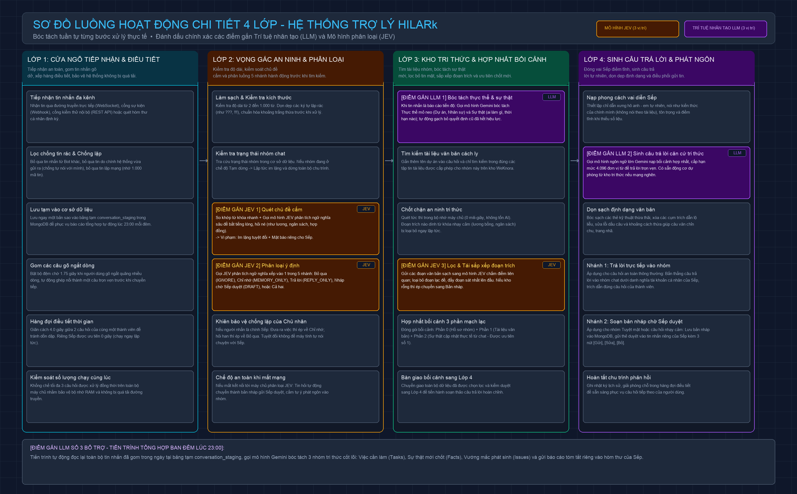
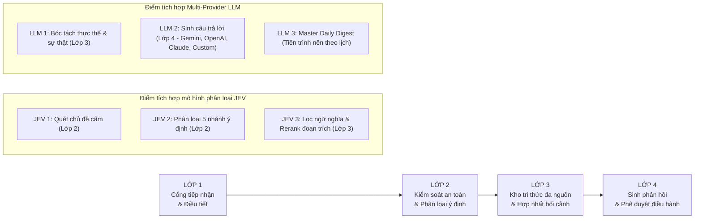

# Sơ đồ Luồng hoạt động Chi tiết 4 Lớp — Hệ thống HiLark

Tài liệu này thuyết minh chi tiết 24 bước xử lý tuần tự qua 4 lớp của hệ thống HiLark, từ khi tiếp nhận sự kiện tin nhắn từ Lark Open Platform đến khi hoàn tất phản hồi hoặc chuyển qua luồng duyệt bản nháp.

---

## 1. Sơ đồ luồng hoạt động trực quan

Dưới đây là sơ đồ kỹ thuật phân rã 4 lớp xử lý tuần tự, làm rõ các điểm tích hợp mô hình phân loại (JEV) và động cơ đa nhà cung cấp LLM:

---

## 2. Tổng quan luồng xử lý giữa 4 lớp

Toàn bộ quá trình tiếp nhận và xử lý tin nhắn được vận hành tuần tự qua 4 lớp:

---

## 3. Chi tiết 24 bước xử lý theo 4 lớp

---

### Lớp 1: Cổng tiếp nhận & Điều tiết tin nhắn (Inbound Gateway)

- **Mục tiêu:** Tiếp nhận sự kiện an toàn, nhận diện tenant, bóc tách tệp đính kèm đa phương thức, đồng bộ thu hồi tin nhắn, khử trùng lặp và điều tiết hàng đợi tránh quá tải.
- **Điểm tích hợp AI:** Không sử dụng mô hình AI tại lớp này để bảo đảm độ trễ tối thiểu và tối ưu chi phí.

| Bước | Tên bước | Mã nguồn liên quan | Mô tả xử lý |
| :---: | :--- | :--- | :--- |
| **1.1** | **Tiếp nhận webhook & Phân định Tenant** | [`server/routers/lark.py`](file:///Users/hoainam/Desktop/HiLark/server/routers/lark.py) | Tiếp nhận sự kiện tại `/api/lark/events` (hoặc `/api/lark/events/{app_id}`). Trích xuất `tenant_key` và thiết lập Scoped Execution Context cho toàn bộ vòng đời request. |
| **1.2** | **Phân giải tệp đính kèm, DocX/Wiki & Drive** | [`server/services/lark/handlers/document_handler.py`](file:///Users/hoainam/Desktop/HiLark/server/services/lark/handlers/document_handler.py) | Nhận diện liên kết Lark DocX/Wiki (đọc Markdown trực tiếp qua OpenAPI, 0 token LLM), gửi tệp nhị phân sang AnyDoc gRPC Reader, và quét đệ quy cây thư mục Lark Drive. |
| **1.3** | **Thu hồi tin nhắn nhiều tầng (Recall Cascade)** | [`server/services/lark/dispatcher.py`](file:///Users/hoainam/Desktop/HiLark/server/services/lark/dispatcher.py) | Bắt sự kiện `im.message.recalled_v1`, tự động xóa cascade: `conversation_staging` (bảng tạm) -> `claims` (ký ức động) -> bộ nhớ cache -> `draft_logs` (bản nháp chờ duyệt). |
| **1.4** | **Lọc tin rác & Khử trùng lặp (Dedup Cache)** | [`server/services/lark/dispatcher.py`](file:///Users/hoainam/Desktop/HiLark/server/services/lark/dispatcher.py) | Bỏ qua tin nhắn từ Bot (`is_bot`) và tin nhắn do chính server gửi (`_sent_message_ids`). Lưu trữ 1.000 message ID gần nhất trong 10 phút để loại trừ sự kiện gửi lặp từ mạng. |
| **1.5** | **Lưu vùng đệm tin nhắn (Staging)** | [`server/services/workflows/digest_workflow.py`](file:///Users/hoainam/Desktop/HiLark/server/services/workflows/digest_workflow.py) | Lưu bản ghi tin nhắn kèm `tenant_key` vào collection `conversation_staging` trong MongoDB để phục vụ tổng hợp Master Daily Digest cuối ngày. |
| **1.6** | **Gom tin nhắn ngắt dòng (Debouncer)** | [`server/services/lark/dispatcher.py`](file:///Users/hoainam/Desktop/HiLark/server/services/lark/dispatcher.py) | Khi người dùng gõ ngắt quãng bấm Enter nhiều dòng liên tiếp, kích hoạt bộ đệm chờ 1.75 giây để gom thành một câu hoàn chỉnh duy nhất trước khi chuyển tiếp. |
| **1.7** | **Hàng đợi điều tiết thời gian (Cooldown Queue)** | [`server/services/lark/dispatcher.py`](file:///Users/hoainam/Desktop/HiLark/server/services/lark/dispatcher.py) | Áp dụng giãn cách 4.0 giây giữa 2 câu hỏi liên tiếp của cùng một thành viên. Quản trị viên (Admin) được ưu tiên xử lý ngay lập tức (cooldown = 0s). |
| **1.8** | **Kiểm soát đồng thời (Concurrency Semaphore)** | [`server/services/workflows/chat_workflow.py`](file:///Users/hoainam/Desktop/HiLark/server/services/workflows/chat_workflow.py) | Giới hạn tối đa 3-5 pipeline hội thoại chạy đồng thời bằng asyncio Semaphore để kiểm soát dung lượng RAM và tránh vượt ngưỡng rate limit của các API bên ngoài. |

---

### Lớp 2: Kiểm soát an toàn & Phân loại ý định (Security & Intent Gateway)

- **Mục tiêu:** Kiểm tra kích thước tin nhắn, kiểm soát vùng cấm thông tin bảo mật (ngân sách, lương bổng), kế thừa ngữ cảnh hội thoại theo luồng (thread) và phân loại ý định chính xác.
- **Điểm tích hợp AI:** Tích hợp 2 điểm phân loại JEV System 1 (phản xạ nhanh, không gọi LLM để tối ưu chi phí).

| Bước | Tên bước | Mã nguồn liên quan | Mô tả xử lý |
| :---: | :--- | :--- | :--- |
| **2.1** | **Làm sạch & Kiểm tra độ dài** | [`server/services/knowledge/rule_engine.py`](file:///Users/hoainam/Desktop/HiLark/server/services/knowledge/rule_engine.py) | Kiểm tra tin nhắn đạt độ dài từ 2 đến 1.000 từ. Làm sạch ký tự lặp rác và chuẩn hóa khoảng trắng thừa. |
| **2.2** | **Kiểm tra trạng thái nhóm (Chat Scope Check)** | [`server/services/knowledge/chat_scopes.py`](file:///Users/hoainam/Desktop/HiLark/server/services/knowledge/chat_scopes.py) | Tra cứu trạng thái nhóm trong `chat_scopes`. Nếu nhóm đang ở trạng thái tạm dừng (`paused`), hệ thống dừng chu trình và không tốn tài nguyên xử lý. |
| **2.3** | **JEV 1: Quét vùng cấm ngân sách & lương (Strict HITL)** | [`server/services/ai/jev_classifier.py`](file:///Users/hoainam/Desktop/HiLark/server/services/ai/jev_classifier.py) | Phát hiện câu hỏi chạm vào thông tin nhạy cảm nội bộ qua 2 vòng: regex từ khóa và phân tích ngữ nghĩa JEV. Nếu vi phạm, bot im lặng trong nhóm và chuyển thành bản nháp gửi riêng Quản trị viên. |
| **2.4** | **JEV 2: Phân loại 5 nhánh ý định** | [`server/services/ai/jev_classifier.py`](file:///Users/hoainam/Desktop/HiLark/server/services/ai/jev_classifier.py) | Phân loại tin nhắn thành 1 trong 5 nhánh: `IGNORE` (chào hỏi, tán gẫu), `MEMORY_ONLY` (cập nhật tiến độ), `REPLY_ONLY` (hỏi đáp nghiệp vụ), `MEMORY_AND_DRAFT`, hoặc `DRAFT_PENDING_APPROVAL`. |
| **2.5** | **Kế thừa ngữ cảnh Thread (Smart Reply)** | [`server/services/lark/handlers/member_message_handler.py`](file:///Users/hoainam/Desktop/HiLark/server/services/lark/handlers/member_message_handler.py) | Nếu tin nhắn nằm trong thread (`parent_id`), hệ thống truy xuất nội dung tin nhắn gốc để bảo toàn ngữ cảnh và phân loại chính xác ý định. |
| **2.6** | **Chống vòng lặp phản hồi từ Quản trị viên** | [`server/services/lark/dispatcher.py`](file:///Users/hoainam/Desktop/HiLark/server/services/lark/dispatcher.py) | Tin nhắn từ chính Quản trị viên được phân luồng: thông tin nghiệp vụ chuyển sang `MEMORY_ONLY`, trò chuyện xã giao đưa vào `IGNORE`. Tuyệt đối không để bot tranh luận với Quản trị viên. |
| **2.7** | **Cơ chế dự phòng sự cố (Fail-Safe)** | [`server/services/workflows/chat_workflow.py`](file:///Users/hoainam/Desktop/HiLark/server/services/workflows/chat_workflow.py) | Nếu cổng kết nối JEV gián đoạn: tin nhắn từ 4 từ trở lên tự động chuyển sang luồng soạn nháp gửi Quản trị viên duyệt; tin nhắn ngắn hơn sẽ được bỏ qua. |

---

### Lớp 3: Kho tri thức đa nguồn & Hợp nhất bối cảnh (Cognitive Engine)

- **Mục tiêu:** Đọc đa định dạng tài liệu, truy xuất tài liệu theo đúng phạm vi nhóm, bóc tách ký ức động, kiểm duyệt dữ liệu mật bằng Line-level Redaction và hợp nhất bối cảnh có thứ tự ưu tiên.
- **Điểm tích hợp AI:** Tích hợp 1 điểm LLM trích xuất + 1 điểm JEV xếp hạng độ tương quan.

| Bước | Tên bước | Mã nguồn liên quan | Mô tả xử lý |
| :---: | :--- | :--- | :--- |
| **3.1** | **LLM 1: Bóc tách thực thể & ký ức động (Claims)** | [`server/services/ai/llm_extractor.py`](file:///Users/hoainam/Desktop/HiLark/server/services/ai/llm_extractor.py) | Khi tin nhắn có tính chất cập nhật (`MEMORY_ONLY`), LLM bóc tách Thực thể và Mệnh đề sự thật (ai làm gì, thời hạn nào), gán compound key `(tenant_key, id)` và lưu vào MongoDB. |
| **3.2** | **Phân quyền thăng hạng tri thức (Proposed Claims)** | [`server/services/workflows/claim_workflow.py`](file:///Users/hoainam/Desktop/HiLark/server/services/workflows/claim_workflow.py) | Thông tin do thành viên gửi được lưu ở trạng thái `proposed` trong im lặng. Chỉ khi Quản trị viên phát ngôn hoặc duyệt trên Master Daily Digest thì tri thức mới được thăng hạng thành `current`. |
| **3.3** | **Đọc tài liệu nhị phân qua AnyDoc gRPC** | [`server/services/knowledge/docreader_client.py`](file:///Users/hoainam/Desktop/HiLark/server/services/knowledge/docreader_client.py) | Kết nối kênh gRPC buffer 50MB tới `WeKnora-docreader:50051`. Chuyển đổi 17 định dạng văn bản (`.docx`, `.pdf`, `.xlsx`, `.pptx`...) sang Markdown sạch. |
| **3.4** | **Truy xuất tài liệu theo phạm vi nhóm (WeKnora RAG)** | [`server/services/knowledge/weknora_client.py`](file:///Users/hoainam/Desktop/HiLark/server/services/knowledge/weknora_client.py) | Giới hạn phạm vi tìm kiếm theo đúng `dataset_id` được gán cho nhóm chat trong `chat_scopes`. Không tìm kiếm chéo sang kho dữ liệu của nhóm khác. |
| **3.5** | **Kiểm duyệt an toàn tri thức (Rule Engine 0ms)** | [`server/services/knowledge/rule_engine.py`](file:///Users/hoainam/Desktop/HiLark/server/services/knowledge/rule_engine.py) | Thực thi trong bộ nhớ RAM (độ trễ 0ms). Áp dụng Line-level Redaction che các dòng chứa thông tin bảo mật mà không làm mất bối cảnh nghiệp vụ xung quanh. |
| **3.6** | **JEV 3: Đánh giá độ liên quan & Rerank** | [`server/services/ai/jev_classifier.py`](file:///Users/hoainam/Desktop/HiLark/server/services/ai/jev_classifier.py) | Chấm điểm mức độ tương quan giữa câu hỏi và các đoạn trích tài liệu. Loại bỏ các đoạn lạc đề, sắp xếp đoạn sát nhất lên đầu danh sách. Nếu không có đoạn nào đạt, chuyển sang luồng soạn nháp. |
| **3.7** | **Hợp nhất bối cảnh có thứ tự ưu tiên (Context Composer)** | [`server/services/knowledge/context_composer.py`](file:///Users/hoainam/Desktop/HiLark/server/services/knowledge/context_composer.py) | Hạn mức bối cảnh 16.000 ký tự. Hợp nhất theo 3 phần: (0) Thông tin nhóm, (1) Tài liệu WeKnora gốc, (2) Sự thật mới nhất (Claims). Áp dụng nguyên tắc: `CURRENT Claims > WeKnora Baseline`. |
| **3.8** | **Bàn giao bối cảnh sang Lớp 4** | [`server/services/workflows/chat_workflow.py`](file:///Users/hoainam/Desktop/HiLark/server/services/workflows/chat_workflow.py) | Đóng gói toàn bộ bối cảnh đã qua tinh lọc kèm danh sách trích dẫn nguồn chuyển tiếp sang Lớp 4. |

---

### Lớp 4: Sinh câu trả lời & Phê duyệt điều hành (Execution & Delivery)

- **Mục tiêu:** Điều phối đa mô hình LLM, áp dụng phong cách phản hồi chuẩn mực, điều hướng phản hồi trực tiếp hoặc gửi Thẻ tương tác phê duyệt nháp.
- **Điểm tích hợp AI:** Tích hợp LLM chính để sinh phản hồi tự nhiên.

| Bước | Tên bước | Mã nguồn liên quan | Mô tả xử lý |
| :---: | :--- | :--- | :--- |
| **4.1** | **Áp dụng phong cách phản hồi điều hành** | [`server/services/workflows/chat_workflow.py`](file:///Users/hoainam/Desktop/HiLark/server/services/workflows/chat_workflow.py) | Nạp chỉ dẫn xưng hô tự nhiên, tôn trọng người hỏi; trả lời như kiến thức của chính mình, tránh viện dẫn máy móc; khi thiếu số liệu thì phản hồi điềm tĩnh và rõ ràng. |
| **4.2** | **LLM 2: Động cơ Đa Nhà Cung Cấp LLM** | [`server/services/ai/gemini_client.py`](file:///Users/hoainam/Desktop/HiLark/server/services/ai/gemini_client.py) | Hỗ trợ 4 nhóm: Google Gemini (`gemini-2.0-flash`), OpenAI (`gpt-4o`), Claude (`claude-3-5-sonnet`), và máy chủ Custom tương thích OpenAI. Tự động giải quyết khóa theo cơ chế BYOK 4 tầng. |
| **4.3** | **Làm sạch định dạng văn bản (Sanitizer)** | [`server/services/knowledge/rule_engine.py`](file:///Users/hoainam/Desktop/HiLark/server/services/knowledge/rule_engine.py) | Loại bỏ các thẻ kỹ thuật nội bộ thừa, dọn dẹp khoảng cách trước dấu câu và dòng trống thừa để câu văn chỉn chu, rõ ràng. |
| **4.4A** | **Phản hồi trực tiếp vào nhóm chat** | [`server/services/lark/handlers/card_action_handler.py`](file:///Users/hoainam/Desktop/HiLark/server/services/lark/handlers/card_action_handler.py) | Khi câu hỏi an toàn và đạt ngưỡng tin cậy: Gửi trực tiếp câu trả lời vào nhóm chat, trích dẫn đúng câu hỏi của thành viên. |
| **4.4B** | **Soạn Thẻ tương tác phê duyệt nháp (HITL Draft Card)** | [`server/services/workflows/draft_workflow.py`](file:///Users/hoainam/Desktop/HiLark/server/services/workflows/draft_workflow.py) | Khi câu hỏi nhạy cảm hoặc thiếu dữ liệu: Lưu bản nháp vào MongoDB `draft_logs` và gửi Thẻ tương tác vào tin nhắn riêng của Quản trị viên kèm các nút 1-chạm: `[Duyệt và gửi]`, `[Nhờ AI sửa]`, `[Tự sửa]`, `[Hủy bỏ]`. |
| **4.4C** | **Executive Control Hub Card V2** | [`server/services/lark/handlers/owner_command_handler.py`](file:///Users/hoainam/Desktop/HiLark/server/services/lark/handlers/owner_command_handler.py) | Trong tin nhắn riêng với Quản trị viên, hệ thống luôn phản hồi bằng Thẻ bảng điều khiển 2 hàng nút 1-chạm, thay thế hoàn toàn các câu lệnh văn bản cũ. |
| **4.5** | **Hoàn tất chu trình & Giải phóng tài nguyên** | [`server/services/workflows/chat_workflow.py`](file:///Users/hoainam/Desktop/HiLark/server/services/workflows/chat_workflow.py) | Ghi nhận telemetry chi phí token và độ trễ, giải phóng Semaphore để sẵn sàng tiếp nhận yêu cầu tiếp theo. |

---

## 4. Tiến trình Báo cáo Ngày (Master Daily Digest Daemon)

- **Vị trí trong mã nguồn:** [`server/services/workflows/digest_workflow.py`](file:///Users/hoainam/Desktop/HiLark/server/services/workflows/digest_workflow.py), [`server/routers/digest.py`](file:///Users/hoainam/Desktop/HiLark/server/routers/digest.py)
- **Hoạt động thực tế:**
  1. Định kỳ theo lịch hẹn (mặc định cấu hình lúc **18:00** hoặc tùy chỉnh trên Wizard), tiến trình tự động khởi chạy.
  2. Đọc toàn bộ tin nhắn thu thập trong ngày tại `conversation_staging` của các nhóm chat đang hoạt động trong tenant.
  3. LLM bóc tách bộ ba thông tin cốt lõi:
     - **Quyết định (Decisions):** Ai quyết định nội dung gì, thời điểm nào.
     - **Cam kết (Commitments):** Ai đảm nhận việc gì, hạn chót ngày nào.
     - **Tiến độ (Status & Milestones):** Cột mốc hoàn thành và các trở ngại (blockers).
  4. Giữ lại đầy đủ liên kết Applink mở đúng vị trí câu thảo luận trên Lark.
  5. Gửi Thẻ tương tác Master Daily Digest tới Quản trị viên. Khi bấm **`[Duyệt toàn bộ thông tin hôm nay]`**, toàn bộ sự thật đề xuất được thăng hạng thành `current` và đồng bộ sang WeKnora.

---

## 5. Bảng tổng hợp các điểm tích hợp AI (JEV & LLM)

| Mô hình | Vị trí | Điểm gắn | Trách nhiệm | Hành vi thực tế |
| :--- | :---: | :---: | :--- | :--- |
| **JEV** | Lớp 2 | **JEV 1** | Quét chủ đề cấm | Phát hiện ngôn ngữ lóng, hỏi né để bảo vệ bí mật công ty $\rightarrow$ Im lặng trong nhóm + Chuyển Thẻ nháp gửi Quản trị viên. |
| **JEV** | Lớp 2 | **JEV 2** | Phân loại 5 nhánh ý định | Phân loại IGNORE / MEMORY / REPLY / DRAFT $\rightarrow$ Tiết kiệm 60-70% chi phí gọi LLM sinh chữ. |
| **LLM** | Lớp 3 | **LLM 1** | Bóc tách ký ức động | Trích xuất Thực thể và Mệnh đề sự thật từ tin nhắn $\rightarrow$ Ghi nhận vào MongoDB Claims và cập nhật lịch sử thay thế. |
| **JEV** | Lớp 3 | **JEV 3** | Lọc ngữ nghĩa đoạn trích | Đánh giá độ tương quan, loại bỏ đoạn lạc đề, đẩy đoạn trích sát nhất lên đầu danh sách trước khi đưa cho LLM. |
| **LLM** | Lớp 4 | **LLM 2** | Sinh phản hồi hoàn thiện | Sinh câu trả lời điềm tĩnh, rõ ràng dựa trên bối cảnh tri thức tổng hợp (Gemini, OpenAI, Claude, Custom). |
| **LLM** | Tiến trình nền | **LLM 3** | Master Daily Digest | Tổng hợp tin nhắn trong ngày, bóc tách Quyết định, Cam kết, Tiến độ và gửi Thẻ tổng kết phê duyệt tới Quản trị viên. |

---

## 6. Nguyên tắc vận hành cốt lõi

1. **Ưu tiên an toàn trước khi phản hồi:** Khi gặp chủ đề bảo mật hoặc thiếu dữ liệu kiểm chứng, hệ thống chủ động chuyển sang Thẻ nháp để Quản trị viên phê duyệt, không tự phỏng đoán thông tin.
2. **Dữ kiện mới nhất có giá trị cao nhất:** Mệnh đề sự thật mới được chốt trong thảo luận nhóm luôn được ưu tiên hơn tài liệu tĩnh trong kho WeKnora nếu phát hiện mâu thuẫn.
3. **Phân tầng xử lý tối ưu chi phí:** Sử dụng mô hình phân loại nhẹ JEV ở các tầng kiểm soát đầu vào; chỉ khi câu hỏi hợp lệ và an toàn mới kích hoạt mô hình ngôn ngữ lớn (LLM).
4. **Giao diện làm việc tinh gọn:** Không sử dụng emoji hoặc icon trang trí dư thừa; duy trì phong cách trình bày trung tính, rõ ràng và tập trung vào hiệu quả công việc.
